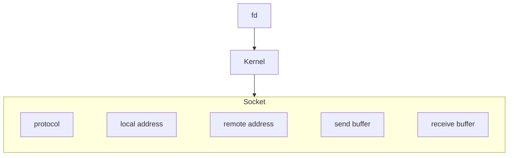
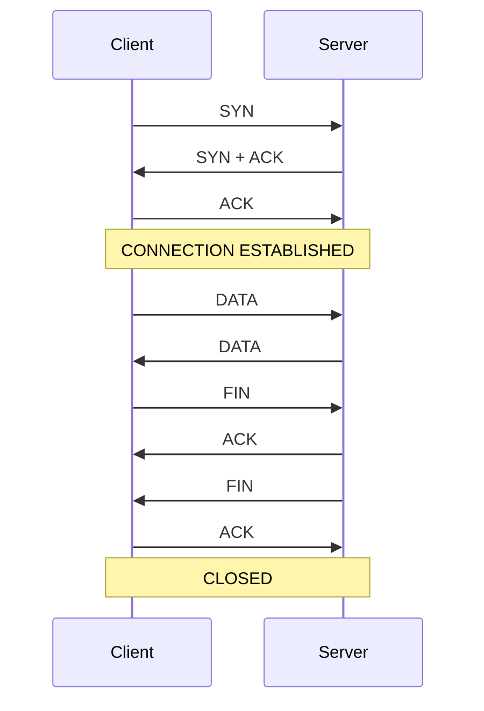
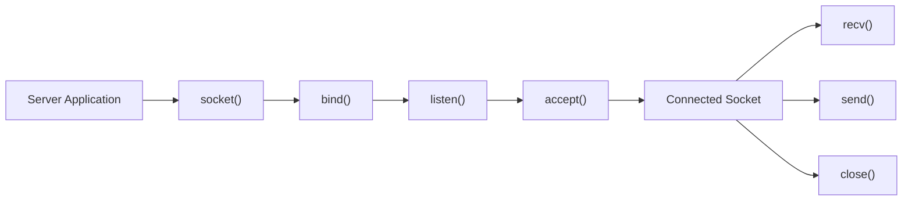
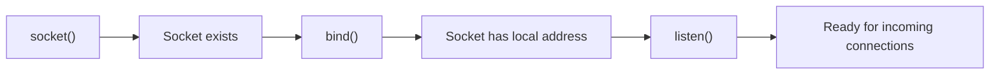
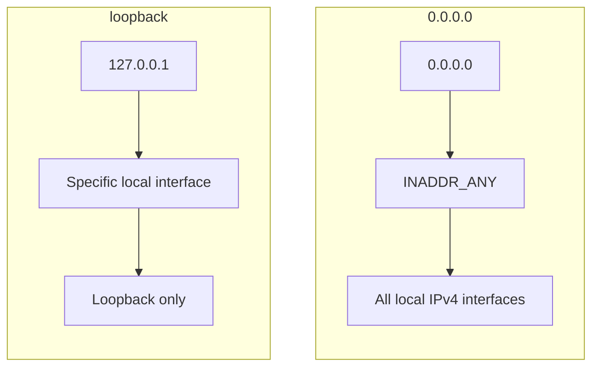
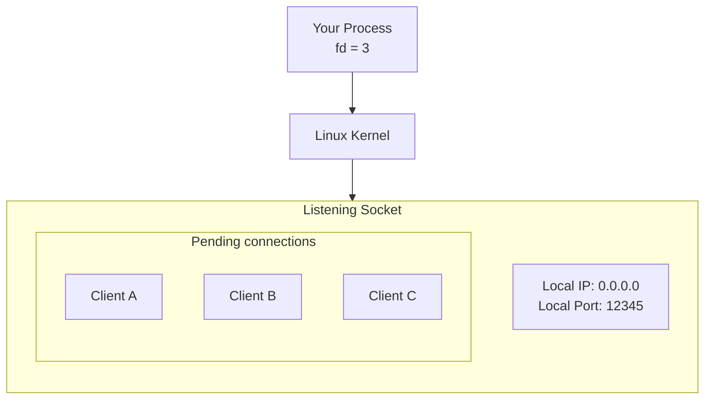
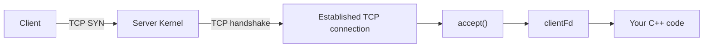

# Notes

> "The socket is a file descriptor that refers to a communication endpoint."

Note that we need to separate the differentiate between file discriptors itself and the socket object inside the kernel.

> "the file discriptor is just a number you use to reach/access the socket object inside the kernel."

- Example:

when you do the folloiwng:
```c
int fd = socket(AF_INET, SOCK_STREAM, 0);
```

the `socket()` may return `3` and the question here is: does the socket itself is `3`? -> the answer is no, the `3` is a number helps me to access the socket object inside the kernel.

### What **File Descriptor** means in Linux?

In linux each process has table called file descriptor table. the processes are using small numbers to point to an open resources (موارد مفتوحه). when a process start you will often see the following:

```
0  → stdin
1  → stdout
2  → stderr
```

which means:

```
fd = 0  → keyboard / standard input
fd = 1  → terminal / standard output
fd = 2  → terminal / standard error
```

if in the code I wrote the following:

```c
int fd = open("test.txt", O_RDONLY);
```

Linux may return `3` and the proccess will have the following file descriptors table:

```
0 → stdin
1 → stdout
2 → stderr
3 → test.txt
```

> "fd is just an integer number the proccess uses to access/points or make I/O operations on an open resource."

When you see the man page of `socket()` you will fined the following description:

> "socket()  creates  an endpoint for communication and returns a file descriptor that refers to that endpoint.  The file descriptor returned by a  successful call will be the lowest-numbered file descriptor not currently open for the process."

### Mental Model of Linux Sockets

Socket in linux is a file descriptor that refers to a communication endpoint.

Example:



* This is important when we start using Asio library, we will see:

```c++
asio::ip::tcp::socket socket(io);
```

### TCP lifecycle

If we understood the TCP lifecycle we will automatically understand why we have: `socket()`, `connect()`, `send()`, `recv()`, `close()`, `accept()`, `listen()`, `bind()`, `shutdown()`.

- **TCP protocol lifecycle:** what happens between the client and the server?
- **Linux socket lifecycle:** what happens with file descriptor and sockets?

> "In linux the applications deal with TCP protocol lifecycle via socket APIs."

The TCP lifecycle stages:
* Connection Establishment
    * 3-Way Handshake
* Data Transfer
    * send
    * receive
* Connection Termination
    * 4-Way termination



#### Server Lifecycle in linux

The server starts usually: **`socket()` -> `bind()` -> `listen()` -> `accept()`**
```c++
socket()
bind()
listen()
accept()
```



> "Note that the `listen()` syscall does not make TCP connection, when you do `listen(server_fd, 10);`, the server tells the kernel: *Hey I am ready to receive incomming TCP connections*."


##### Basics steps to create a TCP server:
1. `socket()` -> first step and this system call returns a file descriptor that refers to a **communication endpoint** or **listening candidate socket**.

```c++
int server_fd = socket(AF_INET, SOCK_STREAM, 0);
```

2. `bind()` -> second step and this system call bind the `socket` with local address `IP:PORT`

```c++
sockaddr_in server_addr{};

server_addr.sin_family = AF_INET;
server_addr.sin_addr.s_addr = INADDR_ANY;
server_addr.sin_port = htons(12345);

bind(
    server_fd,
    reinterpret_cast<sockaddr*>(&server_addr),
    sizeof(server_addr)
);
```

This step make the `server_fd` points/refers to socket object with local address `0.0.0.0:12345`

NOTE: `0.0.0.0:12345` here means that the server bind with appropriate local interfaces, not that this a remote address to which the client connects.

0.0.0.0 هنا معناها إن server يربط على ال local interfaces المناسبة، وليس أن هذا هو عنوانًا remote يتصل به العميل.

4. `listen()` -> Make the server is ready to accept connection. after using this system call the socket `0.0.0.0:12345` became a listening socket.

```c++
listen(server_fd, 10);
```

5. `accept()` -> Takes the connections in the **listening socket's pending queue**, creates new socket for the client, and returns a file descriptor for this connected socket.

> "Linux man-pages explain that `accept()` extracts the first pending connection from the queue of the listening socket and creates a new connected socket for it, while the original socket is unaffected and continues to receive new connections."

Prototype:
```c++
int accept(
    int sockfd,
    struct sockaddr *addr,
    socklen_t *addrlen
);
```

```c++
int client_fd = accept(
    server_fd,
    nullptr,
    nullptr
);
```

**Important:**
- `accept()` -> does not create listening socket.
- `accept()` -> does not make `bind()`.
- `accept()` -> does not convert **listening socket** to **connected socket** -> it gives me `fd` for the connected socket -> returns `client_fd`.


* What is the difference between listen() and accept()?

`listen()` puts a socket into the listening state and allows it to receive incoming connection requests. `accept()` removes a pending connection from the listening queue and returns a new socket representing that established connection. The listening socket remains available for more connections.

#### How do I ask Linux to create a socket?

example code:

```c++
#include <iostream>
#include <sys/socket.h>
#include <unistd.h>

int main()
{
    int fd = socket(AF_INET, SOCK_STREAM, 0);

    if (fd == -1)
    {
        std::cerr << "socket() failed\n";
        return 1;
    }

    std::cout << "Socket created\n";
    std::cout << "fd = " << fd << '\n';

    close(fd);

    return 0;
}
```

for the line `int fd = socket(AF_INET, SOCK_STREAM, 0);` you ask linux kernel to create a socket you can use it for TCP/IP communication.

`socket()` prototype:
```c++
int socket(
    int domain,
    int type,
    int protocol
);
```
* `domain=AF_INET` -> it means we will use IPv4 -> which means the addresses will take the following shapes for example: `127.0.0.1`, `192.168.8.198`, `89.207.132.170`, `8.8.8.8`, etc.
* `type=SOCK_STREAM` -> it means we want **stream-oriented socket** -> this type we use with **TCP**.
* `AF_INIT + SOCK_STREAM` = **IPv4 + TCP**
* `protocol=0` -> here we tell the kernel to select the appropriate default protocol for the domain/type I chose.

> In our case `AF_INET + SOCK_STREAM` the kernel will use TCP protocol. 

#### `bind()` API -> Which IP and port is this socket bound to?

After using socket API we get `fd` and now we need to bind it to a specific IP and port. here the `bind()` API helps us to do that.

example code:

```c++
#include <iostream>

#include <sys/socket.h>
#include <netinet/in.h>
#include <arpa/inet.h>
#include <unistd.h>

int main()
{
    int fd = socket(AF_INET, SOCK_STREAM, 0);

    if (fd == -1)
    {
        std::cerr << "socket() failed\n";
        return 1;
    }

    sockaddr_in address{};

    address.sin_family = AF_INET; // same address family used while creating the socket -> AF_INET -> IPv4
    address.sin_port = htons(12345);
    address.sin_addr.s_addr = inet_addr("127.0.0.1");

    int result = bind(
        fd,
        reinterpret_cast<sockaddr*>(&address),
        sizeof(address)
    );

    if (result == -1)
    {
        std::cerr << "bind() failed\n";
        close(fd);
        return 1;
    }

    std::cout << "Socket bound successfully\n";

    close(fd);

    return 0;
}
```

`bind()` prototype:
```c++
int bind(
    int sockfd,
    const struct sockaddr *addr,
    socklen_t addrlen
);
```

* `sockaddr_in` -> This is a structure in Linux that represents IPv4 socket addresses. -> It holds the address-related information: `IPv4 Address + Port`.

* `sockaddr_in` structure members:
    * `sin_family` -> IPv4
    * `sin_port` -> Port (example: `12345`)
    * `sin_addr` -> IPv4 Address (example: `127.0.0.1`)

* `htons` -> Host TO Network Short -> Computers have a concept known as "byte order." -> In network programming, multi-byte numbers are represented on the network using `Network Byte Order = Big Endian`.

> `htons(12345)`: Convert the number from host byte order to network byte order, as a 16-bit value. -> the port size is 16 bits



> NOTE using the following line `address.sin_addr.s_addr = inet_addr("127.0.0.1");` we tell the socket to work with loopback address `127.0.0.1`, and the socket will only accept connections from the same device.

> If I want to listen for `0.0.0.0` we will use `address.sin_addr.s_addr = htonl(INADDR_ANY);` -> if the device has `lo → 127.0.0.1`, `eth0 → 192.168.1.20`, and `wlan0 → 192.168.1.30`, so when the server work with `0.0.0.0:12345` it can receive connections directed to `lo → 127.0.0.1:12345`, `eth0 → 192.168.1.20:12345`, and `wlan0 → 192.168.1.30:12345`. 

* `INADDR_ANY`: is the value used when calling bind() to instruct the kernel to bind to any local IPv4 address.

> Note: When the server uses `address.sin_addr.s_addr = htonl(INADDR_ANY);`, it binds to all local IPv4 interfaces. As a result, clients can reach the server through any of the host’s IPv4 addresses (e.g. `192.168.1.20:12345`), unless a firewall or network restriction prevents the connection.



**APIs:**

| API        | Job                           |
| ---------- | --------------------------------- |
| `socket()` | creates socket                      |
| `bind()`   | bind socket with local address `ip + port`   |
| `close()`  | close socket                         |


**Helper functions:**

| Function      | Job                                      |
| ------------- | -------------------------------------------- |
| `htons()`     | convert host byte order to network byte order           |
| `inet_addr()` | convert IPv4 string to address representation |

#### Putting the socket in Receiving connection Mode

After `socket()` and then `bind()`, the natural next step is `listen()`.


The socket isn't ready to accept connections yet, and here the role of `listen()` comes into play. example code:

```c++
#include <iostream>

#include <sys/socket.h>
#include <netinet/in.h>
#include <unistd.h>

int main()
{
    int fd = socket(AF_INET, SOCK_STREAM, 0);

    if (fd == -1)
    {
        std::cerr << "socket() failed\n";
        return 1;
    }

    sockaddr_in address{};

    address.sin_family = AF_INET;
    address.sin_port = htons(12345);
    address.sin_addr.s_addr = htonl(INADDR_ANY);

    int result = bind(
        fd,
        reinterpret_cast<sockaddr*>(&address),
        sizeof(address)
    );

    if (result == -1)
    {
        std::cerr << "bind() failed\n";
        close(fd);
        return 1;
    }

    std::cout << "bind() successful\n";

    result = listen(fd, 10);

    if (result == -1)
    {
        std::cerr << "listen() failed\n";
        close(fd);
        return 1;
    }

    std::cout << "listen() successful\n";

    close(fd);

    return 0;
}
```

> `listen()`: tells the kernel convert this socket to a listening socket and wait for incoming connection requests -> the server tells the kernel I am server and I am ready to receive connection requests.


**`listen()` Prototype:**
```c++
int listen(
    int sockfd,
    int backlog
);
```

* `backlog`: it is a number which determines the size of the queue associated with connection requests that have not yet been accepted -> In other words, there might be clients requesting a connection, but the server hasn't yet executed `accept()` for them.

> If the backlog is 10. Important: Do not assume that "10" means the server can handle only 10 clients. That is an incorrect simplification. The backlog relates to queues of pending connections, and the actual behavior depends on the TCP implementation or the kernel.

* What happens inside the kernel after `listen(fd, 10)`?

The kernel socket enters the listening state.


#### Accepting connection requests - `accept()` API

The goal of using accept is taking the connections in the **listening socket's pending queue**, and starting working on them.

example code:

```c++
#include <iostream>

#include <sys/socket.h>
#include <netinet/in.h>
#include <unistd.h>

int main()
{
    int fd = socket(AF_INET, SOCK_STREAM, 0);

    if (fd == -1)
    {
        std::cerr << "socket() failed\n";
        return 1;
    }

    sockaddr_in address{};

    address.sin_family = AF_INET;
    address.sin_port = htons(12345);
    address.sin_addr.s_addr = htonl(INADDR_ANY);

    if (bind(
            fd,
            reinterpret_cast<sockaddr*>(&address),
            sizeof(address)) == -1)
    {
        std::cerr << "bind() failed\n";
        close(fd);
        return 1;
    }

    if (listen(fd, 10) == -1)
    {
        std::cerr << "listen() failed\n";
        close(fd);
        return 1;
    }

    std::cout << "Waiting for a client...\n";

    int clientFd = accept(
        fd,
        nullptr,
        nullptr
    );

    if (clientFd == -1)
    {
        std::cerr << "accept() failed\n";
        close(fd);
        return 1;
    }

    std::cout << "Client connected!\n";

    close(clientFd);
    close(fd);

    return 0;
}
```

> When you use `accept(fd, ...)`, The kernel takes a connection from the **pending queue** and **gives you a new file descriptor representing the connection with that client**.

**``accept()`` Prototype:**
```c++
int accept(
    int sockfd,
    struct sockaddr *addr,
    socklen_t *addrlen
);
```
* `sockfd`: the listening socket fd.
* `addr`: the address of the client.
* `addrlen`: the size of the client address. 

> The params `addr` and `addrlen` are optional and can be `nullptr` to ignore them. you can use those params to get the client address.

> **Very important points:**
>
> * `accept()` does not create a TCP connection out of thin air.
> * The TCP connection is established via a TCP handshake between the **client** and the **server kernel**.
> * After that, `accept()` allows the application to obtain a file descriptor that points to the established connection.



you can build the server code here:
```bash
g++ server.cpp -o server
```
Run the server:
```bash
./server
```

you will see in the terminal:
```bash
Waiting for a client...
```

Here the program will wait for a client to connect - the program will stop, because `accept()` is a blocking by default -> that means the program tells the kernel I need a connection, and when there is a connection give the `clientFd`.

when there is no connection:


when the connection is ready, the program will print `Client connected!` and then exit.

**WE HAVE TWO TYPES OF SOCKETS:**
* Connected socket
* Listening socket

#### Client Side

The client is the one that will initiate the connection using `connect()`. see the following code:

```c++
#include <iostream>

#include <sys/socket.h>
#include <netinet/in.h>
#include <arpa/inet.h>
#include <unistd.h>

int main()
{
    int fd = socket(AF_INET, SOCK_STREAM, 0);

    if (fd == -1)
    {
        std::cerr << "socket() failed\n";
        return 1;
    }

    sockaddr_in serverAddress{};

    serverAddress.sin_family = AF_INET;
    serverAddress.sin_port = htons(12345);
    inet_pton(
        AF_INET,
        "127.0.0.1",
        &serverAddress.sin_addr
    );

    std::cout << "Connecting...\n";

    int result = connect(
        fd,
        reinterpret_cast<sockaddr*>(&serverAddress),
        sizeof(serverAddress)
    );

    if (result == -1)
    {
        std::cerr << "connect() failed\n";
        close(fd);
        return 1;
    }

    std::cout << "Connected!\n";

    close(fd);

    return 0;
}
```

* `connect()`: It requests the kernel to establish a TCP connection with the specified remote endpoint.

##### How does the client know the server?
wee have
```c++
serverAddress.sin_family = AF_INET;
serverAddress.sin_port = htons(12345);
```
and then:
```c++
inet_pton(
    AF_INET,
    "127.0.0.1",
    &serverAddress.sin_addr
);
```
So we have `sockaddr_in serverAddress` with `family = AF_INET`, `IP = 127.0.0.1`, and `port = 12345`. and this is the remote endpoint which the client wants connect to.

Now what is `inet_pton()`? -> its name **Internet Presentation To Network** -> its job -> converting string IP address to appropriate binary representation suitable for socket API.


> `inet_pton()`: It is better than `inet_addr()`, because it is clearer and more general, supporting both IPv4 and IPv6 depending on the address family.


**`connect()` Prototype:**
```c++
int connect(
    int sockfd,
    const struct sockaddr *addr,
    socklen_t addrlen
);
```
Params:
* `sockfd`: the client socket fd.
* `addr`: the address of the server.
* `addrlen`: the size of the server address.

> When client use `connect()`, it starts TCP handshake.
