# Linux TCP Networking — Reading `tcpdump` Like a Network Engineer

* SYN:Synchronize
* SYN-ACK: Synchronize + Acknowledgement
* ACK: Acknowledgement
* PSH: Push

> TCP is a BYTE STREAM not a MESSAGE STREAM

> Practical notes for understanding the relationship between C++ socket APIs, the Linux kernel, TCP packets, sequence numbers, acknowledgements, and `tcpdump`.

* See the following experments:
Terminal 1: Server
```bash
❯ ./build/server
Listening on port 8080...
Client connected!
Received: Hello
Received: Ali
Received: HI
```

Terminal 2: TCP capture
```bash
❯ sudo tcpdump -i lo -n port 8080
[sudo] password for ali-mahmoud:  
tcpdump: verbose output suppressed, use -v[v]... for full protocol decode 
listening on lo, link-type EN10MB (Ethernet), snapshot length 262144 bytes 
20:01:49.370878 IP 127.0.0.1.37262 > 127.0.0.1.8080: Flags [S], seq 257885707, win 65495, options [mss 65495,sackOK,TS val 2807470726 ecr 0,nop,wscale 7], length 0 
20:01:49.370910 IP 127.0.0.1.8080 > 127.0.0.1.37262: Flags [S.], seq 3406291060, ack 257885708, win 65483, options [mss 65495,sackOK,TS val 2807470726 ecr 2807470726,nop,wscale 7], length 0 
20:01:49.370937 IP 127.0.0.1.37262 > 127.0.0.1.8080: Flags [.], ack 1, win 512, options [nop,nop,TS val 2807470726 ecr 2807470726], length 0 
20:02:57.606407 IP 127.0.0.1.37262 > 127.0.0.1.8080: Flags [P.], seq 1:8, ack 1, win 512, options [nop,nop,TS val 2807538961 ecr 2807470726], length 7: HTTP 
20:02:57.606476 IP 127.0.0.1.8080 > 127.0.0.1.37262: Flags [.], ack 8, win 512, options [nop,nop,TS val 2807538961 ecr 2807538961], length 0 
20:04:21.916731 IP 127.0.0.1.37262 > 127.0.0.1.8080: Flags [P.], seq 8:13, ack 1, win 512, options [nop,nop,TS val 2807623272 ecr 2807538961], length 5: HTTP 
20:04:21.916795 IP 127.0.0.1.8080 > 127.0.0.1.37262: Flags [.], ack 13, win 512, options [nop,nop,TS val 2807623272 ecr 2807623272], length 0 
20:04:48.365185 IP 127.0.0.1.8080 > 127.0.0.53.53: 4795+ A? go-updater.brave.com. (38) 
20:04:48.378753 IP 127.0.0.53.53 > 127.0.0.1.8080: 4795 9/0/0 CNAME go-updater-1830831421.us-west-2.elb.amazonaws.com., A 52.43.34.166, A 32.188.37.27, A 44.236.147.252, A 44.255.234.167, A 52.26.138.195, A 44.228.183.26, A 44.244.244.254, A 54.203.139.149 (226) 
^C 
9 packets captured 
18 packets received by filter 
0 packets dropped by kernel 

❯ sudo tcpdump -i lo -n -X port 8080
tcpdump: verbose output suppressed, use -v[v]... for full protocol decode 
listening on lo, link-type EN10MB (Ethernet), snapshot length 262144 bytes 
20:05:29.823657 IP 127.0.0.1.37262 > 127.0.0.1.8080: Flags [P.], seq 257885720:257885724, ack 3406291061, win 512, options [nop,nop,TS val 2807691179 ecr 2807623272], length 4: HTTP 
	0x0000:  4510 0038 8020 4000 4006 bc8d 7f00 0001  E..8..@.@....... 
	0x0010:  7f00 0001 918e 1f90 0f5f 0618 cb07 e075  ........._.....u 
	0x0020:  8018 0200 fe2c 0000 0101 080a a759 f7ab  .....,.......Y.. 
	0x0030:  a758 ee68 4849 0d0a                      .X.hHI.. 
20:05:29.823690 IP 127.0.0.1.8080 > 127.0.0.1.37262: Flags [.], ack 4, win 512, options [nop,nop,TS val 2807691179 ecr 2807691179], length 0 
	0x0000:  4500 0034 28bc 4000 4006 1406 7f00 0001  E..4(.@.@....... 
	0x0010:  7f00 0001 1f90 918e cb07 e075 0f5f 061c  ...........u._.. 
	0x0020:  8010 0200 fe28 0000 0101 080a a759 f7ab  .....(.......Y.. 
	0x0030:  a759 f7ab                                .Y.. 
```

Terminal 3: TCP capture
```bash
❯ sudo tcpdump -i lo -n -A port 8080
[sudo] password for ali-mahmoud:  
tcpdump: verbose output suppressed, use -v[v]... for full protocol decode 
listening on lo, link-type EN10MB (Ethernet), snapshot length 262144 bytes 
20:04:21.916729 IP 127.0.0.1.37262 > 127.0.0.1.8080: Flags [P.], seq 257885715:257885720, ack 3406291061, win 512, options [nop,nop,TS val 2807623272 ecr 2807538961], length 5: HTTP 
E..9..@.@................_.....u.....-..... 
.X.h.W..Ali 
 
20:04:21.916794 IP 127.0.0.1.8080 > 127.0.0.1.37262: Flags [.], ack 5, win 512, options [nop,nop,TS val 2807623272 ecr 2807623272], length 0 
E..4(.@.@..................u._.......(..... 
.X.h.X.h 
20:04:48.365185 IP 127.0.0.1.8080 > 127.0.0.53.53: 4795+ A? go-updater.brave.com. (38) 
E..B..@.@.&........5...5...u............ 
go-updater.brave.com..... 
20:04:48.378753 IP 127.0.0.53.53 > 127.0.0.1.8080: 4795 9/0/0 CNAME go-updater-1830831421.us-west-2.elb.amazonaws.com., A 52.43.34.166, A 32.188.37.27, A 44.236.147.252, A 44.255.234.167, A 52.26.138.195, A 44.228.183.26, A 44.244.244.254, A 54.203.139.149 (226) 
E...[.@........5.....5.....1.......	.... 
go-updater.brave.com..............8.0.go-updater-1830831421	us-west-2.elb	amazonaws...2.......7..4+"..2.......7.. .%..2.......7..,....2.......7..,....2.......7..4....2.......7..,....2.......7..,....2.......7..6... 
20:05:29.823658 IP 127.0.0.1.37262 > 127.0.0.1.8080: Flags [P.], seq 5:9, ack 1, win 512, options [nop,nop,TS val 2807691179 ecr 2807623272], length 4: HTTP 
E..8. @.@................_.....u.....,..... 
.Y...X.hHI 
 
20:05:29.823690 IP 127.0.0.1.8080 > 127.0.0.1.37262: Flags [.], ack 9, win 512, options [nop,nop,TS val 2807691179 ecr 2807691179], length 0 
E..4(.@.@..................u._.......(..... 
.Y...Y.. 
```

We will start the explaination.
---

## 1. The Goal

The goal of this exercise is not just to understand:

```cpp
socket();
bind();
listen();
accept();
connect();
send();
recv();
close();
```

but to connect each API call to what actually happens inside Linux and on the TCP connection.

We are using a local client/server application:

```text
Client: 127.0.0.1:37262
Server: 127.0.0.1:8080
Interface: lo
Protocol: TCP
```

The client sends:

```text
Hello
Ali
HI
```

and the server prints:

```text
Received: Hello
Received: Ali
Received: HI
```

---

# 2. The Big Picture

Because both programs run on the same Linux machine, the traffic goes through the **loopback interface**:

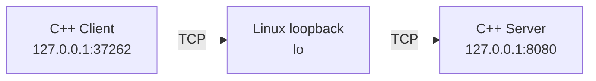

There is no physical Ethernet or Wi-Fi hop here.

The important idea is:

```text
Application
    ↓
Socket API
    ↓
Linux kernel
    ↓
TCP
    ↓
IP
    ↓
Network interface
```

For this experiment, the network interface is `lo`.

---

# 3. What Is `lo`?

Check it with:

```bash
ip link show lo
```

or:

```bash
ip addr show lo
```

You will normally see the loopback address:

```text
127.0.0.1
```

`127.0.0.1` means "this machine".

The communication therefore looks like:

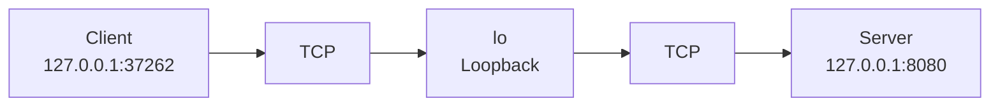

---

# 4. Starting `tcpdump`

The command used was:

```bash
sudo tcpdump -i lo -n port 8080
```

Break it down:

```text
sudo
 │
 └── tcpdump
      │
      ├── -i lo
      │     └── capture packets on interface "lo"
      │
      ├── -n
      │     └── don't resolve addresses/names
      │
      └── port 8080
            └── show packets involving port 8080
```

A more precise filter for this experiment is:

```bash
sudo tcpdump -i lo -n 'tcp port 8080'
```

This focuses on TCP traffic involving port `8080`.

---

# 5. TCP Three-Way Handshake

The first three packets were:

```text
Client → Server
Flags [S]
seq 257885707

Server → Client
Flags [S.]
seq 3406291060
ack 257885708

Client → Server
Flags [.]
ack 3406291061
```

This is the TCP three-way handshake.

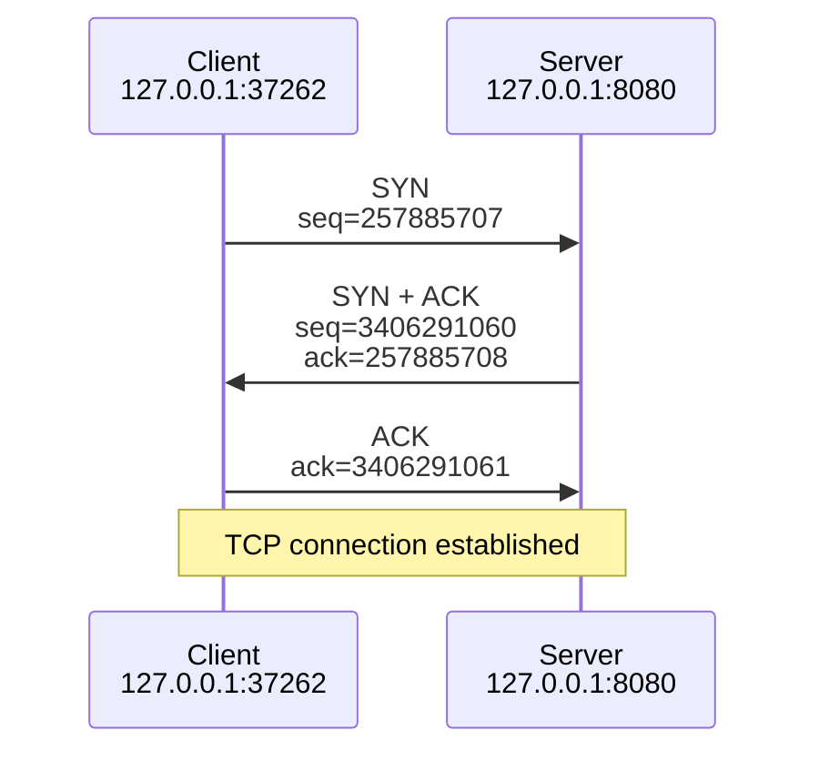

---

# 6. Understanding TCP Flags

`tcpdump` displays flags in a compact form.

## SYN

```text
[S]
```

Means:

```text
S = SYN
```

The client is requesting a TCP connection.

---

## SYN + ACK

```text
[S.]
```

The `S` means SYN.

The `.` means ACK.

So:

```text
[S.]
```

means:

```text
SYN + ACK
```

---

## ACK

```text
[.]
```

Means:

```text
ACK
```

---

## PSH + ACK

```text
[P.]
```

Means:

```text
P = PSH
. = ACK
```

So the segment contains application data and carries an acknowledgement.

Important:

> TCP is a byte stream, not a message protocol. Do not interpret `PSH` as "one application message".

---

# 7. Why Does ACK Increase by One During the Handshake?

The client sends:

```text
SYN
seq = 257885707
```

The server replies:

```text
ack = 257885708
```

Why?

Because SYN consumes one sequence number.

```text
257885707 + 1 = 257885708
```

Similarly, the server sends:

```text
seq = 3406291060
```

The client acknowledges:

```text
ack = 3406291061
```

because:

```text
3406291060 + 1 = 3406291061
```

A useful mental model is:

```text
ACK = next sequence number expected
```

---

# 8. Mapping the Handshake to C++

Suppose the client contains:

```cpp
int fd = socket(...);

connect(fd, ...);
```

The important point is that `connect()` is not just a local function call.

The TCP stack performs the handshake:

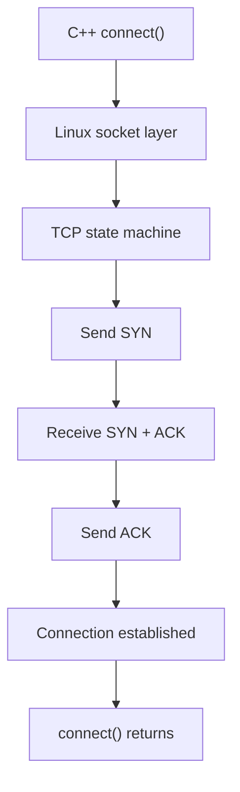

On the server side:

```cpp
socket();
bind();
listen();
accept();
```

`listen()` puts the listening socket into a state where it can accept incoming connections.

`accept()` returns a connected socket for a particular client.

---

# 9. `listen()` vs `accept()`

A common beginner mistake is thinking that `listen()` creates the connection.

Conceptually:

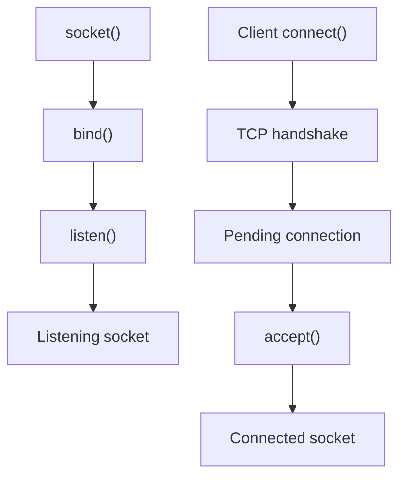

Think of:

```text
listening socket
```

as the server's "door".

Then:

```text
accept()
```

gives you a new connected socket representing a specific client connection.

---

# 10. Application Data: `Hello`

After the handshake, the client sends application data.

`tcpdump` showed something similar to:

```text
127.0.0.1.37262 > 127.0.0.1.8080:
Flags [P.],
seq 1:8,
ack 1,
length 7
```

The important fields are:

```text
seq 1:8
length 7
```

This means the TCP segment carries 7 bytes beginning at sequence number 1.

The server then responds:

```text
127.0.0.1.8080 > 127.0.0.1.37262:
Flags [.],
ack 8,
length 0
```

The server is saying:

```text
"I have received everything up to byte 7.
I expect byte 8 next."
```

This is why:

```text
ACK = 8
```

---

# 11. TCP Sequence Numbers Represent a Byte Stream

This is one of the most important concepts.

TCP does not understand:

```text
"Hello"
"Ali"
"HI"
```

as separate messages.

TCP sees:

```text
a stream of bytes
```

For example:

```text
TCP byte stream

1  2  3  4  5  6  7
└────── Hello ──────┘

8  9  10 11 12
└───── Ali ─────┘

13 14 15 16
└──── HI ─────┘
```

The exact number of bytes depends on what the client actually sends, including delimiters such as `\r\n` or `\n`.

---

# 12. Why Did `Ali` Start at Sequence 8?

The previous segment used:

```text
seq 1:8
```

Therefore the next byte starts at:

```text
8
```

The packet was:

```text
seq 8:13
length 5
```

So the server acknowledges:

```text
ack 13
```

Because:

```text
8 + 5 = 13
```

Mental model:

```text
sequence number
      │
      ▼
position of a byte in the TCP stream
```

and:

```text
ACK
 │
 └── next byte expected
```

---

# 13. `send()` and `recv()` in the Real System

When your C++ code does:

```cpp
send(fd, buffer, size, 0);
```

the actual path is approximately:

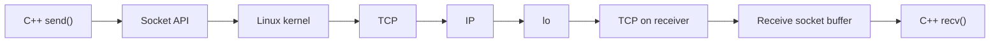

This is the key relationship:

```text
send()
  ↓
kernel
  ↓
TCP
  ↓
packet
  ↓
network interface
  ↓
TCP
  ↓
recv()
```

---

# 14. `tcpdump -X`

The command:

```bash
sudo tcpdump -i lo -n -X 'tcp port 8080'
```

shows packet contents as:

```text
HEX + ASCII
```

For example:

```text
0x0000:
4510 0038 8020 4000 4006 ...
...
48 49 0d 0a
```

The final bytes:

```text
48 49 0d 0a
```

can be interpreted as:

```text
48 = H
49 = I
0d = \r
0a = \n
```

Therefore:

```text
48 49 0d 0a
      ↓
HI\r\n
```

This is extremely useful because you are seeing the actual application payload inside the TCP segment.

---

# 15. IP Addresses Inside the Packet

In the hexadecimal dump you may see:

```text
7f00 0001
7f00 0001
```

Split them into four bytes:

```text
7f 00 00 01
```

Convert hexadecimal to decimal:

```text
7f = 127
00 = 0
00 = 0
01 = 1
```

Therefore:

```text
7f 00 00 01
     ↓
127.0.0.1
```

So the IP header contains:

```text
Source IP      = 127.0.0.1
Destination IP = 127.0.0.1
```

---

# 16. TCP Ports Inside the Packet

In the TCP header you can find:

```text
918e 1f90
```

These are hexadecimal values.

Convert them:

```text
0x918e = 37262
0x1f90 = 8080
```

Therefore:

```text
Source port      = 37262
Destination port = 8080
```

Which matches:

```text
127.0.0.1.37262 > 127.0.0.1.8080
```

This gives you a useful mental model of packet structure:

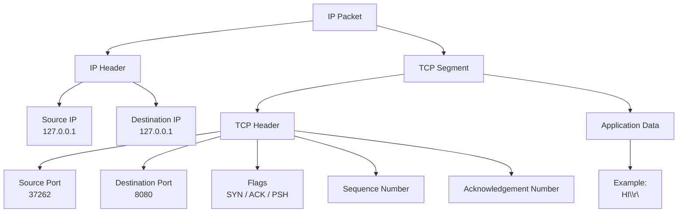

---

# 17. `tcpdump -A` vs `tcpdump -X`

## ASCII

```bash
sudo tcpdump -i lo -n -A 'tcp port 8080'
```

Useful when the payload is text.

You may see:

```text
HI
```

---

## Hex + ASCII

```bash
sudo tcpdump -i lo -n -X 'tcp port 8080'
```

Useful when you want to understand the packet structure and raw bytes:

```text
48 49 0d 0a
```

A useful rule:

```text
-A  → understand text payload
-X  → understand raw packet bytes
```

---

# 18. The Unexpected `go-updater.brave.com` Packet

Your capture also contained:

```text
127.0.0.1.8080 > 127.0.0.53.53:
4795+ A? go-updater.brave.com.
```

This is not your C++ server talking to the client.

It is DNS traffic.

Notice:

```text
source port = 8080
destination port = 53
```

Your filter was:

```bash
port 8080
```

That means:

```text
source port 8080
OR
destination port 8080
```

Therefore `tcpdump` also captured this DNS packet because some other process on your machine happened to use port `8080` as its source port.

---

# 19. DNS Packet

The DNS request:

```text
127.0.0.1.8080 > 127.0.0.53.53
```

means:

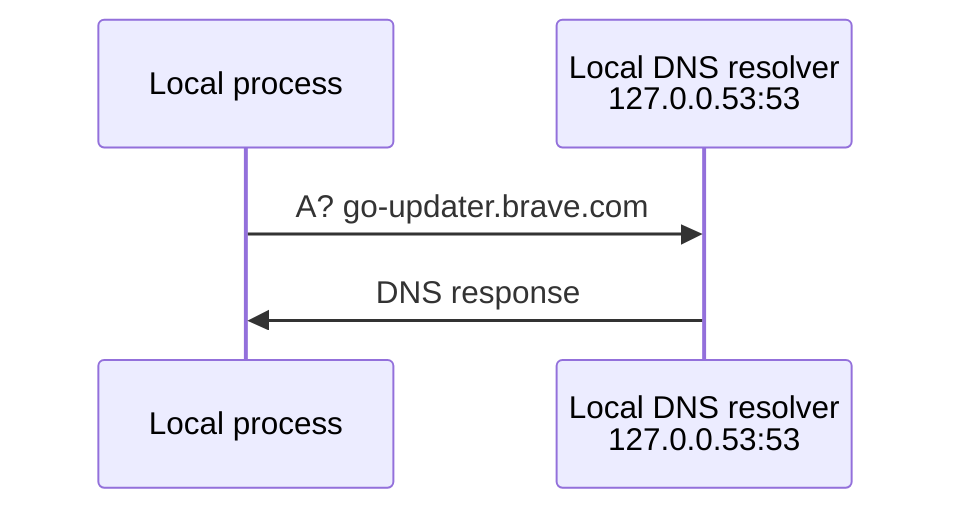

The `A` query asks for IPv4 addresses.

The response contained a CNAME and several IPv4 addresses.

This traffic is unrelated to your C++ TCP connection.

---

# 20. Better `tcpdump` Filter

Instead of:

```bash
sudo tcpdump -i lo -n port 8080
```

use:

```bash
sudo tcpdump -i lo -n 'tcp port 8080'
```

Now you are explicitly asking for TCP traffic.

For this project, these are useful commands:

```bash
# TCP traffic involving port 8080
sudo tcpdump -i lo -n 'tcp port 8080'

# TCP + hexadecimal dump
sudo tcpdump -i lo -n -X 'tcp port 8080'

# TCP + ASCII payload
sudo tcpdump -i lo -n -A 'tcp port 8080'
```

---

# 21. Inspect the Listening Socket

While the server is running:

```bash
ss -lntp | grep 8080
```

Useful flags:

```text
-l = listening
-n = numeric addresses/ports
-t = TCP
-p = show process information
```

You should see something similar to:

```text
LISTEN ... 127.0.0.1:8080 ...
```

---

# 22. Inspect the Established Connection

After the client connects:

```bash
ss -ntp | grep 8080
```

You should see a connection similar to:

```text
127.0.0.1:37262
127.0.0.1:8080
```

Now you can compare:

```text
ss
│
├── local endpoint
├── remote endpoint
└── TCP state

tcpdump
│
├── SYN
├── SYN-ACK
├── ACK
├── data
└── acknowledgements
```

These two tools give complementary views of the same TCP connection.

---

# 23. Complete TCP Lifecycle

The whole experiment can be visualized as:

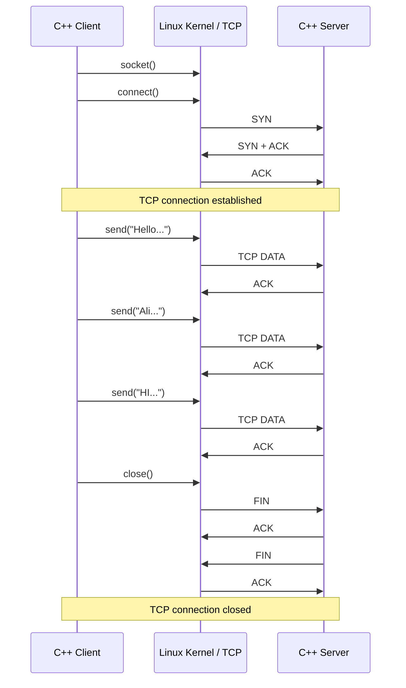

---

# 24. C++ API → TCP Behavior

This is the mapping to remember:

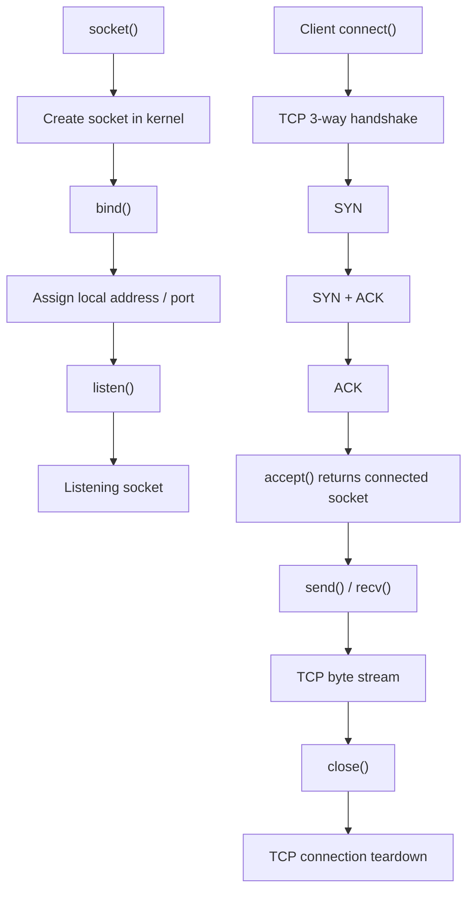

The important distinction is:

```text
socket()
    → creates the communication endpoint

bind()
    → gives it a local address/port

listen()
    → makes a TCP socket a listening socket

accept()
    → obtains a connected socket

connect()
    → initiates the TCP connection

send()
    → gives application data to the socket/TCP stack

recv()
    → reads received bytes from the socket

close()
    → releases the socket and participates in connection teardown
```

---

# 25. The Most Important Mental Model

Think in layers:

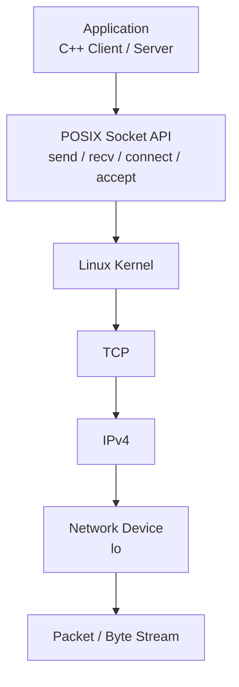

When you call:

```cpp
send()
```

you are not directly "sending a packet".

You are giving bytes to the kernel's socket/TCP implementation.

TCP then decides how those bytes are segmented and transmitted.

Similarly, when you call:

```cpp
recv()
```

you are reading bytes from the receiving socket's data stream.

---

# 26. Commands Cheat Sheet

## Interfaces

```bash
ip link
ip addr
ip addr show lo
```

## Listening sockets

```bash
ss -lntp
ss -lntp | grep 8080
```

## Established TCP connections

```bash
ss -ntp
ss -ntp | grep 8080
```

## TCP packet capture

```bash
sudo tcpdump -i lo -n 'tcp port 8080'
```

## TCP + hex/ASCII

```bash
sudo tcpdump -i lo -n -X 'tcp port 8080'
```

## TCP + ASCII

```bash
sudo tcpdump -i lo -n -A 'tcp port 8080'
```

## Stop capture

```text
Ctrl+C
```

---

# 27. What You Should Be Able to Explain Now

After this exercise, you should be able to explain:

### Endpoint

```text
127.0.0.1:37262
        │
        └── client endpoint
```

and:

```text
127.0.0.1:8080
        │
        └── server endpoint
```

### Handshake

```text
SYN
SYN + ACK
ACK
```

### Sequence numbers

```text
seq = position in TCP byte stream
```

### Acknowledgements

```text
ACK = next sequence number expected
```

### Data

```text
[P.]
seq X:Y
length N
```

means a TCP segment carrying application data.

### Payload

```text
48 49 0d 0a
```

can represent:

```text
HI\r\n
```

### Socket API

```text
connect()
    ↓
TCP handshake

send()
    ↓
TCP data

recv()
    ↑
TCP data

close()
    ↓
TCP teardown
```

---

# 28. The Next Experiment

The best next step is to run the following three tools together:

### Terminal 1 — Server

```bash
./build/server
```

### Terminal 2 — TCP capture

```bash
sudo tcpdump -i lo -n -X 'tcp port 8080'
```

### Terminal 3 — Client

```bash
./build/client
```

Then correlate:

```text
C++ code
   │
   ├── connect()
   │      ↓
   │    SYN
   │      ↓
   │    SYN-ACK
   │      ↓
   │    ACK
   │
   ├── send("Hello")
   │      ↓
   │    TCP DATA
   │      ↓
   │    ACK
   │
   ├── send("Ali")
   │      ↓
   │    TCP DATA
   │      ↓
   │    ACK
   │
   ├── send("HI")
   │      ↓
   │    TCP DATA
   │      ↓
   │    ACK
   │
   └── close()
          ↓
        FIN / ACK
```

This is the point where the C++ socket API, Linux kernel, TCP state machine, and actual packets become one mental model.

---

# References

- [tcpdump manual](https://www.tcpdump.org/manpages/tcpdump.1.html)
- [Linux `socket(7)` — socket interface](https://man7.org/linux/man-pages/man7/socket.7.html)
- [Linux `tcp(7)` — TCP implementation](https://man7.org/linux/man-pages/man7/tcp.7.html)
- [Linux `ss(8)` — socket statistics](https://man7.org/linux/man-pages/man8/ss.8.html)
- [RFC 9293 — Transmission Control Protocol](https://www.rfc-editor.org/rfc/rfc9293)
