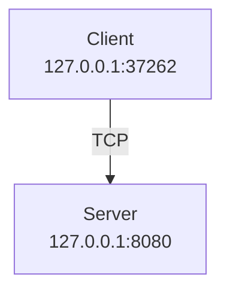
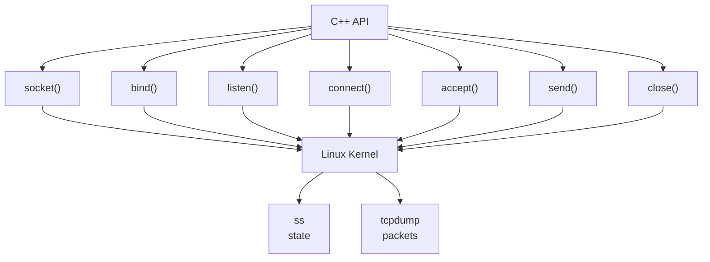
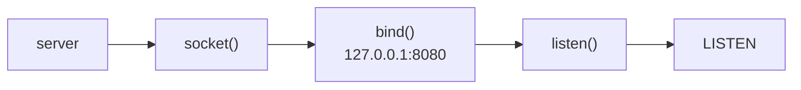
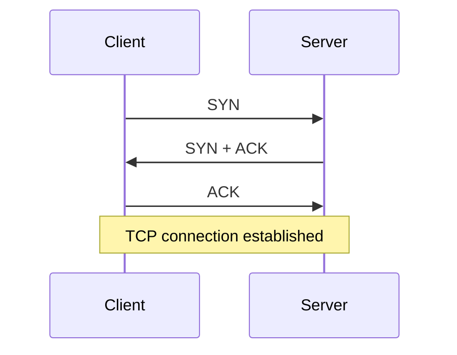
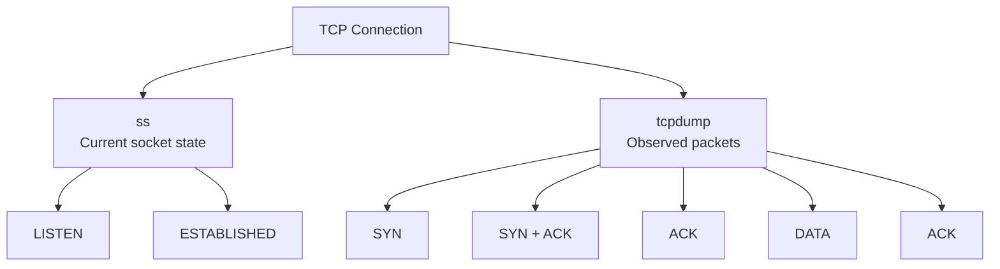
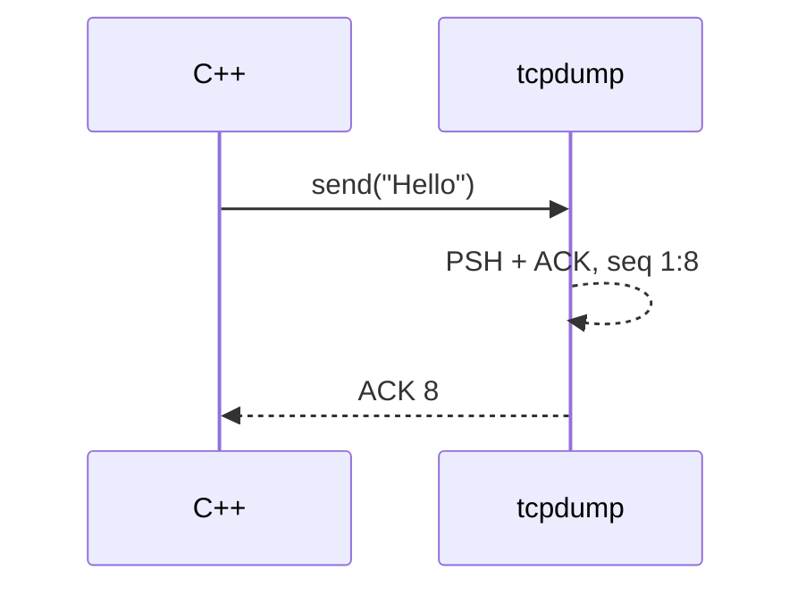
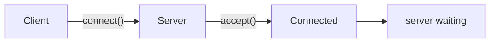
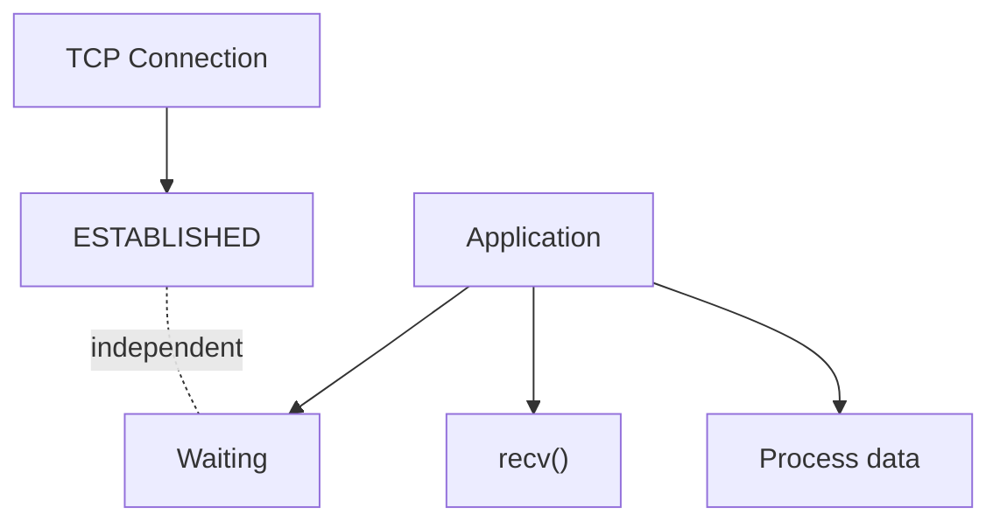
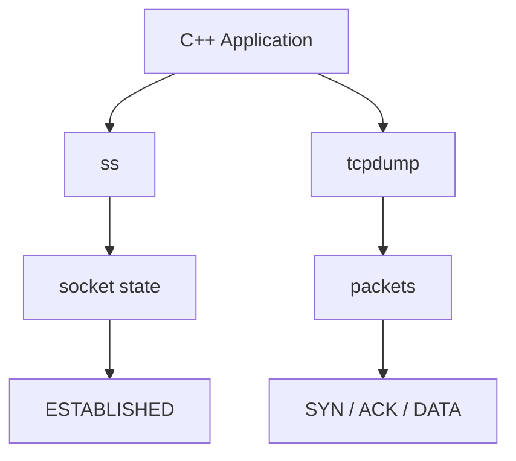

# Lab: `ss` + `tcpdump` + C++ TCP Server

This is a small lab.  
We will use `ss` to watch the socket state, and `tcpdump` to watch the packets.  
We will connect everything to your C++ code.

We have:



The goal is to see:



---

# 1. Start the Server

Terminal 1:

```bash
./build/server
```

You should see:

```text
Listening on port 8080...
```

**Important:** We have not started the client yet.

---

# 2. Use `ss` Before the Client

In Terminal 2:

```bash
ss -lntp | grep 8080
```

You may see something like:

```text
LISTEN 0 128 127.0.0.1:8080 0.0.0.0:* users:(("server",pid=...,fd=...))
```

Look at this part:

```text
LISTEN
```

This means the server has a **listening socket**.

Mental model:



Note that:

```text
listen()
```

does not send a TCP packet to the client.

It only puts the socket into this state:

```text
LISTEN
```

---

# 3. Start `tcpdump`

Terminal 3:

```bash
sudo tcpdump -i lo -n 'tcp port 8080'
```

You will see:

```text
listening on lo...
```

But **nothing will appear yet**.

Why?

Because:

```text
Server = LISTEN
Client = not connected yet
```

There are no TCP packets.

---

# 4. Start the Client

Terminal 4:

```bash
./build/client
```

Now look at Terminal 3.

You will see something like:

```text
127.0.0.1.37262 > 127.0.0.1.8080:
Flags [S], ...

127.0.0.1.8080 > 127.0.0.1.37262:
Flags [S.], ...

127.0.0.1.37262 > 127.0.0.1.8080:
Flags [.], ...
```

This is:



---

# 5. At the Same Time, Use `ss`

Terminal 2:

```bash
ss -ntp | grep 8080
```

Before the client connected, you had:

```text
LISTEN
```

After the connection, you will see something like:

```text
ESTAB 0 0 127.0.0.1:8080 127.0.0.1:37262 users:(("server",...))
```

Notice the change:

```text
LISTEN
   ↓
ESTABLISHED
```

This is very important.

---

# 6. Now Connect `ss` with `tcpdump`

We have two tools:

### `ss`

It tells us:

> What is the **socket state now?**

For example:

```text
LISTEN
ESTABLISHED
```

### `tcpdump`

It tells us:

> What are the **packets that crossed the interface?**

For example:

```text
SYN
SYN-ACK
ACK
DATA
ACK
FIN
```

So:



---

# 7. Now Watch `send()`

Your server prints:

```text
Received: Hello
Received: Ali
Received: HI
```

When the client does:

```cpp
send(..., "Hello", ...);
```

Watch `tcpdump`.

You will see something like:

```text
127.0.0.1.37262 > 127.0.0.1.8080:
Flags [P.],
seq 1:8,
ack 1,
length 7
```

Then:

```text
127.0.0.1.8080 > 127.0.0.1.37262:
Flags [.],
ack 8,
length 0
```

So:



---

# 8. Use `ss` to Watch Buffers

This is very nice.

Run:

```bash
ss -ntpi | grep -A 1 8080
```

The `-i` option shows extra internal TCP information, such as some congestion and window state information.

You may see output with information like:

```text
cubic
wscale
rto
rtt
cwnd
bytes_sent
bytes_received
```

This helps you start seeing that TCP is not just:

```text
send()
recv()
```

TCP has state and connection management inside the kernel.

---

# 9. Important Test: Stop the Server

Now try this:

```text
Terminal 1
```

Press:

```text
Ctrl+C
```

The server will stop.

Watch:

```bash
ss -ntp | grep 8080
```

And watch `tcpdump`.

You may see TCP teardown, like:

```text
FIN
ACK
```

This depends on who started the close and how your code behaves.

---

# 10. Most Important Test: Pause the Server

Let us make the test clearer.

In the server, after `accept()`, you can temporarily add:

```cpp
std::cin.get();
```

So the server accepts the connection but waits before running the rest of the code.

For example:

```cpp
int clientFd = server.accept();

std::cout << "Client connected!\n";

std::cin.get();

char buffer[1024];

int n = client.receive(buffer, sizeof(buffer));
```

Now:



At the same time:

```bash
ss -ntp | grep 8080
```

will say:

```text
ESTABLISHED
```

While:

```bash
tcpdump
```

will tell you that the handshake already happened.

---

# 11. Here We Discover Something Very Important

It is possible that:

```text
ss
↓
ESTABLISHED
```

but the application itself is still not working:

```cpp
recv();
```

This means:

```text
TCP connection state
```

is different from:

```text
Application state
```

This is a very important point in debugging.



---

# 12. Full Lab

Do this in order:

### Terminal 1

```bash
./build/server
```

### Terminal 2

```bash
watch -n 0.5 'ss -lntp | grep 8080'
```

You will see:

```text
LISTEN
```

### Terminal 3

```bash
sudo tcpdump -i lo -n 'tcp port 8080'
```

### Terminal 4

```bash
./build/client
```

Now watch all three:



---

# 13. Very Important Table

During the test, try to fill this table:

| Moment            | C++         | `ss`          | `tcpdump`        |
| ----------------- | ----------- | ------------- | ---------------- |
| Server started    | `listen()`  | `LISTEN`      | Nothing          |
| Client starts     | `connect()` | transition    | `SYN`            |
| Handshake         | —           | `ESTABLISHED` | `SYN-ACK`, `ACK` |
| Client sends      | `send()`    | `ESTABLISHED` | `PSH/ACK`        |
| Server receives   | `recv()`    | `ESTABLISHED` | ACK              |
| Connection closes | `close()`   | closing state | `FIN/ACK`        |

This is exactly the connection we want to understand.

---

# 14. Commands You Should Remember

### Socket state

```bash
ss -lntp
```

### Connection state

```bash
ss -ntp
```

### Detailed TCP information

```bash
ss -ntpi
```

### Packet capture

```bash
sudo tcpdump -i lo -n 'tcp port 8080'
```

### Packet + HEX

```bash
sudo tcpdump -i lo -n -X 'tcp port 8080'
```

### Packet + ASCII

```bash
sudo tcpdump -i lo -n -A 'tcp port 8080'
```

---

## The Goal of This Lab

At the end, I want you to see this line:

```text
127.0.0.1.37262 > 127.0.0.1.8080: Flags [S]
```

and say immediately:

> **This is the client doing `connect()`, and the TCP state machine has started the three-way handshake.**

Then see:

```text
ESTAB  ... 127.0.0.1:8080  127.0.0.1:37262
```

and say:

> **The kernel has a connected TCP socket between the server and the client.**

Then see:

```text
Flags [P.], seq 8:13, ack ...
```

and say:

> **Application data is moving inside the TCP byte stream, and the segment carries PSH + ACK.**

This is exactly the level you need to reach before we move to:

**non-blocking sockets → `select()` → `poll()` → `epoll()` → then Asio**

Reference: [Linux ss(8)](https://man7.org/linux/man-pages/man8/ss.8.html) and [tcpdump documentation](https://www.tcpdump.org/manpages/tcpdump.1.html).
