# Non-Blocking Sockets

The Road we will take:
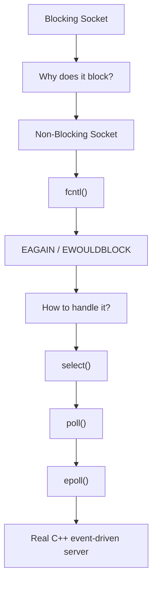

## What blocking means?

Let's go back to the socket we were working on, when you do:
```c++
int client_fd = accept(server_fd, nullptr, nullptr);
```

The kernel may say "currently no client connected". In the normal case, `accept()` will not return immediately.

The process will remain stop or WAIT for the client to connect:
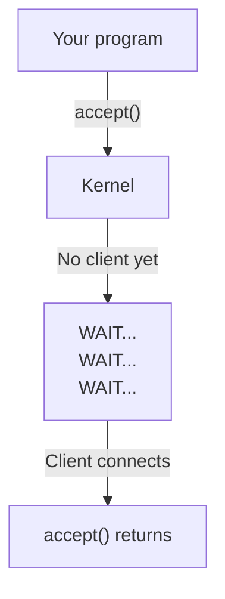

> This is called **blocking**.

### So why is that (blocking) a problem?

Imagine you have a server like:
```c++
while (true)
{
    int client_fd = accept(server_fd, nullptr, nullptr);

    // handle client
}
```

when there is no client, the server will remain blocked.

Ower thread is not doing anything, also even a client connected, after that we may do:
```c++
recv(client_fd, buffer, sizeof(buffer), 0);
```

if the client connected and did not send anything, the server will remain blocked/waiting and the thread will not do anything and still waiting:


From here the idea of non-blocking sockets comes.

## Non-Blocking Sockets Idea

We want to tell the kernel, when I request a socket operation from you, don't make me wait.

instead of the following:
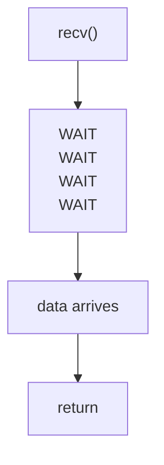
we want:
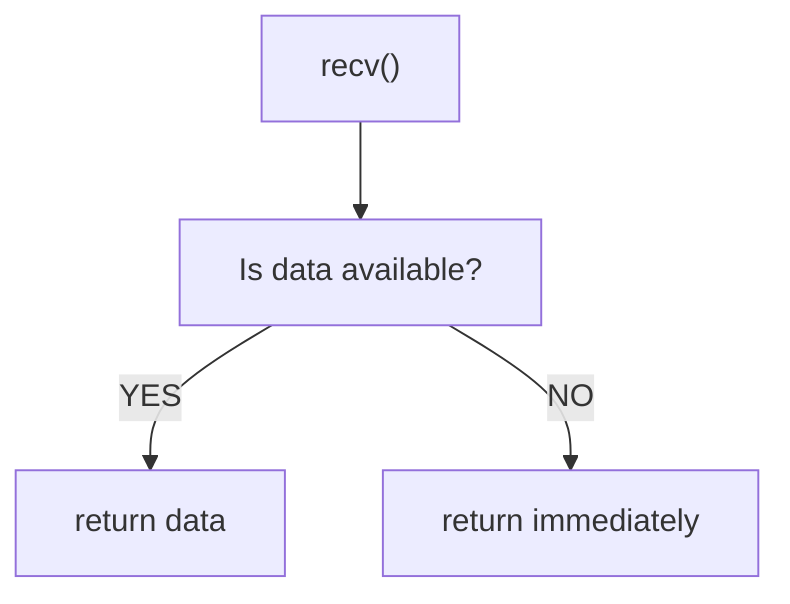

And this is exactly a non-blocking socket.

### Simple Example

if we have a socket `int fd = socket(AF_INET, SOCK_STREAM, 0);`, we assume it is a blocking socket -> that means `recv(fd, ...);` may wait. But if we made the socket non-blocking, then the `recv(fd, ...);` will not wait and return immediately.

The `recv(fd, ...);` will return if there is no data:
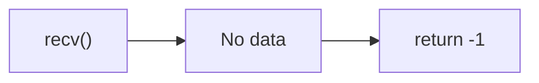

**However, there is a very important point here:**
* `-1` does not necessarily mean there is an actual error.
* It could mean the operation is not possible right now; please try again. We will see that through `errno`, and specially `EAGAIN` or `EWOULDBLOCK`.

### How do we convert a socket to Non-Blocking?

On Linux, we have a basic method using `fcntl()`. example:
```c++
#include <fcntl.h>

int flags = fcntl(fd, F_GETFL, 0);

fcntl(fd, F_SETFL, flags | O_NONBLOCK);
```

lets understand it line by line:
1. `fcntl(fd, F_GETFL, 0)` -> we tell the kernel "Hey give the file status flags for this socket `fd`" -> The function returns the flags as an `int`, or `-1` if an error occurs (and sets `errno`). what each part means:

    1. `fnctl`: Short for "file control," this is a system call that controls the properties of a file descriptor.
    2. `fd`: The file descriptor of the file to be controlled.
    3. `F_GETFL`: The command to retrieve the file status flags.
    4. `0`: The third argument is ignored with `F_GETFL`, so we provide any value (usually `0`). 

> ال syscall اللي اسمها `fcntl` بتتحكم في خصائص ال file descriptor

> We tell the kernel to give us the file status flags for this socket `fd`, and the flags may be:
> * `O_RDONLY` / `O_WRONLY` / `O_RDWR`  -> The access mode (read/write)
> * `O_APPEND` -> Always writing at the end of the file.
> * `O_NONBLOCK` -> The I/O operation will not block.
> * `O_ASYNC` -> Signal notification when I/O is ready.
> * `O_SYNC` / `O_DSYNC` -> Writing is performed synchronously.
>
>Note: Open flags like `O_CREAT`, `O_TRUNC`, and `O_EXCL` are not returned here, as they only affect the `open` operation itself.

> What are these flags?
> It’s a bitmask—meaning multiple flags combined into a single number using the OR operation.

We don't want to clear the existing flags. we want to add `O_NONBLOCK`. the next line:
```c++
fcntl(fd, F_SETFL, flags | O_NONBLOCK);
```
* `flags | O_NONBLOCK` -> add `O_NONBLOCK` to the existing flags -> save all existing flags and add to then `O_NONBLOCK`.

#### VERY IMPORTANT:

The socket itself resides in the kernel. when you do `int fd = socket(...);` the `fd` is just a number in our code. example:
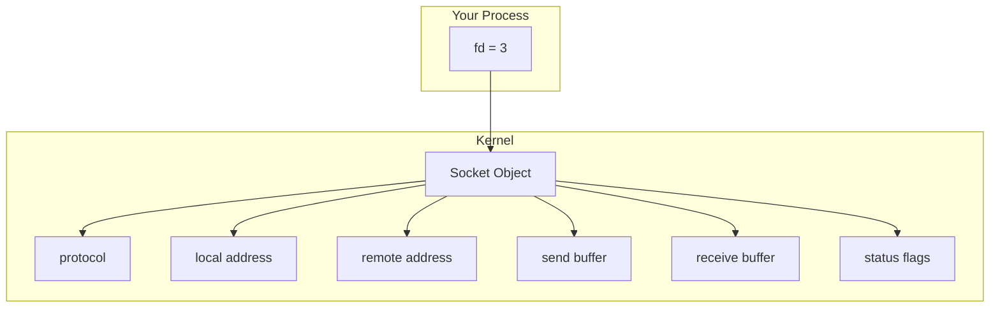
when you do the following:
```c++
fcntl(fd, F_SETFL, flags | O_NONBLOCK);
```
You are changing a **configuration associated** with the `open` file description or `socket` access in the kernel; you aren't changing the value of the file descriptor (`fd`) itself.

> The file descriptor will remain `3` (we assume when do `int fd = socket(...);` the fd is `3`), **However, the way I/O operations handle it changes.**

## First Experiment: Non-Blocking Socket

See the [**Non-Blocking Socket**](./main.cpp) code example and its is a small server. In this example we don't need networking architecture or C++ classes right now. we need to understand how to make `accept()` non-blocking. 

The most inportant part in the code:
```c++
int client_fd = accept(
    server_fd,
    nullptr,
    nullptr
);
```
if there is no client:
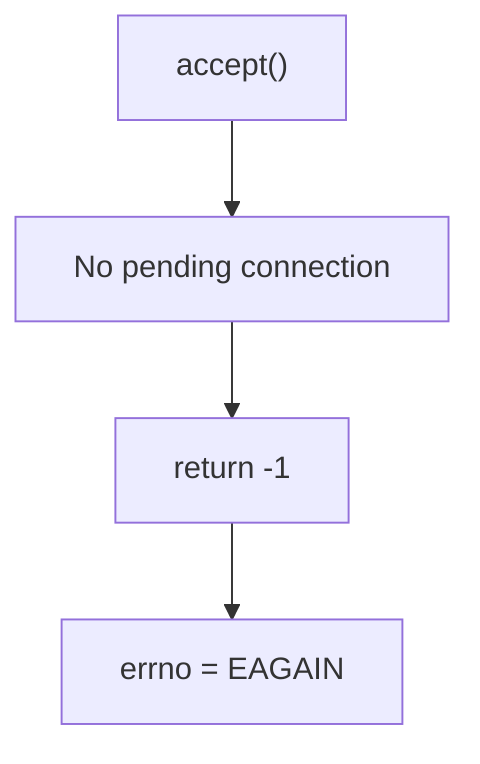

So `if (errno == EAGAIN || errno == EWOULDBLOCK)` roughly means (معناها تقريبا) nothing is ready right now, and no real problem has occurred.

### The difference between blocking and non-blocking:
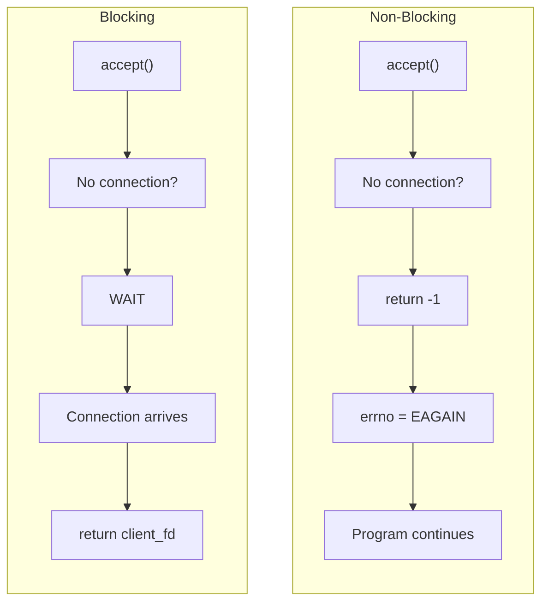

This is the core of this topic.


Now we have a problem in the code, see:
```c++
while (true)
{
    int client_fd = accept(...);

    if (client_fd == -1)
    {
        if (errno == EAGAIN)
        {
            sleep(1);
            continue;
        }
    }
}
```
Here we made the socket non-blocking, but what we do now manual polling:
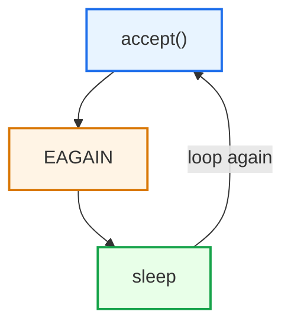

> Now we have a non-blocking socket, and we are polling it. NOTE that is not the solution we use in the real servers, because if you have 1000 sockets it doesn't make sense to loop over them one by one and ask:
> 
>"Do you have data?"
>
>"And you?"
>
> "And you?"
>
> "And you?"
>
> "And you?"
>
> And this is exactly where we start to understand why these were introduced `select()`, `poll()`, and `epoll()`.
>
> But we won't go into them right now.


### Mental Model

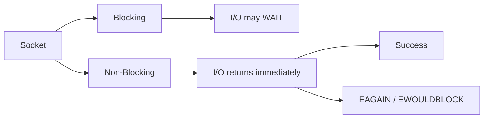

The conversion:
```c++
int flags = fcntl(fd, F_GETFL, 0);

fcntl(fd, F_SETFL, flags | O_NONBLOCK);
```

> IMPORTANT: "Non-blocking" does not mean that the operation always succeeds --> which means --> the process does not wait until it succeeds.

## Understanding `fcntl()`

* `fcntl` -> file control -> It is a **system call/interface** that allows you to perform various operations on a file descriptor.

prototype:
```c++
int fcntl(int fd, int op, ... /* arg */ );
// fd: file descriptor -> which fd?
// op: what do you want
```

The `op` argument specifies the operation you want to perform. `fcntl()` supports a wide range of operations, including duplicating descriptors, managing descriptor flags and file status flags, handling locks, and more.

> AGAIN: the fd is just a descriptor which process uses it to access an object inside the kernel.

### Question: So, what does `fcntl(fd, ...)` actually do?

**Answer:**

Simply put -> "Hey Kernel, I have an object associated with this `fd`, and I want to perform a specific operation on it."

Example:
```c++
fcntl(fd, F_GETFL); // give me current status flags
```
And
```c++
fcntl(fd, F_SETFL, something); // change the status flags with something(value of flags)
```

* set status flags -> `O_NONBLOCK` -> `flags =flags | O_NONBLOCK` -> `flags |= O_NONBLOCK`
* reset status flags -> `O_NONBLOCK` -> `flags = flags & ~O_NONBLOCK` -> `flags &= ~O_NONBLOCK`

> When Calling `fcntl(fd, F_GETFL);` the retuen value is the current status flags on success and -1 on error.

Example Code:
```c++
#include <fcntl.h>
#include <iostream>

bool setNonBlocking(int fd)
{
    int flags = fcntl(fd, F_GETFL);

    if (flags == -1)
    {
        return false;
    }

    flags |= O_NONBLOCK;

    if (fcntl(fd, F_SETFL, flags) == -1)
    {
        return false;
    }

    return true;
}
```

### STDIN Non-Blocking LAB

We did lab to make the stdin non-blocking, see [STDIN Non-Blocking LAB](./stdin-non-blocking.cpp).

when you build and run the lab, the program will not stop waiting for input:


when you enter data (e.g. "Hello"):


the output will be something like:
```text
No input yet
No input yet
No input yet
No input yet
No input yet
No input yet
No input yet
No input yet

Received: hello

```

> This is where we really start to understand "non-blocking."

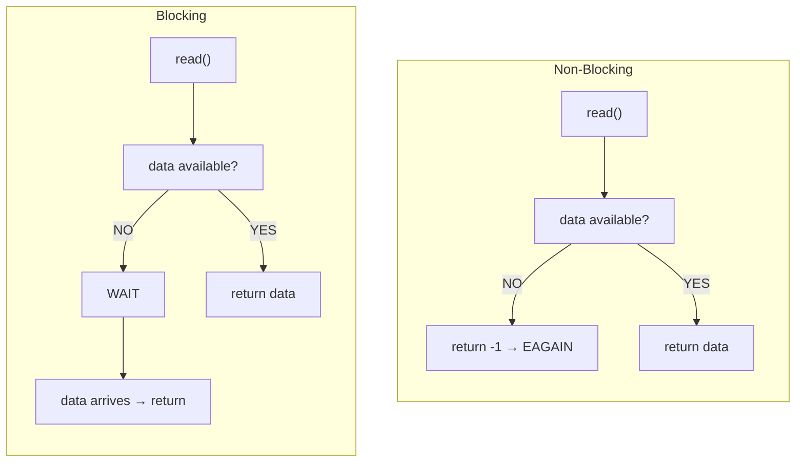

> NO WAIT in Non-Blocking mode.

> This is the essence(جوهر) of `O_NONBLOCK`. Linux specifies that socket operations which would normally block return `EAGAIN`/`EWOULDBLOCK` when `O_NONBLOCK` is enabled; `connect()` is a special case, often returning `EINPROGRESS`.


* `EAGAIN`: The operation cannot be completed right now without waiting -> And that’s the reason for the name `EAGAIN` -> You can understand it conceptually as "Try Again".
    * "Try again later"
    * connection isn't ready
    * data isn't available

> Linux socket documentation indicates that non-blocking socket operations—which would otherwise block—typically return `EAGAIN` or `EWOULDBLOCK`.

Common Portable Pattern:
```c++
if (errno == EAGAIN || errno == EWOULDBLOCK)
{
    // Not ready yet
}
```

> NOTE that `F_SETFL` and `F_GETFL` deal with file status flags (e.g. `O_NONBLOCK`, `O_APPEND`, and etc).

> There is `F_SETFD` and `F_GETFD` for file descriptor flags (e.g. `FD_CLOEXEC`, `FD_NONBLOCK`, and etc).
>
> `FD_CLOEXEC` is related to the behavior of `execve()`: it causes the file descriptor to be closed automatically upon a successful `execve()`.


## `O_NONBLOCK` vs `MSG_DONTWAIT`

This very important information fo sockets.

We can do:
```c++
fcntl(fd, F_SETFL, flags | O_NONBLOCK);
```
Now we made the file descriptor non-blocking. but with `recv()` we have option:
```c++
fcntl(fd, F_SETFL, flags | O_NONBLOCK);
```

The main difference:
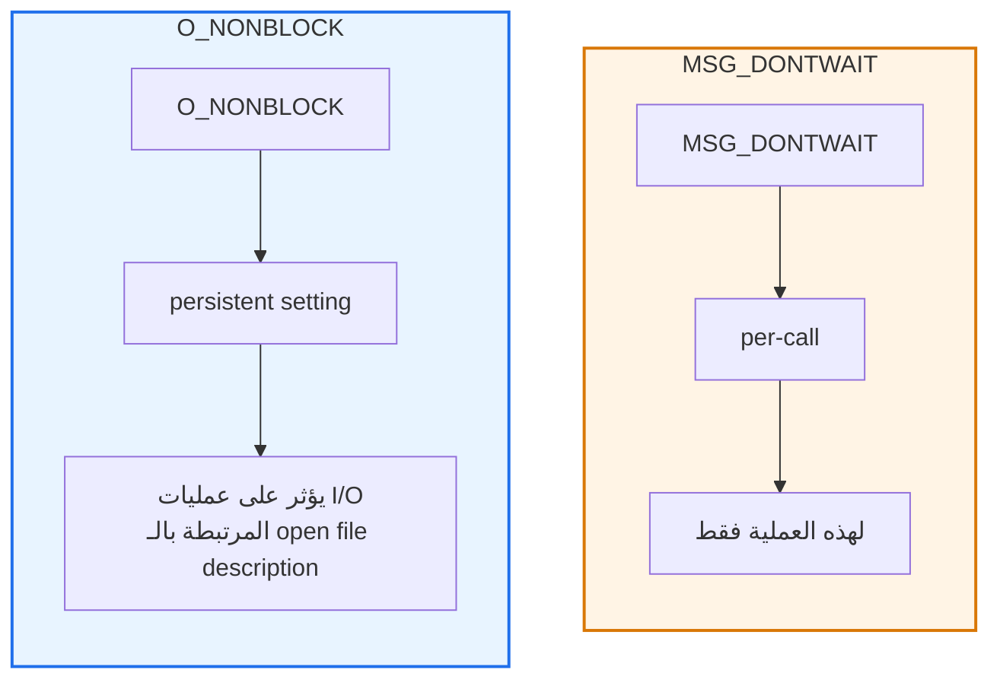

>However, we don't want to get into `MSG_DONTWAIT` right now; let's treat it as a side note.


### Returning back to socket

If we did the following:
```c++
int server_fd = socket(
    AF_INET,
    SOCK_STREAM,
    0
);
```

then:
```c++
int flags = fcntl(server_fd, F_GETFL);

if (flags == -1)
{
    perror("F_GETFL");
    return 1;
}

flags |= O_NONBLOCK;

if (fcntl(server_fd, F_SETFL, flags) == -1)
{
    perror("F_SETFL");
    return 1;
}
```

the socket became:
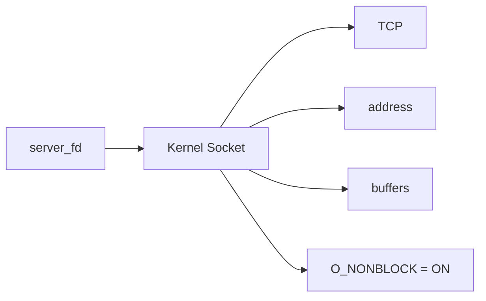

When using `accept(serverfd, ...)`, if there is no ready connection:
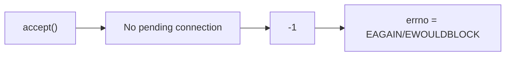
Instead of **blocking** or thread doing **wait**.

### Mental Model

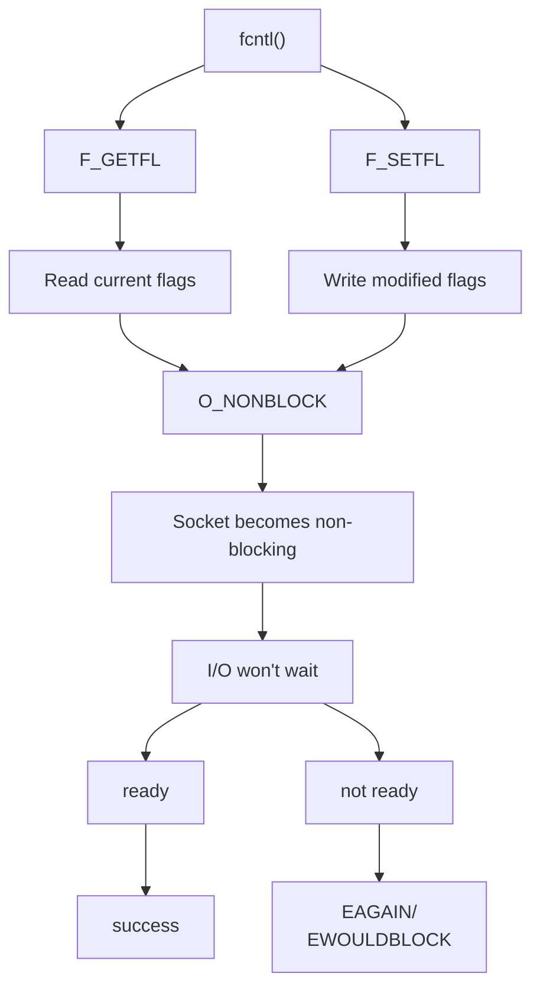

Some code:
```c++
int flags = fcntl(fd, F_GETFL);

if (flags == -1)
{
    // handle error
}

if (fcntl(fd, F_SETFL, flags | O_NONBLOCK) == -1)
{
    // handle error
}
```
encapsulated in a function:
```c++
bool setNonBlocking(int fd)
{
    int flags = fcntl(fd, F_GETFL);

    if (flags == -1)
        return false;

    if (fcntl(fd, F_SETFL, flags | O_NONBLOCK) == -1)
        return false;

    return true;
}
```


## Lab Files Summary

* [`main.cpp`](./main.cpp): a TCP server listening on port `12345`. It sets `server_fd` to `O_NONBLOCK` with `fcntl()`, then loops on `accept()`. When no client is pending, `accept()` returns `-1` with `EAGAIN`/`EWOULDBLOCK`, so it prints `No client yet`, sleeps for one second, and tries again. Any other error is reported with `strerror(errno)` and breaks the loop. When a client connects, it prints `Client connected!` and closes `client_fd`.

* [`stdin-non-blocking.cpp`](./stdin-non-blocking.cpp): the same idea applied to `STDIN_FILENO` instead of a socket. It sets `O_NONBLOCK` on stdin, then loops on `read()`. With no input, `read()` returns `-1` with `EAGAIN`, so it prints `No input yet` and sleeps; once input arrives, it prints `Received: ...`. It shows that `O_NONBLOCK` works on any file descriptor, not only sockets.

Both labs use manual polling with `sleep(1)`, which is exactly the limitation that `select()`, `poll()`, and `epoll()` solve.
