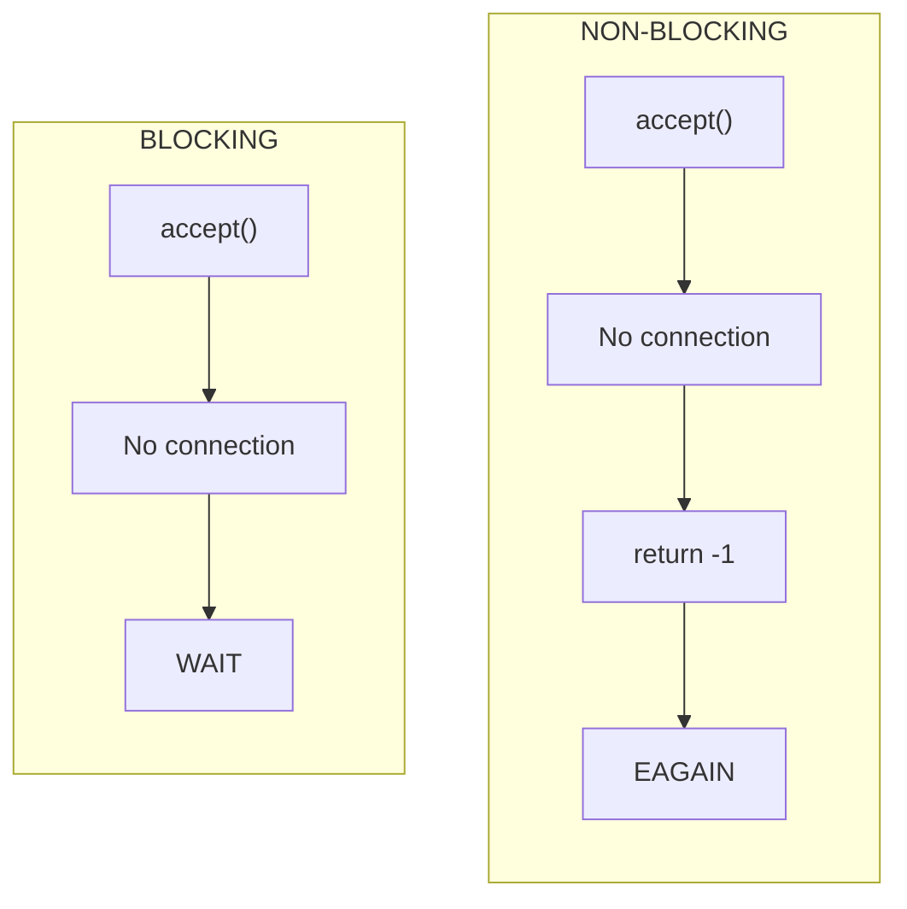
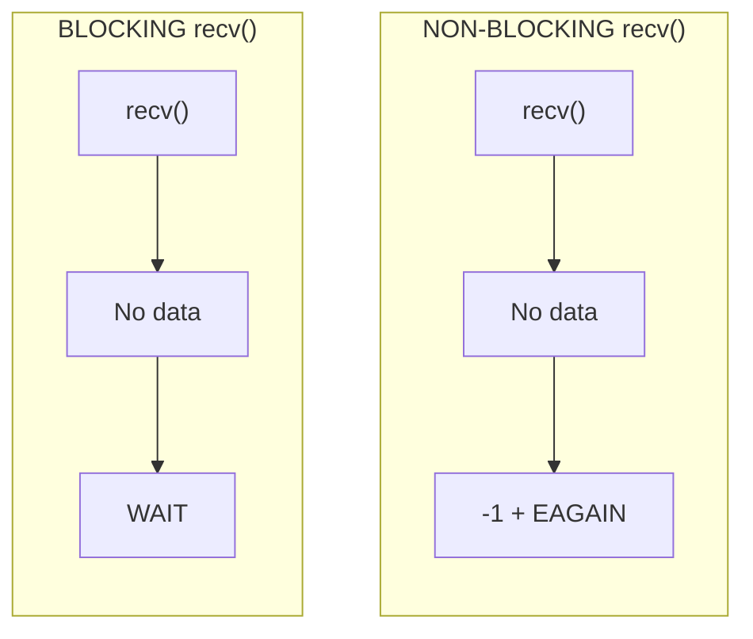
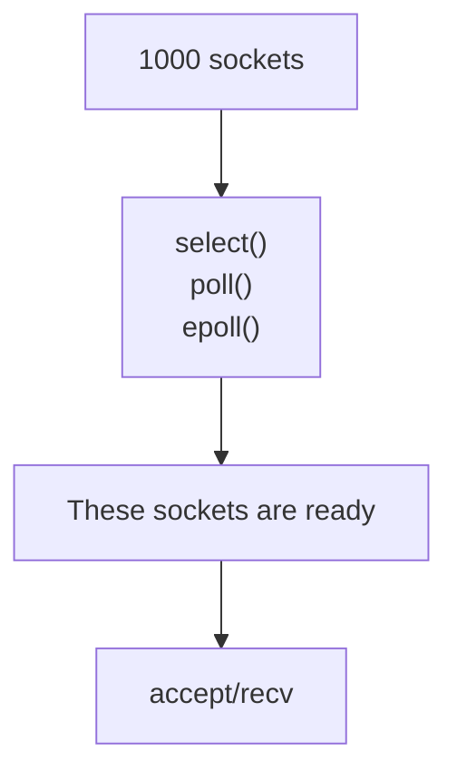

# Non-Blocking Sockets LABs.

### Blocking accept vs Non-Blocking accept



### Blocking recv vs Non-Blocking recv



### And that is exactly the reason why we subsequently needed (نحتاج بعد كدا) I/O multiplexing:



## Labs Notes

All labs are small TCP servers on port `12345`. Each lab is the previous one plus one small change.

### The story

1. **Blocking `accept()`:** the server waits until a client connects. Nothing else can run.
2. **Non-blocking `accept()`:** we add `O_NONBLOCK` to `server_fd`. Now `accept()` returns `-1` with `EAGAIN` when no client is waiting.
3. **Blocking `recv()`:** a client connects, but the server waits again, this time inside `recv()`, until the client sends something.
4. **Non-blocking `recv()`:** we add `O_NONBLOCK` to `client_fd` too. Now `recv()` returns `-1` with `EAGAIN` when there is no data yet.

> `O_NONBLOCK` on `server_fd` does not affect `client_fd`. The fd returned by `accept()` is a new socket, so it needs its own `fcntl()`.

### The files

| Folder | File | What it does |
|---|---|---|
| `blocking-socket/` | `main.cpp` | Normal blocking `accept()`. Waits for one client, then exits. |
| `non-blocking-accept/` | `main.cpp` | Makes `server_fd` non-blocking and calls `accept()` once. Prints `errno` to show `EAGAIN`. |
| `non-blocking-accept/` | `main2.cpp` | Same, but in a loop. On `EAGAIN` it prints `No client yet...`, sleeps 1s, and tries again. |
| `blocking-recv/` | `main.cpp` | Non-blocking `accept()` loop, then a normal blocking `recv()` on the client. It waits if the client sends nothing. |
| `non-blocking-recv/` | `main.cpp` | Makes `client_fd` non-blocking too, but calls `recv()` only once. If no data is ready, it fails with `EAGAIN`. |
| `non-blocking-recv/` | `main2.cpp` | Loops on `recv()`. On `EAGAIN` it prints `No data yet...`, sleeps 1s, and tries again. |

### How to read `recv()` results

* `n > 0`: got `n` bytes.
* `n == 0`: the client closed the connection.
* `n == -1` with `EAGAIN`/`EWOULDBLOCK`: no data yet, try again later.
* `n == -1` with another `errno`: real error.

### Test it

Run a lab in one terminal, and connect from another:
```bash
nc 127.0.0.1 12345
```
Type a message in `nc` to send data. Wait before typing to see `No data yet...` in the non-blocking `recv()` lab.

### Limitation

The labs use `sleep(1)` to poll. While we sleep or loop on one client, no other client is served, and this is why we need `select()`, `poll()`, and `epoll()`.


