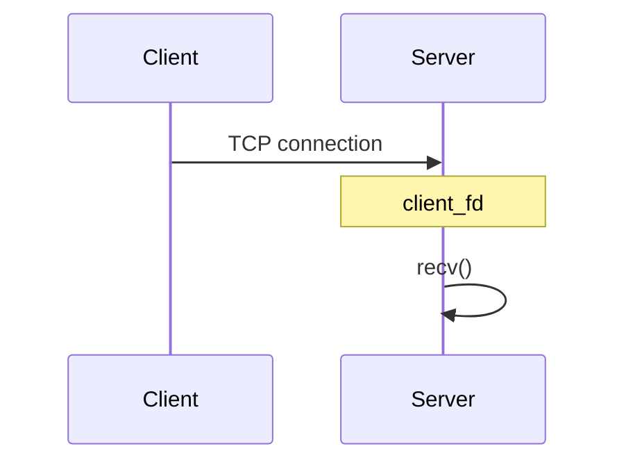
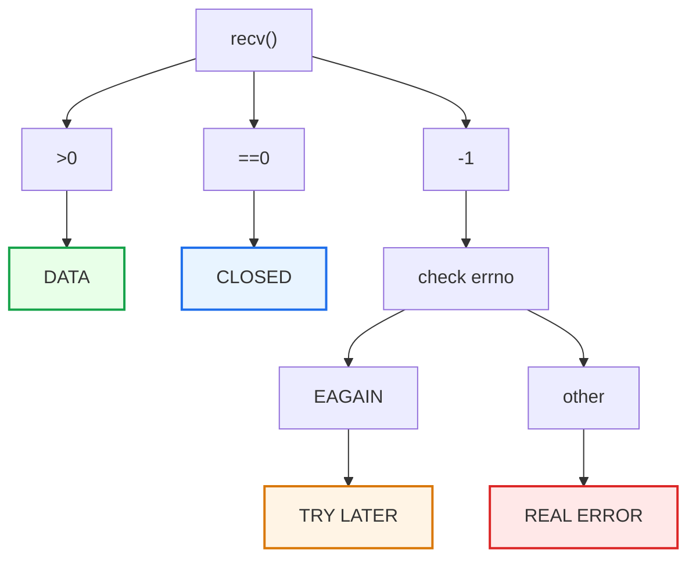
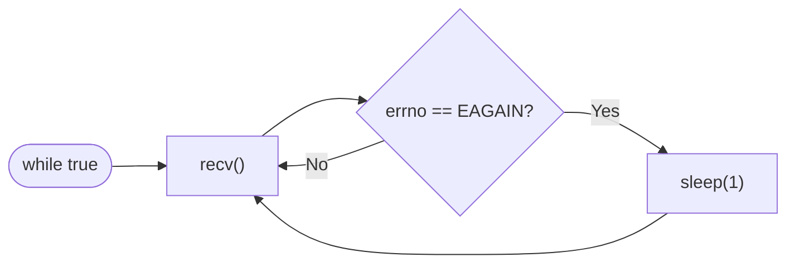

# `recv()` with non-blocking sockets

Alright. Now let’s move on to the most important scenario after `accept()`: understanding `recv()` with a non-blocking socket—specifically, the difference between:
* `recv() > 0`
* `recv() == 0`
* `recv() == -1` with `EAGAIN`

This is a point that needs to be thoroughly understood before we dive into `select()`.

---

### What is `recv()`?

Assume we have a client connected to the server:

>When server do:
>```c++
>char buffer[1024];
>
>ssize_t n = recv(
>    client_fd,
>    buffer,
>    sizeof(buffer),
>    0
>);
>```
>The server tells the kernel: "Hey, Get me the data currently in the socket's receive buffer."

> `recv()` returns:
> * `> 0`: the number of bytes received
> * `== 0`: the connection was closed - client closed the connection - client sent FIN.
> * `== -1`: an error occurred / not ready


> NOTE: when `recv()` returns `-1`, there are two possible reasons:
> * real error
> * non-blocking socket + no data available yet
>
> SO WE NEED TO CHECK `errno`.


If we have:
```c++
ssize_t n = recv(...);

if (n == -1 && (errno == EAGAIN || errno == EWOULDBLOCK))
{
    // no data right now
}
```
this means:
* There is no ready data at the moment.
* Try again later.

IT DOESN'T MEAN THAT THE CONNECTION IS CLOSED.

Check the code: [Non Blocking Socket Example](./main.cpp)


## Summary

### `recv()` with errno table
| `recv()` | `errno`              | Meaning                        |
| -------- | -------------------- | ------------------------------ |
| `> 0`    | —                    | Data received                  |
| `== 0`   | —                    | Peer closed the connection     |
| `== -1`  | `EAGAIN/EWOULDBLOCK` | No data available right now    |
| `== -1`  | other                | Real error                     |


### Mental Model
How to work with `recv()` return values with `errno`:


### The Code Problem

see the part:
```c++
while (true)
{
    recv(...);

    if (EAGAIN)
    {
        sleep(1);
    }
}
```
see did the following:


> This is called "busy polling" or a "polling approach"—in a rudimentary form.
>
> We keep asking the kernel:
> * Is there data?
>     * No.
> * A second later:
>     * Is there data?
>         * No.
> * A second later:
>     * Is there data?
>         * No.
> 
> **And that isn't efficient.**

IMPORTANT:
>The big question: We have a socket client_fd that may be CONNECTED yet have NO DATA — how do we know when data arrives instead of polling?
>
> إزاي نعرف امتى يبق في data بدل ما نفضل نسأل؟
>
> HERE I/O MULTIPLEXING IDEA COME INTO PLAY.

I/O Multiplexing tool: `select()`, `poll()`, `epoll()`, `kqueue()`, `epoll_create()`, `poll_create()`, `kqueue_create()`

The first tool that comes to mind: `select()`.

> `select()` does not read the data. it just tells you the file descriptor is ready for I/O operation.

