# `select` System Call

Alright. Now we’ve reached a very important part: `select()`.

We’ll explain it from scratch and link it directly to the non-blocking `accept()` and `recv()` calls we implemented earlier.

### `select()` — From Non-Blocking Sockets to I/O Multiplexing

Before we begin, let's establish our position in the learning path:
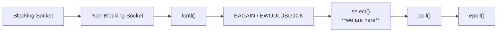

We understood that `O_NONBLOCK` makes `recv()` not wait if there is no data. And here there is a problem appear, and the question is: Okay, so how do I know when to call `recv()` in the first place?

> طيب أعرف إمتى أعمل `recv()` أصلًا؟

Here the story of `select()` comes in.

### What problem does `select()` solve?

let's assume we have a TCP server, and initially we have a listining socket then **client A** connected, **client B** connected, **client C** connected, and **client D** connected. So we have listening socket with `fd=3` for example and 4 clients connected with `fds 4, 5, 6, and 7`. see the story in the graph below:
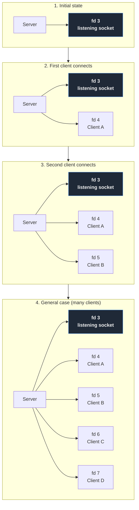

Each socket can have a different state (*"At any given moment, not all sockets need to be in the same state."*), for example:
* `fd 3` → listening socket -> new connection waiting
* `fd 4` → Client A -> no data
* `fd 5` → Client B -> data available
* `fd 6` → Client C -> no data
* `fd 7` → Client D -> connection closed

which means:
* `fd 3` → READY
* `fd 4` → NOT READY
* `fd 5` → READY
* `fd 6` → NOT READY
* `fd 7` → READY

> WE NEED TO UNDERSTAND WHAT READY MEANS.

#### What does "ready" mean?

A file descriptor is **ready** when the I/O operation you want to perform on it can be done **right now without blocking**.

> يعني الـ fd يبقى ready لما العملية اللي هتعملها عليه هترجع فورًا ومش هتستنى.

Ready does **not** mean "there is data". It means the kernel can answer your system call immediately, whether with a result, an error, or EOF.

This connects directly to what we learned before `select()`:

* **NOT READY** → a non-blocking `recv()` would have returned `EAGAIN` / `EWOULDBLOCK`
* **READY** → the call will not return `EAGAIN` (it either succeeds or fails with a real error)

#### Ready depends on what you want to do

`select()` takes three sets, and each one defines "ready" differently:

| Set | The fd is ready when... |
|---|---|
| `readfds` | `recv()` / `read()` won't block: data is in the receive buffer, **or** the peer closed the connection (EOF), **or** an error is pending |
| `readfds` (listening socket) | a completed connection is waiting in the accept queue, so `accept()` won't block |
| `writefds` | `send()` / `write()` won't block: there is free space in the send buffer |
| `writefds` (non-blocking connect) | the `connect()` has finished (succeeded or failed) |
| `exceptfds` | an exceptional condition occurred, in practice only TCP **out-of-band (urgent) data** |

#### Applying it to our example

```
fd 3 → listening socket, connection waiting  → READY      → accept() returns immediately
fd 4 → Client A, no data                     → NOT READY  → recv() would return EAGAIN
fd 5 → Client B, data available              → READY      → recv() returns the data
fd 6 → Client C, no data                     → NOT READY
fd 7 → Client D, connection closed           → READY      → recv() returns 0 (EOF)
```

#### Important notes

1. **`fd 7` is ready even though there is no data.** `recv()` returns `0` immediately, which means EOF. "Ready" means "won't block", not "has something useful". After that you must `close(fd)`.

2. **Ready doesn't mean success.** An fd can be ready because of an error (like `ECONNRESET`). `recv()` returns `-1` immediately, which is still non-blocking.

3. **`writefds` is ready most of the time**, because the send buffer is usually not full. If you add an fd to `writefds` when you have nothing to send, `select()` returns immediately every time and your loop becomes a busy loop. Only add it when you actually have pending data to send.

4. **Ready is a snapshot.** It tells you the state at the moment `select()` returned. There is no guarantee it stays that way, so with non-blocking sockets you still need to handle `EAGAIN`.

> **Summary:** `select()` answers one question: *"Which of these fds can I operate on right now without waiting?"*

> When We say a socket is readable, it doesn't necessarily mean: "There is data." ->  The more precise meaning is: "The read operation on the file descriptor can proceed without blocking."
>
> For example:
>
> ```
> recv(fd, buffer, sizeof(buffer), 0);
> ```
>
> If the socket is readable, `recv()` won't have to wait due to a lack of data to read.
>
> The outcome could be:
>
> * Case 1 — Data is available -> client sent e.g. "Hello"
>   * recv() → returns > 0
> 
> * Case 2 — The peer has closed the connection
>   * recv() → returns 0
> * Case 3 — The descriptor is ready to be read for another reason.
> 
> So, we can say that a socket is readable if:
> * data is available
> * EOF / connection closed


> **This is a very important point because `select()` doesn't tell you**: "There are 100 bytes."
>
>It tells you: "The `fd` is ready for a read operation."

#### 4. What if we have only one socket?

With a single socket, say `fd = 4`, things are simple: we just call `recv(4, ...)`. If the socket is blocking and no data has arrived, the call waits until data shows up. If it is non-blocking, the call returns immediately with `-1` and `errno` set to `EAGAIN`, and we can retry later. Either way, there is only one place to look, so waiting or retrying costs us nothing.

The problem starts when we have many sockets. Blocking on one of them can leave the others unattended, and polling all of them in a loop wastes CPU. We need a way to ask which sockets are ready, and that is exactly what `select()` provides.

> مع socket واحد الموضوع بسيط، لكن المشكلة بتبدأ لما يبقى عندنا عدد كبير من الـ sockets.


### When I have multiple sockets - Polling

Imagine if we have four clients with `fds 4,5,6,7`, and we want to read data from any client send data. the first idea is to do the following:
```c++
while (true)
{
    recv(fd4, ...);
    recv(fd5, ...);
    recv(fd6, ...);
    recv(fd7, ...);
}
```
Now we have a problem, if we used blocking socket:
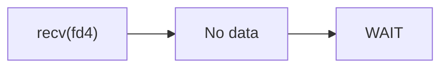
The program will stop, even if `fd6` has ready data. THE SERVER WILL NOT BE ABLE TO REACH `fd6`. 

The second solution to use is **Non-Blocking** by adding `O_NONBLOCK` flag to the `fds` and do:
```c++
while (true)
{
    recv(fd4, ...);
    recv(fd5, ...);
    recv(fd6, ...);
    recv(fd7, ...);
}
```
If there is no data:
```text
fd4 → EAGAIN
fd5 → EAGAIN
fd6 → DATA
fd7 → EAGAIN
```
This prevents the server from stopping. BUT THERE IS A PROBLEM HERE **"POLLING"**.

With non-blocking sockets, the server loops over all its file descriptors and calls `recv()` on each one. **Most of the time the answer is `EAGAIN`**: `fd4` has nothing, `fd5` has nothing, `fd6` has data (we handle it), `fd7` has nothing. Then the loop starts over, and on the next pass it may be `EAGAIN` for every single fd. This repeats forever.

In effect, we are asking the kernel the same question again and again: 
* *"Does fd4 have data? No.
* Does fd5 have data? No.
* Does fd6 have data? Yes.
* Does fd7 have data? No."*

This is called **polling**: we are the ones checking every descriptor, over and over, instead of being told when one is ready.

The cost is high. Each `recv()` is a system call, so most of the CPU time goes to system calls that return nothing useful, and the cost grows with the number of sockets. We need a way for the kernel to tell us which fds are ready, so we can sleep until then, and that is what `select()` does.

> إحنا بنسأل الـ kernel كل شوية "فيه data؟" على كل fd، وأغلب الإجابات "لا". ده اسمه polling، وبيستهلك CPU من غير فايدة.

Imagine if we have 10 sockets, the polling can be acceptedable, but if we have 1000 or 10000 sockets and most of them have no data, the cost of polling is high -> the server will perform a massive number of checks and will perform the checks over and over again:
```text
fd 1 → EAGAIN
fd 2 → EAGAIN
fd 3 → EAGAIN
fd 4 → EAGAIN
...
...
fd 9999 → EAGAIN
```

We are consuming CPU cycles asking: "Has anything happened?". Even though, most of the time: "No."

> WE NEED TO TELL THE KERNEL: "Hey, watch all the follwing sockets and when one of them is ready, wake me up." - That is what `select()` does.


### `select()` — Avoid Polling

`select()` is a mechanism for waiting on and monitoring the readiness)(استعداد) of a set of file descriptors.

Linux defines `select()` as an interface that allows waiting for one or more file descriptors to become ready for a specific I/O operation.

> Instead of making the application check all fds we tell the kernel to watch the fds and when one of them is ready, wake us up.

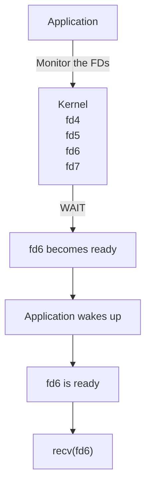

> IMPORTANT: `select()` does not recieve data -> `select()` did not read any data from the socket, it just told "fd6 is ready". and after that you will read `recv(fd6, buffer, sizeof(buffer), 0);` 
>```mermaid
>flowchart LR
>    A["select()"] -->|tells us| B["FD is ready"]
>    B --> C["recv()"]
>    C -->|actually reads| D["Data"]
>```
>
> The kernel will wake the process up when any of the became ready. then the process will continue.


## Using `select()`

### How to tell `select()` the FDs we want to watch

Here the `fd_set` comes, you can currently think of it as a set/group of file descriptors I care about (e.g. `4`, `5`, `6`, `7`).


If we have
```c++
fd_set readfds;
FD_ZERO(&readfds); // the set is empty = {}

int server_fd = 3;
int client_a = 4;
int client_b = 5;
int client_c = 6;

// FD_SET() is a macro that adds a fd to the set we want to watch
FD_SET(server_fd, &readfds);
FD_SET(client_a, &readfds);
FD_SET(client_b, &readfds);
FD_SET(client_c, &readfds); // the set is now {3, 4, 5, 6}
```

The four main APIs:
* `FD_ZERO(&readfds)` - clear the set
* `FD_SET(fd, &readfds)` - add a fd to the set
* `select(...)` - wait for one or more fds in the set to become ready
* `FD_ISSET(fd, &readfds);` - check if a fd in the set is ready

The full picture now is:
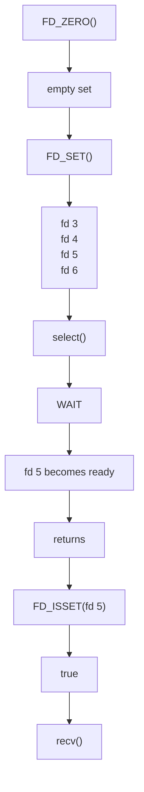

## `select()` System Call

### Prtotype:
```c++
int select(
    int nfds,
    fd_set* readfds,
    fd_set* writefds,
    fd_set* exceptfds,
    struct timeval* timeout
);
```

Parameters:
* `nfds` - The maximum number of file descriptors to check -> if we have `fds 3,5,8` so `nfds = 9` -> equation is `nfds = max_fd + 1` -> The reason is that `select()` checks the descriptors from `0` up to `nfds - 1`.
* `readfds` - The set of file descriptors to check for readability. when we write the following:

```c++
select(
    max_fd + 1,
    &readfds,
    nullptr,
    nullptr,
    nullptr
);
```
We say: "Monitor the descriptors in `readfds` and tell me which of them have become readable."
* `writefds` - Here, we also ask: "Which sockets have become writable?" -> For example, the TCP send buffer has available space, allowing the `send()` operation to proceed without blocking.
* `exceptfds` - This relates to **exceptional conditions** and is less commonly used in the design of modern TCP servers.
* `timeout` - How long does `select()` wait?
    * if it is `nullptr`, this means wait without a time limit until an event occurs. And this is very suitable for a first, simple server.

### What readable means in TCP?

Regarding a connected TCP socket, it could be:
* There is data to read -> OR we can say -> received data
    * so, kernel recieved a buffer -> `recv()` now able to read data
* The peer has closed the connection -> readable means -> A result of the read operation is available without the need to wait for new data.
    * so, `recv()` now return 0

### What happen inside `select()`?

Let's build a mental model of the kernel. our proccess say "Hey, I am interested in `fds 3,4,5,6`" then make `select(...)`:
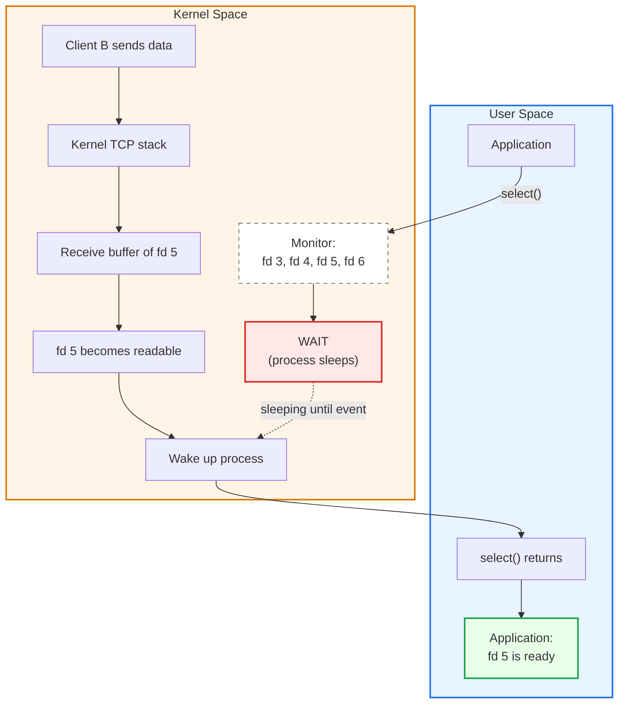

What is the return value of `select()`:
```c++
int result = select(...);
```
* `result == -1`: error occurred
* `result == 0`: The timeout expired, and no descriptor became ready.
* `result > 0`: At least one of the descriptors became ready.
    *  if `fd5` and `fd6` are ready, then the resulut may be `result == 2`

> After using `select()`, and I want to know which descriptors are ready, I can use `FD_ISSET()`, example of using `FD_ISSET()`:
> ```c++
>if (FD_ISSET(fd5, &readfds)) {
>    // fd5 is ready
>   std::cout << "fd5 is ready" << std::endl;
>}
>```
> and:
> ```c++
>if (FD_ISSET(fd5, &readfds)) {
>    // fd5 is ready
>   std::cout << "fd5 is ready" << std::endl;
>}
>```
>The proccess will become:
> ```mermaid
> flowchart LR
>     A["select()"] --> B["2 descriptors ready"]
>     B --> C["fd 4"]
>     B --> D["fd 6"]
>     C --> E["FD_ISSET()"]
>     D --> E
>     E --> F["true"]
> ```

### Important: `select()` modifies the `fd_set`

This is one of the most important details about `select()`. The `fd_set` you pass in is both an **input** and an **output**. Before the call, it holds the descriptors you want to monitor. After the call, `select()` overwrites it in place so that it contains only the descriptors that are ready.

For example, suppose we monitor four descriptors. Before `select()` -> `readfds = { 3, 4, 5, 6 }`

Assume `fd 4` and `fd 6` turn out to be ready. After `select()` -> `readfds = { 4, 6 }`

> This means the set you passed to `select()` has been modified to contain the descriptors that have become ready.


The Linux man page documents this behavior: on return, each of the descriptor sets is modified in place to indicate which descriptors are ready. Descriptors 3 and 5 are not "lost" by the kernel; they were simply removed from *your copy* of the set because they were not ready.

This is why we **rebuild the set on every iteration** of the loop:

```c
while (true)
{
    FD_ZERO(&readfds);
    FD_SET(server_fd, &readfds);
    FD_SET(client_fd, &readfds);

    select(...);
}
```

and not like this:

```c
FD_ZERO(&readfds);
FD_SET(server_fd, &readfds);
FD_SET(client_fd, &readfds);

while (true)
{
    select(...);   // wrong: readfds is no longer the full list
}
```

In the second version, after the first `select()` the set no longer represents *all the sockets we want to monitor*. It represents only *the sockets that were ready in the previous iteration*. Any socket that wasn't ready would silently drop out of the set and never be monitored again. Rebuilding the set each time guarantees that `select()` always starts from the full list.

> ال `select()` بتعدّل الـ `fd_set` اللي بتبعتهالها وبتسيب فيه بس الـ fds الجاهزة. عشان كده لازم نبني الـ set من الأول في كل iteration (أو نحتفظ بنسخة أصلية ونعمل copy منها قبل كل استدعاء)


### See example of using select with `stdin` here: [**first select lab**](./main.cpp)

This lab we will be the fisrt one to use `select()` and then return back to TCP server.

Compile the lab:
```bash
g++ main.cpp -o main
```

### Connecting everything to the TCP server.

We have arrived at the following form:
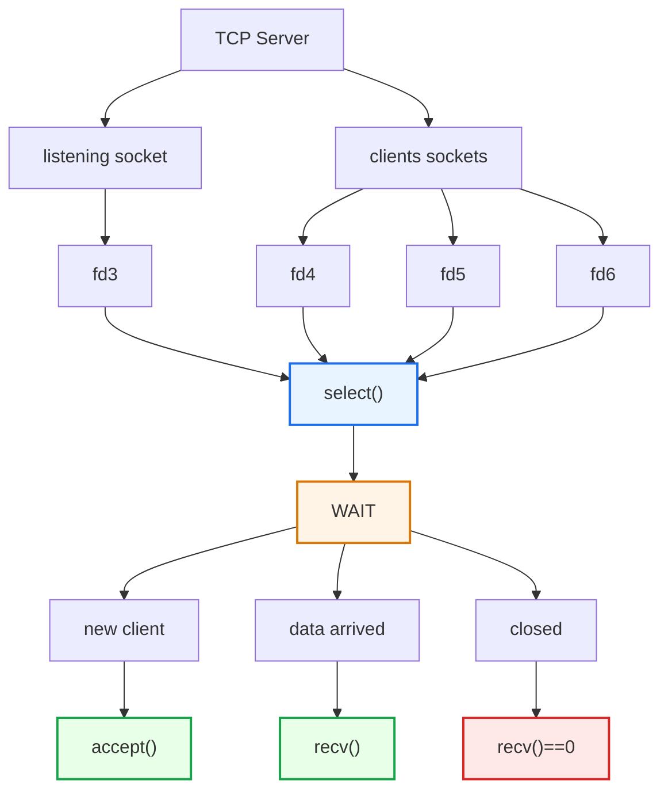
This is where `select()` solves the original problem (Polling).

#### The `server_fd` case - `select()`

When we add `server_fd` to `readfds` with `FD_SET(server_fd, &readfds)`, wait in `select()`, and then find that `FD_ISSET(server_fd, &readfds)` is true, it means that for a listening socket there is a pending connection in the accept queue, so calling `accept()` will return immediately instead of waiting for a client. We then accept it with `int client_fd = accept(server_fd, nullptr, nullptr);`, which gives us a new socket for that client, and we add it to the set of descriptors we monitor.

> لو `server_fd` طلع ready بعد `select()`، يعني فيه connection مستني، فنعمل `accept()` من غير ما نتعطل، ونضيف الـ `client_fd` الجديد للـ fds اللي بنراقبها.

#### The `client_fd` case - `select()`

### The `client_fd` case

If `FD_ISSET(client_fd, &readfds)` is true, it means a read on that socket is ready, so calling `recv(client_fd, ...)` will return immediately instead of blocking. The result tells us what actually happened: if `recv()` returns a value greater than `0`, that many bytes of data arrived and we can process them; if it returns `0`, the client closed the connection (EOF), so we call `close(client_fd)` and remove it from the set of monitored descriptors. A return value of `-1` is also possible when an error is pending, such as `ECONNRESET`, and we handle it by closing the socket as well.

> لو `client_fd` طلع ready بعد `select()`، يبقى `recv()` مش هتعمل block. لو رجعت قيمة أكبر من 0 فيه data نعالجها، ولو رجعت 0 فالـ client قفل الاتصال فنقفل الـ socket ونشيله من القايمة.

### The server loop is becoming clear.

Consequently, the logical structure becomes:
```c++
while (true)
{
    // 1. Build the set
    FD_ZERO(&readfds);

    // 2. Monitor listening socket
    FD_SET(server_fd, &readfds);

    // 3. Monitor clients
    for (...)
    {
        FD_SET(client_fd, &readfds);
    }

    // 4. Wait
    select(...);

    // 5. Check listening socket
    if (FD_ISSET(server_fd, &readfds))
    {
        accept(...);
    }

    // 6. Check clients
    for (...)
    {
        if (FD_ISSET(client_fd, &readfds))
        {
            recv(...);
        }
    }
}
```

And this is the first real shape of **Event-Driven I/O**.

## Summary

### The core difference between the solutions

We started with Blocking:
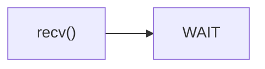

Then Non-Blocking + Polling:
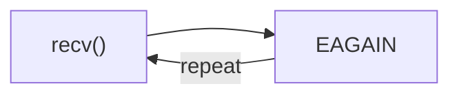

The useing `select()`:
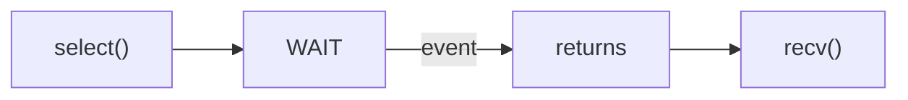

>This is a very important leap in understanding network programming.
>
> ودي قفزة مهمة جدًا في فهم ال network programming.


### Mental Model

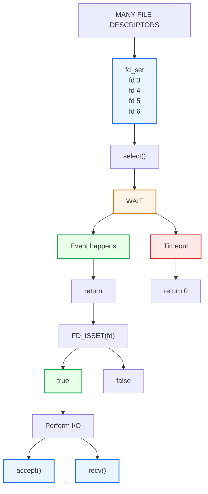

If you want to summarize the entire lesson in a single sentence:

`select()` allows a process to wait on a set of file descriptors, rather than waiting on a single socket or constantly checking every socket.

Once one or more of them become ready, `select()` returns, and you use `FD_ISSET()` to determine which descriptors are ready.
