# `poll()` System Call

We’ll follow our usual approach: first understand the problem, then the API, then write a small example, and finally switch our server from `select()` to `poll()`.

> Keep in mind while checking the labs that `poll()` and `select()` are blocking functions until event occurs:
> * If the event is new connection established, they will return and accept the new connection.
>   * with poll(), the condition `fds[0].revents & POLLIN` will be true -> then the logic of calling `accept()` and getting new FDs(Client FDs) will be executed.
>   * with select(), the condition `FD_ISSET(server_fd, &readfds)` will be true -> then the logic of calling `accept()` and getting new FDs(Client FDs) will be executed.
> * If the event is that a client FD has data to read, they will return and the data will be read from that client.
>   * with poll(), the condition `fds[i].revents & POLLIN` will be true for that client's entry (i > 0) -> then the logic of calling `recv()` on that client FD will be executed.
>   * with select(), the condition `FD_ISSET(client_fd, &readfds)` will be true -> then the logic of calling `recv()` on that client FD will be executed.
>   * If `recv()` returns 0, the client has disconnected, so close its FD and remove it from the watched set.

### why we need `poll()`?

With select(), we have an idea like:
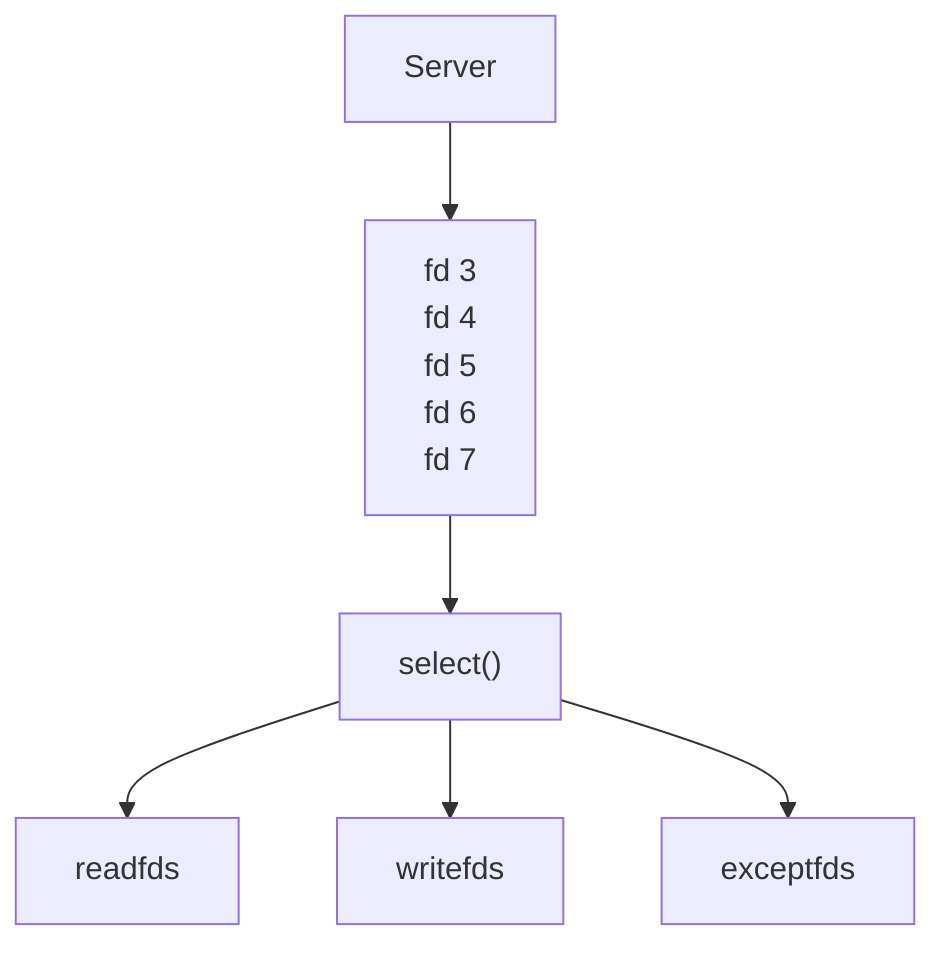

And each time, before calling `select()`, we needed to prepare the `fd_set`.
```c++
FD_ZERO(&readfds);

FD_SET(server_fd, &readfds);
FD_SET(client_fd1, &readfds);
FD_SET(client_fd2, &readfds);

select(max_fd + 1, &readfds, nullptr, nullptr, nullptr);
```

And here `poll()` comes with more simple idea:
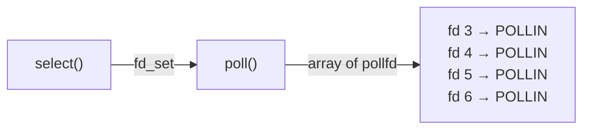

Instead of having a separate `fd_set` for each event type, we use an array of:
```c++
struct pollfd
{
    int   fd;
    short events;
    short revents;
};
```
And this is the most important thing to focus on at the beginning.

### understanding `pollfd` struct

```c++
struct pollfd pfd;
pfd.fd = server_fd;
pfd.events = POLLIN;
pfd.revents = 0;
```
The parameters means:
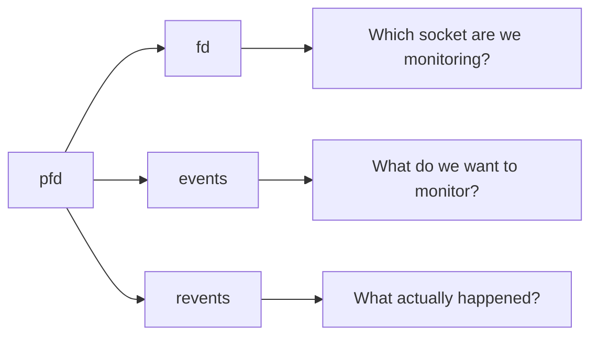

>The difference between "events" and "revents" is very important:
>
> pollfd:
> * events ----------> I want to know about READ
> * revents <---------- READ is ready
> 
> which means when doing `pfd.events = POLLIN;`, we tell the kernel "I am intersted to know if that `fd` becomes readable".
>
> After `poll()`, we ask the kernel "Has the file descriptor actually become ready for reading?":
> ```c++
> if (pfd.revents & POLLIN)
> {
>     // fd is ready for reading
> }
> ```


### `poll()` API

Prototype:
```c++
#include <poll.h>

int poll(
    struct pollfd *fds,
    nfds_t nfds,
    int timeout
);
```
Parameters:
* `fds` - array of pollfd
* `nfds` - number of pollfd -> the size of the array -> number of elements in the array
* `timeout` - timeout in milliseconds -> how long to wait for a file descriptor to become ready

example:
```c++
struct pollfd fds[1];

fds[0].fd = server_fd;
fds[0].events = POLLIN;

int ret = poll(fds, 1, -1); // timeout = -1 (infinite) - wait until event occurs
```

If the `ret > 0` -> This means that one or more of the descriptors has an event. then check:
```c++
if (fds[0].revents & POLLIN)
{
    // ready
}
```

## TCP server with `poll()` and `select()`

Here we will demonstrate that `select()` and `poll()` solve essentially the same problem, but with different interfaces.

We will build the same TCP server twice:
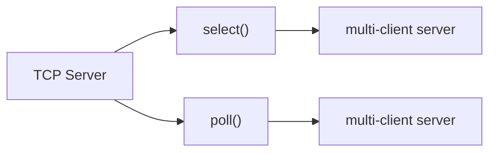
The server will do the following:
* Listen on port `12345`
* Accept multiple clients
* Use **non-blocking sockets**
* Monitor the listening socket and client sockets
* Receive messages
* Print them
* Echo them back to the client
* Remove the client if the connection is closed

### TCP server with `select()`

#### THE CODE: [TCP server with `select()`](./select-tcp-server/main.cpp)

#### Architecture

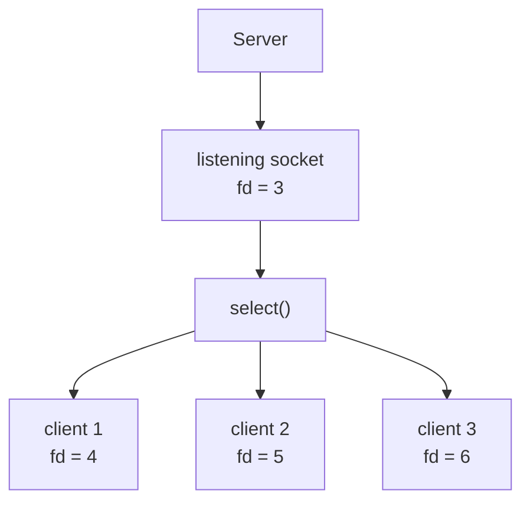

Each time select() returns, we ask:
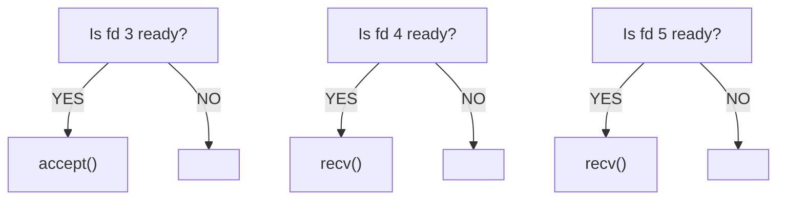

If we have:
```text
server_fd = 3

client 1 = 4
client 2 = 5
client 3 = 6
```

> **IN THIS EXAMPLE, there are esatblished 3 connections. this means a 3 FDs are connected to our server and the server accepted them so I know the FDs of them `4, 5, and 6`.**

before `select()` we clear FDs `FD_ZERO(&readfds);`, then set FDs `FD_ZERO(...);`, the `readfds`:
```text
fd3 → listening socket 

fd4 → client
fd5 → client
fd6 → client
```
then call `select(max_fd + 1, &readfds, nullptr, nullptr, nullptr);`. for example client 2 sent data, so:

* before `select()`:
```text
fd3 → NO pending connection
fd4 → NO data
fd5 → YES -> data arrived
fd6 → NO data
```

* After `select()`:
```text
FD_ISSET(3) → false
FD_ISSET(4) → false
FD_ISSET(5) → true -> only this one stays in readfds
FD_ISSET(6) → false
```

* So, we call `recv()` on `fd5`: `recv(5, ...);`


### TCP server with `poll()`

#### THE CODE: [TCP server with `poll()`](./poll-tcp-server/main.cpp)

#### Architecture

Here, the architecture changes slightly:
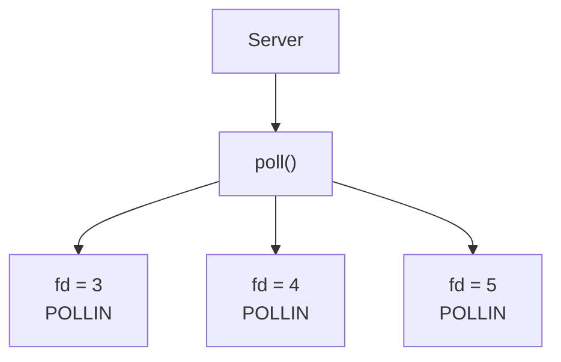
Instead of:
```c++
fd_set readfds;
FD_SET(...);
FD_ISSET(...);
```
We use:
```c++
pollfd fds[MAX_CLIENTS + 1];
```
Defining the array (We place the **listening socket** at index `0`:):
```c++
pollfd fds[MAX_CLIENTS + 1]{};

fds[0].fd = server_fd;
fds[0].events = POLLIN;
```

And the clients:

| Index | FD |  role  |
| ----- | -- |  ----  |
|   0   |  3 | Server |
|   1   |  4 | Client |
|   2   |  5 | Client |
|   3   |  6 | Client |


### The most important difference/comparison between the TCP servers

#### `select()`

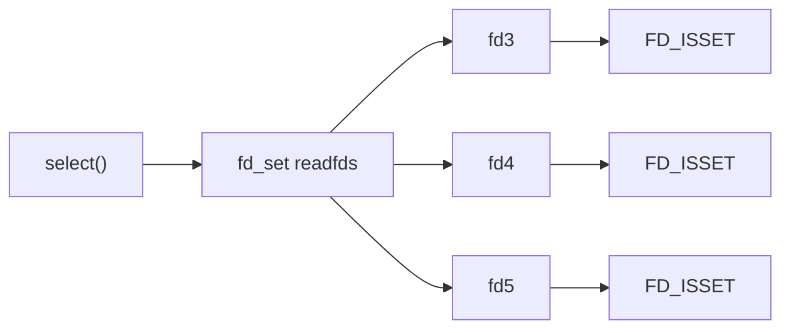

#### `poll()`

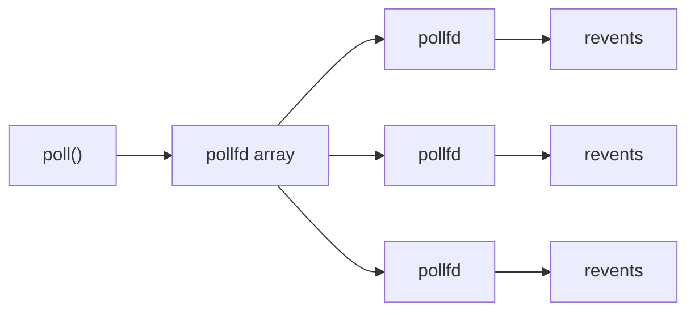

#### the rest of architecture is the same

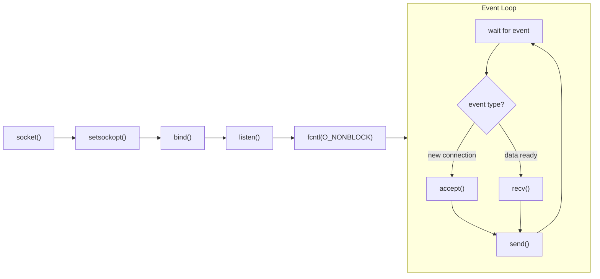

#### What changed is:

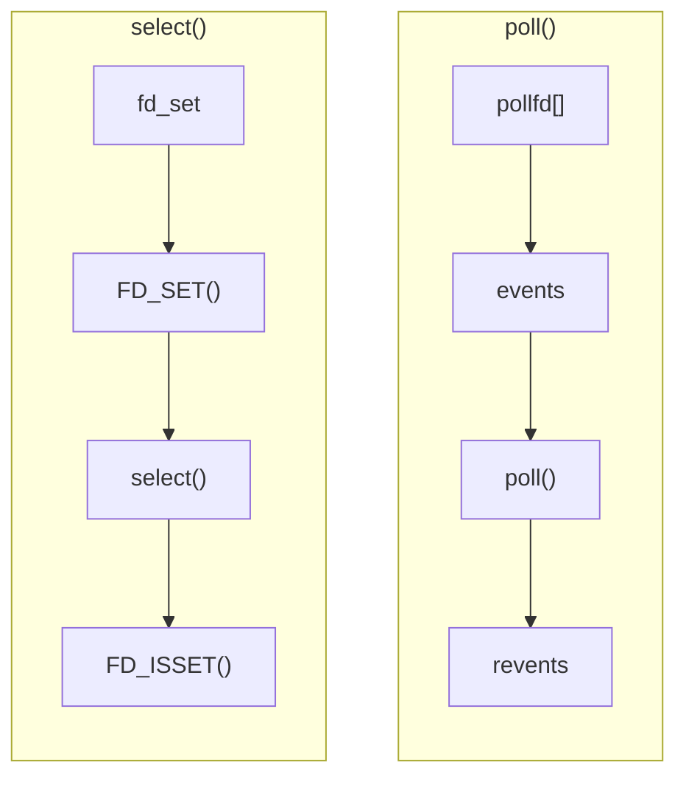

#### Important Note

> In the two examples, we used `send()` directly for the sake of simplicity. In a production-grade non-blocking server, one cannot assume that `send()` transmits all bytes in a single call; we will address this later when discussing partial writes and `POLLOUT`. This is a crucial point to understand before moving on to `epoll`.
