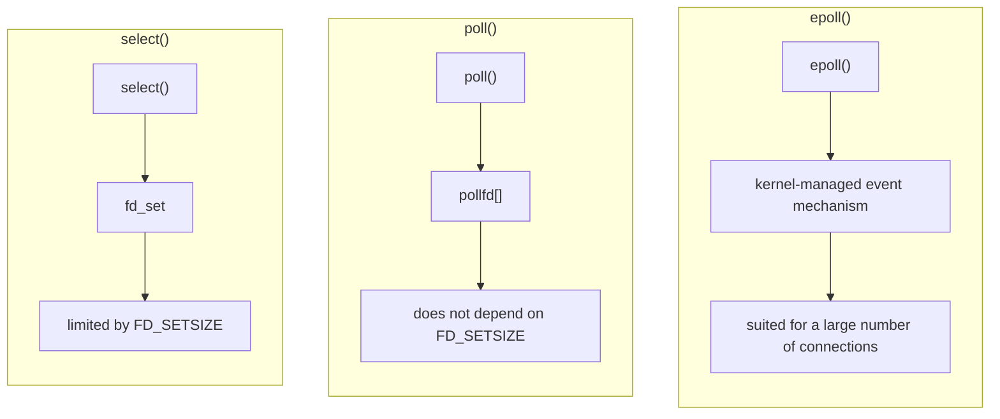
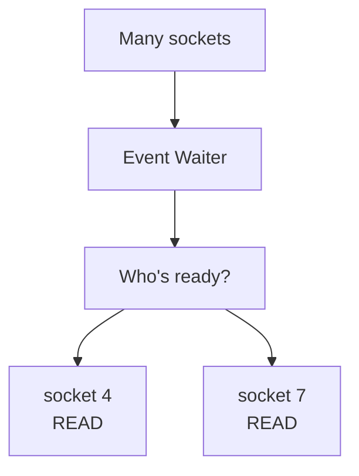
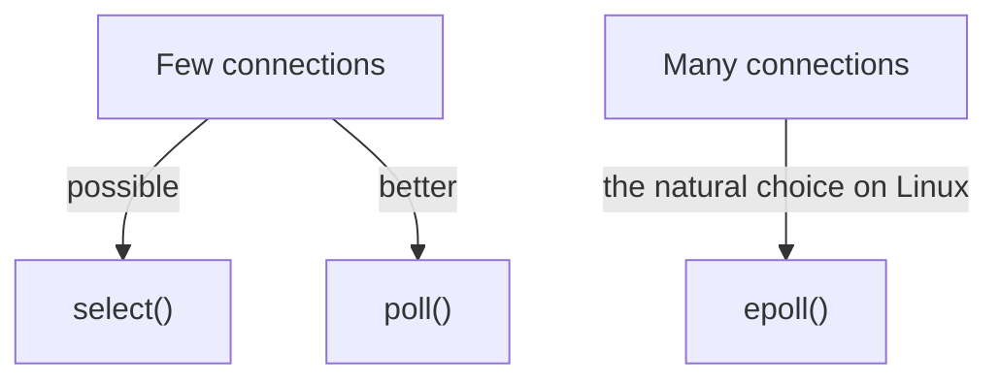
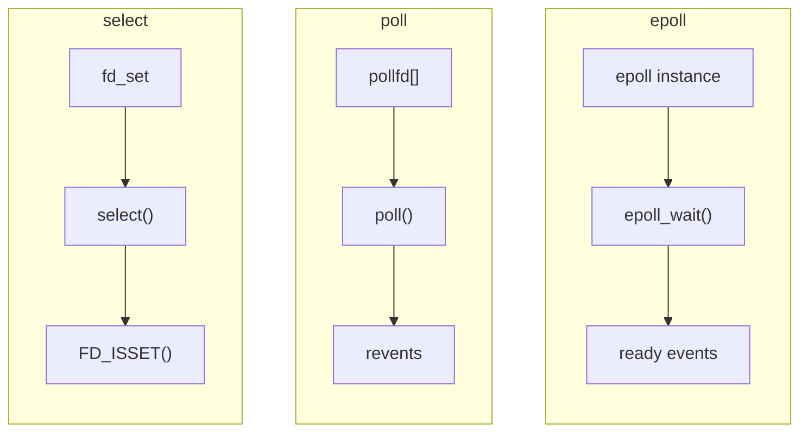

# select() vs poll() (and epoll)

When we're talking about a **modern Linux TCP server**, **`poll()` is better than `select()`**, but not because `poll()` is magically faster. The main differences are in the API and its limitations.

## Quick comparison

|                                | `select()`   | `poll()`                              |
| ------------------------------ | ------------ | ------------------------------------- |
| API                            | Older        | Newer than `select`                   |
| How fds are represented        | `fd_set`     | `pollfd[]`                            |
| `FD_SETSIZE` limit             | **Yes**      | No such limit in `poll()` itself      |
| Checking events                | `FD_ISSET()` | `revents`                             |
| Adding/removing an fd          | Less flexible | Easier                               |
| Code readability               | Average      | Better                                |
| Good for learning              | ⭐⭐⭐⭐⭐        | ⭐⭐⭐⭐⭐                                 |
| Good for a large Linux server  | ❌            | ⚠️ Limited compared to `epoll`        |

The core idea:

## So why did we study `select()` first?

Because `select()` is excellent for understanding **I/O multiplexing**.

You have:

This is the mental model we'll need later with:

## In a real project, which one do I pick?

If you're on Linux:

For the **C++ / Linux / System Programming** path we're following, I don't recommend skipping `poll()` and jumping straight to `epoll()`.

I want you to see the difference yourself:

## Summary

`select()` is the best entry point for learning, `poll()` is a better API than `select()`, and **`epoll()` is the most important one when talking about Linux servers with a large number of connections**.
