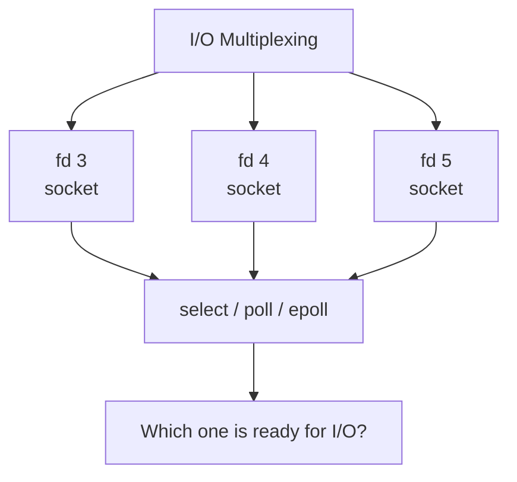
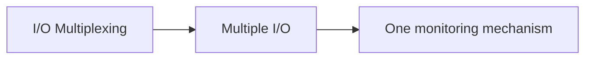

# Small Review

## What is I/O Multiplexing?

In a nutshell:

**I/O Multiplexing** means managing and monitoring multiple I/O sources using a single mechanism.

In networking:

### What does the word "multiplexing" itself mean?

Multiplex = multiple + ... meaning to combine/manage several channels or sources over a shared resource or path.

In our case:

Instead of creating a thread or a blocking call for each socket, you use a single mechanism to monitor multiple sockets.

Therefore:

This is exactly why `select()`, `poll()`, and `epoll()` are called I/O multiplexing mechanisms.
