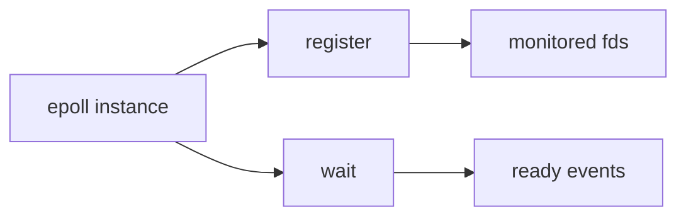
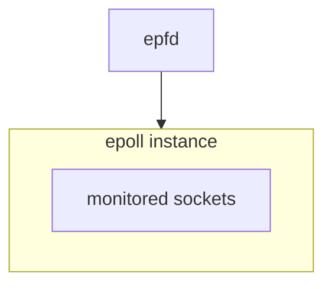
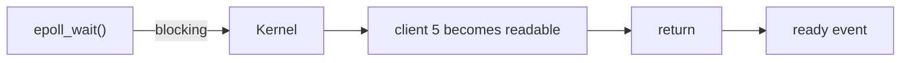
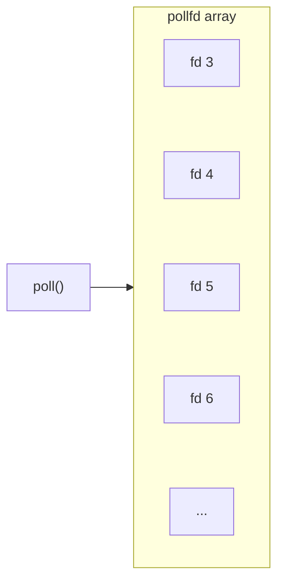
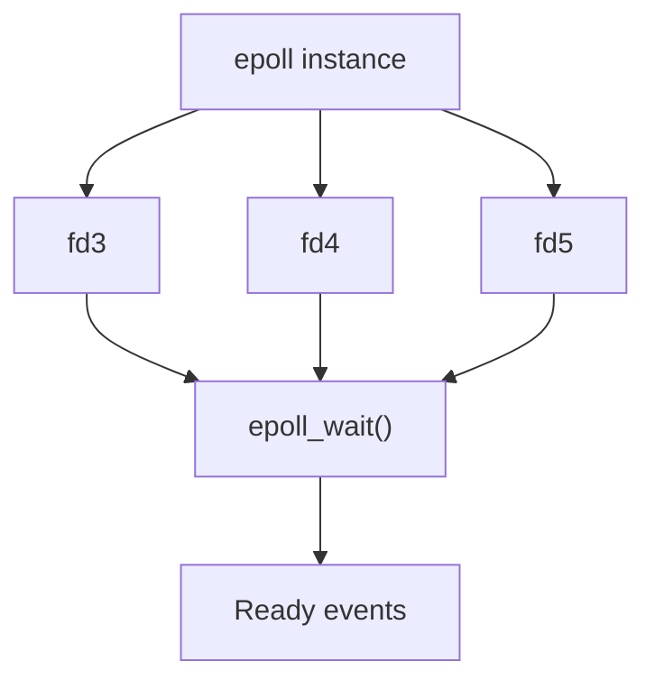
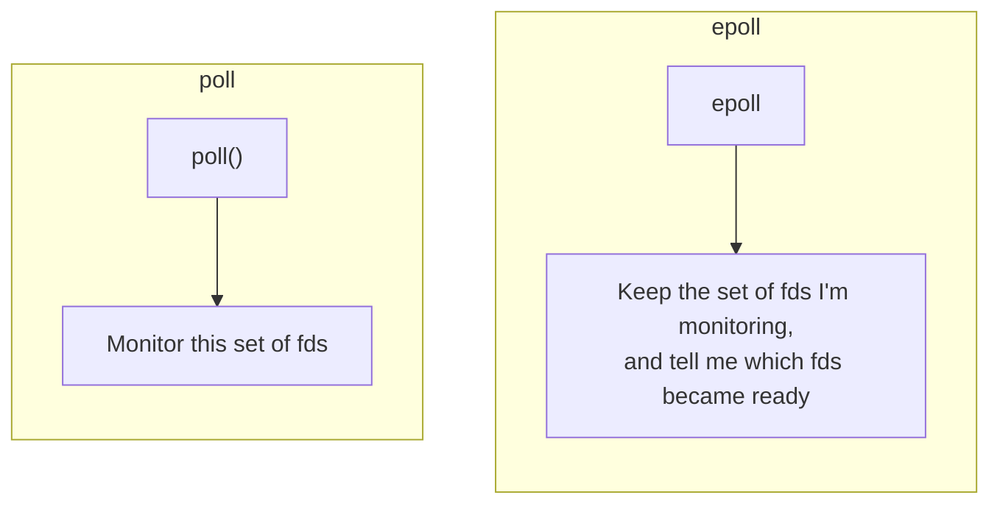

# `epoll()` System Call

This is important because `epoll` is the primary mechanism you will encounter on Linux when building **high-concurrency servers**; it is also essential for understanding what happens under the hood of certain **asynchronous networking frameworks**.


### Why do we need `epoll`?

First question: why do we need `epoll`?

Imagine we have:

```text
10,000 connections

fd 4
fd 5
fd 6
...
fd 10003
```

With `poll()`, on every iteration you pass in a large array:

> مع `poll()` عند كل iteration أنت تمرر `array` كبيرة

* `poll()`:
    * fd 4
    * fd 5
    * fd 6
    * ...
    * fd 10003

Then you have to scan the results to find out which sockets became ready.

`epoll` gives us a different model:



Instead of thinking:
> "Every time, check all the fds."

We want to tell the kernel:
> "I'm interested in these sockets. When one of them becomes ready, give me the ready events."


### The 3 Core APIs

We'll start by focusing on just three functions.

#### 1. `epoll_create1()`

Creates an epoll instance:

```cpp
int epfd = epoll_create1(0);
```

Think of it like this:



#### 2. `epoll_ctl()`

You tell the kernel: "I want to monitor this fd."

For example:

```cpp
epoll_ctl(
    epfd,
    EPOLL_CTL_ADD,
    server_fd,
    &event
);
```

The operations are:

```c++
EPOLL_CTL_ADD
EPOLL_CTL_MOD
EPOLL_CTL_DEL
```

Which means:
* ADD → add an fd
* MOD → change the events being monitored for it
* DEL → remove an fd

#### 3. `epoll_wait()`

This is the most important one:

```cpp
int n = epoll_wait(
    epfd,
    events,
    MAX_EVENTS,
    -1
);
```

It means:
> Wait until some file descriptors become ready.

For example:



### The New Mental Model

With `poll()`:



With `epoll`:



And this is the very important conceptual difference:



### Check the LAB1: [LAB1 Directory](./epoll-lab1/)

