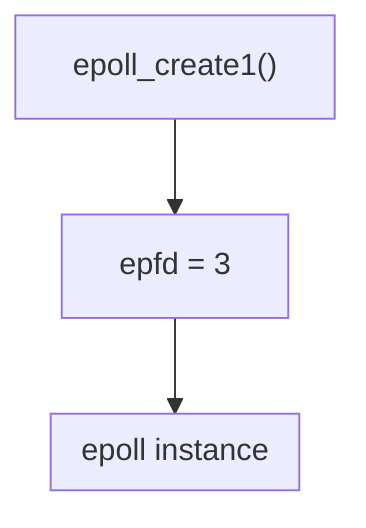

# `epoll()` first LAB

We won't write a TCP server just yet. I want you to look at `epoll` on its own first.

### See the code here: [**first epoll lab code**](./main.cpp)

Here:

Note that `epfd` is itself a file descriptor. This is crucial because, from the start, we established the following mental model:
> In Linux, a socket is a file descriptor representing an object within the kernel.
> 
> The `epoll` instance itself also has a file descriptor.

## Next Step

Now we'll do the most important experiment:

```text
stdin
  │
  ▼
epoll_ctl(ADD)
  │
  ▼
epoll_wait()
  │
  ▼
Type something in the terminal
  │
  ▼
EPOLLIN
```

Right after that, we'll use a TCP socket instead of stdin, and build:

```text
epoll TCP Server
      │
      ├── accept()
      ├── multiple clients
      ├── EPOLLIN
      └── recv()
```

And after that, we'll understand one of the two most important topics in `epoll`:
Level-Triggered vs Edge-Triggered.

