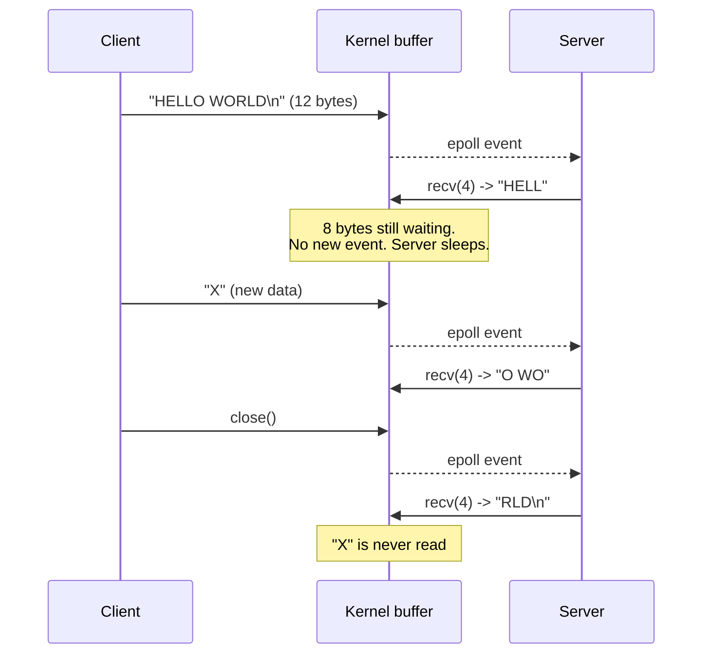

# EPOLLET Lab: `recv()` once vs `recv()` in a loop

A very small experiment with **one client** to see the main rule of edge-triggered epoll:

> With `EPOLLET`, you must read until `EAGAIN`.

## Files

| File | Binary | What it does |
|---|---|---|
| [main.cpp](./main.cpp) | `epoll-lab4-et-once` | `EPOLLET`, calls `recv()` **once** per event. |
| [main2.cpp](./main2.cpp) | `epoll-lab4-et-loop` | `EPOLLET`, calls `recv()` in a **`while`** loop until `EAGAIN`. |

Both servers are the same except for the read part:

* Port `12345`.
* The listening socket is level-triggered (`EPOLLIN`).
* The client socket is non-blocking and edge-triggered (`EPOLLIN | EPOLLET`).
* The buffer is only **4 bytes**, so a short message does not fit in one `recv()`.
* Every `epoll_wait()` wakeup is printed, so we can count them.

## Level-triggered vs edge-triggered

| Mode | epoll tells you... |
|---|---|
| Level-triggered (default) | "There is **still** data to read", on every `epoll_wait()` until you read it all. |
| Edge-triggered (`EPOLLET`) | "**New** data arrived", only once, when the state changes. |

So with `EPOLLET`, if you leave data in the socket buffer, epoll will **not** remind you.

## Build

From `0x07-IO_multiplexing`:

```bash
cmake -S . -B build
cmake --build build
```

## Run

Terminal 1, start one server:

```bash
./build/epoll-lab4-et/epoll-lab4-et-once
# or
./build/epoll-lab4-et/epoll-lab4-et-loop
```

Terminal 2, connect with `nc`:

```bash
nc 127.0.0.1 12345
```

Then:

1. Type `HELLO WORLD` and press Enter (12 bytes with the newline).
2. Wait one second.
3. Type `X` (one more byte, without Enter, or with it).
4. Close `nc` with `Ctrl+C`.

> Do not use `printf ... | nc`. When `nc` finishes it closes the connection, and the close creates one more event that hides the result.

## Result 1: `recv()` once

```text
New client: fd=5
[epoll_wait wakeup #1] fd=5 is readable
  recv() -> 4 bytes: "HELL"
[epoll_wait wakeup #2] fd=5 is readable
  recv() -> 4 bytes: "O WO"
[epoll_wait wakeup #3] fd=5 is readable
  recv() -> 4 bytes: "RLD\n"
```

What happened:



* After wakeup #1 the server read only 4 bytes. The other 8 bytes stayed in the kernel, but **epoll said nothing more**.
* The server was stuck with unread data until something **new** happened (the `X`, then the close).
* Each read was always **late**, and the `X` was **never read**.

In a real server this means a client that sends one message looks "frozen".

## Result 2: `recv()` in a loop

```text
New client: fd=5
[epoll_wait wakeup #1] fd=5 is readable
  recv() -> 4 bytes: "HELL"
  recv() -> 4 bytes: "O WO"
  recv() -> 4 bytes: "RLD\n"
  recv() -> EAGAIN (drained)
[epoll_wait wakeup #2] fd=5 is readable
  recv() -> 1 bytes: "X"
  recv() -> EAGAIN (drained)
[epoll_wait wakeup #3] fd=5 is readable
  client closed fd=5
```

What happened:

* In wakeup #1, the loop kept calling `recv()` until the socket was empty. The kernel answered `EAGAIN`, which means "no more data right now".
* All 12 bytes were read at once, not one piece per event.
* Wakeup #2 handled `X` completely, and wakeup #3 handled the close (`recv()` returned `0`).
* No data was lost.

## Comparison

| | `recv()` once | `recv()` in `while` |
|---|---|---|
| Bytes read at first wakeup | 4 of 12 | 12 of 12 |
| Remaining data after wakeup | 8 bytes stuck | 0 |
| Does epoll remind you? | No | Not needed |
| Data lost | `X` was never read | None |
| Total wakeups | 3 (late and out of sync) | 3 (each one clean) |

## Why does `EAGAIN` matter here?

The loop needs a way to know "the socket is empty". For a **non-blocking** socket, `recv()` returns `-1` with `EAGAIN`/`EWOULDBLOCK` when there is no data, and that is the stop signal.

If the socket were **blocking**, the loop would call `recv()` one more time and wait forever. This is why `EPOLLET` is always used with non-blocking sockets.

## Rule for the full TCP server

When we go back to `epoll-lab3-tcp` with `EPOLLET`:

1. The client sockets must be non-blocking (already true).
2. On a readable event, call `recv()` in a loop until:
    * `-1` with `EAGAIN`/`EWOULDBLOCK`: done, wait for the next event.
    * `0`: the client closed, remove it and `close()` it.
    * `-1` with another error: close the client.
3. The listening socket needs the same rule if it uses `EPOLLET`: call `accept()` in a loop until `EAGAIN`, because many connections can arrive in one event.
