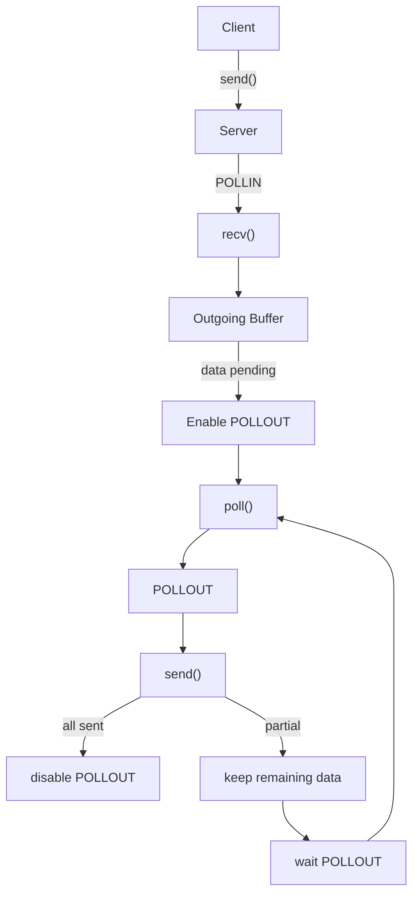
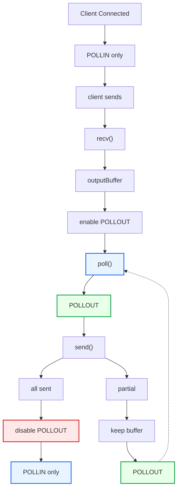

# Echo Server with `poll()` and Partial Writes

### READ FIRST: [POLLOUT and Partial Writes Explaination](./pollout-and-partial-writes.md)

Alright. We'll turn the `poll()` server we built into a **real Echo Server that supports partial writes**. the previous code [**Poll TCP Server**](../../0x06-event-driven-dev-poll/poll-tcp-server/main.cpp)

The goal here isn't just to get the code working; it's to build the right mental model:



## 1. Designing the Client Connection

Instead of storing only:

```cpp
int client_fd;
```

we need state for each connection:

```cpp
struct ClientConnection
{
    int fd;

    std::string outputBuffer;
    std::size_t outputOffset = 0;
};
```

For example, if we have:

```text
outputBuffer:

Hello World
^^^^^^^^^^^

outputOffset = 5
```

It means:

```text
Already sent:
Hello

Remaining:
 World
```

---

## 2. Why do we need `outputOffset`?

Because:

```cpp
send(fd, buffer, size, 0);
```

Suppose we have a buffer of 1000 bytes to send. We call `send()`, but it only accepts 500 bytes. So 500 bytes have been sent and 500 bytes are still remaining.

We need to know where to continue from:

```cpp
outputOffset += bytesSent;
```

---

## 3. The Full Code

We'll use:

```text
poll()
POLLIN
POLLOUT
non-blocking
partial writes
output buffer
```

---

## 4. Let's Understand the Most Important Part

Focus on:

```cpp
if (pfd.revents & POLLIN)
{
    handleRead(client);
}
```

The client sent data:

```text
Client
   │
   │ "Hello"
   ▼
Server
   │
   ▼
POLLIN
   │
   ▼
recv()
```

After that:

```cpp
client.outputBuffer.append(
    buffer,
    bytes);
```

Now we have:

```text
outputBuffer

┌────────────────────────┐
│ Hello                  │
└────────────────────────┘
         │
         ▼
      pending
```

So we do:

```cpp
pfd.events |= POLLOUT;
```

---

## 5. Now `poll()` Knows We Have Data to Send

```text
              poll()
                │
        ┌───────┴────────┐
        │                │
      POLLIN           POLLOUT
        │                │
        ▼                ▼
      recv()           send()
```

And when the socket is writable:

```cpp
if (pfd.revents & POLLOUT)
{
    handleWrite(client);
}
```

---

## 6. Inside `handleWrite()`

The most important line here is:

```cpp
const char* data =
    client.outputBuffer.data()
    + client.outputOffset;
```

Suppose:

```text
outputBuffer:

0123456789ABCDEFGHIJ
```

and:

```text
outputOffset = 10
```

Then:

```text
              offset
                 ↓
0123456789ABCDEFGHIJ
          └─────────┘
             remaining
```

We do **not** resend the first 10 bytes.

We start from:

```cpp
outputBuffer.data() + 10
```

---

## 7. What If `send()` Only Sends Part of the Data?

For example:

```cpp
ssize_t bytes = send(...);
```

returns:

```text
bytes = 5
```

We do:

```cpp
client.outputOffset += bytes;
```

So it becomes:

```text
Before:

0123456789ABCDEFGHIJ
          ↑
       offset = 10


send() → 5


After:

0123456789ABCDEFGHIJ
               ↑
          offset = 15
```

And the remaining data is:

```text
FGHIJ
```

---

## 8. What If `send()` Returns `EAGAIN`?

This is the most important moment.

```text
send()
  │
  ▼
EAGAIN
```

It means:

> I can't send any more right now without blocking.

**We do not retry in an endless loop.**

We go back to the event loop:

```text
             EAGAIN
                │
                ▼
         return to poll()
                │
                ▼
             POLLOUT
                │
                ▼
             send()
```

This is the essence of event-driven networking.

---

## 9. When Do We Remove `POLLOUT`?

When:

```cpp
client.outputOffset ==
client.outputBuffer.size()
```

which means:

```text
Pending data = 0
```

So we clear the buffer:

```cpp
client.outputBuffer.clear();
client.outputOffset = 0;
```

Then:

```cpp
pfd.events &= ~POLLOUT;
```

So we go from:

```text
Before:

POLLIN | POLLOUT


After:

POLLIN
```

Because we don't need to be woken up for a writable socket as long as we have nothing to send.

---

## 10. The State Machine Is Now Clear



This is one of the most important mental models in networking.

---

## 11. An Important Point About the Code

I used:

```cpp
while (true)
{
    recv(...);
}
```

and also:

```cpp
while (hasPendingData(client))
{
    send(...);
}
```

Why?

Because the sockets are **non-blocking**.

So we try to drain whatever data is currently available:

```text
recv
recv
recv
recv
EAGAIN
 ↓
stop
```

Or:

```text
send
send
send
EAGAIN
 ↓
stop
 ↓
wait for POLLOUT
```

This will be very important when we get to **epoll + edge-triggered (`EPOLLET`)**.

---

## 12. One More Very Important Point

This code is for learning; it is not fully production-ready.

For example, `send()` may run into:

* `EPIPE`
* `ECONNRESET`
* `SIGPIPE`
* output-buffer growth
* message framing
* backpressure

Also, the `std::string outputBuffer` could be improved, instead of constantly shifting/accumulating data.

But **the networking concept we want to learn here is correct**:

```text
Non-blocking socket
       +
poll()
       +
POLLIN
       +
POLLOUT
       +
partial read/write
       +
application buffers
       =
Event-driven TCP server
```

And this is exactly the foundation we need before going back to `epoll()`.

## References

* [Linux `poll(2)`: `POLLIN`, `POLLOUT`, `revents`](https://man7.org/linux/man-pages/man2/poll.2.html)
* [Linux `send(2)`: nonblocking `send()` and return values](https://man7.org/linux/man-pages/man2/send.2.html)
* [Linux `recv(2)`: receiving on sockets and nonblocking behavior](https://man7.org/linux/man-pages/man2/recv.2.html)
* [Linux `fcntl(2)`: setting `O_NONBLOCK`](https://man7.org/linux/man-pages/man2/fcntl.2.html)

## What's Next

We now have a very strong foundation for `epoll`. In the next step, we'll take **this same server** and change only the event mechanism layer from `poll()` to `epoll()`, so you can see for yourself exactly **what changed, and why `epoll` is different**.
