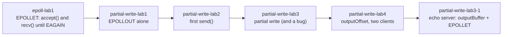
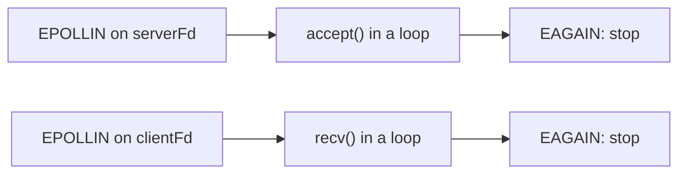
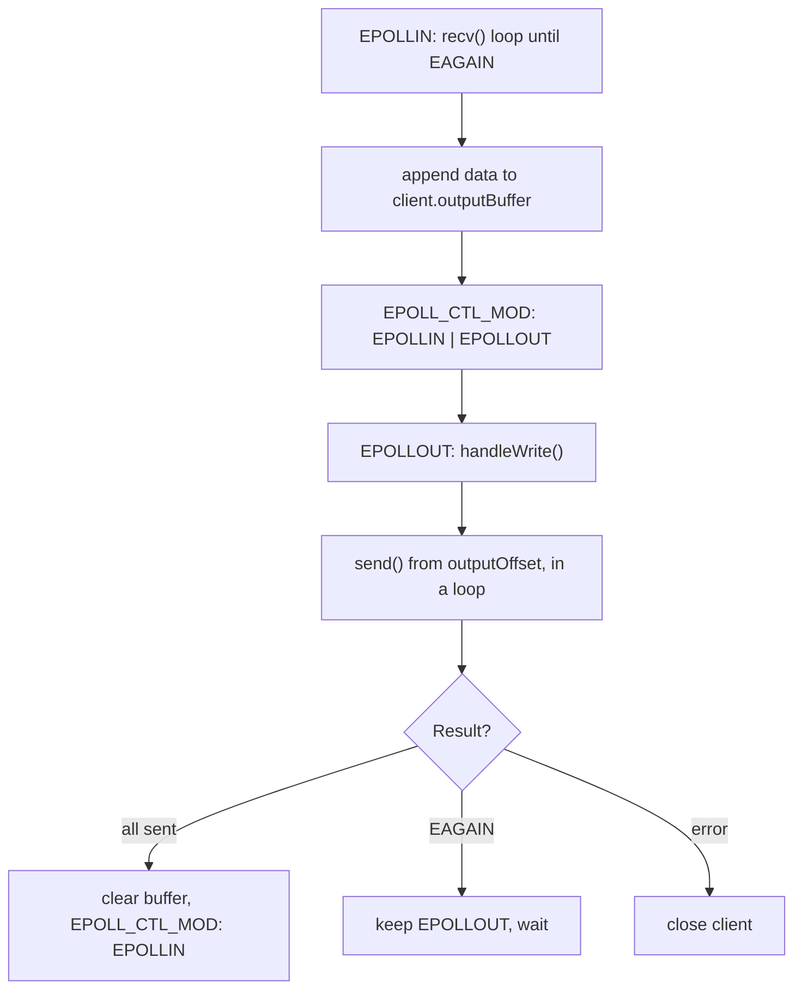

# 0x08: epoll + EPOLLET

Notes about every lab in this folder. The labs build on each other: first the **input** side with `EPOLLET` (`accept()` and `recv()` until `EAGAIN`), then the **output** side (`EPOLLOUT`, partial writes, output buffer and offset).



## Overview

| Lab | Topic | Binary | Main lesson |
|---|---|---|---|
| [epoll-lab1](./epoll-lab1) | TCP server with `EPOLLET` | `epoll_lab1` | With `EPOLLET`, drain `accept()` and `recv()` until `EAGAIN`. |
| [epoll-partial-write-lab1](./epoll-partial-write-lab1) | `EPOLLOUT` alone | `epoll_partial_write_lab1` | A socket with free send buffer is writable, so `EPOLLOUT` repeats. |
| [epoll-partial-write-lab2](./epoll-partial-write-lab2) | First `send()` on `EPOLLOUT` | `epoll-partial-write-lab2` | After sending, turn `EPOLLOUT` off with `EPOLL_CTL_MOD`. |
| [epoll-partial-write-lab3](./epoll-partial-write-lab3) | Partial write | `server`, `client` | `send()` can accept less than asked, and a restart from byte 0 is a bug. |
| [epoll-partial-write-lab4](./epoll-partial-write-lab4) | `outputOffset` | `output_offset_server`, `slow_client` | Continue from the offset after every partial write. |
| [epoll-partial-write-lab3-1](./epoll-partial-write-lab3-1) | Echo server | `epoll-echo-server` | Per-client `outputBuffer` + `outputOffset` + `EPOLLET`. |

## Build

Labs 1, partial-1, partial-2 and partial-4 are listed in [CMakeLists.txt](./CMakeLists.txt):

```bash
cmake -S . -B build
cmake --build build

./build/epoll-lab1/epoll_lab1
./build/epoll-partial-write-lab4/output_offset_server
```

`epoll-partial-write-lab3` and `epoll-partial-write-lab3-1` are **not** in that file. Each has its own `CMakeLists.txt`, so build them separately:

```bash
cmake -S epoll-partial-write-lab3 -B build/lab3
cmake --build build/lab3

cmake -S epoll-partial-write-lab3-1 -B build/lab3-1
cmake --build build/lab3-1
```

All servers listen on port `12345`, so run **one server at a time**.

---

## epoll-lab1: `EPOLLET` TCP server

Source: [main.cpp](./epoll-lab1/main.cpp), notes: [README.md](./epoll-lab1/README.md), [Question.md](./epoll-lab1/Question.md), [Question2.md](./epoll-lab1/َQuestion2.md)

**What it is.** A complete TCP server with one `epoll` instance. The listening socket and every client are non-blocking and registered with `EPOLLIN | EPOLLET`. It only prints what clients send (no echo).

**What it shows.** With edge-triggered mode you get one event for a change, so you must consume all the available work:



**Result from a test.** Three clients sent `Hello`, `ABC` and 5000 bytes. The 5000 bytes arrived as `4 x 1024 + 904` in a **single** wakeup.

**Notes.**

* The `accept()` loop is optional with level-triggered mode but required with `EPOLLET`. [Question2.md](./epoll-lab1/َQuestion2.md) explains why, including the "no loop" case.
* [Question.md](./epoll-lab1/Question.md) explains why `accept()` goes inside a loop.
* The earlier small experiment is in `../0x07-IO_multiplexing/epoll-lab4-et` (`recv()` once vs `recv()` in a loop).
* Known gaps: no echo, no `SO_REUSEADDR`, `EPOLLERR` / `EPOLLHUP` are not handled, and a client that keeps sending can hold the `recv()` loop and delay the others.

---

## epoll-partial-write-lab1: `EPOLLOUT` alone

Source: [main.cpp](./epoll-partial-write-lab1/main.cpp), notes: [README.md](./epoll-partial-write-lab1/README.md)

**What it is.** A server that registers each client with `EPOLLIN | EPOLLOUT` (level-triggered) and only prints which events it gets. It never calls `recv()` or `send()`.

**What it shows.**

| `clientEvent.events` | Client idle | Client sends data | Client closes |
|---|---|---|---|
| `EPOLLIN \| EPOLLOUT` | `EPOLLOUT` repeats | both repeat | both keep repeating |
| `EPOLLOUT` | `EPOLLOUT` repeats | `EPOLLOUT` repeats, never `EPOLLIN` | `EPOLLOUT` repeats |
| `EPOLLIN` | nothing | `EPOLLIN` repeats | `EPOLLIN` repeats |

Each line was printed hundreds of thousands of times per second.

**Notes.**

* `EPOLLOUT` does not mean the client received anything. It only means a write would not block.
* A level-triggered event that is not consumed repeats. `EPOLLOUT` repeats because the socket is almost always writable. `EPOLLIN` repeats because the server never calls `recv()`.
* Rule: enable `EPOLLOUT` only while there is data waiting to be sent.
* On purpose, the server never closes disconnected clients and calls `accept()` once per event.
* The README of this lab also has the general theory (sections 1 to 5) and the roadmap for the next steps.

---

## epoll-partial-write-lab2: the first `send()`

Source: [main.cpp](./epoll-partial-write-lab2/main.cpp), notes: [README.md](./epoll-partial-write-lab2/README.md)

**What it is.** When a client connects, the server sends `Hello from server!\n` (19 bytes) on the first `EPOLLOUT`, then switches the client to `EPOLLIN` only with `EPOLL_CTL_MOD`.

**Result.**

```text
Client connected. fd = 5
EPOLLOUT on fd 5
send() returned 19
Client sent: hi server
Client disconnected
```

**Notes.**

* `send()` returning `19` means 19 bytes were copied into the kernel send buffer, not that the client got them.
* Without the `EPOLL_CTL_MOD` step, `EPOLLOUT` would keep firing and the message would be sent again and again.
* The weak point: the code assumes `send()` sends everything. With 19 bytes that is always true, so the bug cannot be seen here. The next lab shows it.
* Other gaps (also listed in its README): result of `EPOLL_CTL_MOD` not checked, `recv()` errors ignored, `EPOLLERR` / `EPOLLHUP` not handled, no `MSG_NOSIGNAL`.

---

## epoll-partial-write-lab3: the partial write (and a crash)

Source: [server.cpp](./epoll-partial-write-lab3/server.cpp), [client.cpp](./epoll-partial-write-lab3/client.cpp), notes: [README.md](./epoll-partial-write-lab3/README.md)

**What it is.** The server tries to send 10 MB on `EPOLLOUT`. The client connects and **never reads**, so the buffers fill up. (Do not use `nc`: it keeps reading and the buffers never fill.)

**Result.**

```text
Prepared 10485760 bytes
Client connected. fd = 5
EPOLLOUT
send() -> 2614080 bytes
```

`send()` accepted `2614080` of `10485760` bytes: a **partial write**.

**Notes.**

* There is no `send() -> EAGAIN` line. After the partial write the socket is not writable, so epoll does not wake the server. `EAGAIN` shows up only when the code calls `send()` again, as in lab 4.
* **Bug:** every `EPOLLOUT` sends from byte 0, so a second wakeup would send duplicated data.
* **Crash:** killing the client makes the server die. First `send()` fails with `ECONNRESET`, the code only prints it and does not close the fd, epoll reports the socket again, the next `send()` fails with `EPIPE` and `SIGPIPE` kills the process (exit status `141`). Fix: `MSG_NOSIGNAL`, and close the client on any error other than `EAGAIN`.
* The number `2614080` depends on the system.

---

## epoll-partial-write-lab4: `outputOffset`

Source: [server.cpp](./epoll-partial-write-lab4/server.cpp), [client.cpp](./epoll-partial-write-lab4/client.cpp), notes: [README.md](./epoll-partial-write-lab4/README.md), [two-clients-output.md](./epoll-partial-write-lab4/two-clients-output.md)

**What it is.** Lab 3 fixed. The server keeps a `ClientState` per fd with `outputOffset` and always sends from `message.data() + outputOffset`. The loop runs until all data is accepted or `EAGAIN`. `MSG_NOSIGNAL` and `EPOLLERR` / `EPOLLHUP` handling are added, and `EPOLLOUT` is turned off when the message is complete.

The 10 MB message is `ABC...XYZABC...` (byte `i` is `'A' + i % 26`). `slow_client` waits 2 seconds, then reads 64 KB every 10 ms and **checks every byte**.

**Result (one client).** 7 `EPOLLOUT` wakeups, 6 `EAGAIN`, and `Data OK`.

**Notes.**

* Each wakeup accepts what fits (about 1.4 to 1.9 MB), then `send()` returns `EAGAIN`. The last wakeup finishes without `EAGAIN`, so `EAGAIN = wakeups - 1`.
* **Experiment:** use `message.data()` instead of `message.data() + outputOffset`. The server log looks exactly the same, but the client prints `DATA WRONG at byte 2614080`. Only checking the content finds this bug.
* **Two clients:** both got `Data OK` with different offsets, because the offset is per client. See [two-clients-output.md](./epoll-partial-write-lab4/two-clients-output.md).
* Killing a client after the transfer was already handed to the kernel shows the `EPOLLERR` / `EPOLLHUP` cleanup, not the `send()` error path. Kill it earlier to test that path.
* In [client.cpp](./epoll-partial-write-lab4/client.cpp) there is a commented line, `while (true) {}`. Enabling it makes a client that never reads. I expect the server to keep that client's offset at the first partial write and keep serving other clients (I did not run this).
* The server now prints `fd N:` in the `EPOLLOUT` lines. The output blocks in the lab 4 README and in `two-clients-output.md` were taken before that change and do not show the prefix.
* The message is shared by all clients and only the offset is per client. A real server needs a per-client buffer (see lab 3-1).

---

## epoll-partial-write-lab3-1: echo server

Source: [main.cpp](./epoll-partial-write-lab3-1/main.cpp), notes: [REAME.md](./epoll-partial-write-lab3-1/REAME.md)

**What it is.** The first complete server in this folder: multiple clients, non-blocking sockets, `EPOLLET`, and per-client state.



```cpp
struct ClientConnection
{
    int fd;
    std::string outputBuffer;
    std::size_t outputOffset = 0;
};
```

**Test.** I tested a copy of this server (with the missing include, see below). All of these succeeded and the server stayed alive:

* a small echo (`Hello\n` comes back);
* a 3 MB echo, with the client sending and receiving at the same time;
* two clients echoing 1 MB each with different byte patterns, both correct;
* an 8 MB echo where the client did not read for 3 seconds and then read everything;
* a client that sent `abc` and closed immediately.

**Notes and things to fix.**

1. **It does not compile with GCC 11 as it is.** `main.cpp` uses `std::unordered_map` but does not include `<unordered_map>`. Add `#include <unordered_map>` at the top. (I tested a temporary copy with that line added.)
2. **No `MSG_NOSIGNAL`.** `handleWrite()` calls `send(..., 0)`. Writing to a connection that the peer already closed can raise `SIGPIPE`, which is what crashed lab 3. I did not reproduce it on this server, but use `MSG_NOSIGNAL`.
3. **`EPOLLRDHUP` is never reported.** It is in the error check, but it is not registered in any `events` mask, so epoll will not send it. This is harmless now. If you register it later, remember that a half-closed client may still have output waiting.
4. **`handleRead()` only enables `EPOLLOUT`.** The first `send()` happens on the next event. Trying `send()` right away and enabling `EPOLLOUT` only after `EAGAIN` or a partial write saves one wakeup.
5. **No limit on `outputBuffer`.** A client that sends but never reads makes the buffer grow forever.
6. **`EPOLL_CTL_MOD` and `EPOLLET`.** `modifyClientEvents()` always adds `EPOLLET`, so the toggle keeps the edge-triggered mode. `MOD` re-checks readiness, which is why `EPOLLOUT` arrives right after `enableWrite()`.
7. The notes file is named `REAME.md` (typo) and is only partly in English.
8. This lab is not in the parent [CMakeLists.txt](./CMakeLists.txt) (see Build above).

---

## Rules from all the labs

1. **`EPOLLET` means: consume everything until `EAGAIN`.** This applies to `accept()`, `recv()` and `send()`.
2. **Sockets must be non-blocking.** Otherwise the call that should return `EAGAIN` blocks forever.
3. **`EPOLLOUT` only while output is pending.** A level-triggered `EPOLLOUT` on an idle socket spins.
4. **`send()` returns how many bytes were accepted.** Keep the rest and continue from the offset, never from the start.
5. **`EAGAIN` is not an error.** Keep the data, keep `EPOLLOUT`, and wait.
6. **`EPOLL_CTL_MOD` replaces the whole mask.** Keep `EPOLLIN` (and `EPOLLET`) when toggling `EPOLLOUT`.
7. **Close the client on real errors, `EPOLLERR` and `EPOLLHUP`.** Use `MSG_NOSIGNAL` so a dead peer cannot kill the server.
8. **Each client needs its own state.** At least an `outputOffset`, and in a real server its own `outputBuffer`.
9. **Test the content, not only the byte count.** A missing offset gives the right number of bytes with wrong data.
10. **Backpressure matters.** Limit buffer size and handle slow readers.

## Open items

* Fix the missing `#include <unordered_map>` in lab 3-1.
* Decide whether to add labs 3 and 3-1 to [CMakeLists.txt](./CMakeLists.txt).
* Rename `epoll-partial-write-lab3-1/REAME.md` to `README.md` and translate it.
* Update the output blocks in the lab 4 README and `two-clients-output.md` to show the new `fd N:` prefix.
* Labs 1 to 3 do not set `SO_REUSEADDR`. Restarting a server right after clients were connected can fail with `bind failed: Address already in use`.
