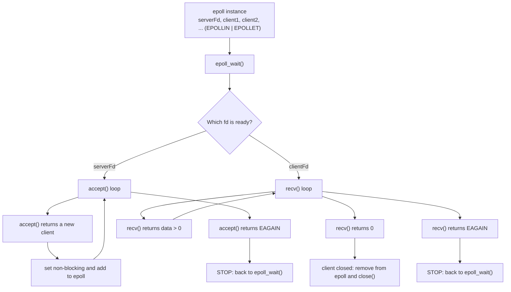
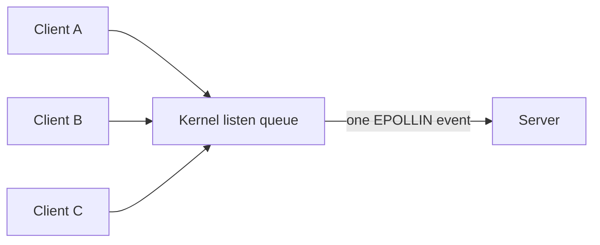
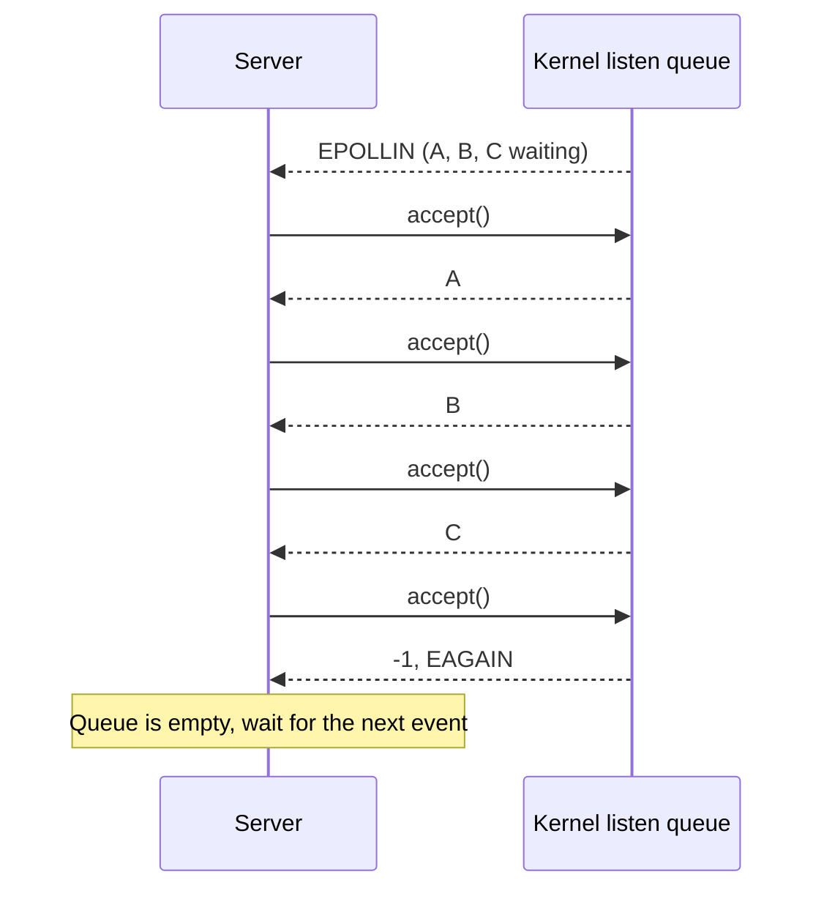
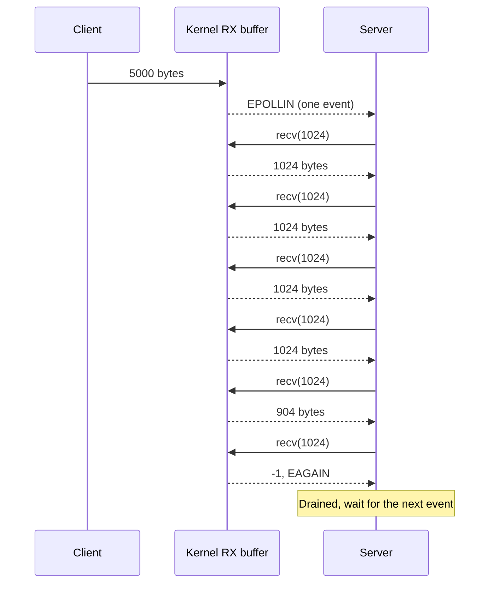
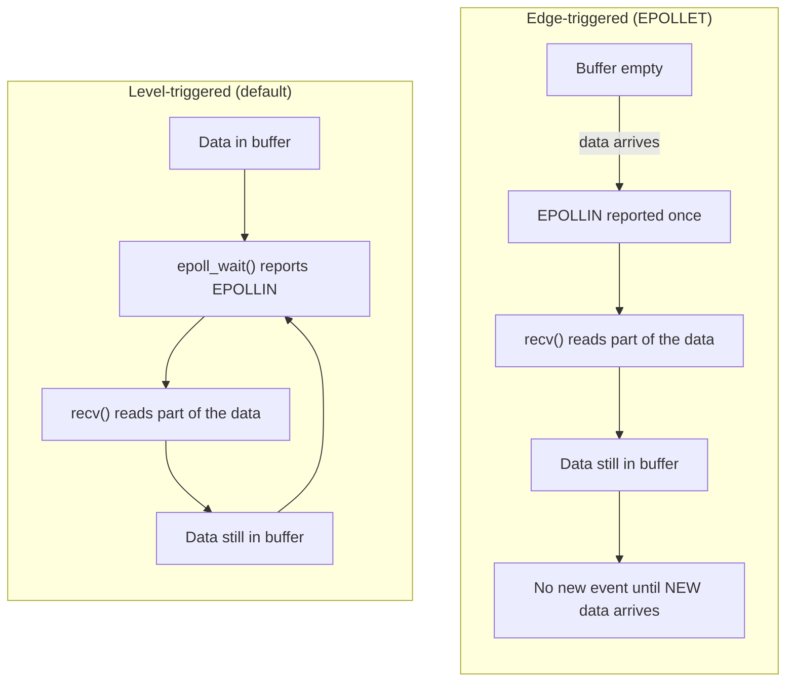
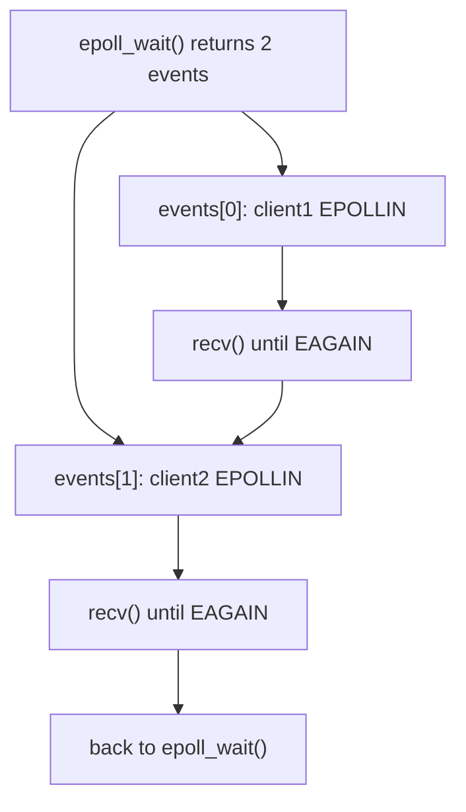
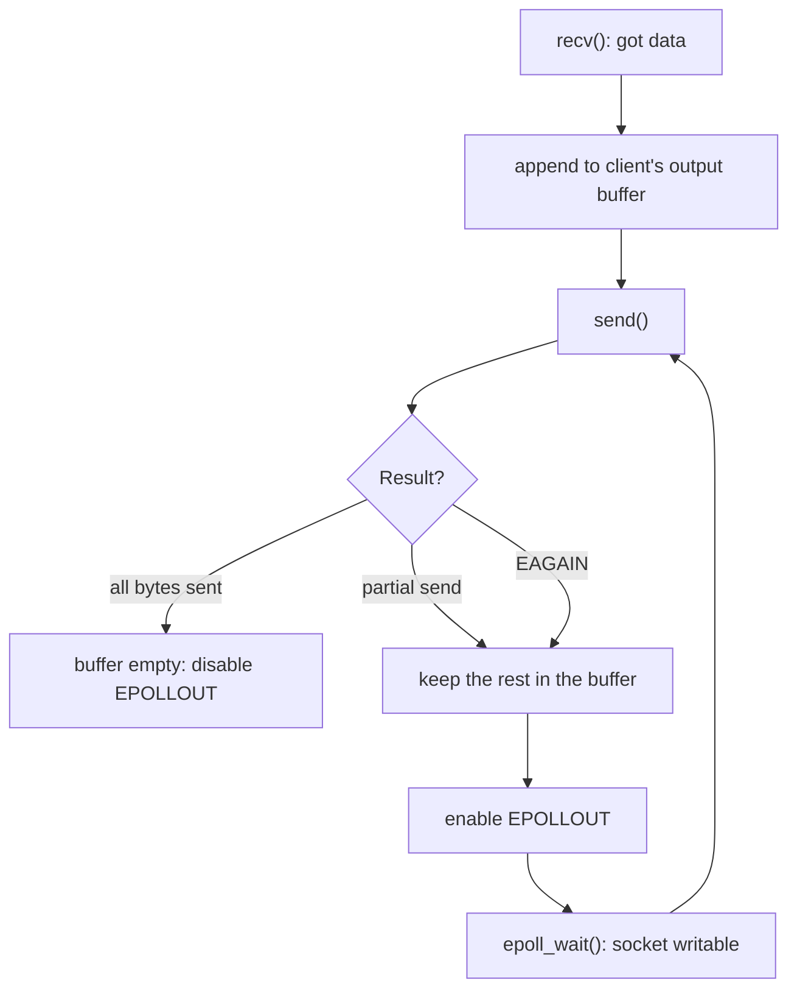

# epoll + EPOLLET: Full TCP Server (Drain Until `EAGAIN`)

After the small experiment in `0x07-IO_multiplexing/epoll-lab4-et`, this lab applies the same rule to a complete TCP server:

> With `EPOLLET`, an event means "something changed". You must consume **all** the work that is available right now, until the kernel says `EAGAIN`.

Source: [main.cpp](./main.cpp)

## Build and run

```bash
g++ -std=c++17 -Wall -Wextra -O2 -o epoll_et_server main.cpp
./epoll_et_server
```

In other terminals:

```bash
nc 127.0.0.1 12345
```

## The big picture

One `epoll` instance watches the listening socket and every client socket. All of them are non-blocking and edge-triggered (`EPOLLIN | EPOLLET`).



## Startup flow


## Part 1: `accept()` in a loop

`EPOLLIN` on the **listening** socket does not mean "there is data to `recv()`". It means "there is at least one pending connection, `accept()` can make progress".

Several clients can arrive before the server wakes up, and with `EPOLLET` we get only **one** event for all of them:



If we called `accept()` once, we would take A and leave B and C waiting, with no new event to wake us. So we loop:



For each accepted client the server:

1. Prints `New client: <fd>`.
2. Makes the client socket non-blocking.
3. Adds it to epoll with `EPOLLIN | EPOLLET`.

## Part 2: `recv()` in a loop

When a client sends data, the bytes sit in the kernel receive buffer and epoll reports **one** edge. The server must read until the buffer is empty:



What each `recv()` result means:

| Result | Meaning | Server action |
|---|---|---|
| `> 0` | Got data | Process it and call `recv()` again. |
| `0` | Client closed the connection | `EPOLL_CTL_DEL`, `close(fd)`, stop the loop. |
| `-1` + `EAGAIN` / `EWOULDBLOCK` | Socket is empty | Stop the loop, go back to `epoll_wait()`. |
| `-1` + other `errno` | Real error | Print it, remove and close the client. |

## Level-triggered vs edge-triggered



That is why the loop is not optional: if you leave data behind, epoll will not remind you.

## Multiple clients in one `epoll_wait()`

`epoll_wait()` can return several ready fds at once. The server handles them one by one, and each one is drained completely:



## Try it

Start the server, then connect three clients (for example with `nc`, or a small script) and send:

* client 1: `Hello`
* client 2: `ABC`
* client 3: 5000 bytes

Output from a run with that test:

```text
Server listening on port 12345
New client: 5
Client 5 sent 6 bytes:
Hello

New client: 6
Client 6 sent 4 bytes:
ABC

New client: 7
Client 7 sent 1024 bytes:
zzzz...
Client 7 sent 1024 bytes:
zzzz...
Client 7 sent 1024 bytes:
zzzz...
Client 7 sent 1024 bytes:
zzzz...
Client 7 sent 904 bytes:
zzzz...
Client 5 disconnected
Client 6 disconnected
Client 7 disconnected
```

* The 5000 bytes arrived as `4 x 1024 + 904`, all in **one** wakeup. The loop kept going until the buffer was empty.
* Nothing was left behind, even though epoll sent only one event.

## Known limitations

This is a lab server, so a few things are intentionally simple:

* **No echo.** It only prints what it receives. Echoing needs an output buffer and `EPOLLOUT` (see next step).
* **No `SO_REUSEADDR`.** If you stop the server while clients are connected, restarting right away can fail with `bind failed: Address already in use`.
* **Fairness.** A client that keeps sending can hold the `recv()` loop for a long time, and other clients wait. Real servers usually cap the work per event.
* **`EPOLLERR` / `EPOLLHUP` are not handled separately.** The code only checks `EPOLLIN`. This is usually fine because a closed connection makes `recv()` return `0` or an error.
* **Logging.** Every message is printed, which is slow under heavy load.

## Next step: echo with `EPOLLOUT`

Echoing a message back means writing with `send()`, and `send()` may not send everything:



We register `EPOLLOUT` only while there is pending output, otherwise epoll would keep reporting that the socket is writable.
