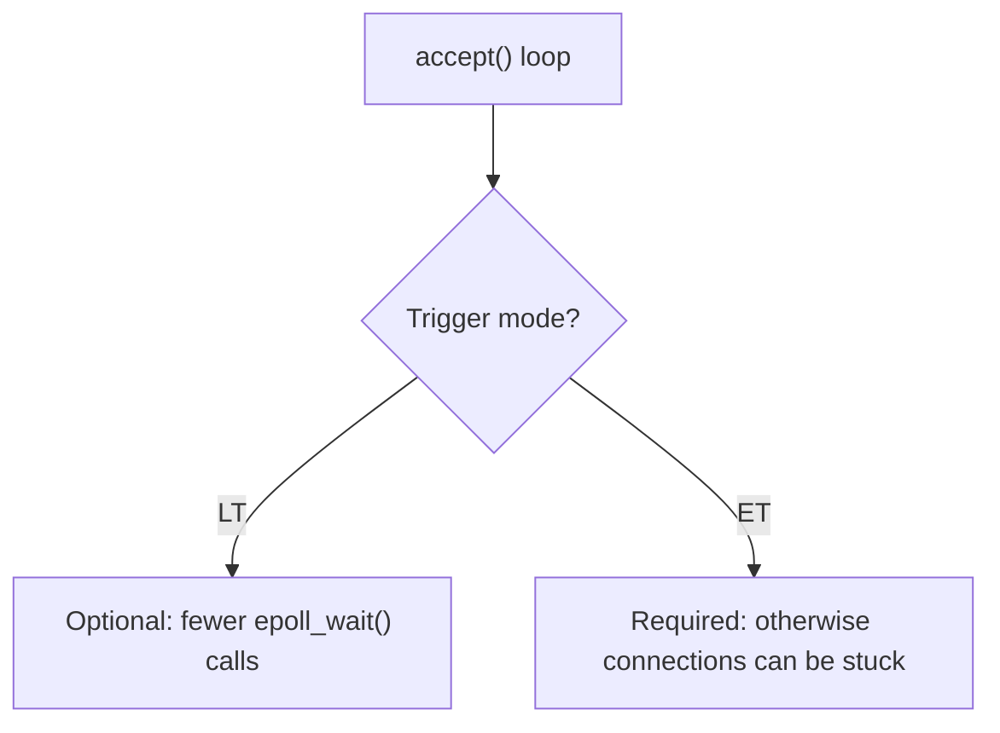
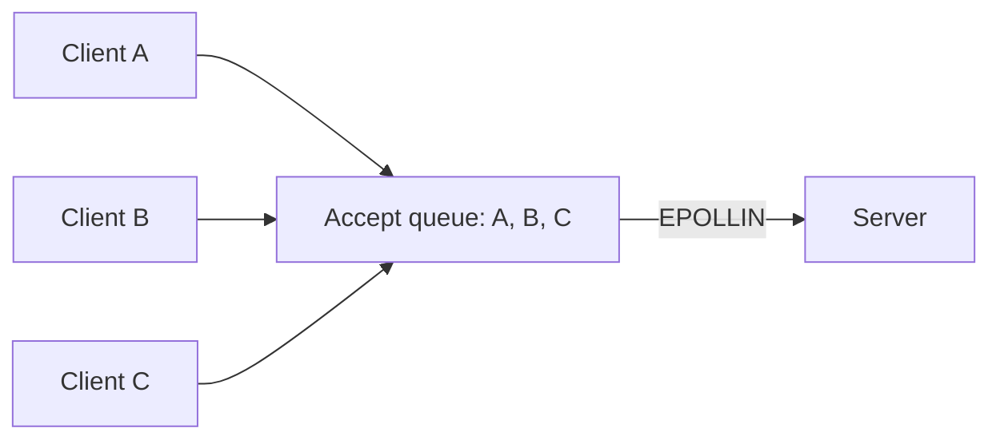
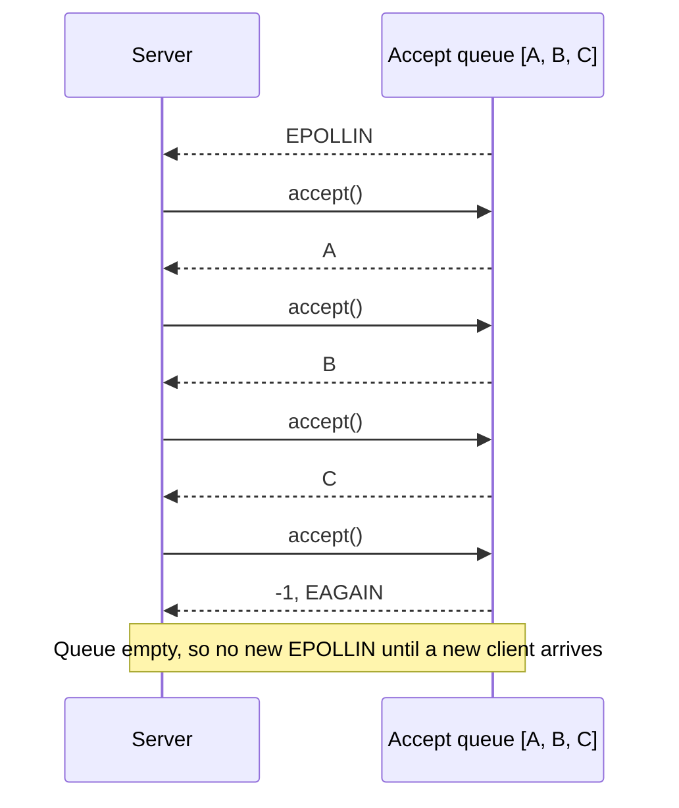
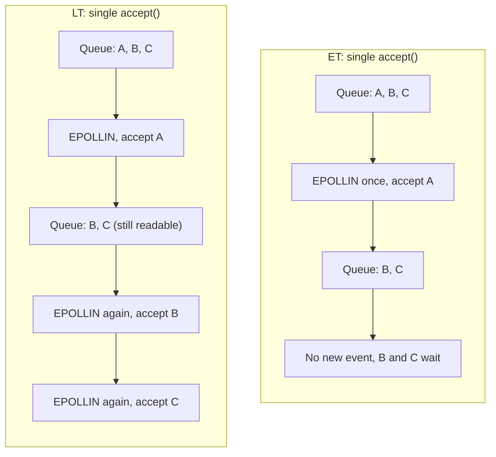
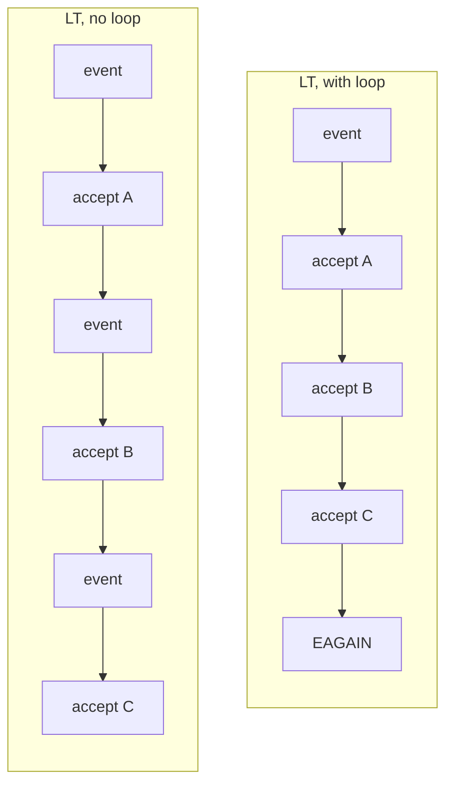
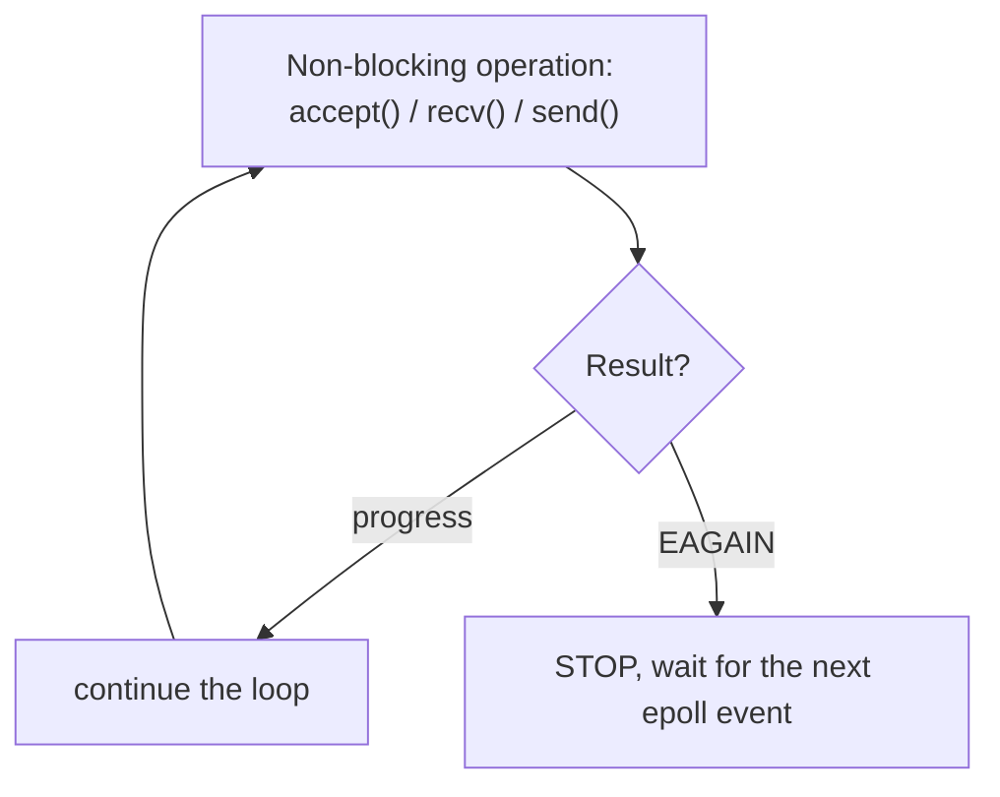

# Question: If `accept()` is in a `while` loop, what does `EPOLLET` change?

If I register the listening socket with only `EPOLLIN` (level-triggered) and put `accept()` inside a `while` loop, I still accept every client that is waiting in the queue. So what is the real difference from `EPOLLET`?

## Short answer

Yes, the loop drains the whole accept queue in **both** modes. The loop is not what makes a server edge-triggered.

The difference is what happens if you **do not** drain the queue:

* **Level-triggered (LT):** epoll keeps reporting `EPOLLIN` while connections are still pending. A missed connection is picked up on the next `epoll_wait()`.
* **Edge-triggered (ET):** epoll reports the change once. A missed connection stays in the queue and you are **not** told again.

So the loop is *optional* in LT (an optimization) and *required* in ET (a correctness rule).



## The starting point

The kernel keeps a queue of connections that finished the TCP handshake but were not `accept()`ed yet. Say three clients arrived:



## Case 1: LT with an `accept()` loop

```cpp
serverEvent.events = EPOLLIN;   // level-triggered
```

```cpp
while (true)
{
    int clientFd = accept(serverFd, nullptr, nullptr);

    if (clientFd == -1)
    {
        if (errno == EAGAIN || errno == EWOULDBLOCK)
            break;              // queue is empty

        perror("accept");
        break;
    }

    // handle clientFd
}
```



A, B and C are all accepted in one event-loop iteration.

## Case 2: ET with the same loop

```cpp
serverEvent.events = EPOLLIN | EPOLLET;   // edge-triggered
```

With the same loop, in this simple example the result is the same: `A -> B -> C -> EAGAIN`. The difference only shows when the loop is missing or stops early.

## Where the difference appears: no loop

Now each event calls `accept()` only once:

```cpp
if (events[i].events & EPOLLIN)
{
    accept(serverFd, nullptr, nullptr);   // takes A only
}
```



* **LT:** slower (one extra `epoll_wait()` per client), but correct.
* **ET:** B and C stay in the queue until some **new** connection arrives, and even then you again take only one. Clients can wait for a long time. This is the bug the loop prevents.

## Why use the loop even with LT?

It lets you drain the queue in one iteration instead of one `epoll_wait()` per client:



This can be more efficient, but it is not required for correctness in LT.

## Comparison

| | LT, no loop | LT, loop | ET, no loop | ET, loop |
|---|---|---|---|---|
| Accepts all pending clients | Yes, over several events | Yes, in one event | **No** | Yes, in one event |
| epoll reminds you of leftovers | Yes | Not needed | **No** | Not needed |
| Correct? | Yes | Yes | **No** | Yes |

## Rules to remember

**LT:**

> "As long as the socket is still ready, I keep notifying you."

**ET:**

> "I told you the state changed. It is your job to consume all the available work until `EAGAIN`."

The same rule applies to `recv()` and `send()`:



## Notes

1. **The socket must be non-blocking.** Without `O_NONBLOCK`, the last `accept()` (the one that would return `EAGAIN`) blocks forever, with LT as well as ET. The loop only works because `accept()` returns `EAGAIN` instead of waiting.

2. **Check `clientFd == -1` before using `errno`.** `errno` is only meaningful after a failed call. Always test the return value first, as in the snippet above.

3. **Not every `accept()` error should stop the loop.** `EINTR` and `ECONNABORTED` mean "try again", so use `continue`. Other errors can be logged and break the loop.

4. **`EMFILE` / `ENFILE` (out of file descriptors) is a trap.** The connection stays in the queue and `accept()` keeps failing.
    * With LT, `epoll_wait()` returns immediately again and the server spins at 100% CPU.
    * With ET, you get no new event and the pending connections are stuck.

5. **A big drain loop can starve other fds.** If thousands of clients arrive at once, one loop can run for a long time while other sockets wait. Real servers often cap the number of `accept()` calls per event, which is safe in LT (the event repeats) but needs extra care in ET (you must remember to come back).

6. **`EPOLLIN` on a listening socket means "a connection is ready", not "data is ready".** There is no `recv()` here until you have a client socket.
