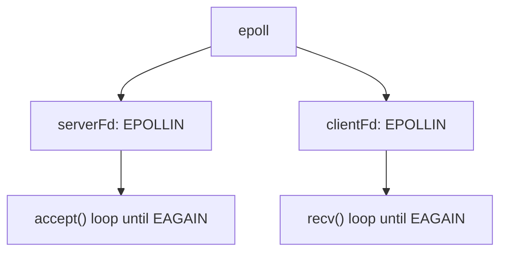
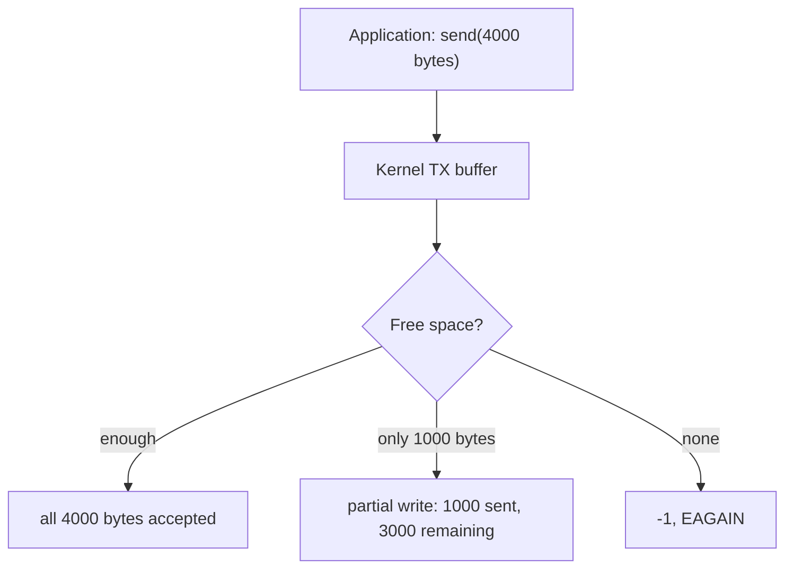
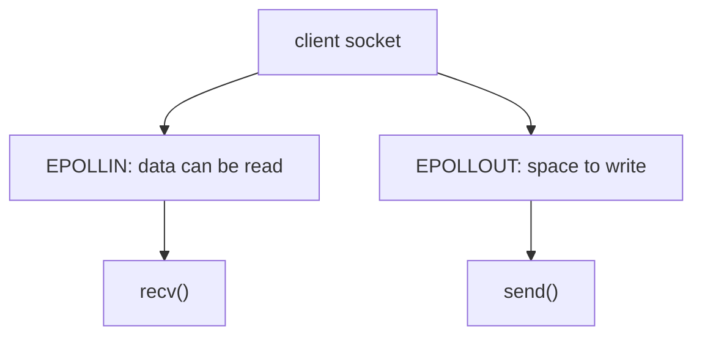
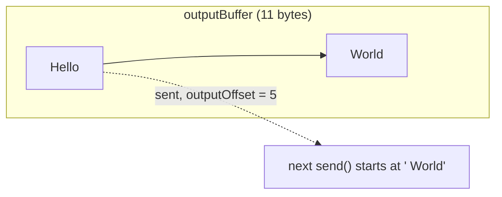
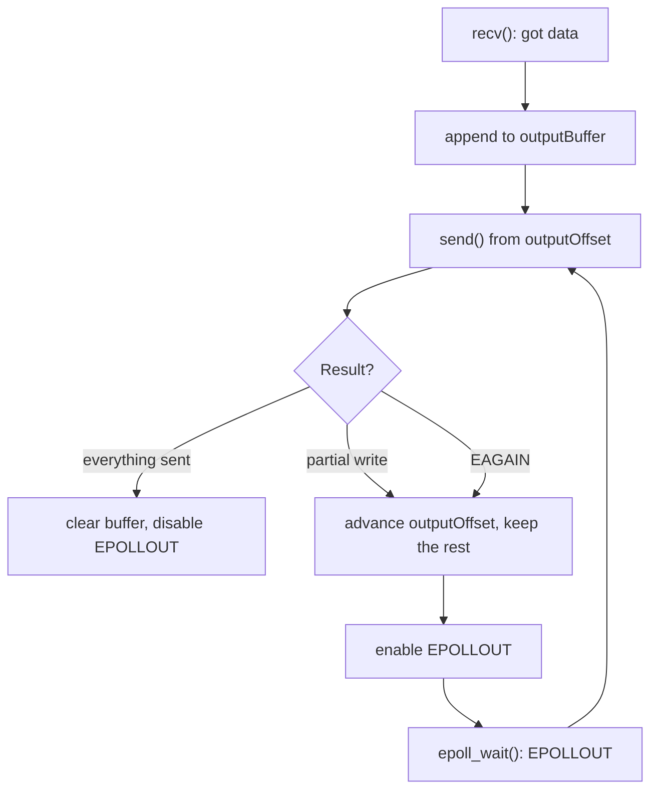
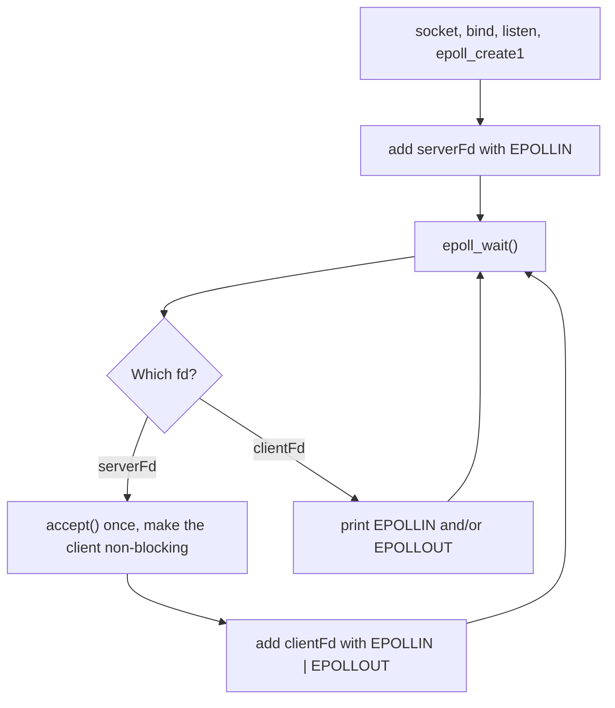
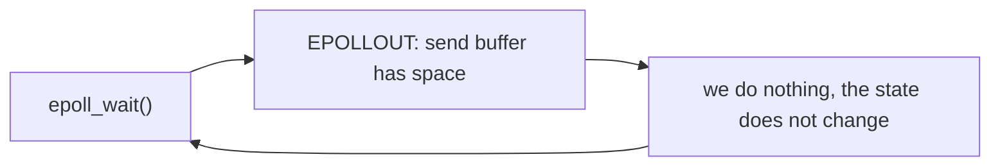
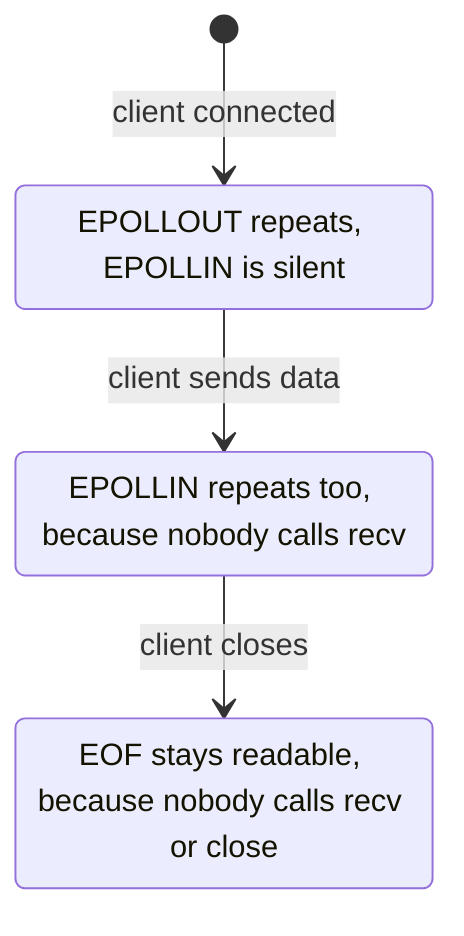
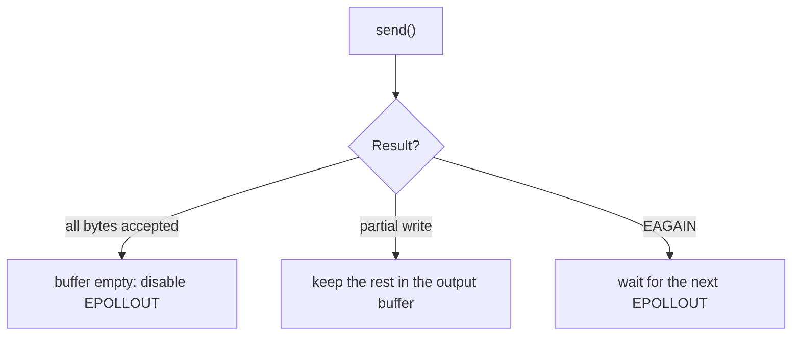

# epoll + EPOLLOUT: Partial Writes

So far we handled the **input** side of an epoll server:



This lab starts the other side: **how does the server send data to a client without blocking?**

## 1. The problem: `send()` does not always send everything

Take an echo server: it receives data and sends it back.


It is tempting to think that `send(fd, buffer, size, 0)` always sends all `size` bytes. On a non-blocking socket it does not. Three things can happen:

| `send()` result | Meaning |
|---|---|
| `n == size` | Everything was accepted by the kernel. |
| `0 < n < size` | **Partial write.** Only `n` bytes were accepted, the rest must be sent later. |
| `-1` with `EAGAIN` / `EWOULDBLOCK` | The kernel send buffer is full. Nothing was accepted. |

> A successful `send()` only means the bytes were copied into the kernel send buffer. It does not mean the client received them.



When the buffer is full we cannot call `send()` in a loop and hope. That would waste CPU (busy-wait). We need the kernel to tell us **when there is space again**.

## 2. `EPOLLOUT`: "this socket is writable"

`EPOLLOUT` is the write-side twin of `EPOLLIN`. epoll reports it when the socket has room in its send buffer.



## 3. Do not leave `EPOLLOUT` armed all the time

Most of the time a socket **is** writable (its send buffer is mostly empty). So with a level-triggered `EPOLLOUT`, `epoll_wait()` returns again and again, even when there is nothing to send:


The usual rule:

| Client state | `EPOLLOUT` |
|---|---|
| No pending output | **disabled** |
| Pending output | **enabled** |

Step 1 below shows this behavior with real output.

## 4. Per-client state

Because a send can be partial, every client needs its own output buffer and a position inside it:

```cpp
struct ClientConnection
{
    int fd = -1;

    std::string outputBuffer;
    std::size_t outputOffset = 0;   // bytes already sent
};
```

Example: `outputBuffer = "Hello World"` and `send()` accepted only 5 bytes.



## 5. The full write flow



## Roadmap

| Step | Goal | Status |
|---|---|---|
| 1 | Understand `EPOLLOUT` alone: when is a socket writable? | **Done, see below** |
| 2 | Non-blocking `send()` on an echo path: full write, partial write, `EAGAIN` | Next |
| 3 | Add `outputBuffer` and `outputOffset` per client | |
| 4 | Add `EPOLLOUT` to the TCP server (`EPOLLIN` -> `recv()`, `EPOLLOUT` -> `send()`) | |
| 5 | Full echo server with `epoll` + `EPOLLET` | |

The final server will combine: multiple clients, non-blocking sockets, `EPOLLIN`, `EPOLLOUT`, partial reads, partial writes, `EAGAIN`, and per-client state.

## Step 1 Lab: when and why does epoll give us `EPOLLOUT`?

Source: [main.cpp](./main.cpp)

The goal is **not** an echo server yet. We only want to understand one thing: *when does `epoll` report `EPOLLOUT`?* This matters before we deal with partial writes.

### The idea

We already know:

| Event | Meaning |
|---|---|
| `EPOLLIN` | I can **read** from this socket without blocking. |
| `EPOLLOUT` | I can **write** to this socket without blocking. |

> `EPOLLOUT` does **not** mean the client received the data. It only means a write can make progress without waiting, because the kernel send buffer has space.

### What the program does

It is a small TCP server on port `12345`. It never calls `recv()` or `send()`. It only prints the events that epoll gives it.



The important line is the one that registers the client:

```cpp
clientEvent.events = EPOLLIN | EPOLLOUT;
```

Both flags are level-triggered here (no `EPOLLET`).

### Build and run

```bash
cmake -S . -B build
cmake --build build

./build/epoll_out_lab
```

Expected first line:

```text
Server listening on port 12345
```

In a second terminal:

```bash
nc 127.0.0.1 12345
```

The output is very fast, so it helps to count it instead of reading it:

```bash
./build/epoll_out_lab | uniq -c
```

Stop the server with `Ctrl+C`.

### Result

As soon as the client connects, the server prints this **without stopping**, even though nobody sent anything:

```text
Server listening on port 12345
Client connected. fd = 5
EPOLLOUT on fd 5
EPOLLOUT on fd 5
EPOLLOUT on fd 5
EPOLLOUT on fd 5
...
```

When you type something in `nc`, `EPOLLIN` lines start to appear too:

```text
EPOLLOUT on fd 5
EPOLLIN on fd 5
EPOLLOUT on fd 5
EPOLLIN on fd 5
...
```

In my test, each of these lines was printed hundreds of thousands of times per second.

### Why does `EPOLLOUT` repeat?

We never sent any data, but the TCP socket has free space in its send buffer, so it is **writable**. The registration is level-triggered, so epoll reports the state every time we call `epoll_wait()`:



This is the reason to enable `EPOLLOUT` **only when we have data waiting to be sent** (see section 3). Otherwise the server wakes up all the time for nothing.

### Why does `EPOLLIN` repeat too?

For the same reason, from the read side. After the client sends `hello`, the bytes stay in the kernel receive buffer because this server **never calls `recv()`**. The socket is still readable, so a level-triggered `EPOLLIN` is reported again and again.

The same happens after the client closes the connection: the end-of-file is also "readable", and the server never reads it or calls `close()`. In my test the counters kept growing after `nc` was closed.

> Rule: with level-triggered `EPOLLIN`, an event that is not consumed will be repeated.

### Experiment: change what we watch

Change the registration line, rebuild, and run it with `nc 127.0.0.1 12345`:

| `clientEvent.events` | Client idle | Client sends `hello` | Client closes |
|---|---|---|---|
| `EPOLLIN \| EPOLLOUT` | `EPOLLOUT` repeats | `EPOLLIN` and `EPOLLOUT` repeat | both keep repeating |
| `EPOLLOUT` | `EPOLLOUT` repeats | `EPOLLOUT` repeats, no `EPOLLIN` at all | `EPOLLOUT` repeats |
| `EPOLLIN` | **nothing** | `EPOLLIN` repeats | `EPOLLIN` repeats |

This confirms what `epoll_ctl()` really does: it says "I am interested in **these** events". If we do not ask for `EPOLLOUT`, epoll never reports it.



### What we learned

1. A connected socket with free send-buffer space is **writable**, so `EPOLLOUT` fires without any `send()`.
2. Level-triggered `EPOLLOUT` repeats as long as the socket stays writable, which is almost always.
3. Level-triggered `EPOLLIN` repeats until we read the data (and the EOF).
4. We only get the events we register for.
5. Keeping `EPOLLOUT` on with no data to send wastes CPU. Turn it on only while there is pending output.

### What this lab leaves out on purpose

This server is deliberately simple. It is not a model for a real server:

* It never calls `recv()`, so `EPOLLIN` can never be satisfied.
* It never calls `close()` and never removes a disconnected client from epoll.
* It calls `accept()` once per event, not in a loop.
* It does not use `SO_REUSEADDR`, so restarting it right after a connection may fail with `bind failed: Address already in use`.
* It never calls `send()`. That is the next step.

### Next: Step 2, a real `send()`

We will call `send()` when `EPOLLOUT` fires and see the three possible results:



## Notes and things to add in the next steps

1. **Try `send()` first, enable `EPOLLOUT` only if bytes remain.** Most writes succeed immediately. Arm `EPOLLOUT` with `EPOLL_CTL_MOD` after a partial write or `EAGAIN`, and disarm it when the buffer is empty.
2. **`EPOLL_CTL_MOD` replaces the whole event mask.** When toggling `EPOLLOUT`, keep `EPOLLIN` (and `EPOLLET` if used), or the server silently stops reading.
3. **Level-triggered vs edge-triggered `EPOLLOUT`.** The spinning seen in this lab is the level-triggered case. With `EPOLLET`, `EPOLLOUT` is reported only when the state changes (for example when a full buffer gets space again), so it does not spin. You still must write until `EAGAIN`.
4. **Keep the byte order.** If the output buffer already has pending data, append new data to its end. Never call `send()` directly with new data first, or it will arrive before the older data.
5. **Backpressure.** If a client never reads, its output buffer grows forever. Set a maximum size, then stop reading from that client or close it.
6. **Do not crash on a closed peer.** Writing to a closed connection raises `SIGPIPE`. Use `send(..., MSG_NOSIGNAL)` and handle `EPIPE` / `ECONNRESET` by closing the client.
7. **Handle `EPOLLERR` and `EPOLLHUP`.** epoll reports them even if you did not ask for them. Treat them as "close this client".
8. **`EPOLLOUT` also signals a finished non-blocking `connect()`.** Check `SO_ERROR` to see whether it succeeded. Not needed for this server, but good to know.
