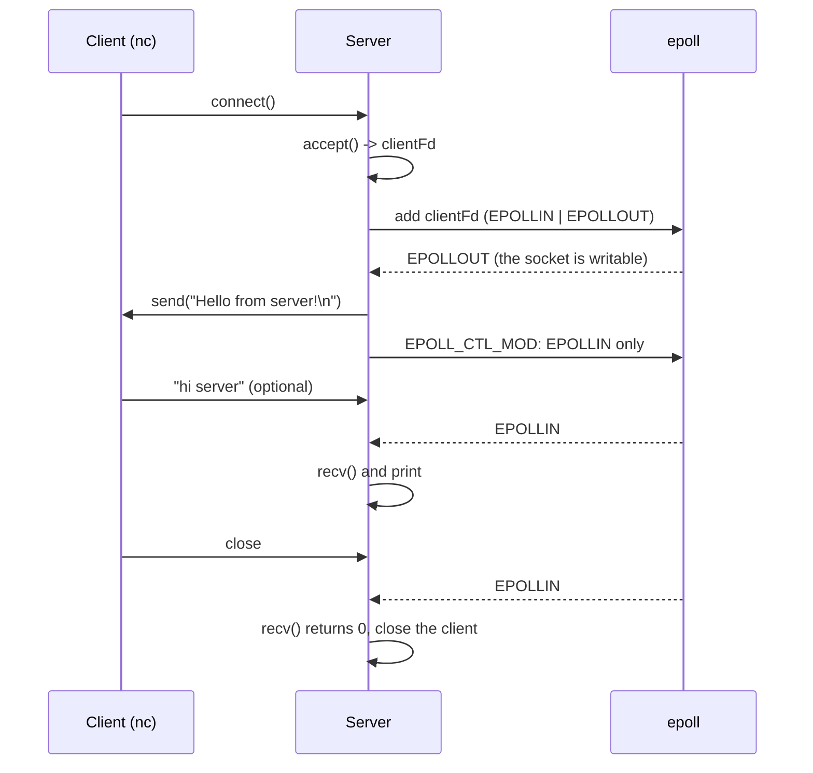
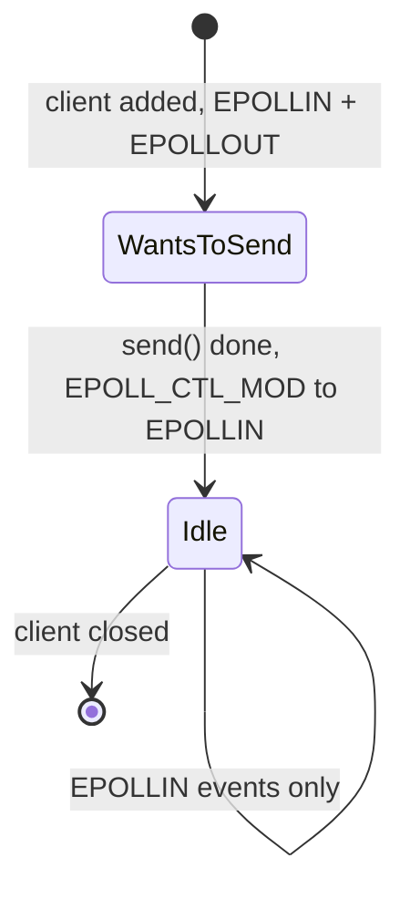
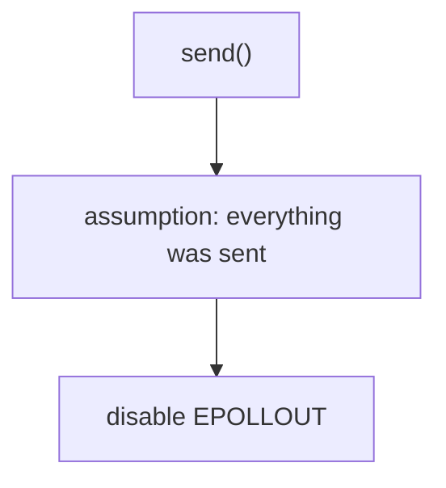
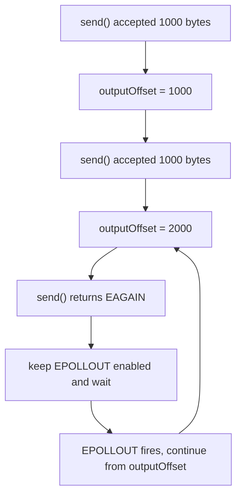

# epoll Lab: `send()` when `EPOLLOUT` fires

In the previous lab we saw **when** epoll reports `EPOLLOUT`. Now we add a real `send()`.

We do **not** force a partial write yet. This lab only shows the relation between three things:


The next lab will create the harder cases: a partial write and `EAGAIN`.

Source: [main.cpp](./main.cpp)

## 1. The experiment

As soon as a client connects, the server sends it this message:

```text
Hello from server!
```



## 2. The important parts of the code

**Register the client for reading and writing:**

```cpp
clientEvent.events = EPOLLIN | EPOLLOUT;
```

**When `EPOLLOUT` fires, send the message:**

```cpp
const char message[] = "Hello from server!\n";

ssize_t bytesSent = send(fd, message, sizeof(message) - 1, 0);
```

`sizeof(message) - 1` removes the `'\0'` at the end of the string, so we send `19` bytes: 18 characters plus the newline.

**After the send, stop watching `EPOLLOUT`:**

```cpp
clientEvent.events = EPOLLIN;
clientEvent.data.fd = fd;

epoll_ctl(epollFd, EPOLL_CTL_MOD, fd, &clientEvent);
```

## 3. Build and run

```bash
cmake -S . -B build
cmake --build build

./build/epoll-partial-write-lab2
```

Expected first line:

```text
Server listening on port 12345
```

In a second terminal:

```bash
nc 127.0.0.1 12345
```

The client receives:

```text
Hello from server!
```

## 4. Result

I ran the server with a client that connected, read the reply, sent `hi server`, and closed the connection.

**Server output:**

```text
Server listening on port 12345
Client connected. fd = 5
EPOLLOUT on fd 5
send() returned 19
Client sent: hi server

Client disconnected
```

**Client output:**

```text
Hello from server!
```

If the client connects and closes at once without reading or sending anything, the server prints:

```text
Server listening on port 12345
Client connected. fd = 5
EPOLLOUT on fd 5
send() returned 19
Client disconnected
```

## 5. What happened, step by step

1. **The client connects.** The listening socket gets `EPOLLIN`, the server calls `accept()` and gets `clientFd = 5`.
2. **The client is added to epoll** with `EPOLLIN | EPOLLOUT`.
3. **`EPOLLOUT` fires immediately.** The socket is writable, because its kernel send buffer is empty (see the previous lab).
4. **The server calls `send()`.** It returns `19`: the kernel accepted all 19 bytes into the send buffer.
5. **The server removes `EPOLLOUT`.** There is nothing else to send, so it switches the mask to `EPOLLIN` only.
6. **Later events are only `EPOLLIN`:** the client sends data, or closes the connection (`recv()` returns `0`).

> `send()` returning `19` means "19 bytes were copied into the kernel send buffer". It does not mean the client already received them.

## 6. Why `EPOLL_CTL_MOD` matters

Without the `EPOLL_CTL_MOD` step, the socket stays registered for `EPOLLOUT`. It is almost always writable and the registration is level-triggered, so `epoll_wait()` would return `EPOLLOUT` again and again. The server would print `send() returned 19` in a loop and send the message over and over (try it by commenting that block out).



The rule from the previous lab applies:

| Output state | `EPOLLOUT` |
|---|---|
| Nothing to send | **off** |
| Something to send | **on** |

## 7. The problem with this code

The code assumes that after `send()` returns, **all** the data was sent:



`send()` does not promise that. With a bigger message it can accept only part of the data:


In this lab the message is only 19 bytes, so the kernel always accepts all of it and the bug cannot be seen. It appears with large data or a slow client.

## 8. Next lab: partial write and `EAGAIN`

We will send a large amount of data and keep what was not sent in a per-client buffer:

```text
outputBuffer
┌───────────────────────────────┐
│ ABCDEFGHIJKLMNOPQRSTUVWXYZ... │
└───────────────────────────────┘
       ▲
       │
  outputOffset
```



That is where `EPOLLOUT` becomes truly necessary, not just an experiment showing that a socket is writable.

## Notes and things to improve

These are small gaps in the current code. They are fine for this experiment but need fixing in a real server:

1. **Compare `bytesSent` with the message length.** Only `bytesSent == length` means everything was sent. Anything less is a partial write and the rest must be kept.
2. **A retry after a partial write would restart from the beginning.** The message is a local variable inside the event handler, and the code has no offset. If `EPOLLOUT` fired again, it would resend from byte 0 and the client would get duplicated data. The data must live in a per-client `outputBuffer` with an `outputOffset`.
3. **The `EAGAIN` branch uses `continue`.** `EPOLLOUT` stays enabled, so the send is retried on the next event, which is correct. But `continue` also skips the `EPOLLIN` handling for that same event.
4. **Check the result of `epoll_ctl(EPOLL_CTL_MOD)`.** It is ignored here. `MOD` replaces the whole mask, so keep `EPOLLIN` in it (add `EPOLLET` too if the socket uses it).
5. **Handle `recv()` errors.** Only `bytesRead > 0` and `bytesRead == 0` are handled. A real error such as `ECONNRESET` is ignored, so the client is never closed and level-triggered `EPOLLIN` keeps firing. `EAGAIN` should be ignored, any other error should close the client.
6. **Handle `EPOLLERR` and `EPOLLHUP`.** epoll reports them even if you do not ask for them. Treat them as "close this client".
7. **Use `MSG_NOSIGNAL`.** Writing to a connection the peer already closed can raise `SIGPIPE`, which kills the process by default. Use `send(fd, ..., MSG_NOSIGNAL)` and treat `EPIPE` / `ECONNRESET` as "close this client".
8. **No `SO_REUSEADDR`.** Restarting the server right after clients were connected can fail with `bind failed: Address already in use`.
