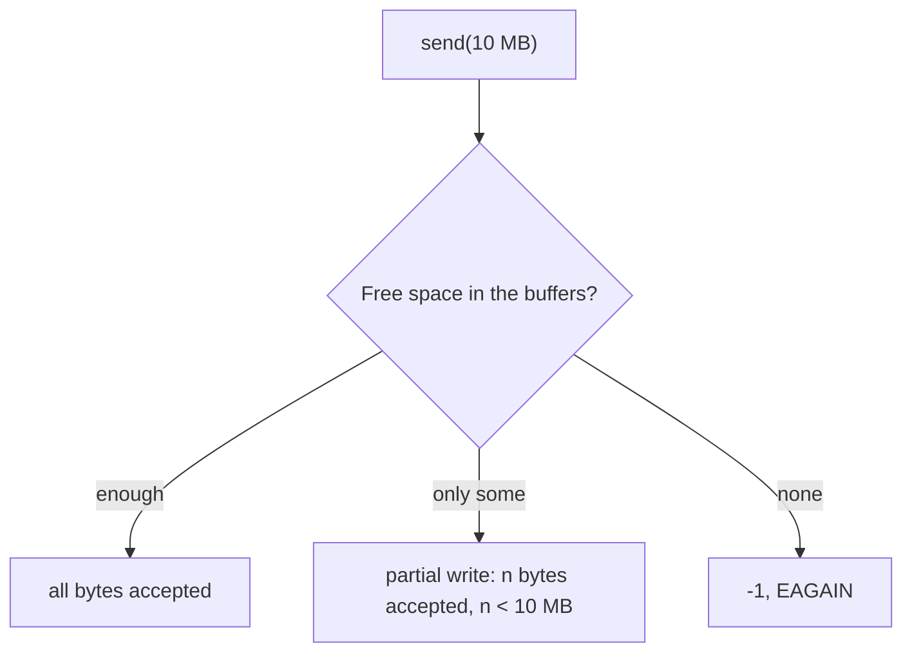
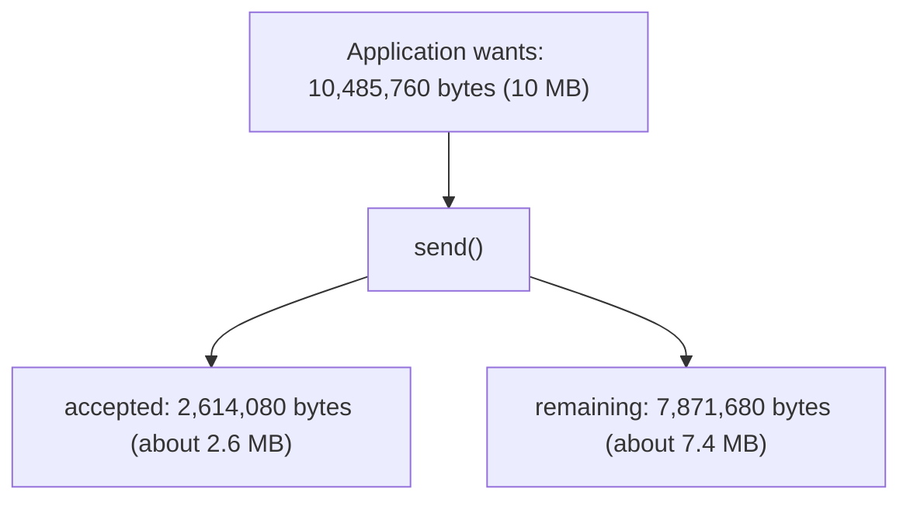
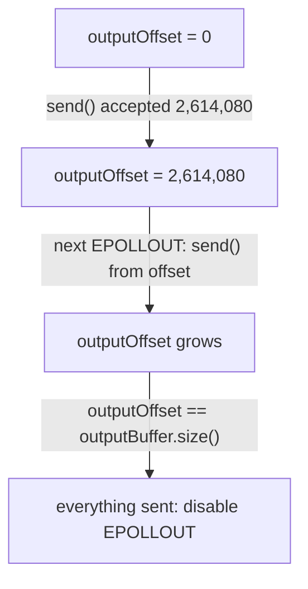
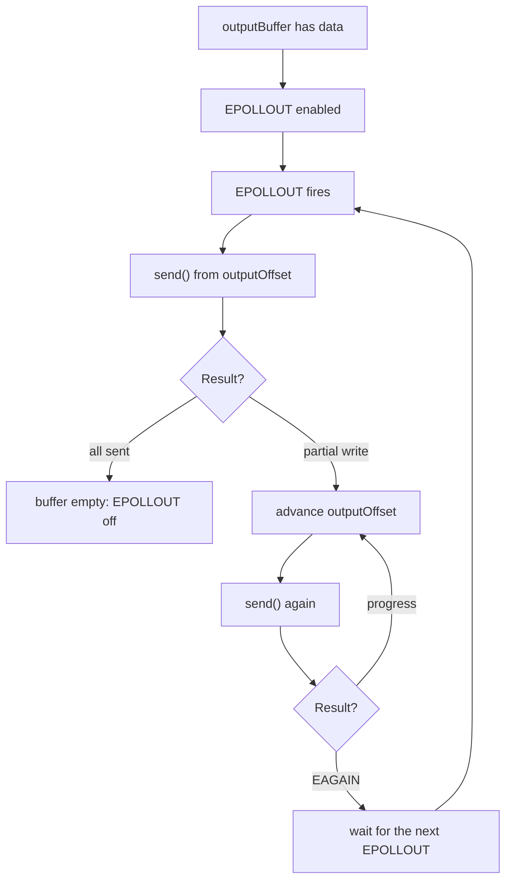
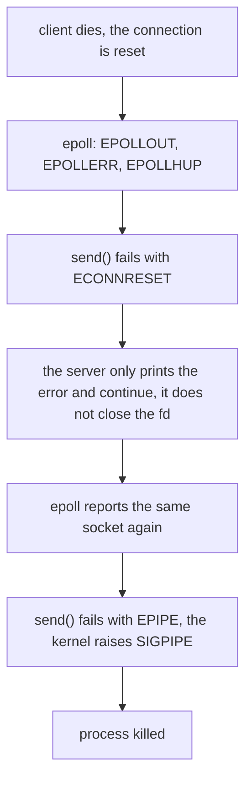
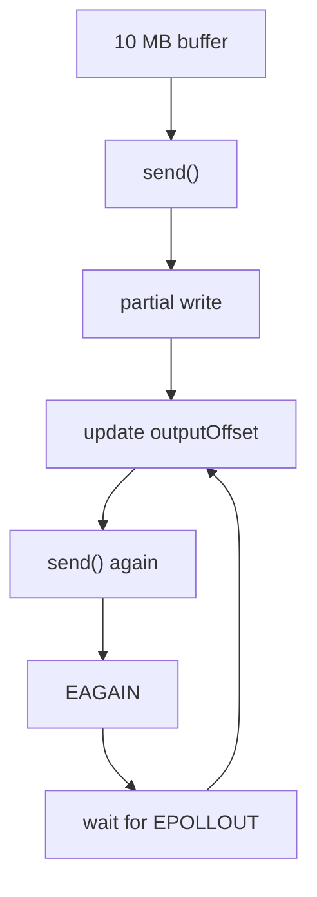

# epoll Lab: Partial Write

This is the most important part of `EPOLLOUT`: the **partial write**.

The goal is to prove one thing:

> `send()` does **not** promise to send all the data you asked it to send.

Files:

| File | Purpose |
|---|---|
| [server.cpp](./server.cpp) | Server that tries to send 10 MB to each client when `EPOLLOUT` fires. |
| [client.cpp](./client.cpp) | Client that connects and **never reads** from the socket. |
| [CMakeLists.txt](./CMakeLists.txt) | Builds both: `server` and `client`. |

## 1. The experiment

The server prepares a large message instead of `Hello from server!`:

```text
10 MB  (10 * 1024 * 1024 'A' characters)
```

The client connects but does **not** read. The data piles up in the TCP buffers until they are full:


Because the client never reads, at some point there is no room left on the way and `send()` cannot take everything:



> Do not use `nc` for this experiment. `nc` keeps reading from the socket (and `nc ... > /dev/null` reads even faster), so the buffers never fill. That is why we use our own client that never calls `recv()`.

## 2. The code

**Server: watch the client for writing.** The client is added with `EPOLLOUT` only, because this server has nothing to read:

```cpp
clientEvent.events = EPOLLOUT;
```

**Server: on `EPOLLOUT`, send the whole message and print the result:**

```cpp
ssize_t bytesSent = send(fd, message.data(), message.size(), 0);

if (bytesSent == -1)
{
    if (errno == EAGAIN || errno == EWOULDBLOCK)
        std::cout << "send() -> EAGAIN\n";
    else
        std::cerr << "send() failed: " << std::strerror(errno) << '\n';

    continue;
}

std::cout << "send() -> " << bytesSent << " bytes\n";
```

**Client: connect and sleep forever:**

```cpp
connect(fd, ...);
std::cout << "I will NOT read from socket.\n";

while (true)
    sleep(1);
```

## 3. Build and run

```bash
cmake -S . -B build
cmake --build build
```

Terminal 1:

```bash
./build/server
```

```text
Prepared 10485760 bytes
```

Terminal 2:

```bash
./build/client
```

```text
Connected.
I will NOT read from socket.
```

## 4. Result

Server output:

```text
Prepared 10485760 bytes
Client connected. fd = 5
EPOLLOUT
send() -> 2614080 bytes
```

We asked to send `10485760` bytes, and `send()` returned `2614080`:



This is a **partial write**. The exact number depends on your system (socket buffer sizes are tuned by the kernel), but it will be smaller than 10 MB.

Notice what did **not** happen:

* There is **no** `send() -> EAGAIN` line. After the partial write the buffers are full, so the socket is not writable and epoll stays silent. `EAGAIN` appears only if we call `send()` again ourselves (we will do that in the next lab).
* The server did not print anything else, because nothing changed. It is waiting for `EPOLLOUT`.

## 5. A design bug in this experiment

Every time `EPOLLOUT` fires, the server sends from the **start** of the message:

```cpp
send(fd, message.data(), message.size(), 0);
```

But after a partial write, the first 2.6 MB were already accepted. The next send should continue from there. Instead, it would send the first bytes again:


In this run the second `EPOLLOUT` never came (until the client died, see section 8), so the bug stayed hidden. It is still wrong.

## 6. The fix: output buffer and offset

The server must remember how much of the message was already accepted:

```cpp
std::string outputBuffer;
std::size_t outputOffset = 0;
```

```text
outputBuffer
┌─────────────────────────────────────┐
│ already accepted │ still to send    │
└─────────────────────────────────────┘
                   ▲
                   │
             outputOffset
```

After each `send()`, move the offset and continue from there:

```cpp
ssize_t n = send(
    fd,
    outputBuffer.data() + outputOffset,
    outputBuffer.size() - outputOffset,
    0);

if (n > 0)
    outputOffset += n;
```

Example with the numbers from this lab:



## 7. The real pattern for non-blocking output



What the return value of `send()` really means:

| Return value | Meaning |
|---|---|
| `n == size` | The kernel accepted all the data. |
| `0 < n < size` | **Partial write.** `n` bytes were accepted, `size - n` bytes remain. |
| `-1`, `EAGAIN` / `EWOULDBLOCK` | Nothing accepted right now. Wait for `EPOLLOUT`. |
| `-1`, another `errno` | Real error. Close the client. |

So `send(fd, data, size, 0)` means:

> "Try to send up to `size` bytes without blocking, and tell me how many were accepted."

## 8. What happens when the client dies

Stop the client (for example with `Ctrl+C` or `kill`) while the server is running. The server **crashes**. I traced it with `strace`:

```text
epoll_wait(...) = [{events=EPOLLOUT|EPOLLERR|EPOLLHUP, data=fd 5}]
sendto(5, ...) = -1 ECONNRESET (Connection reset by peer)
epoll_wait(...) = [{events=EPOLLOUT|EPOLLHUP, data=fd 5}]
sendto(5, ...) = -1 EPIPE (Broken pipe)
--- SIGPIPE ---
+++ killed by SIGPIPE +++
```

Server log (stdout is buffered when redirected, so the last lines may be missing):

```text
Prepared 10485760 bytes
Client connected. fd = 5
EPOLLOUT
send() -> 2614080 bytes
EPOLLOUT
send() failed: Connection reset by peer
```

The exit status of the server is `141` (`128 + 13`, where `13` is `SIGPIPE`).



Two mistakes caused this:

1. After a real `send()` error the server did not remove the fd from epoll and did not `close()` it, so the dead socket kept coming back.
2. `send()` on a broken connection raises `SIGPIPE`, and the default action kills the process.

The fix is small:

```cpp
send(fd, data, size, MSG_NOSIGNAL);   // return EPIPE instead of killing the process

// on any error other than EAGAIN:
epoll_ctl(epollFd, EPOLL_CTL_DEL, fd, nullptr);
close(fd);
```

Also treat `EPOLLERR` and `EPOLLHUP` as "close this client".

## 9. Next lab

A very small version with `outputOffset`, before we put everything into the full TCP server:



That puts `EPOLLOUT`, partial write, `EAGAIN` and the output buffer together as one unit.

## Notes and things to improve

1. **The numbers vary.** `2614080` came from my machine. Socket buffer sizes change with the kernel, system settings, and the client's receive buffer. You can look at the queues while the client is connected with `ss -tn '( sport = :12345 or dport = :12345 )'` (the `Send-Q` column).
2. **No `EPOLLIN` on the client socket.** The server registers only `EPOLLOUT`, so it never calls `recv()` and cannot see a normal close (`recv()` returning `0`). It finds out about a dead client only through `EPOLLERR` / `EPOLLHUP` or a failed `send()`.
3. **`EPOLLOUT` is level-triggered here.** If the socket is writable again, epoll reports it again, and the current code would restart from byte 0. This is another reason the offset is required.
4. **One shared 10 MB string.** All clients would use the same `message`. A real server needs a buffer (and offset) **per client**, because each client can be at a different position.
5. **When everything is sent, turn off `EPOLLOUT`** with `EPOLL_CTL_MOD`. Otherwise the level-triggered `EPOLLOUT` keeps waking the server for nothing (see the first `EPOLLOUT` lab).
6. **`accept()` is called once per event** and `SO_REUSEADDR` is not set, so restarting the server right after a client was connected can fail with `bind failed: Address already in use`.
7. **Memory and backpressure.** Producing data faster than the client reads makes the output buffer grow. Set a maximum size and stop producing (or close the client) when it is reached.
