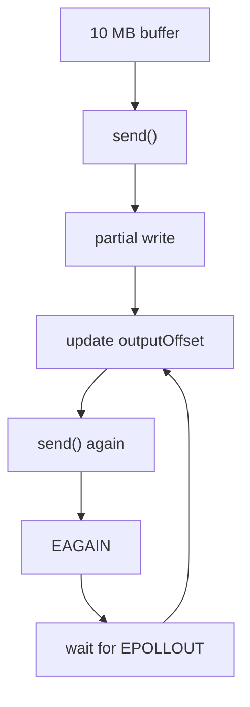
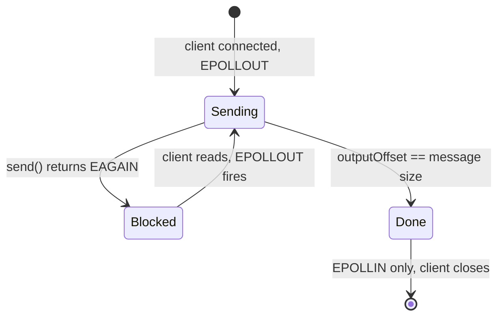
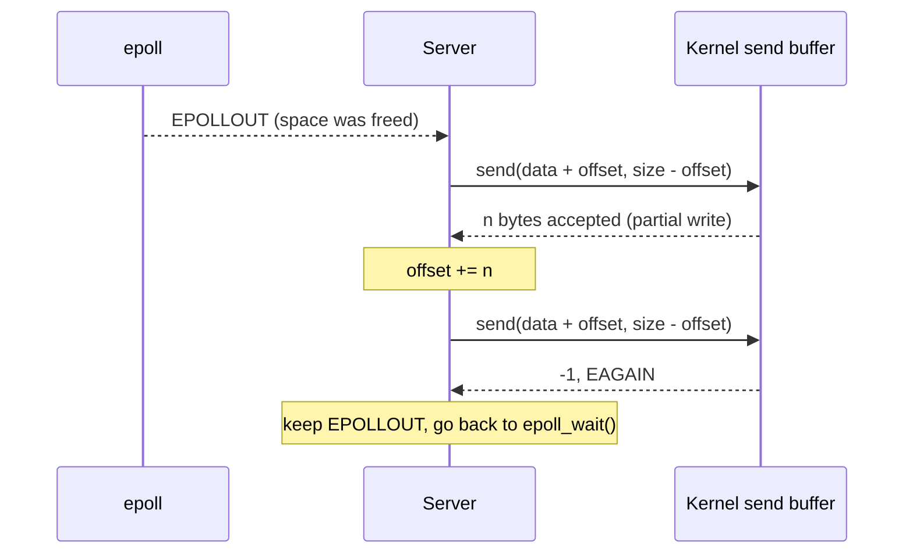

# epoll Lab: Partial Write with `outputOffset`

In the previous lab we saw that `send()` can accept only part of the data, and that the server then restarted from byte 0. This lab fixes it with the smallest possible design:



This puts `EPOLLOUT`, partial write, `EAGAIN` and the output offset together as one unit. After this, we can build the full TCP server.

Files:

| File | Purpose |
|---|---|
| [server.cpp](./server.cpp) | Sends 10 MB to each client, continuing from `outputOffset` after every partial write. |
| [client.cpp](./client.cpp) | Slow client: waits 2 seconds, then reads slowly and **checks every byte**. |
| [CMakeLists.txt](./CMakeLists.txt) | Targets `output_offset_server` and `slow_client`. |

## 1. What changed compared to the previous lab

| Previous lab | This lab |
|---|---|
| `send(fd, message.data(), message.size(), 0)` (always from byte 0) | `send(fd, message.data() + offset, message.size() - offset, ...)` |
| No state per client | `ClientState` per client, with `outputOffset` |
| One `send()` per event, `EAGAIN` rarely seen | `send()` loop until all data is accepted or `EAGAIN` |
| `EPOLLOUT` stays on forever | When everything is sent: switch to `EPOLLIN` |
| A dead client crashed the server (`SIGPIPE`) | `MSG_NOSIGNAL`, close the client on errors, handle `EPOLLERR` / `EPOLLHUP` |
| No `SO_REUSEADDR` | `SO_REUSEADDR` is set |

## 2. The important parts of the code

**State per client:**

```cpp
struct ClientState
{
    std::size_t outputOffset = 0;   // bytes of the message already accepted by send()
    int wakeups = 0;
    int sendCalls = 0;
    int eagainCount = 0;
};

std::unordered_map<int, ClientState> clients;   // key: client fd
```

Only `outputOffset` is needed for correctness. The other fields are counters for the printed summary.

**The write loop (runs when `EPOLLOUT` fires):**

```cpp
while (client.outputOffset < message.size())
{
    ssize_t sent = send(
        fd,
        message.data() + client.outputOffset,
        message.size() - client.outputOffset,
        MSG_NOSIGNAL);

    if (sent > 0)
    {
        client.outputOffset += sent;   // partial or full write: move the offset
        continue;
    }

    if (errno == EAGAIN || errno == EWOULDBLOCK)
        break;                         // buffer full: keep EPOLLOUT, wait

    // real error: close the client
}
```

**When everything was sent, stop watching `EPOLLOUT`:**

```cpp
clientEvent.events = EPOLLIN;
epoll_ctl(epollFd, EPOLL_CTL_MOD, fd, &clientEvent);
```

`EPOLLIN` stays on only to see the client close the connection (`recv()` returns `0`).

**The message is easy to verify.** Byte number `i` is `'A' + (i % 26)`:

```text
ABCDEFGHIJKLMNOPQRSTUVWXYZABCDEFGHIJKLMNOPQRSTUVWXYZ...
```

The client checks every byte it receives. If data is missing or repeated, the pattern breaks and the client tells us at which byte.

## 3. Build and run

```bash
cmake -S . -B build
cmake --build build
```

Terminal 1:

```bash
./build/output_offset_server
```

Terminal 2:

```bash
./build/slow_client
```

The client does this on purpose:


## 4. Result

Server output:

```text
Prepared 10485760 bytes
Client connected. fd = 5
EPOLLOUT #1: 1 send() calls accepted 2614080 bytes, offset = 2614080 / 10485760
  send() -> EAGAIN, wait for the next EPOLLOUT
EPOLLOUT #2: 1 send() calls accepted 1393458 bytes, offset = 4007538 / 10485760
  send() -> EAGAIN, wait for the next EPOLLOUT
EPOLLOUT #3: 1 send() calls accepted 1899007 bytes, offset = 5906545 / 10485760
  send() -> EAGAIN, wait for the next EPOLLOUT
EPOLLOUT #4: 1 send() calls accepted 1506109 bytes, offset = 7412654 / 10485760
  send() -> EAGAIN, wait for the next EPOLLOUT
EPOLLOUT #5: 1 send() calls accepted 1440626 bytes, offset = 8853280 / 10485760
  send() -> EAGAIN, wait for the next EPOLLOUT
EPOLLOUT #6: 1 send() calls accepted 1440626 bytes, offset = 10293906 / 10485760
  send() -> EAGAIN, wait for the next EPOLLOUT
EPOLLOUT #7: 1 send() calls accepted 191854 bytes, offset = 10485760 / 10485760
All bytes sent. EPOLLOUT wakeups: 7, send() calls: 7, EAGAIN: 6
Client closed, fd = 5
```

Client output:

```text
Connected. Not reading for 2 seconds, so the server's buffers fill up.
Reading slowly now.
Received 10485760 bytes
Data OK
```

The exact byte counts depend on your system, but the pattern is the same.

## 5. How to read this output

* **Wakeup #1:** the first `send()` accepted only `2614080` of `10485760` bytes. That is the partial write from the previous lab. The offset moved to `2614080`.
* **Then `EAGAIN`:** the loop called `send()` again and the kernel said "no room". The server stops and waits. Nothing is spent on polling.
* **Wakeups #2 to #6:** each time the client reads some data, space is freed and `EPOLLOUT` fires. The server continues **from the offset**, accepts another 1.4 to 1.9 MB, and gets `EAGAIN` again.
* **Wakeup #7:** the remaining `191854` bytes fit, the offset reaches `10485760`, and the loop ends **without** `EAGAIN`.
* **Summary line:** 7 wakeups, 7 successful `send()` calls, 6 `EAGAIN`.
* **`Data OK`:** all `10485760` bytes arrived, in order, with no repetition.



The sequence for one wakeup:



## 6. Experiment: remove the offset and see what breaks

Change only this line in `server.cpp`:

```diff
-                        message.data() + client.outputOffset,
+                        message.data(),
```

Now every `send()` starts from byte 0 again. Result of the same test with this change:

```text
Connected. Not reading for 2 seconds, so the server's buffers fill up.
Reading slowly now.
Received 10485760 bytes
DATA WRONG at byte 2614080
```

The server log looks exactly the same as before (same counts, same offsets). It believes everything is fine. Only the client, which checks the data, notices the problem.

`2614080` is exactly where the first partial write ended. The correct next byte is `'A' + 2614080 % 26`, which is `'O'`, but the broken server sent `'A'` again (the start of the message).

> Counting bytes on the server is not enough. A missing offset gives the right number of bytes with the wrong content.

## 7. What happens when the client dies

I killed the client with `kill -9` before it finished reading. The server did **not** crash, unlike in the previous lab:

```text
All bytes sent. EPOLLOUT wakeups: 7, send() calls: 7, EAGAIN: 6
fd 5: EPOLLERR/EPOLLHUP, closing
```

* The server closed the dead client when epoll reported `EPOLLERR` / `EPOLLHUP`.
* `MSG_NOSIGNAL` means a write to a broken connection returns `EPIPE` instead of raising `SIGPIPE`.
* Any other `send()` error also closes the client.

> In this run the server had already handed all 10 MB to the kernel and was waiting only for `EPOLLIN`, so the test shows the `EPOLLERR` / `EPOLLHUP` cleanup. It does not exercise the `send()` error path. To test that path, kill the client earlier, for example 2.5 seconds after it starts (while it is still not reading).

## 8. Rules we confirmed

1. **`send()` returns how many bytes were accepted.** Add that number to the offset.
2. **Always send from `data + offset`.** Never from the start again.
3. **`EAGAIN` is not an error.** It means "wait for the next `EPOLLOUT`". Keep the data and the offset.
4. **Keep `EPOLLOUT` on only while data is pending.** When `offset == size`, switch to `EPOLLIN`.
5. **Close the client on real errors**, and use `MSG_NOSIGNAL`.
6. **Test the content, not only the byte count.**

## Notes and next steps

1. **The message is shared.** All clients send the same read-only `message`, and only `outputOffset` is per client. In the full echo server each client needs its **own** `outputBuffer`, because the data is different for each client.
2. **Why there is no `EAGAIN` on the last send.** When the remaining data fits, `send()` accepts it all and the loop ends with `offset == size`. That is why the summary shows 6 `EAGAIN` for 7 wakeups.
3. **`EPOLLET` and this loop.** The write loop already runs until the data is sent or `EAGAIN`, which is exactly what edge-triggered mode requires. I did not test this lab with `EPOLLET`.
4. **Backpressure.** If the client never reads, the offset stops moving but the server keeps the client open forever. A real server needs a timeout or a maximum buffer size.
5. **`lab3/CMakeLists.txt` is not in the parent `CMakeLists.txt`.** This lab was added to [../CMakeLists.txt](../CMakeLists.txt). Lab 3 is not listed there.
6. **Next step:** the full echo server. `recv()` appends data to a per-client `outputBuffer`, `send()` continues from `outputOffset`, and `EPOLLOUT` is turned on only while the buffer has data. Everything from this lab is reused.
