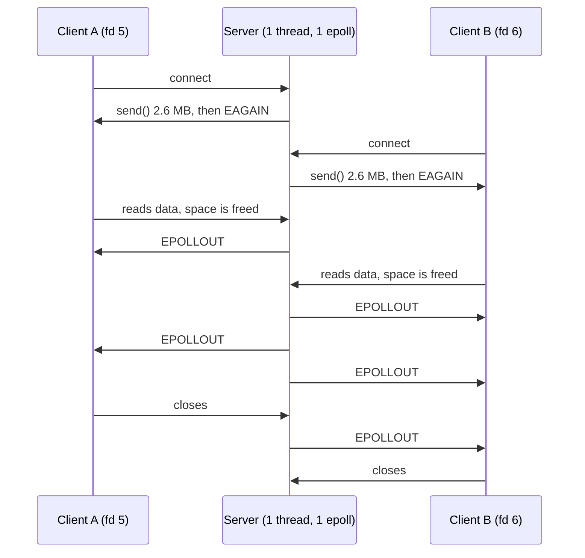
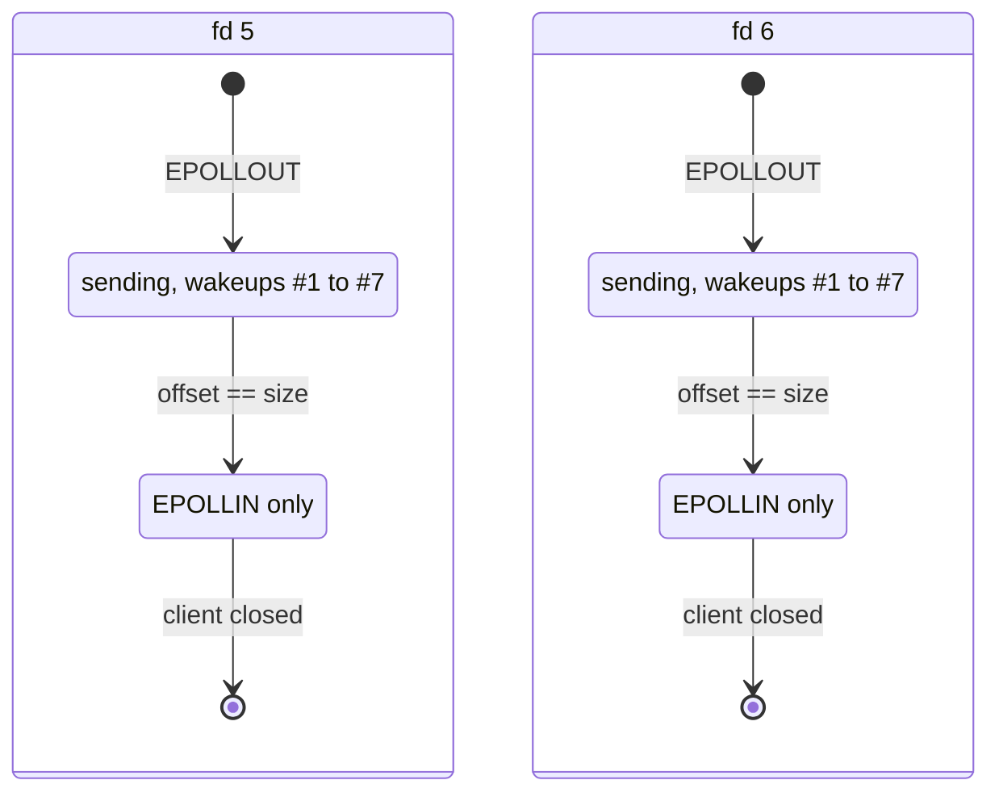

# Lab 4 Output Explained: Two Clients at Once

This note explains the output of [server.cpp](./server.cpp) when **two** `slow_client` programs are started at almost the same time (terminals 2 and 3).

```text
Terminal 1: ./build/epoll-partial-write-lab4/output_offset_server
Terminal 2: ./build/epoll-partial-write-lab4/slow_client   (becomes fd 5)
Terminal 3: ./build/epoll-partial-write-lab4/slow_client   (becomes fd 6)
```

Both clients ended with `Received 10485760 bytes` and `Data OK`.

## 1. The two streams are mixed in one log

The server is a single thread with a single `epoll`. It serves both clients in turn, so their lines are mixed.

The log lines **do not print the fd**, so you have to tell the clients apart yourself. There are two easy rules:

1. **The "wakeup" number is per client.** Each client has its own counter (`#1`, `#2`, ... `#7`).
2. **The offset continues from the same client's previous offset.** For example `4007538 + 1899007 = 5906545`, so these two lines belong to the same client.

Here is the full output with each line labeled:

```text
Prepared 10485760 bytes
Client connected. fd = 5                                                  <- client A connects
EPOLLOUT #1: ... accepted 2614080 bytes, offset = 2614080 / 10485760      [fd 5]
  send() -> EAGAIN, wait for the next EPOLLOUT                            [fd 5]
Client connected. fd = 6                                                  <- client B connects
EPOLLOUT #1: ... accepted 2614080 bytes, offset = 2614080 / 10485760      [fd 6]
  send() -> EAGAIN, wait for the next EPOLLOUT                            [fd 6]
EPOLLOUT #2: ... accepted 1393458 bytes, offset = 4007538 / 10485760      [fd 5]
  send() -> EAGAIN, wait for the next EPOLLOUT                            [fd 5]
EPOLLOUT #3: ... accepted 1899007 bytes, offset = 5906545 / 10485760      [fd 5]
  send() -> EAGAIN, wait for the next EPOLLOUT                            [fd 5]
EPOLLOUT #4: ... accepted 1506109 bytes, offset = 7412654 / 10485760      [fd 5]
  send() -> EAGAIN, wait for the next EPOLLOUT                            [fd 5]
EPOLLOUT #5: ... accepted 1440626 bytes, offset = 8853280 / 10485760      [fd 5]
  send() -> EAGAIN, wait for the next EPOLLOUT                            [fd 5]
EPOLLOUT #6: ... accepted 1440626 bytes, offset = 10293906 / 10485760     [fd 5]
  send() -> EAGAIN, wait for the next EPOLLOUT                            [fd 5]
EPOLLOUT #2: ... accepted 1393458 bytes, offset = 4007538 / 10485760      [fd 6]
  send() -> EAGAIN, wait for the next EPOLLOUT                            [fd 6]
EPOLLOUT #3: ... accepted 1637075 bytes, offset = 5644613 / 10485760      [fd 6]
  send() -> EAGAIN, wait for the next EPOLLOUT                            [fd 6]
EPOLLOUT #7: ... accepted 191854 bytes, offset = 10485760 / 10485760      [fd 5]
All bytes sent. EPOLLOUT wakeups: 7, send() calls: 7, EAGAIN: 6           [fd 5] finished
EPOLLOUT #4: ... accepted 1506109 bytes, offset = 7150722 / 10485760      [fd 6]
  send() -> EAGAIN, wait for the next EPOLLOUT                            [fd 6]
EPOLLOUT #5: ... accepted 1440626 bytes, offset = 8591348 / 10485760      [fd 6]
  send() -> EAGAIN, wait for the next EPOLLOUT                            [fd 6]
EPOLLOUT #6: ... accepted 1440626 bytes, offset = 10031974 / 10485760     [fd 6]
  send() -> EAGAIN, wait for the next EPOLLOUT                            [fd 6]
Client closed, fd = 5                                                     <- client A closed
EPOLLOUT #7: ... accepted 453786 bytes, offset = 10485760 / 10485760      [fd 6]
All bytes sent. EPOLLOUT wakeups: 7, send() calls: 7, EAGAIN: 6           [fd 6] finished
Client closed, fd = 6                                                     <- client B closed
```

## 2. Each client side by side

Splitting the log by client shows two clean, independent transfers:

| Wakeup | fd 5: accepted | fd 5: offset | fd 6: accepted | fd 6: offset |
|---|---|---|---|---|
| #1 | 2,614,080 | 2,614,080 | 2,614,080 | 2,614,080 |
| #2 | 1,393,458 | 4,007,538 | 1,393,458 | 4,007,538 |
| #3 | 1,899,007 | 5,906,545 | 1,637,075 | 5,644,613 |
| #4 | 1,506,109 | 7,412,654 | 1,506,109 | 7,150,722 |
| #5 | 1,440,626 | 8,853,280 | 1,440,626 | 8,591,348 |
| #6 | 1,440,626 | 10,293,906 | 1,440,626 | 10,031,974 |
| #7 | 191,854 | **10,485,760** | 453,786 | **10,485,760** |

Check the last row: `10,031,974 + 453,786 = 10,485,760`. Both clients got the whole message.

## 3. What this output shows

### 3.1 One thread served both clients without blocking

While fd 5 was blocked on `EAGAIN` (waiting for its client to read), the server accepted fd 6 and started sending to it. It never waited for either client.



The exact interleaving depends on when each client reads, so it can be different on every run.

### 3.2 Every client has its own offset

`ClientState` is stored per fd in `std::unordered_map<int, ClientState> clients`. That is why the two offsets (`10293906` for fd 5, `10031974` for fd 6) can be different at the same time, and why both clients received correct data.

> If there were **one shared** `outputOffset` for all clients, each client's progress would change the other's offset. Client B would skip bytes that client A had already consumed, and `slow_client` would most likely print `DATA WRONG` (this is reasoning, I did not run that variant).

The message (`message`) is shared, but it is read-only, so sharing it is fine. Only the position in it is per client.

### 3.3 The counters are per client too

`All bytes sent. EPOLLOUT wakeups: 7, send() calls: 7, EAGAIN: 6` appears **twice**, once per client. If the counters were global, the second line would show bigger numbers (like 14 wakeups).

Why 7, 7 and 6 in both cases:

* Each wakeup did **one** successful `send()`. In the loop, the second `send()` of the wakeup returned `EAGAIN`.
* The last wakeup (`#7`) is different: the remaining bytes fitted, the loop ended because `offset == size`, and no `EAGAIN` was needed.
* So `EAGAIN = wakeups - 1 = 6`.

### 3.4 Same sizes, different sizes

* For both clients the first wakeup accepted exactly `2614080` bytes. This is the kernel's buffer capacity for a client that has not read anything yet.
* Later sizes (`1393458`, `1506109`, `1440626`) are equal for both clients in several rows. They depend on how much space the kernel could free after the client read.
* Some rows differ (`#3`: `1899007` vs `1637075`, and the last wakeup: `191854` vs `453786`). Client B started reading later, so its buffers were in a slightly different state. These numbers depend on timing and system state and will change from run to run.

### 3.5 Why `Client closed, fd = 5` comes before fd 6 finished

Client A (fd 5) finished sending at wakeup `#7`, and the server then switched fd 5 to `EPOLLIN` only. fd 5 stopped producing `EPOLLOUT` events, so the log shows only fd 6 lines for a while. When client A finished reading and closed, `recv()` returned `0` and the server printed `Client closed, fd = 5` and cleaned it up. This happened while fd 6 was still in its transfer, between `#6` and `#7`.



The two state machines run independently inside the same event loop.

## 4. Why this is the correct behavior

| Check | Result |
|---|---|
| Each client received 10,485,760 bytes | Yes, `Received 10485760 bytes` in both terminals |
| No missing or repeated bytes | Yes, `Data OK` in both terminals |
| Server never blocked | Yes, it handled fd 6 while fd 5 was waiting |
| `EPOLLOUT` turned off after finishing | Yes, no more events for a finished client |
| Dead or finished clients cleaned up | Yes, `Client closed` for both |

## 5. Small improvement: print the fd

The log is hard to read because of the missing fd. You can add it to the lines in `server.cpp`:

```cpp
std::cout << "fd " << fd << " EPOLLOUT #" << client.wakeups
          << ": " << calls << " send() calls accepted "
          // ... rest unchanged
```

Do the same for the `EAGAIN` and `All bytes sent` lines. Then the output can be read directly, without matching offsets.

## 6. Things to try

1. **Three or more clients.** Start `slow_client` in 3 or 4 terminals. Every client should still print `Data OK`.
2. **A delayed second client.** Start the second client 3 or 4 seconds after the first. The first one will be far ahead, and the offsets will differ more.
3. **Kill one client in the middle.** Press `Ctrl+C` in one `slow_client` while the other is still reading. The server should close the dead one and the other should still finish with `Data OK`.
