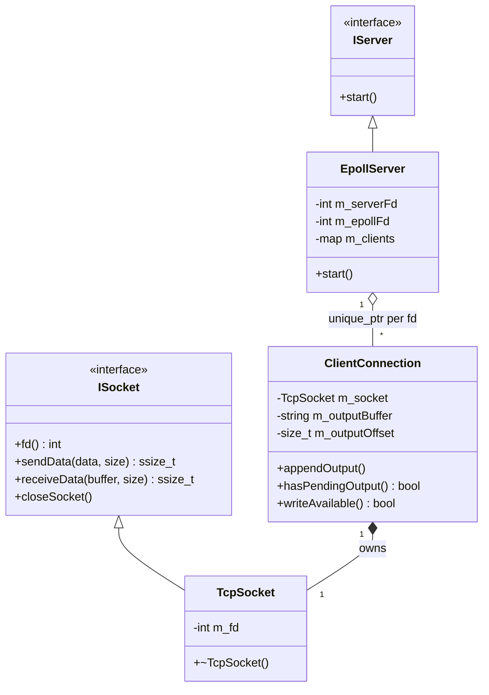
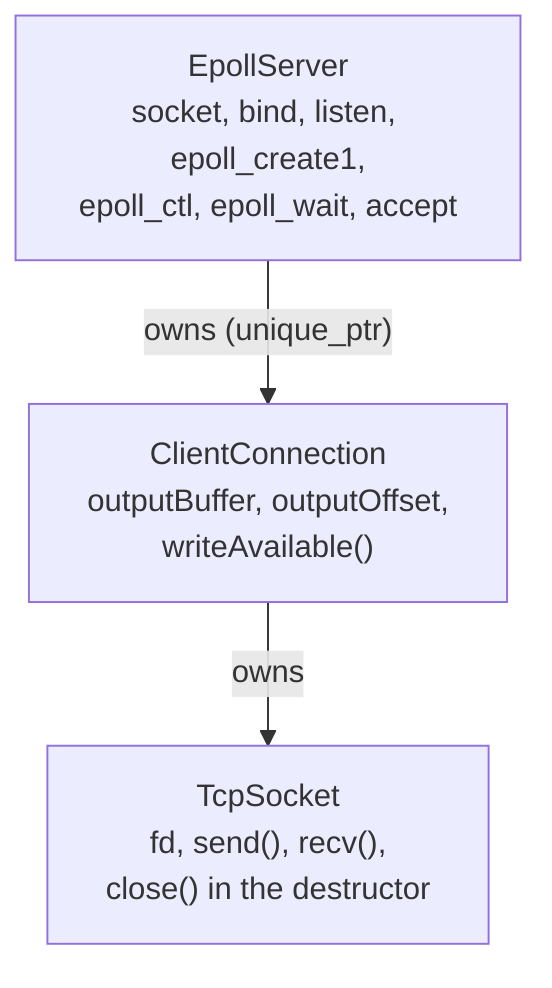
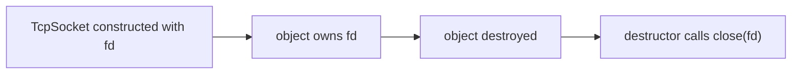
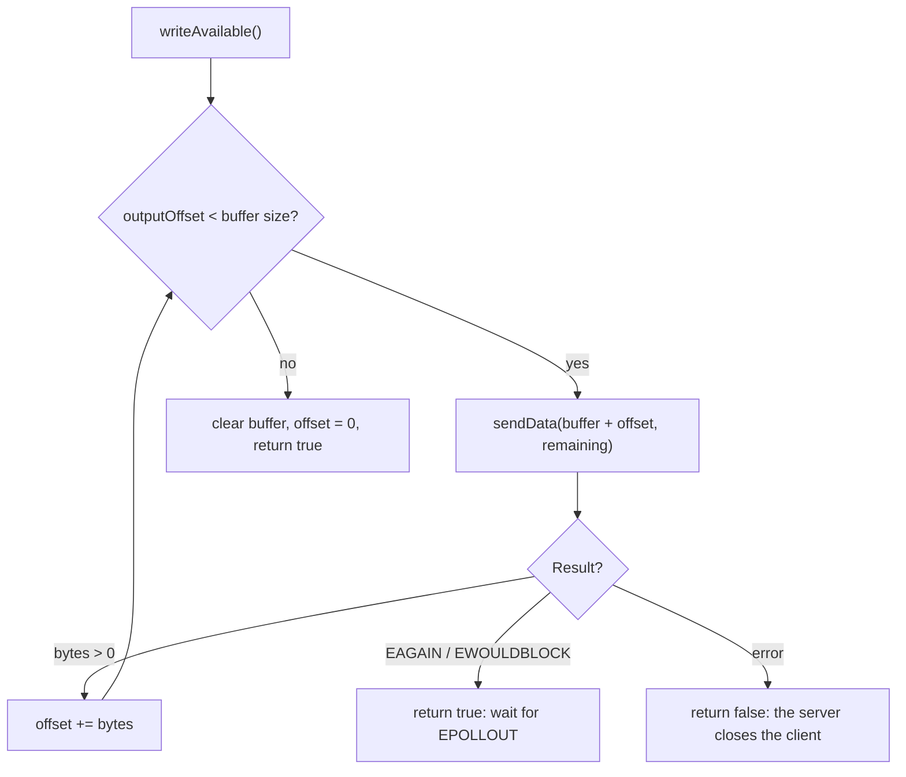
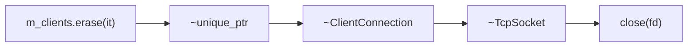
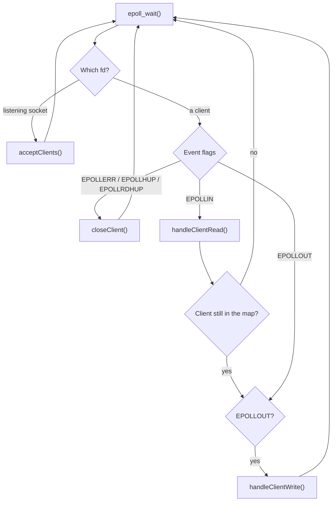
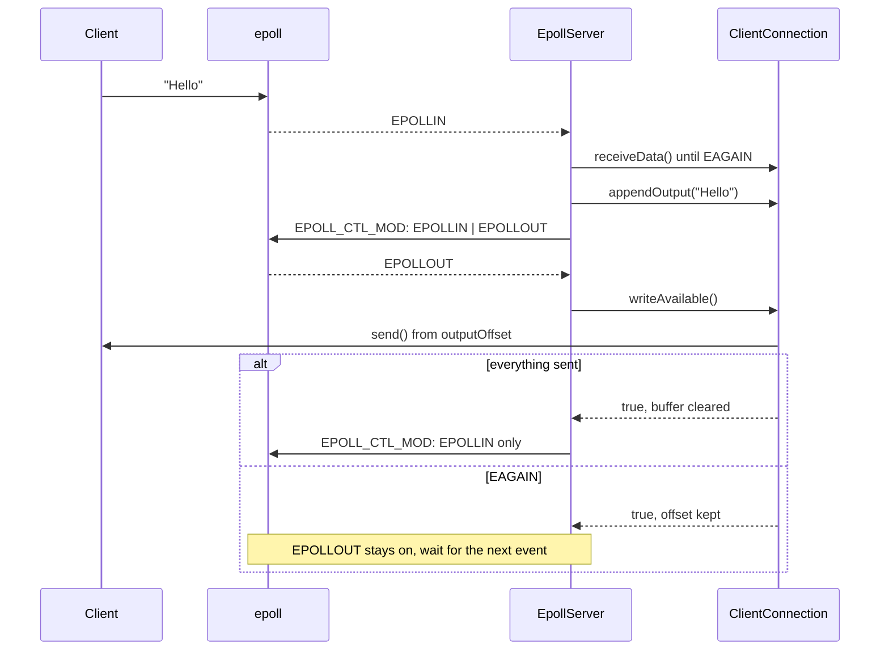

# epoll Echo Server with RAII, Classes and Interfaces

In `0x08_epoll-EPOLLET` we built an `epoll` echo server with partial writes as **one file of procedural code** (see `epoll-partial-write-lab3-1`). This lab moves the same logic into a cleaner C++ design:

* **RAII** for sockets: an object owns the file descriptor and closes it in its destructor.
* **Classes** with one responsibility each.
* **Interfaces** for the socket and the server.

The behavior is the same: non-blocking sockets, `EPOLLET`, an echo server, and an output buffer with `outputOffset` for partial writes. We do not use Boost.Asio yet.

## Project layout

```text
0x09_epoll-RAII/
├── CMakeLists.txt
├── main.cpp
├── interface/
│   ├── ISocket.hpp
│   └── IServer.hpp
├── socket/
│   ├── TCPSocket.hpp
│   └── TCPSocket.cpp
└── server/
    ├── ClientConnection.hpp
    ├── ClientConnection.cpp
    ├── EpollServer.hpp
    └── EpollServer.cpp
```

| File | Class | Role |
|---|---|---|
| [interface/ISocket.hpp](./interface/ISocket.hpp) | `ISocket` | Interface: `fd()`, `sendData()`, `receiveData()`, `closeSocket()`. |
| [interface/IServer.hpp](./interface/IServer.hpp) | `IServer` | Interface: `start()`. |
| [socket/TCPSocket.hpp](./socket/TCPSocket.hpp), [.cpp](./socket/TCPSocket.cpp) | `TcpSocket` | Owns one fd (RAII). Wraps `send()` and `recv()`. |
| [server/ClientConnection.hpp](./server/ClientConnection.hpp), [.cpp](./server/ClientConnection.cpp) | `ClientConnection` | One client: its socket, `outputBuffer` and `outputOffset`. |
| [server/EpollServer.hpp](./server/EpollServer.hpp), [.cpp](./server/EpollServer.cpp) | `EpollServer` | The event loop: listening socket, `epoll`, accept, read, write. |
| [main.cpp](./main.cpp) | | Creates `EpollServer(12345)` and calls `start()`. |

## Build and run

```bash
cmake -S . -B build
cmake --build build

./build/epoll_server
```

In another terminal:

```bash
nc 127.0.0.1 12345
```

Type a line and the server echoes it back. The server listens on port `12345`.

## The big picture



Who owns what:



| Class | It knows how to... |
|---|---|
| `TcpSocket` | handle **one file descriptor** (send, receive, close). |
| `ClientConnection` | manage **one connection's state** (what is left to send). |
| `EpollServer` | run the **event loop** (`epoll_wait()`, accept, `EPOLLIN`, `EPOLLOUT`). |

## 1. `TcpSocket`: RAII for the file descriptor

[socket/TCPSocket.cpp](./socket/TCPSocket.cpp)

```cpp
TcpSocket::~TcpSocket()
{
    closeSocket();
}

void TcpSocket::closeSocket()
{
    if (m_fd != -1)
    {
        ::close(m_fd);
        m_fd = -1;
    }
}
```

RAII means: the constructor takes the fd, the destructor releases it.



The class is **move-only**:

```cpp
TcpSocket(const TcpSocket&) = delete;
TcpSocket& operator=(const TcpSocket&) = delete;

TcpSocket(TcpSocket&& other) noexcept;              // takes the fd, sets other.m_fd = -1
TcpSocket& operator=(TcpSocket&& other) noexcept;   // closes its own fd first, then takes the other's
```

* **No copy:** two objects must never own the same fd, or the fd would be closed twice.
* **Move:** ownership can be transferred, and the moved-from object holds `-1`.
* **`closeSocket()` is safe to call twice,** because it sets `m_fd = -1` after closing. A manual call followed by the destructor is fine.

The practical result: no manual `close(clientFd)` for client sockets. Destroying the object closes the socket.

## 2. `ClientConnection`: the state of one client

[server/ClientConnection.cpp](./server/ClientConnection.cpp)

It owns the client's `TcpSocket` and the pending output:

```cpp
TcpSocket   m_socket;
std::string m_outputBuffer;
std::size_t m_outputOffset{0};
```

The partial-write logic from the earlier labs now lives here, in `writeAvailable()`:



The return value tells the server what to do: `true` means keep the client, `false` means close it.

`hasPendingOutput()` returns `outputOffset < outputBuffer.size()`. The server uses it to decide whether `EPOLLOUT` is needed.

## 3. `EpollServer`: the event loop

[server/EpollServer.cpp](./server/EpollServer.cpp)

| Method | What it does |
|---|---|
| `setup()` | `socket()`, non-blocking, `SO_REUSEADDR`, `bind()`, `listen()`, `epoll_create1()`, add the listening socket with `EPOLLIN \| EPOLLET`. |
| `acceptClients()` | `accept()` in a loop until `EAGAIN`. For each client: non-blocking, create `ClientConnection`, add to epoll with `EPOLLIN \| EPOLLET`. |
| `handleClientRead()` | `recv()` in a loop until `EAGAIN`. Appends the data to the client's output buffer (echo) and updates the events. |
| `handleClientWrite()` | Calls `client.writeAvailable()`. Closes the client if it returns `false`. |
| `updateClientEvents()` | `EPOLL_CTL_MOD`: `EPOLLIN \| EPOLLET`, plus `EPOLLOUT` only while there is pending output. |
| `closeClient()` | `EPOLL_CTL_DEL`, then erases the client from the map. |
| `start()` | `setup()`, then the `epoll_wait()` loop. |

Clients are stored in:

```cpp
std::unordered_map<int, std::unique_ptr<ClientConnection>> m_clients;
```

### Closing a client is automatic

```cpp
epoll_ctl(m_epollFd, EPOLL_CTL_DEL, fd, nullptr);   // 1. stop watching the fd
m_clients.erase(it);                                 // 2. destroy the object
```



The order matters: remove the fd from epoll **while it is still open**, then let the destructors close it.

### The event loop



After `handleClientRead()` the loop checks `m_clients.find(fd)` again, because the read may have closed the client (for example `recv()` returned `0`). Without that check the code would use a destroyed object.

## 4. The echo flow

When a client sends `Hello`:



This is the same pattern as the earlier labs: output buffer, `EPOLLOUT` only while there is data, continue from the offset after `EAGAIN`.

## 5. Test results

I built it with `-Wall -Wextra` (no warnings) and tested it with a Python client against the running server:

| Test | Result |
|---|---|
| Small echo (`Hello`) | OK |
| 3 MB echo, client sends and receives at the same time | OK, data identical |
| Two clients at once, 1 MB each, different patterns | Both OK |
| 8 MB echo, client does not read for 3 seconds, then reads everything | OK |
| Client sends `abc` and closes at once | Server stays alive, closes the client |

I also ran the 2 MB and 3 MB echo tests against a build with AddressSanitizer and UBSan: the data matched and the sanitizers reported nothing.

Example from the 8 MB test. The client was not reading, then started reading:

```text
[Client 5] sent 2614080 bytes, remaining = 5774528
[Client 5] send would block
[Client 5] sent 5774528 bytes, remaining = 0
[Client 5] output buffer drained
Closing client fd=5
```

`2614080 + 5774528 = 8388608` bytes (8 MB). The first `send()` was a partial write, the second hit `EAGAIN`, and the offset continued from where it stopped.

## 6. Notes and things to improve

These are points I found by reading the code. The code works for the tests above, but these are worth fixing:

1. **Double `close()` in `acceptClients()`.** The `ClientConnection` is created (and owns `clientFd`) *before* `epoll_ctl(ADD)`. If `epoll_ctl` fails, the code calls `close(clientFd)` and `continue`s, and then the `unique_ptr` destroys the object, which closes the same fd again. Remove the manual `close(clientFd)` there, or create the `ClientConnection` only after `epoll_ctl` succeeds. The `setNonBlocking` failure path is fine, because the object does not exist yet.
2. **Not fully RAII yet.** `m_serverFd` and `m_epollFd` are plain `int`s closed by hand in `~EpollServer()`. A small `UniqueFd` class (or reusing `TcpSocket`) would remove the last manual `close()` calls.
3. **No `MSG_NOSIGNAL`.** `TcpSocket::sendData()` calls `send(..., 0)`. Writing to a connection the peer already closed can raise `SIGPIPE` and kill the server (this crashed lab 3 of `0x08`). Use `MSG_NOSIGNAL`.
4. **`updateClientEvents()` runs after every `recv()` chunk.** It is called inside the read loop, so a 1 MB message can cause up to about 1000 `epoll_ctl(MOD)` calls. Call it once after the loop, or only when the buffer was empty before.
5. **`EPOLLRDHUP` is never delivered.** The loop checks it, but no `events` mask registers it. It is harmless now. If you register it, remember that a half-closed client may still have output waiting.
6. **The server prints all the data it receives.** For large transfers that makes a huge, slow log. Print only the byte count.
7. **Silent startup failures.** In `setup()` only `socket()` prints an error. If `bind()` fails (for example the port is in use), `start()` just returns and the program exits without a message.
8. **The interfaces are not used polymorphically.** `ClientConnection` holds a `TcpSocket` and `socket()` returns `TcpSocket&`, so `ISocket` is never used through a pointer or reference. `EpollServer` is also used directly in `main.cpp` instead of through `IServer`. The interfaces describe the design, but nothing depends on them yet.
9. **Naming.** The file is `TCPSocket.hpp` but the class is `TcpSocket`.
10. **No limit on `outputBuffer`.** A client that sends data but never reads makes the buffer grow without bound.

## 7. Next step

Make the listening socket and the epoll fd RAII objects too (a small fd wrapper, or a socket factory), so that `EpollServer` has almost no manual `close()`.

After that, we can compare this design with `Boost.Asio` directly:

| This lab | Boost.Asio |
|---|---|
| `EpollServer` (event loop, accept) | `io_context` + `tcp::acceptor` |
| `TcpSocket` | `tcp::socket` |
| `ClientConnection` | a session object |
| `outputBuffer` + `outputOffset` + `EPOLLOUT` | `async_write`, which keeps writing until all data is sent |
| `EPOLLIN` + `recv()` loop | `async_read_some` |

Asio hides the readiness handling (`epoll`, `EAGAIN`, `EPOLLOUT`, offsets) and gives you completion handlers instead. Having built the manual version first makes it clear what Asio does for you.
