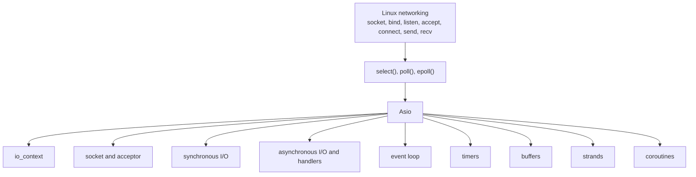
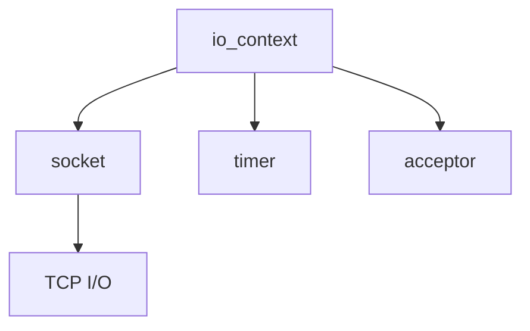
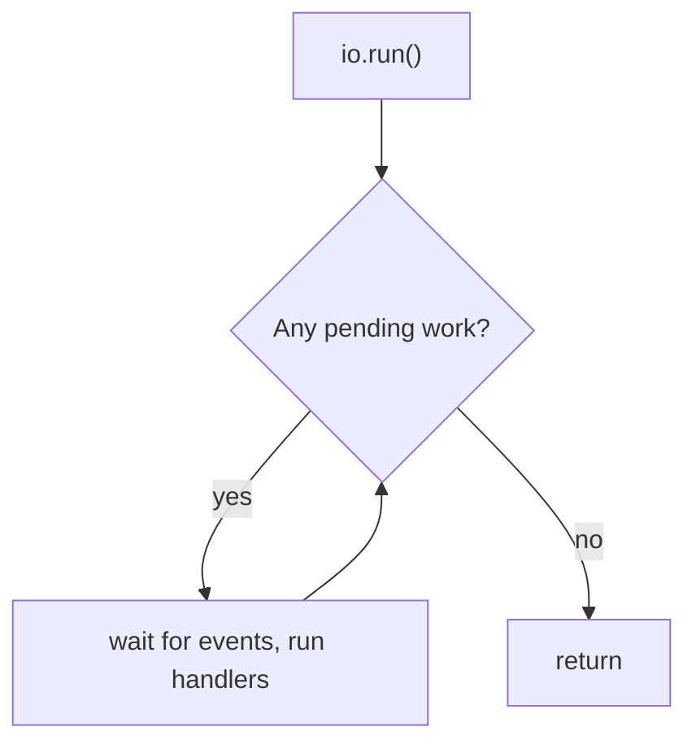
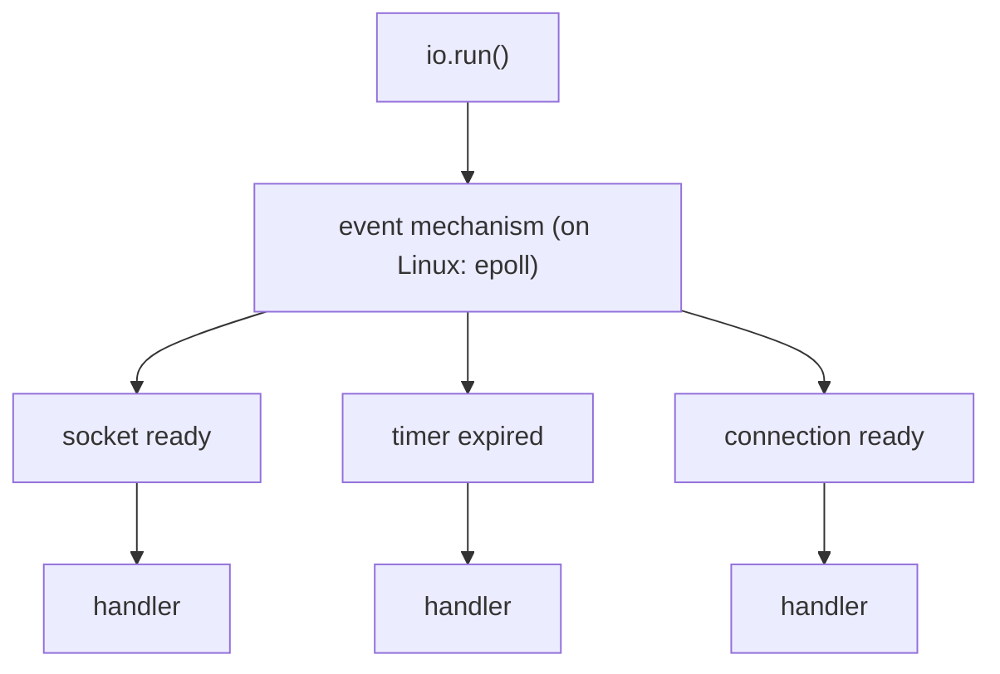
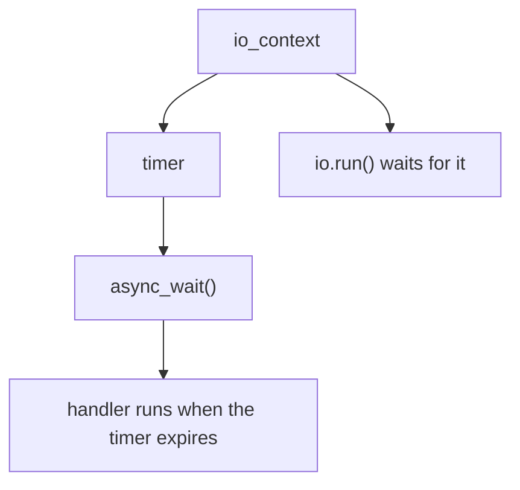

# Asio Kickoff

We finished the Linux networking basics: **sockets, blocking, non-blocking, `fcntl()`, `select()`, `poll()`, `epoll()`**. Now we start **Asio**.

The best way to start is **not** to jump into the API. First we see how Asio solves the same problems we already solved by hand, then we learn its pieces one at a time, with a small experiment for each.

## The plan



We start with **standalone Asio**, not Boost.Asio, to learn the library itself without depending on Boost.

## Files in this lab

| File | Binary | What it does |
|---|---|---|
| [main.cpp](./main.cpp) | `asio_hello` | Creates an `io_context` and prints a message. Checks that the setup works. |
| [main2.cpp](./main2.cpp) | `asio_run` | Calls `io.run()` with no work to see what it does. |
| [CMakeLists.txt](./CMakeLists.txt) | | Builds both programs as two separate executables. |

## Step 1: Set up Asio

### 1. What is Asio?

Asio is a C++ library for:

* TCP and UDP
* timers
* serial ports
* asynchronous I/O
* event-driven applications

> Asio is **not** a replacement for TCP/IP or Linux sockets. It is an abstraction on top of what the operating system provides.

On Linux, Asio uses OS mechanisms such as file descriptors and `epoll` underneath.

### 2. Standalone Asio vs Boost.Asio

| | Standalone Asio | Boost.Asio |
|---|---|---|
| Include | `#include <asio.hpp>` | `#include <boost/asio.hpp>` |
| Namespace | `asio::` | `boost::asio::` |
| Needs Boost | No | Yes |

We use standalone Asio. Moving to Boost.Asio later is easy, because the API is almost the same.

### 3. Installation (Ubuntu)

```bash
sudo apt update
sudo apt install libasio-dev
```

Check the files:

```bash
dpkg -L libasio-dev | head
```

You should see something like:

```text
/usr/include/asio.hpp
/usr/include/asio/...
```

On this machine the package is `libasio-dev 1:1.18.1-1`.

### 4. Project structure

```text
0x0A-ASIO-kickoff/
├── CMakeLists.txt
├── main.cpp
└── main2.cpp
```

### 5. `main.cpp`: the first Asio program

```cpp
#include <asio.hpp>
#include <iostream>

int main()
{
    asio::io_context io;

    std::cout << "Asio is working!\n";

    return 0;
}
```

We created:

```cpp
asio::io_context io;
```

This is **the most important object in Asio**, but we have not started it yet.

### 6. CMake

```cmake
cmake_minimum_required(VERSION 3.22.1)

project(asio_learning)

set(CMAKE_CXX_STANDARD 17)
set(CMAKE_CXX_STANDARD_REQUIRED ON)

add_executable(asio_hello main.cpp)
add_executable(asio_run main2.cpp)

foreach(target asio_hello asio_run)
    target_include_directories(${target} PRIVATE
        /usr/include
    )
endforeach()
```

> Each file has its own `main()`, so each one must be its own executable. If both files are in the same `add_executable`, the linker fails with `multiple definition of 'main'`.

On Ubuntu `/usr/include` is already searched by the compiler, so `target_include_directories` is not needed. It is kept to make the setup explicit.

### 7. Build and run

```bash
cmake -S . -B build
cmake --build build

./build/asio_hello
```

Expected output:

```text
Asio is working!
```

If you changed the CMake targets and the old build gives errors, delete the `build/` folder and configure again.

## The first mental model

Keep two things separate from the start.

**A socket** is the TCP endpoint:

```cpp
asio::ip::tcp::socket socket(io);
```

**`io_context`** is **not** a socket:

```cpp
asio::io_context io;
```

It is the object that runs and tracks asynchronous I/O operations and their handlers.



All Asio objects (sockets, timers, acceptors) are created with an `io_context`. This becomes important when we reach `io.run()`.

## Experiment: what does `io.run()` do?

[main2.cpp](./main2.cpp):

```cpp
#include <asio.hpp>
#include <iostream>

int main()
{
    asio::io_context io;

    std::cout << "Before run()\n";

    io.run();

    std::cout << "After run()\n";

    return 0;
}
```

Build and run it:

```bash
./build/asio_run
```

Output:

```text
Before run()
After run()
```

This looks strange at first: `run()` returned immediately.

The reason is that the `io_context` has **no work**. `io.run()` does **not** mean "enter an infinite loop". It means roughly:

> Run the pending asynchronous operations and handlers, and keep going while there is work.



With nothing registered, `run()` returns at once. When we add an async operation (a timer, then a socket), `run()` will stay inside until that work is complete.

## From our `epoll` loop to Asio

In the old socket project we wrote the event loop ourselves:

```cpp
while (running)
{
    epoll_wait(...);

    // handle events
}
```

In Asio the same idea moves into `io_context`:



| Our `epoll` code | Asio |
|---|---|
| `epoll_wait()` loop | `io.run()` |
| Check which fd is ready, then `recv()` | Asio does it and calls your **handler** |
| `EAGAIN`, `EPOLLOUT`, offsets | Handled inside Asio |
| `accept()` loop | `acceptor` + `async_accept` |

Asio helps us manage this lifecycle at a higher level.

> Do not assume that Asio is just `epoll`. On Linux it uses `epoll` by default, but other platforms use other mechanisms. We will look at what happens under the hood later.

## Next step: the first asynchronous operation

A timer, to see `async_*` for the first time:



It will explain:

* what `async_*` means
* what a handler is
* what `io.run()` waits for
* the event loop
* completion
* synchronous vs asynchronous I/O

After that we move to a **TCP socket** and connect everything to what we learned with `epoll`.
