# Asio Timer: the First Asynchronous Operation

This is the first real Asio concept: **`io_context` + an asynchronous operation + a handler**.

We will use these ideas in everything that follows: TCP, UDP, timers, accept, read, write, and coroutines.

We start with a **timer**, because it shows the asynchronous model without any networking details.

## Files

| File | Binary | What it does |
|---|---|---|
| [main.cpp](./main.cpp) | `asio-timer1` | Lab 1: a 2 second timer with `async_wait()` and `io.run()`. |
| [main2.cpp](./main2.cpp) | `asio-timer2` | Lab 2: prints `A`, `B`, `C` right after `async_wait()`, to show it does not block. |
| [CMakeLists.txt](./CMakeLists.txt) | | Builds both programs. |
| [build.sh](./build.sh) | | Configures and builds with CMake. |

## Build and run

```bash
cmake -S . -B build
cmake --build build

./build/asio-timer1
./build/asio-timer2
```

`build.sh` does the same thing: it configures in `build/` (Debug) and then builds, and it stops at the first error.

## The flow

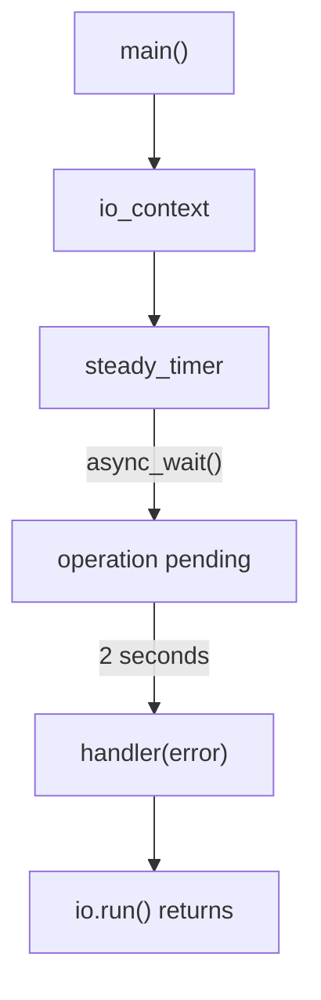

## Lab 1: the first timer

[main.cpp](./main.cpp):

```cpp
#include <asio.hpp>
#include <iostream>
#include <chrono>

int main()
{
    asio::io_context io;

    asio::steady_timer timer(
        io,
        std::chrono::seconds(2)
    );

    timer.async_wait(
        [](const asio::error_code& error)
        {
            if (!error)
            {
                std::cout << "Timer expired!\n";
            }
        }
    );

    std::cout << "Before io.run()\n";

    io.run();

    std::cout << "After io.run()\n";

    return 0;
}
```

Run:

```bash
./build/asio-timer1
```

Output:

```text
Before io.run()
```

and after about two seconds:

```text
Timer expired!
After io.run()
```

(I measured `2.00s` for the whole run.)

## Understanding the code, line by line

### 1. `io_context`

```cpp
asio::io_context io;
```

This is Asio's **execution context**. For now, think of it as the place where Asio manages asynchronous operations and runs their handlers.

### 2. The timer

```cpp
asio::steady_timer timer(io, std::chrono::seconds(2));
```

The timer is attached to `io` and set to expire after 2 seconds. Nothing has run yet: no callback was called.

### 3. The key line: `async_wait()`

```cpp
timer.async_wait(handler);
```

This tells Asio:

> "When the timer expires, run this handler."

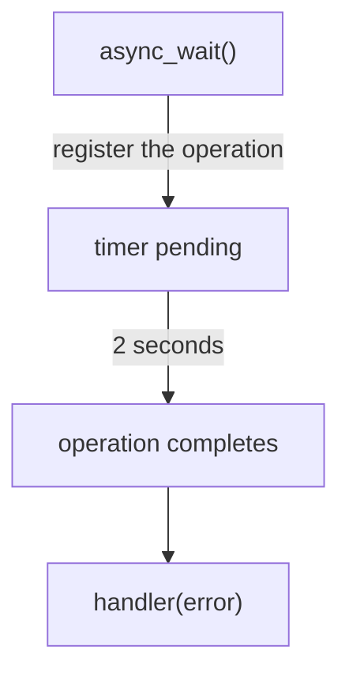

### 4. Does `async_wait()` wait?

No. The call **returns immediately**, and the timer keeps counting in the background. That is what `async` means.

```cpp
timer.async_wait(...);

std::cout << "Hello\n";   // printed right away
```

### 5. Who runs the handler? `io.run()`

```cpp
io.run();
```

`io.run()` processes the pending operations and calls the handlers when they complete:

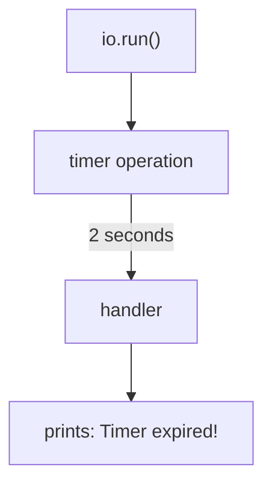

### 6. Compared with blocking code

Blocking:

```cpp
sleep(2);
std::cout << "Timer expired\n";
```

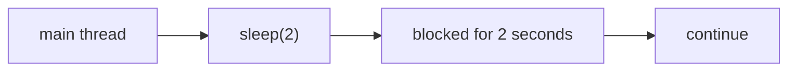

Asio:

```cpp
timer.async_wait(handler);   // register the operation
io.run();                    // handler runs when it completes
```

The operation is registered first. The handler is called when it completes.

## What is the relation to `epoll`?

We used to write the event loop ourselves:

```cpp
while (running)
{
    int n = epoll_wait(...);

    for (...)
    {
        // event happened
    }
}

recv(fd, ...);
```

With Asio we do not manage event notification this way. A simplified picture:

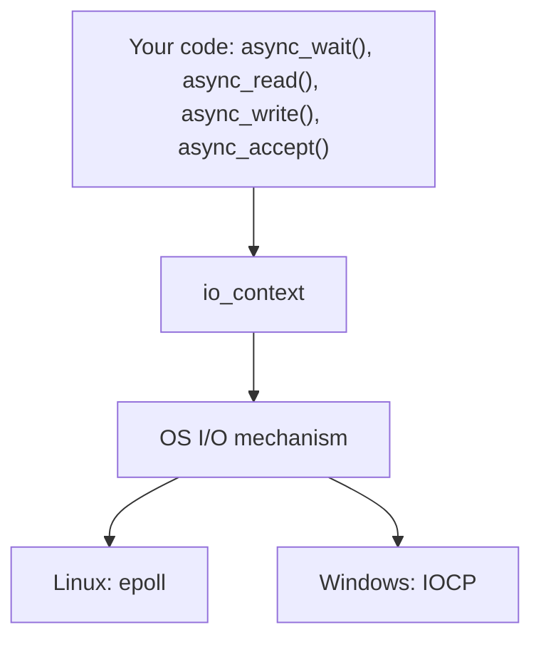

> This is a simplified mental model. It does not mean that every Asio operation turns into an `epoll_wait()` call in the same way. We will look at the implementation after we understand the API.

## `error_code`

The handler receives:

```cpp
const asio::error_code& error
```

An asynchronous operation can succeed, fail, or be cancelled:

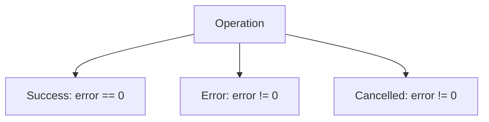

So the usual check is:

```cpp
if (!error)
{
    // success
}
```

To print the reason:

```cpp
if (error)
{
    std::cout << error.message() << '\n';
}
```

**Try it:** call `timer.cancel();` before `io.run()`, and print `error.message()` in the handler. The handler runs immediately and prints:

```text
Operation canceled
```

Cancelling does not skip the handler. The handler still runs, with an error.

## Lab 2: `async_wait()` does not block

[main2.cpp](./main2.cpp) uses a 5 second timer and prints three lines right after `async_wait()`:

```cpp
timer.async_wait(/* handler */);

std::cout << "A\n";
std::cout << "B\n";
std::cout << "C\n";

io.run();

std::cout << "D\n";
```

Run:

```bash
./build/asio-timer2
```

`A`, `B` and `C` appear immediately. After 5 seconds:

```text
Timer expired!
D
```

(Total run time measured: `5.00s`.)

`async_wait()` did not wait. What waited was **`io.run()`**, because it had a pending asynchronous operation.

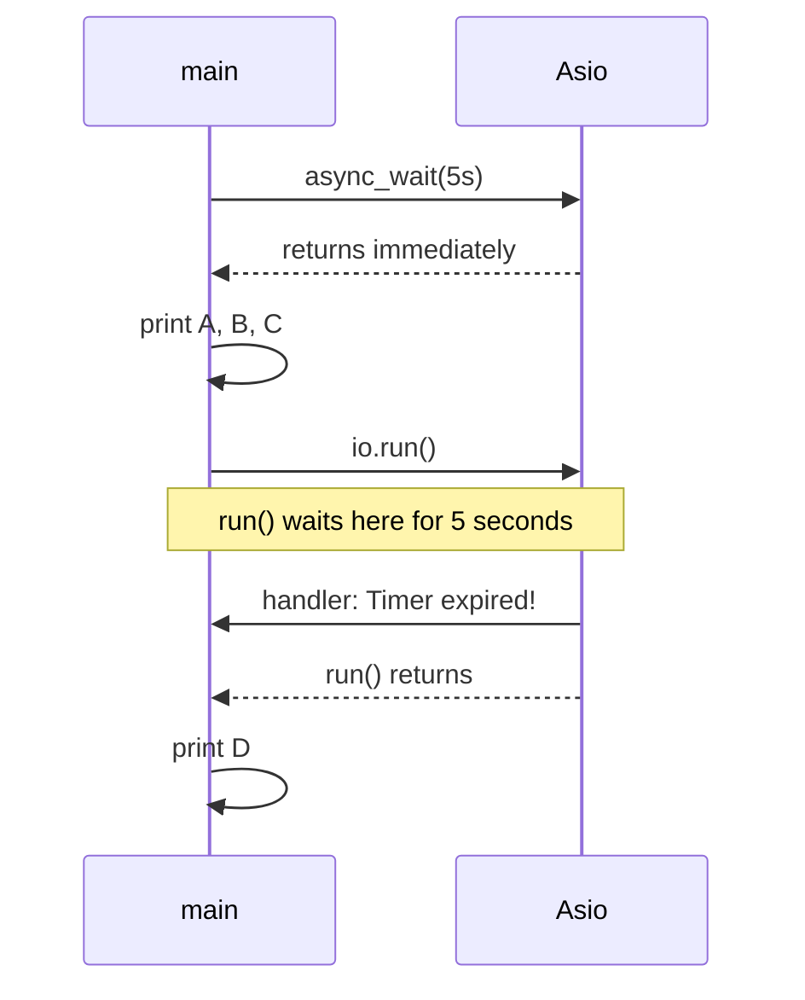

## Experiment: remove `io.run()`

Remove `io.run();` from Lab 1 and print `Done` at the end. The output is:

```text
Before io.run()
Done
```

and the program exits at once. The handler **never runs**.

The operation was registered, but nothing processed it:

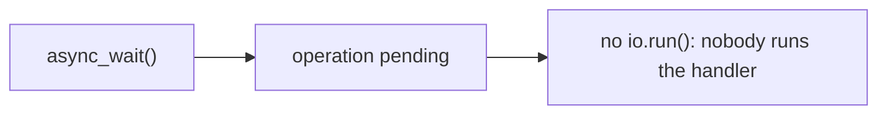

Rule:

> `async_*()` starts (registers) an asynchronous operation. `io_context::run()` is what processes it and calls the completion handlers.

## The handler is not a thread

```cpp
timer.async_wait(handler);
```

does **not** create a new thread for the handler. Asio does not start a thread per asynchronous operation. The handler runs on a thread that is inside `io.run()`.

I checked this by printing `std::this_thread::get_id()` in `main` and in the handler. Both printed the same thread id.

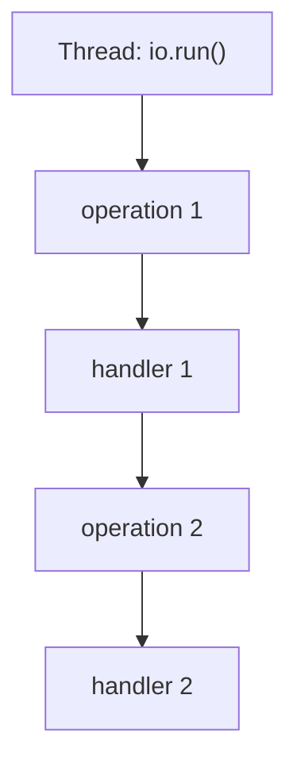

Later, when we study concurrency, we will see what happens when more than one thread calls `io.run()`.

## The new mental model

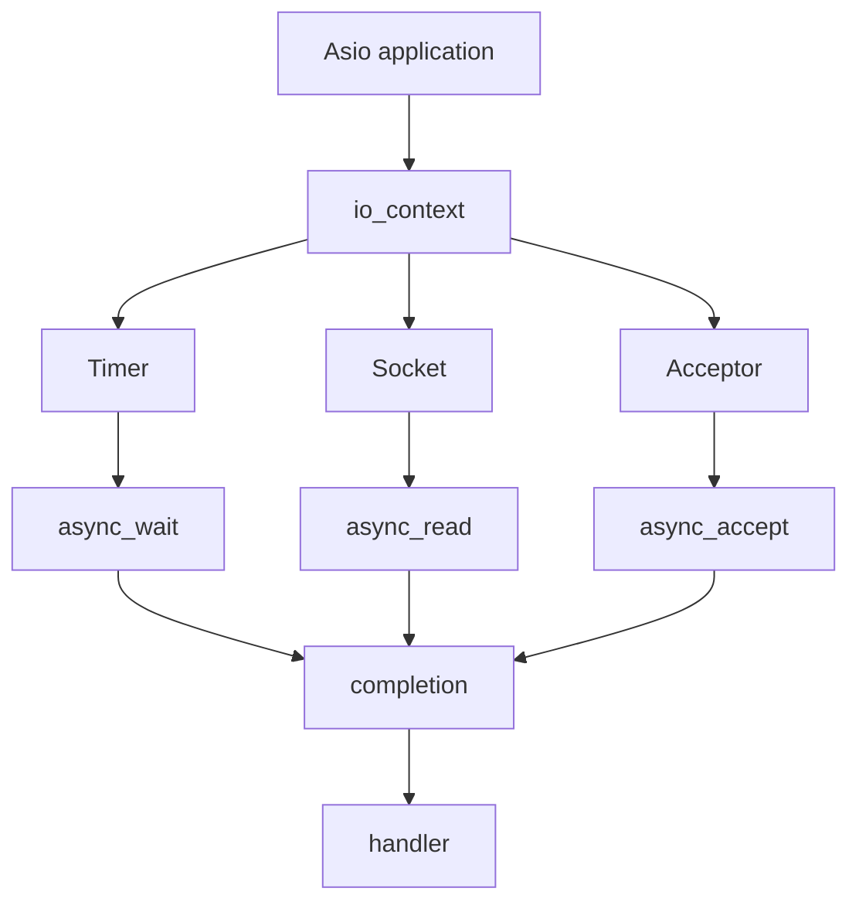

This is the foundation of almost all of Asio.

## Notes

1. **`run()` stays while there is work.** In the [previous lab](../0x0A-ASIO-kickoff) `run()` returned at once because there was nothing registered. Here it waits, because the timer is pending. If a handler registers a **new** `async_wait`, `run()` continues. I tested a handler that re-arms the timer once: it printed `Timer expired!` twice and the program ran for about 2 seconds with a 1 second timer.
2. **No `-pthread` was needed** to compile these two files with `g++ -std=c++17` on this machine (Asio `1.18.1`).
3. **`main2.cpp` is Lab 2**, with its own `main()`. Each lab is a separate executable in `CMakeLists.txt`.
4. **Possible mistake:** a timer that goes out of scope (for example a local variable in a function that returns) before it expires. Keep the timer alive until the handler runs.

## Next step: TCP

We have not done TCP yet. The next step is the simplest possible TCP server with Asio, but **synchronous** first:

```cpp
asio::ip::tcp::acceptor
asio::ip::tcp::socket
```

We map them to the Linux calls we already know:

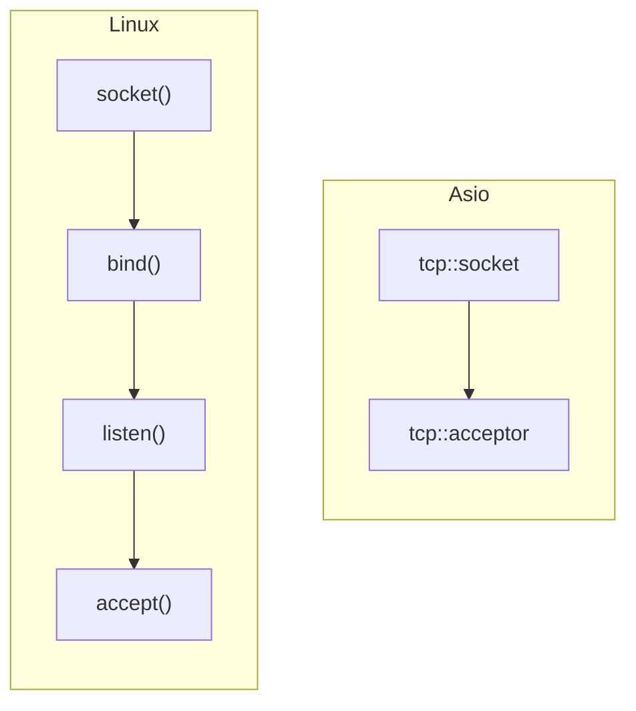

Then we convert the same server to `async_accept()`, and compare the three versions:

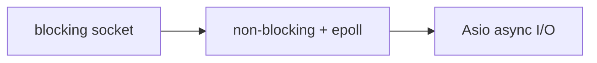

## References

* [Asio documentation](https://think-async.com/Asio/)
* [Asio tutorial: timer examples](https://think-async.com/Asio/asio-1.36.0/doc/asio/tutorial.html)
* [Asio reference: io_context](https://think-async.com/Asio/asio-1.36.0/doc/asio/reference/io_context.html)

The reference links point to Asio `1.36.0`. The version installed here is `1.18.1`, so small details can differ.
