# Asio TCP Server (Synchronous)

This is our first real TCP code in Asio. We start with a **synchronous** server only.

The goal is not to build a complex server. The goal is to connect every Asio object to the Linux socket calls we already know.

## From Linux sockets to Asio

On Linux, a TCP server does:

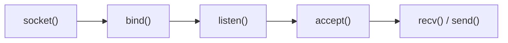

In Asio the same idea looks like this:

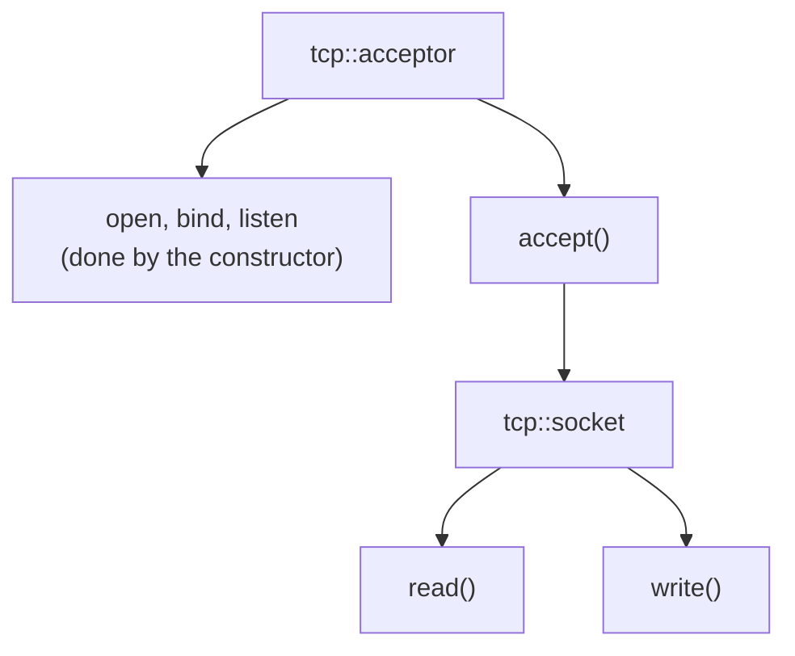

Asio provides `ip::tcp::acceptor` to accept TCP connections and `ip::tcp::socket` to represent a TCP connection.

## Files

| File | Binary | What it does |
|---|---|---|
| [main.cpp](./main.cpp) | `asio-tcp-server1` | Listens on port `8080`, accepts **one** client, prints a message and exits. |
| [main2.cpp](./main2.cpp) | `asio-tcp-server2` | Same, and also sends `Hello from Asio!` to the client with `asio::write()`. |
| [CMakeLists.txt](./CMakeLists.txt) | | Builds both programs as separate executables. |

## Build and run

```bash
cmake -S . -B build
cmake --build build

./build/asio-tcp-server1
```

The CMake file:

```cmake
cmake_minimum_required(VERSION 3.22.1)

project(asio_tcp_server LANGUAGES CXX)

set(CMAKE_CXX_STANDARD 17)
set(CMAKE_CXX_STANDARD_REQUIRED ON)

add_executable(asio-tcp-server1 main.cpp)
add_executable(asio-tcp-server2 main2.cpp)

foreach(target asio-tcp-server1 asio-tcp-server2)
    target_include_directories(${target} PRIVATE
        /usr/include
    )
endforeach()
```

> Each `main*.cpp` has its own `main()`, so each one is a separate executable. Putting both in one `add_executable` gives `multiple definition of 'main'`. The `target_include_directories` is not required on Ubuntu (`/usr/include` is already searched), but it keeps the setup explicit.

## Lab 1: the first server

[main.cpp](./main.cpp):

```cpp
#include <asio.hpp>
#include <iostream>

int main()
{
    asio::io_context io;

    asio::ip::tcp::acceptor acceptor(
        io,
        asio::ip::tcp::endpoint(
            asio::ip::tcp::v4(),
            8080
        )
    );

    std::cout << "Server listening on port 8080...\n";

    asio::ip::tcp::socket socket(io);

    acceptor.accept(socket);

    std::cout << "Client connected!\n";

    return 0;
}
```

Run it:

```text
Server listening on port 8080...
```

The program now **stops at `acceptor.accept(socket);`**, waiting for a client. This is expected.

While it waits, check the listening socket in another terminal:

```bash
ss -ltnp | grep 8080
```

```text
LISTEN 0      4096      0.0.0.0:8080      0.0.0.0:*    users:(("asio-tcp-server",pid=...,fd=6))
```

(The process name is cut to 15 characters by Linux.)

### Try a client

```bash
nc 127.0.0.1 8080
```

The server prints:

```text
Server listening on port 8080...
Client connected!
```

and then **exits**. `nc` also exits at once, with status `0`.

> `main.cpp` returns right after `accept()`. When `main()` ends, the `socket` object is destroyed and closes the connection, so the client sees the connection closed immediately. A second `nc` after that is refused (exit status `1`), because the server is gone. This server handles exactly one client.

If you want the connection to stay open so you can inspect it with `ss -tn 'sport = :8080'`, add a pause before `return 0;`, for example `std::cin.get();` (this is a suggestion and is not part of the lab code).

## Understanding the code

### 1. `io_context`

```cpp
asio::io_context io;
```

Both the acceptor and the socket need an execution context:

```cpp
asio::ip::tcp::acceptor acceptor(io, ...);
asio::ip::tcp::socket socket(io);
```

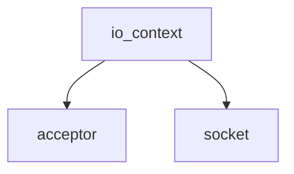

### 2. What is `tcp::acceptor`?

```cpp
asio::ip::tcp::acceptor acceptor(
    io,
    asio::ip::tcp::endpoint(
        asio::ip::tcp::v4(),
        8080
    )
);
```

It looks big, so we split it:

| Part | Meaning |
|---|---|
| `asio::ip::tcp` | The TCP protocol type. |
| `tcp::v4()` | IPv4. |
| `tcp::endpoint(tcp::v4(), 8080)` | IPv4 + port `8080`. No specific IP is given, so it means `0.0.0.0:8080` (all interfaces). |
| `acceptor(io, endpoint)` | An object that waits for incoming TCP connections on that endpoint. |

### 3. What happens inside the constructor

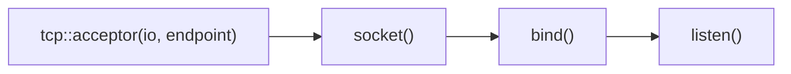

Asio does the setup for us. Compare:

Raw Linux:

```cpp
int fd = socket(AF_INET, SOCK_STREAM, 0);

bind(fd, ...);

listen(fd, ...);
```

Asio:

```cpp
asio::ip::tcp::acceptor acceptor(io, endpoint);
```

Asio hides the raw socket API. The `ss` output above (`LISTEN 0 4096 0.0.0.0:8080`) shows the result: a normal Linux listening socket.

### 4. `accept()`

```cpp
acceptor.accept(socket);
```

This is a **synchronous accept**: the program **blocks here** until a client connects. It is the same idea as Linux `accept(server_fd, ...)`.

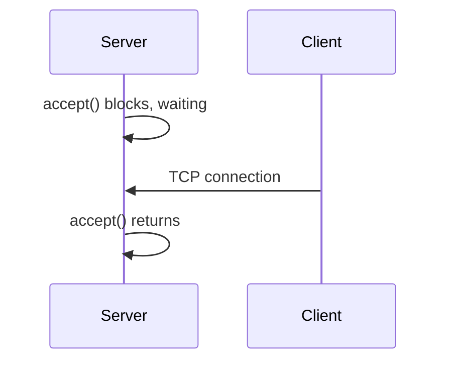

### 5. `acceptor` and `socket` are different things

```cpp
asio::ip::tcp::acceptor acceptor(...);   // waits for incoming connections
asio::ip::tcp::socket socket(io);        // one connection with one client
```

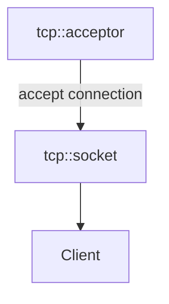

With three clients there is still **one** acceptor and one socket per client:

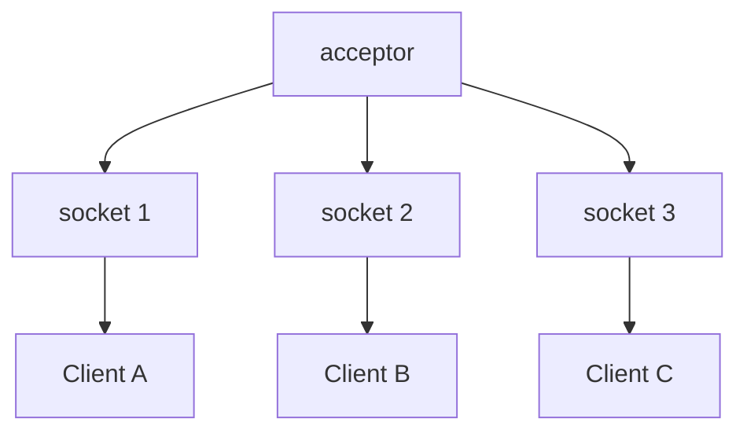

We will use this when we build the asynchronous server. The code in this lab accepts only one client.

## Lab 2: sending data

Lab 1 has no data transfer yet. [main2.cpp](./main2.cpp) adds a write after `accept()`:

```cpp
std::string message = "Hello from Asio!\n";

asio::write(
    socket,
    asio::buffer(message)
);
```

Run:

```bash
./build/asio-tcp-server2
```

and from another terminal:

```bash
nc 127.0.0.1 8080
```

The client receives:

```text
Hello from Asio!
```

and the server prints:

```text
Server listening on port 8080...
Client connected!
Message sent!
```

After that the server exits and `nc` closes.

### `asio::write()`

```cpp
asio::write(socket, asio::buffer(message));
```

| Part | Meaning |
|---|---|
| `socket` | The TCP connection to write to. |
| `asio::buffer(message)` | A **view** of the bytes in the `std::string`. It does not copy the data. |
| `asio::write(...)` | A **synchronous write**: it returns when the whole buffer was written, or throws on error. |

`asio::write()` keeps writing until all the bytes are written. A single `send()` on a non-blocking socket can be a partial write, as we saw in the `epoll` labs. `asio::write()` hides that loop for us (for a blocking socket like this one).

> The buffer is only a view, so `message` must stay alive while the write runs. Here that is automatic, because the write is synchronous. This will matter for asynchronous writes.

## Synchronous so far

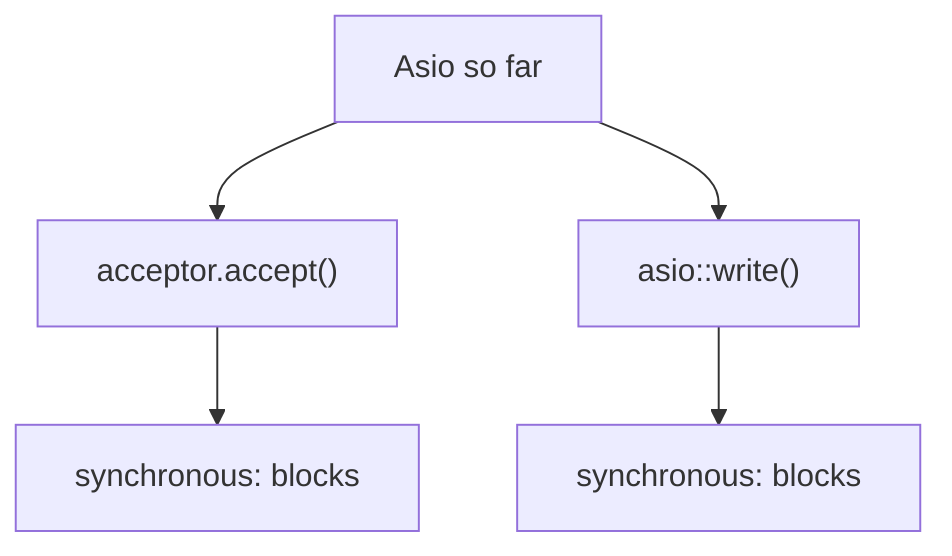

This is very close to the blocking socket programming we started with. Asio also has asynchronous versions:

```cpp
acceptor.async_accept(...);
asio::async_write(...);
```

That is where Asio starts to show its real value.

## Why is there no `io.run()`?

In the timer lab we learned that `io.run()` is important. This server does not call it because we use **synchronous** calls:

```cpp
acceptor.accept(socket);
asio::write(socket, ...);
```

They do their work inside the call, so there are no completion handlers for `io.run()` to run. We need `io.run()` as soon as we use:

```cpp
async_accept()
async_read()
async_write()
async_wait()
```

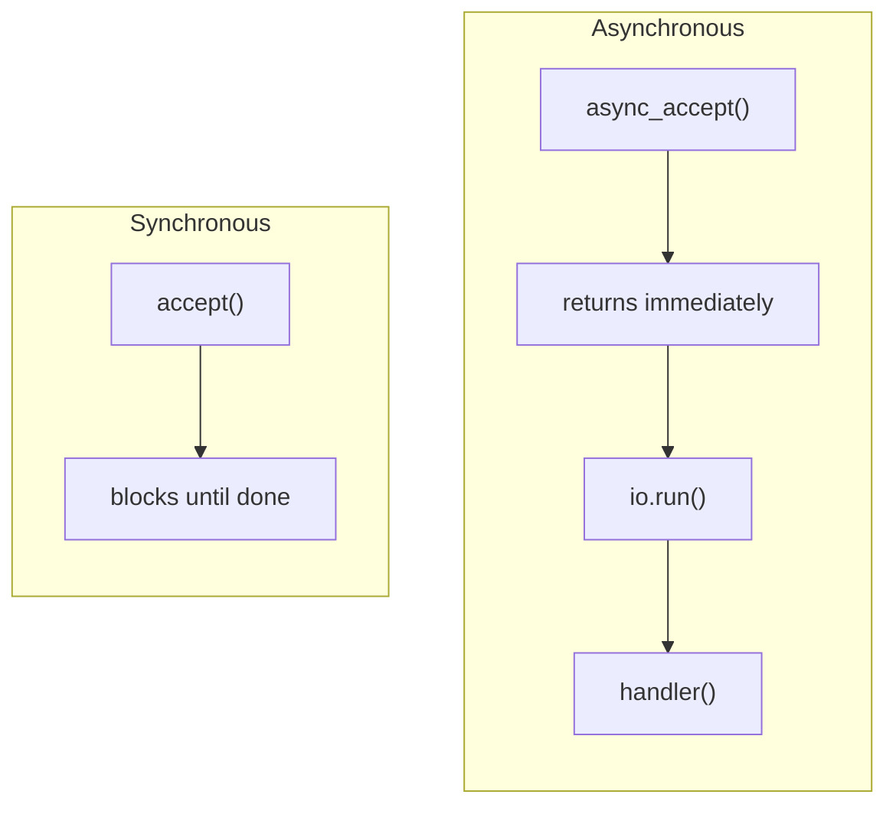

## Notes

1. **One client only.** Both programs accept one connection and then exit. A second client is refused after that. A server loop comes with the asynchronous version.
2. **Errors are exceptions.** The synchronous calls throw when they fail. I started a second copy while the first was listening, and the second printed:

    ```text
    terminate called after throwing an instance of 'std::system_error'
      what():  bind: Address already in use
    ```

    and was aborted (exit status `134`). The reason is that nothing catches the exception. You can wrap the code in `try { ... } catch (const std::exception& e) { ... }`, or use the overloads that take an `asio::error_code&`.
3. **Restarting works right away.** I ran the server again immediately after the previous one exited, and it started listening. The acceptor constructor enables `SO_REUSEADDR` by default, so you do not need to set it yourself as we did with raw sockets.
4. **Port.** This lab uses `8080`. The `epoll` labs used `12345`.
5. **Versions.** The installed Asio is `1.18.1`. The reference links below are for `1.36.0`, so small details may differ.

## Next step: `async_accept()`

We convert the same server from synchronous to asynchronous and see what changes, and what `io_context` becomes responsible for:

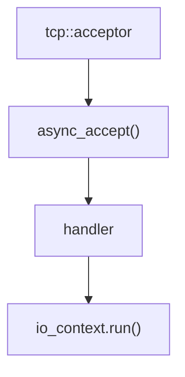

Then we compare the three styles:

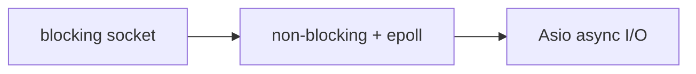

## References

* [Asio TCP daytime server tutorial](https://think-async.com/Asio/asio-1.36.0/doc/asio/tutorial/tutdaytime1.html)
* [Asio reference: tcp::acceptor](https://think-async.com/Asio/asio-1.36.0/doc/asio/reference/ip__tcp/acceptor.html)
* [Asio reference: tcp::socket](https://think-async.com/Asio/asio-1.36.0/doc/asio/reference/ip__tcp/socket.html)
* [Asio reference: io_context](https://think-async.com/Asio/asio-1.36.0/doc/asio/reference/io_context.html)
