# Asio TCP Server: `async_accept()`

This is the most important transition in Asio so far:

> We change the TCP server from **synchronous** to **asynchronous**.

For the first time we see the relation between these three things:

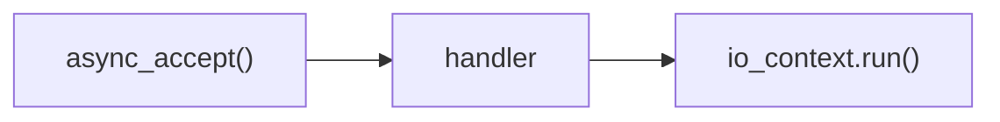

and we connect it to the `epoll` event loops we wrote by hand.

## Files

| File | Binary | What it shows |
|---|---|---|
| [main.cpp](./main.cpp) | `asio-async` | The server from the previous lab with `accept()` replaced by `async_accept()`. |
| [main2.cpp](./main2.cpp) | `asio-async2` | Same, but the handler prints when it starts and when it finishes, to show when it runs. |
| [CMakeLists.txt](./CMakeLists.txt) | | Builds both programs as separate executables. |

The code is not repeated here. Open the files and follow the line links below.

## Build and run

```bash
cmake -S . -B build
cmake --build build

./build/asio-async
./build/asio-async2
```

Both listen on port `8080`. Run one at a time. Connect from another terminal with:

```bash
nc 127.0.0.1 8080
```

## What changed from the synchronous server

The previous lab used `acceptor.accept(socket)`, which **blocks** until a client connects. Here that call is replaced by `acceptor.async_accept(socket, handler)`.

| | Synchronous | Asynchronous |
|---|---|---|
| Call | `accept(socket)` | `async_accept(socket, handler)` |
| Behavior | blocks | returns immediately |
| Who waits | the function itself | `io.run()` |
| Result comes as | a return value (or an exception) | a call to the **handler** |
| Needs `io.run()` | no | yes |

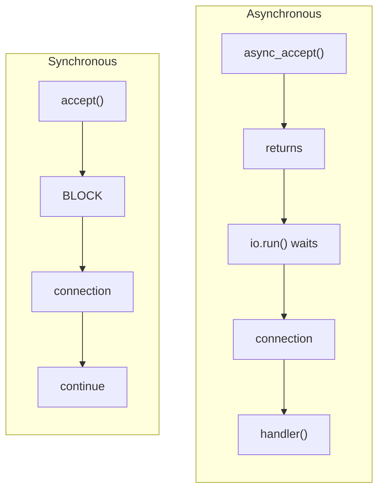

## Lab 1: [main.cpp](./main.cpp)

### The setup (lines 7 to 19)

* [Line 7](./main.cpp#L7): `asio::io_context io;` is the execution context. Both the acceptor and the socket are attached to it.
* [Lines 9 to 15](./main.cpp#L9-L15): the `tcp::acceptor`. Same as the synchronous lab: IPv4 on port `8080`, and the constructor does the socket, bind and listen setup.
* [Line 17](./main.cpp#L17): prints `Server listening on port 8080...`.
* [Line 19](./main.cpp#L19): an empty `tcp::socket`. It will become the connection **after** a client is accepted.

### The asynchronous call (lines 21 to 30)

[Lines 21 to 30](./main.cpp#L21-L30) are the key change:

```cpp
acceptor.async_accept(socket, handler);
```

This tells Asio:

> "Start waiting for a connection. When one arrives, put the connected client into `socket` and run this handler."

The handler is the lambda on [lines 23 to 29](./main.cpp#L23-L29). It receives an `error_code`:

* no error: prints `Client connected!` ([line 25](./main.cpp#L25));
* error: prints `Accept failed: ...` with `ec.message()` ([line 27](./main.cpp#L27)).

### `io.run()` (lines 32 to 36)

* [Line 32](./main.cpp#L32): prints `Before io.run()`.
* [Line 34](./main.cpp#L34): `io.run()`. This is where the program waits now.
* [Line 36](./main.cpp#L36): prints `After io.run()`.

### Result

Before any client connects:

```text
Server listening on port 8080...
Before io.run()
```

The program stops, but **not inside `accept()` this time**. It waits inside `io.run()`.

After `nc 127.0.0.1 8080`:

```text
Server listening on port 8080...
Before io.run()
Client connected!
After io.run()
```

and the server exits.

### The execution flow

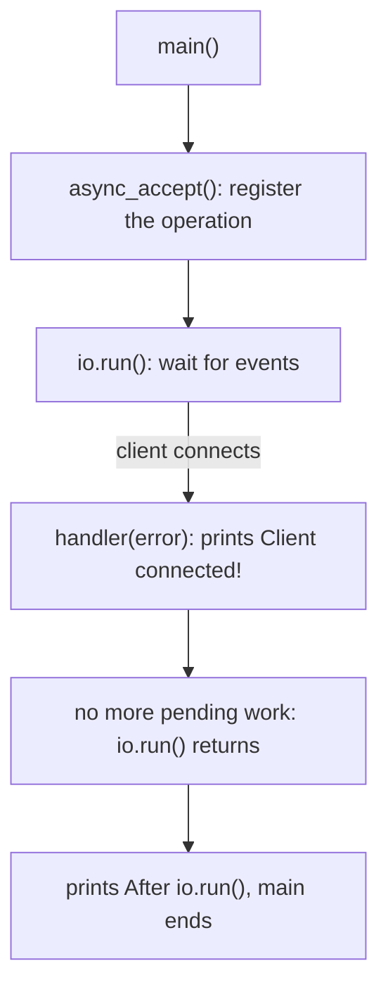

Why does `io.run()` return after one client? Because we called `async_accept()` **once**. When it completes, there is no other pending operation, so `run()` has no work and returns (as in the timer lab).

## Lab 2: [main2.cpp](./main2.cpp)

Same program, except the handler ([lines 23 to 31](./main2.cpp#L23-L31)) prints a line at its **start** ([line 24](./main2.cpp#L24)) and at its **end** ([line 30](./main2.cpp#L30)).

Before any client:

```text
Server listening on port 8080...
Before io.run()
```

After a client connects:

```text
Server listening on port 8080...
Before io.run()
Handler started - Accept callback invoked
Client connected!
Handler finished - Accept callback completed
After io.run()
```

This shows the order clearly:

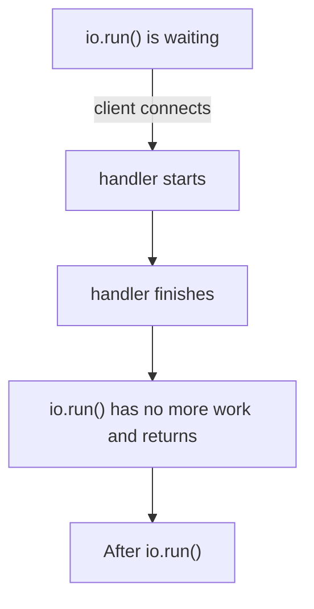

The handler runs **inside** `io.run()`. It is not called from some other place at some other time.

## The rule

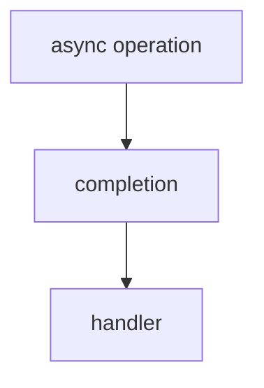

* `async_accept()` **starts** the operation and returns at once.
* `io_context::run()` is responsible for **running the handler** when the operation completes.

## `async_accept()` does not mean a thread

Asio does **not** create a new thread to accept the connection. I checked the running `asio-async` while it waited in `io.run()`: the process had **one** thread.

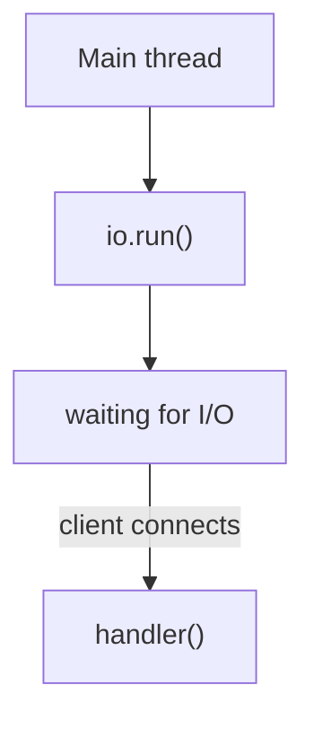

A wrong mental model would be:

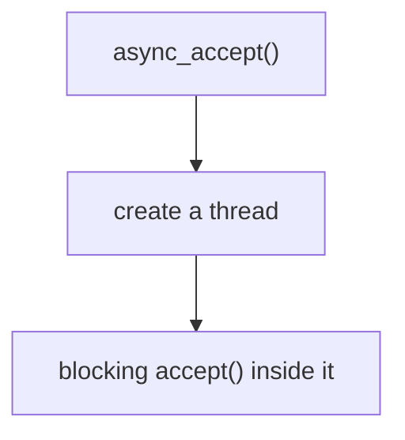

That is **not** what happens.

## What does `io.run()` do? Compare with `epoll`

Think of `io.run()` as the **event loop**, but do not assume it is literally `epoll_wait()`.

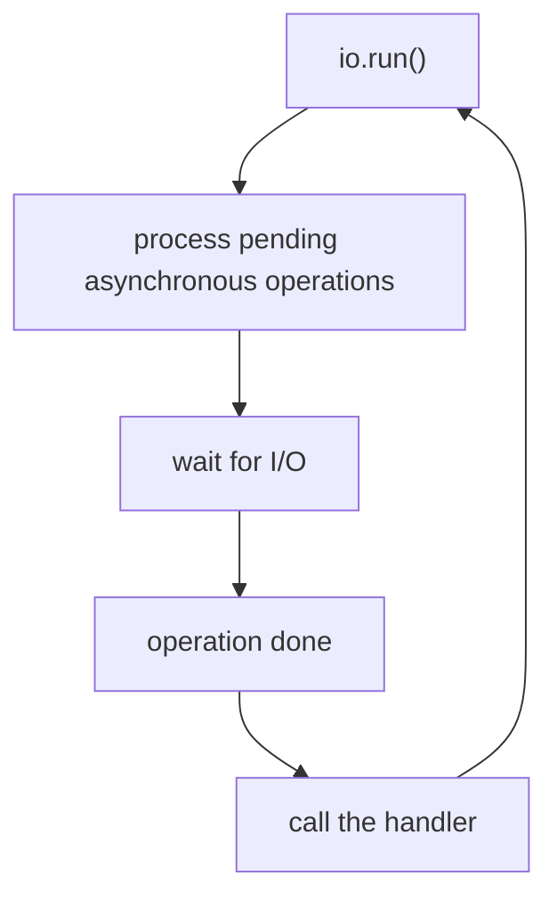

With `epoll` we wrote this ourselves:

```text
wait -> detect the event -> identify the fd -> call the right code
```

With Asio we write `async_accept(socket, handler)` and `io.run()`, and Asio does the middle part:

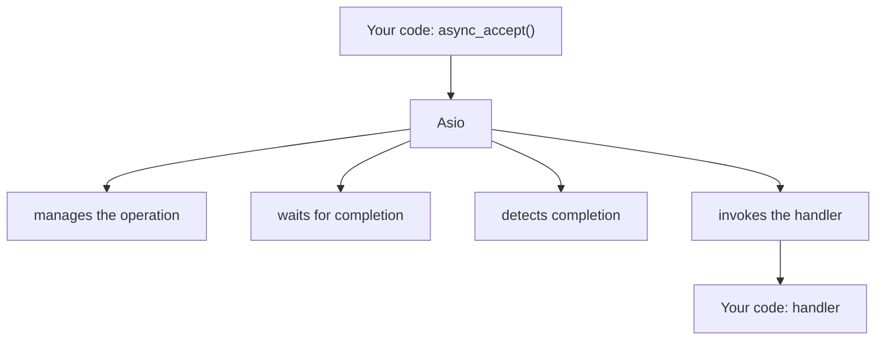

This is one of the main reasons to use an asynchronous networking library.

## Limitation: only one client

Both programs call `async_accept()` **once**. After the first client, the operation is finished, so the program exits. We want a server that accepts clients continuously:

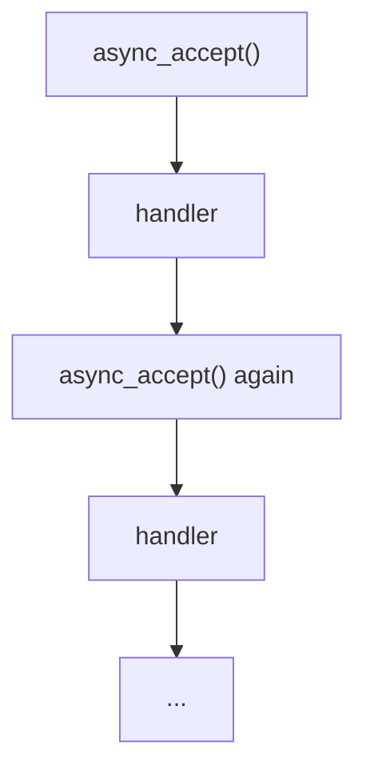

The handler can start the next `async_accept()` itself. But we cannot do that with the code as it is, because there is **one** `socket`:

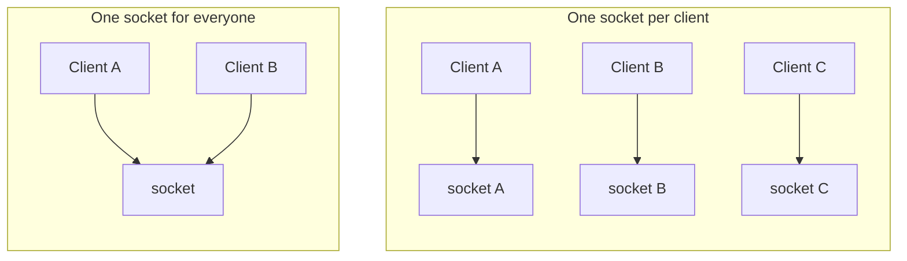

We need an object that represents one **connection**:

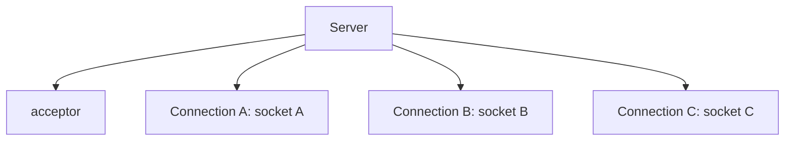

That is where `std::shared_ptr` and `enable_shared_from_this` come in. We do not use them yet.

## Notes

1. **Lifetime.** The `acceptor` and the `socket` are local variables in `main()`. They must stay alive until the operation completes. Here they do, because `io.run()` blocks `main()` until then. This will matter when we move things into functions and classes.
2. **`nc` does not quit by itself.** After the server exits it has closed the connection, but the OpenBSD `nc` keeps running while its stdin is open (`ss` shows `CLOSE-WAIT` on the client side). Press `Ctrl+C` or `Ctrl+D`. `nc 127.0.0.1 8080 < /dev/null` exits at once, because stdin is already at end-of-file.
3. **A second client is refused.** After the first client the server has exited, so a new `nc` fails with exit status `1`.
4. **The error branch.** The `Accept failed: ...` path (lines [27](./main.cpp#L27) and [28](./main2.cpp#L28)) did not run in my tests. It would run if the operation failed, for example if it was cancelled.
5. **Restarting works.** Starting the server again right after it exited works, because the acceptor enables `SO_REUSEADDR` by default.
6. **Starting a second copy** while the first is still listening makes it fail in the acceptor constructor with `std::system_error: bind: Address already in use`, because the constructor still throws (see the synchronous lab).

## Next step: `async_read()` and `async_write()`

We add asynchronous reading and writing on the same connection:

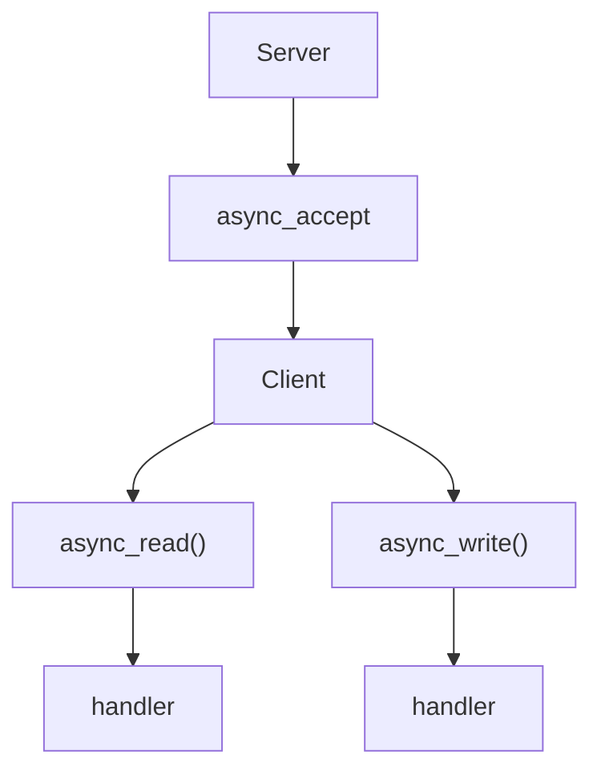

Then we have a real Asio TCP echo server, and we compare:

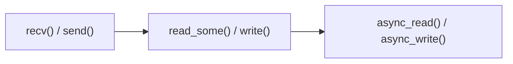

## References

* [Asio TCP daytime server tutorial (asynchronous)](https://think-async.com/Asio/asio-1.36.0/doc/asio/tutorial/tutdaytime3.html)
* [Asio reference: tcp::acceptor](https://think-async.com/Asio/asio-1.36.0/doc/asio/reference/ip__tcp/acceptor.html)
* [Asio reference: io_context](https://think-async.com/Asio/asio-1.36.0/doc/asio/reference/io_context.html)

The reference links are for Asio `1.36.0`. The version installed here is `1.18.1`, so small details can differ.
