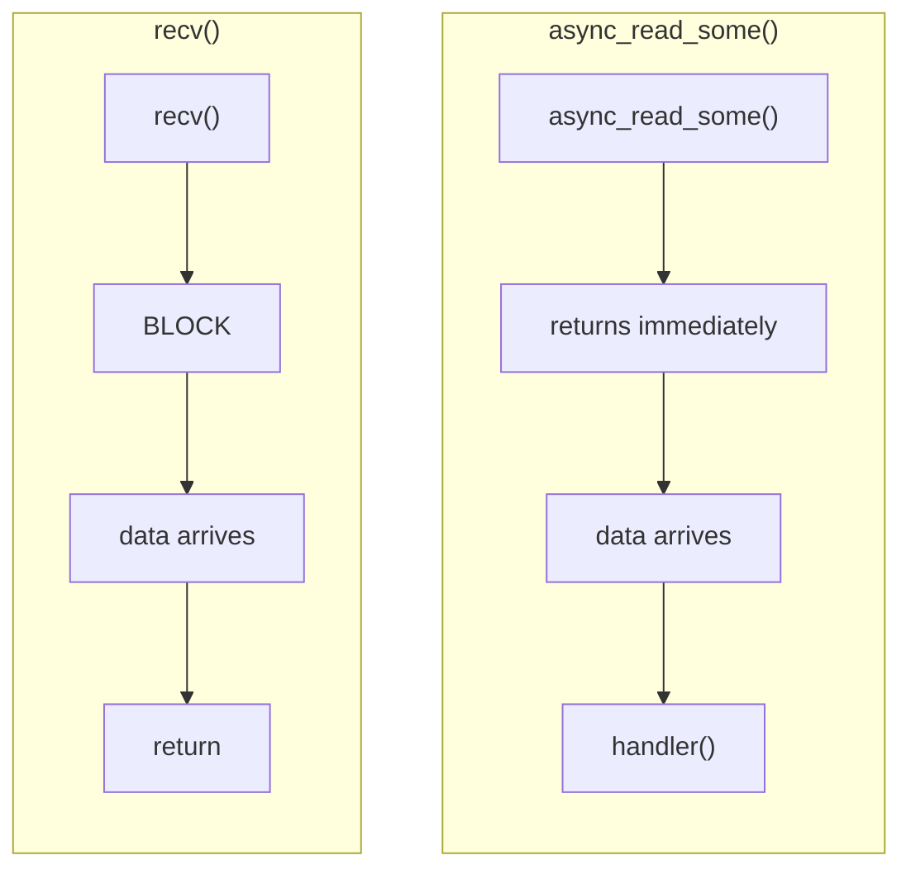
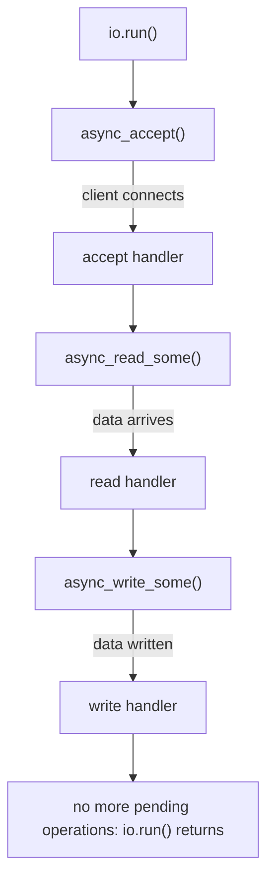
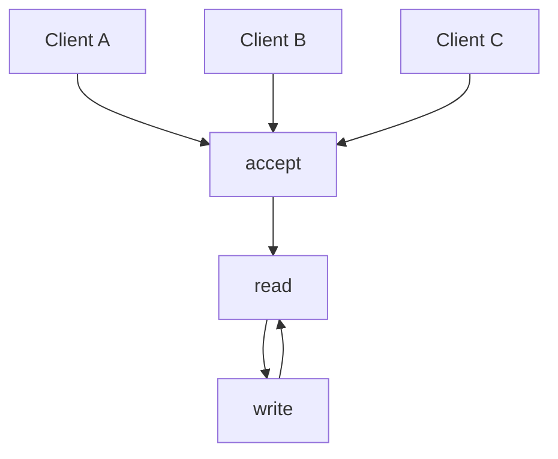
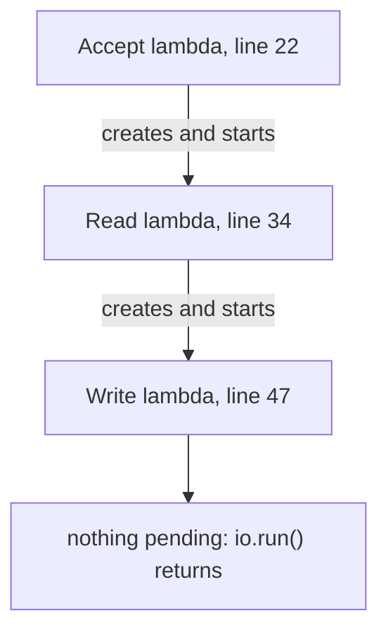
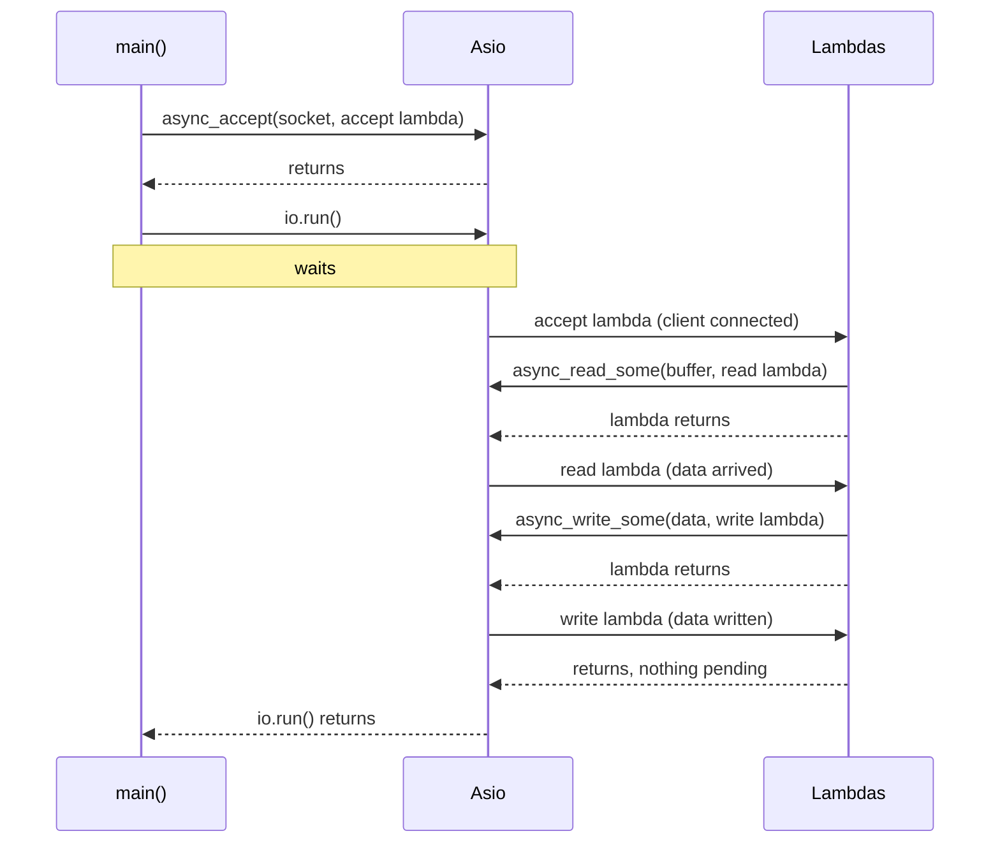
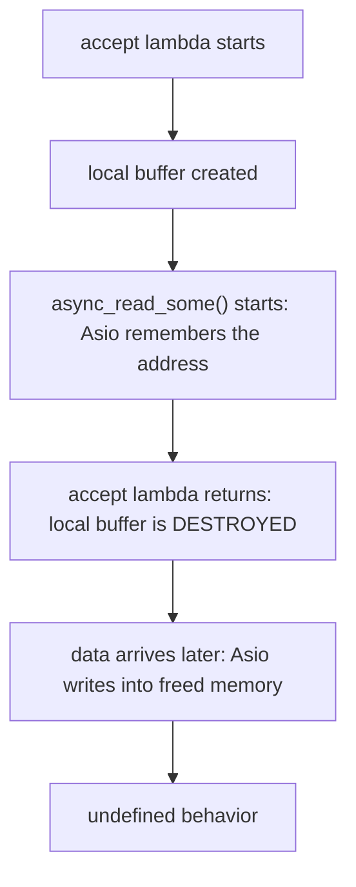
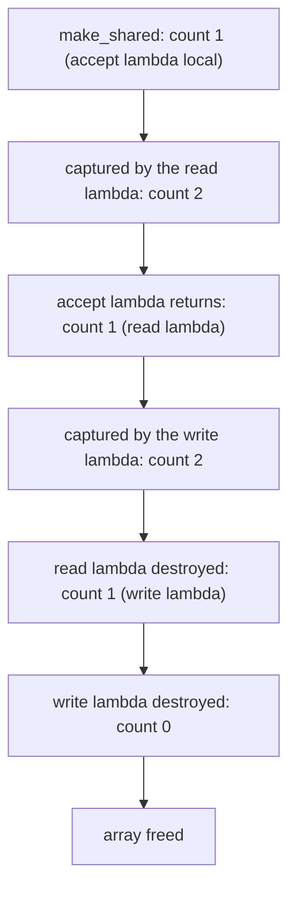

# Asio Echo Server: `async_read_some()` and `async_write_some()`

This lab connects Asio directly to the `recv()` and `send()` calls we already know.

We start with the simplest version: **one client**, and an **echo server**. Whatever the client sends, the server sends back.


Source: [main.cpp](./main.cpp). The code is not repeated here. Open the file and follow the line links.

## Files

| File | Binary | What it does |
|---|---|---|
| [main.cpp](./main.cpp) | `asio_tcp_echo_server` | Accepts one client, reads once, writes the same bytes back, then exits. |
| [CMakeLists.txt](./CMakeLists.txt) | | Builds the program. |

## Build and run

```bash
cmake -S . -B build
cmake --build build

./build/asio_tcp_echo_server
```

In another terminal:

```bash
nc 127.0.0.1 8080
```

Type a line and press Enter. The server echoes it back.

## Before Asio and with Asio

| Linux sockets | Asio (this lab) |
|---|---|
| `accept()` | `acceptor.async_accept(socket, handler)` |
| `recv(fd, buffer, 1024, 0)` | `socket.async_read_some(asio::buffer(...), handler)` |
| `send(fd, buffer, n, 0)` | `socket.async_write_some(asio::buffer(..., n), handler)` |
| `epoll_wait()` loop | `io.run()` |

The difference: `recv()` **blocks** until data arrives. `async_read_some()` **returns at once**, and the handler is called later when data has arrived.



## Walkthrough of [main.cpp](./main.cpp)

### Setup

* [Lines 3 to 4](./main.cpp#L3-L4): `<memory>` (for `std::make_shared`) and `<array>` (for `std::array`).
* [Line 8](./main.cpp#L8): the `io_context`.
* [Lines 9 to 15](./main.cpp#L9-L15): the `tcp::acceptor`, IPv4 on port `8080`.
* [Line 17](./main.cpp#L17): prints `Server listening on port 8080...`.
* [Line 18](./main.cpp#L18): an empty `tcp::socket`. It becomes the client connection after the accept completes.

### Step 1: accept ([lines 20 to 59](./main.cpp#L20-L59))

* [Lines 20 to 22](./main.cpp#L20-L22): `async_accept(socket, handler)`. It returns immediately. The handler is the lambda that starts on line 22.
* [Lines 23 to 26](./main.cpp#L23-L26): if the accept failed, print the error and `return`. Returning without starting another operation ends the chain.
* [Line 28](./main.cpp#L28): prints `Client connected!`.
* [Line 30](./main.cpp#L30): creates the 1024-byte buffer, owned by a `shared_ptr` (see the deep dive at the end).

### Step 2: read ([lines 32 to 57](./main.cpp#L32-L57))

* [Line 32](./main.cpp#L32): `socket.async_read_some(...)`. Returns immediately.
* [Line 33](./main.cpp#L33): `asio::buffer(*buffer)`: tells Asio where to put the received bytes (the whole 1024-byte array).
* [Lines 34 to 35](./main.cpp#L34-L35): the read handler. It receives an `error_code` and `bytes_read`, the number of bytes received. This plays the role of the return value of `recv()`.
* [Lines 37 to 40](./main.cpp#L37-L40): on error, print it and `return`.
* [Line 42](./main.cpp#L42): prints `Received N bytes from client.`

Example: if the client sends `Hello` and presses Enter, that is 6 bytes (`H e l l o \n`), so `bytes_read` is `6`. The first 6 positions of the buffer are valid data, and the rest is unused space.

### Step 3: echo ([lines 44 to 55](./main.cpp#L44-L55))

* [Line 45](./main.cpp#L45): `socket.async_write_some(...)`.
* [Line 46](./main.cpp#L46): `asio::buffer(buffer->data(), bytes_read)`: sends **only the valid part**, the first `bytes_read` bytes. If we used the whole array we would send 1024 bytes, including garbage.
* [Lines 47 to 48](./main.cpp#L47-L48): the write handler. It receives `bytes_written`, like the return value of `send()`.
* [Lines 49 to 52](./main.cpp#L49-L52): on error, print and `return`.
* [Line 53](./main.cpp#L53): prints `Sent N bytes to client.`

### Run ([lines 61 to 65](./main.cpp#L61-L65))

* [Line 61](./main.cpp#L61): prints `Server Started`.
* [Line 63](./main.cpp#L63): `io.run()`. Everything above only **registered** operations. This is where they actually run.
* [Line 65](./main.cpp#L65): prints `Server Stopped` after `io.run()` returns.

## Result

With one client that sends one line, the server prints:

```text
Server listening on port 8080...
Server Started
Client connected!
Received N bytes from client.
Sent N bytes to client.
Server Stopped
```

where `N` is the number of bytes the client sent. The client gets the same text back.

I built it with `-Wall -Wextra` (no warnings) and checked these cases:

| Test | Result |
|---|---|
| Client sends a short line | Echoed. `Received N` and `Sent N` show the same number. |
| Client sends a second message after the first | **Not** echoed. The server already exited. |
| Client sends 3000 bytes in one go | Only **1024** bytes come back, then the client gets `Connection reset by peer`. |
| Threads in the process while waiting | **1**. Asio did not create a thread. |

## The pipeline



Each handler starts the next operation. When the last handler finishes without starting anything, `io.run()` has no work left and returns. That is why the server exits after one echo.

This server does exactly this: accept one client, read **once**, write **once**, exit.

## Why `_some`?

The names are `async_read_some` and `async_write_some`, not `async_read` and `async_write`.

* `async_read_some()` means: read **some** of the available data. The handler can run before all the data you expect has arrived. It is close to `recv()`.
* `async_write_some()` means: write **some** data. The handler tells you how many bytes were written, which can be less than you asked. It is close to `send()`.

TCP is a **byte stream**, not a message protocol. If a client sends `Hello` and then `World`, the server may read `HelloWorld`, or `Hel` then `loWor` then `ld`. The read boundaries do not match the send boundaries.

You can see this in the 3000-byte test: one `async_read_some()` returned only 1024 bytes, because that is all the buffer holds.

Asio also has higher-level versions:

| Low level | Higher level |
|---|---|
| `socket.async_read_some()` | `asio::async_read()`: keeps reading until the buffer is full (or an error). |
| `socket.async_write_some()` | `asio::async_write()`: keeps writing until **all** the data is written. |

We start with `_some` because it shows partial reads and partial writes, like `recv()` and `send()` in the `epoll` labs. After this we will use `async_read()` and `async_write()`.

## Is `io.run()` the same as `epoll_wait()`?

It plays the same role: it is the event loop. But do not treat it as a thin wrapper around `epoll_wait()`. It is part of Asio's execution model, and the implementation uses the right OS mechanism for the platform.

| Our `epoll` code | Asio |
|---|---|
| `epoll_wait()` | `io.run()` |
| Find the ready fd, call the right code | Asio calls the handler |
| `recv()` / `send()` | `async_read_some()` / `async_write_some()` |
| Output buffer + `outputOffset` + `EPOLLOUT` | Handled by Asio inside the write operation |

## Notes

1. **Only the first message is echoed.** There is one read and one write. A second message from the same client is never read.
2. **Large messages are cut.** The buffer is 1024 bytes. In my 3000-byte test the server echoed 1024 bytes and then exited with the rest (about 1976 bytes) still unread. Closing a socket with unread data makes the kernel send a reset, so the client saw `Connection reset by peer` after receiving 1024 bytes.
3. **Partial writes are not handled.** The write handler ([line 47](./main.cpp#L47)) prints `bytes_written` but does not check that it equals `bytes_read`. `async_write_some()` may write less. For a short echo it normally writes everything, but a real server should use `asio::async_write()`, which keeps going until all bytes are written.
4. **If the client closes without sending,** the read handler should get an error (end of file) and print it on the `Read error:` branch ([line 38](./main.cpp#L38)). I did not run this case.
5. **The server stops after one client.** To keep it running we need to accept again, read in a loop, and give each client its own connection object. That is the next step.

## Next step: a server that keeps running



We will have to solve the first real Asio problem: **how do we keep the asynchronous operations alive, and how do we keep the socket, the buffer and the connection object alive?** That is where `std::shared_ptr`, `std::enable_shared_from_this` and a `Connection` class come in. The deep dive below shows the first step of this idea.

---

## Deep dive 1: the lambdas in [main.cpp](./main.cpp)

### What a lambda is here

A lambda is a function written in place, without a name. The compiler turns it into an object that can be stored and called later.

```text
[ captures ] ( parameters ) { body }
```

* **captures**: which outer variables the lambda can use, and how (reference or copy).
* **parameters**: what the caller passes in when it calls the lambda.
* **body**: the code that runs.

In Asio, the lambda is the **handler**. `async_*()` stores it inside the pending operation. When the operation completes, `io.run()` calls it once and then destroys it.

### The three lambdas

The file has three lambdas, **nested** inside each other. Each one is created inside the previous one:

| Handler | Lines | Parameters | Captures | What it does | Starts next |
|---|---|---|---|---|---|
| Accept | [22 to 58](./main.cpp#L22-L58) | `ec` | `[&]` | Checks the error, creates the buffer | the read |
| Read | [34 to 56](./main.cpp#L34-L56) | `ec`, `bytes_read` | `[&, buffer]` | Checks the error, prints `bytes_read` | the write |
| Write | [47 to 54](./main.cpp#L47-L54) | `ec`, `bytes_written` | `[&, buffer]` | Checks the error, prints `bytes_written` | nothing |



The nesting is how we express "do this, **then** do that" with callbacks. When the accept completes, the accept lambda runs and starts the read. When the read completes, the read lambda runs and starts the write.

### Line by line

**[Line 22](./main.cpp#L22): `[&](const asio::error_code& ec){`**

* `[&]`: capture every outer variable the body uses **by reference**. Here the body uses `socket` (line 32), which lives in `main()`. No copy is made. The lambda refers to the real `socket`.
* `const asio::error_code& ec`: the signature Asio requires for an accept handler. `ec` says whether the accept worked.

**[Lines 23 to 26](./main.cpp#L23-L26): `if (ec) { ...; return; }`**

* An `error_code` converts to `true` when there is an error.
* `return` leaves the lambda early. No new operation is started, so the chain stops here.

**[Lines 34 to 35](./main.cpp#L34-L35): `[&, buffer](const asio::error_code& ec, std::size_t bytes_read)`**

* `[&, buffer]` means: everything by reference (so `socket` is used by reference, line 45), **except `buffer`, which is copied**. The copy is a `shared_ptr` copy, which increases the reference count (see the next deep dive).
* The parameters `error_code` and `size_t` are the signature Asio requires for a read handler.
* This `ec` is a **new parameter**. It has the same name as the `ec` of the outer lambda, so it hides it. They do not conflict, and the inner lambda does not use the outer one. Each handler gets the result of its own operation.

**[Lines 47 to 48](./main.cpp#L47-L48): `[&, buffer](const asio::error_code& ec, std::size_t bytes_written)`**

* Same capture list. Here `buffer` is captured but **not used in the body**. That is on purpose: the capture keeps the buffer alive while the write is in progress, because line 46 gave Asio a view of that memory. (The compiler does not warn about it with `-Wall -Wextra`.)
* `bytes_written` is the number of bytes accepted by the write.

**Where each handler is passed:** the lambda is the last argument of `async_accept` ([line 22](./main.cpp#L22)), `async_read_some` ([line 34](./main.cpp#L34)) and `async_write_some` ([line 47](./main.cpp#L47)). Asio takes it, stores it, and returns immediately.

### When does a lambda run, and where?



All three run on the same thread, the one that called `io.run()`. Each one returns quickly and only **starts** the next operation, which is the rule for handlers: do a little work, start the next async operation, return.

### Capturing by reference: why it is safe here

`[&]` captures `socket` by reference. A reference is only valid while the original exists. `socket` is a local of `main()`, and `main()` stays blocked in `io.run()` ([line 63](./main.cpp#L63)) until all handlers have finished. So the reference is always valid.

It would **not** be safe if the lambda could run after the variable was destroyed, for example if `socket` were a local variable inside a function that returned before the operation completed. That is called a **dangling reference**, and it is the most common bug with asynchronous lambdas.

### Rule of thumb

| Capture | Use it for |
|---|---|
| By reference (`&`) | Things that **certainly live longer** than the operation. Here: `socket`, which lives in `main()`. |
| By copy (`buffer`) | Things the operation **must own** so they stay alive. Here: the shared buffer. |

### Why the lambda style gets hard

Three levels of nesting is already a lot to read. Each new step in the conversation adds another level. Later we will move this logic into a class with member functions, and then into coroutines, to avoid this "callback pyramid".

---

## Deep dive 2: the `shared_ptr` in [main.cpp](./main.cpp)

### The problem: `asio::buffer` does not own the memory

`asio::buffer(...)` creates a small **view**: a pointer and a size. It does not copy and does not own the bytes. When we call `async_read_some()` the function returns at once, but the read happens **later**, and Asio will write into that memory then. So the memory must still exist at that later time.

If the buffer were a plain local variable of the accept lambda, this would happen:



This is a **lifetime bug**. We need the buffer to live as long as the pending operation needs it.

### The solution: shared ownership

Include: [line 3](./main.cpp#L3) `#include <memory>` for `std::shared_ptr` and `std::make_shared`, and [line 4](./main.cpp#L4) `#include <array>` for `std::array`.

**[Line 30](./main.cpp#L30)**: `auto buffer = std::make_shared<std::array<char, 1024>>();`

Piece by piece:

| Piece | Meaning |
|---|---|
| `std::array<char, 1024>` | A fixed-size array of 1024 `char`, like `char buffer[1024]` in C. |
| `std::make_shared<...>()` | Allocates the array on the heap together with a small control block that holds the **reference count**, and returns a `shared_ptr` to it. The array is value-initialized (all zeros). |
| `auto` | The type is `std::shared_ptr<std::array<char, 1024>>`. |
| Result | `buffer` is a smart pointer. The reference count is `1`. |

**A `shared_ptr` is a pointer with a counter.** Every copy of it increases the count. Every destroyed copy decreases it. When the count reaches `0`, the array is deleted.

### How the buffer is used

| Line | Code idea | What it does |
|---|---|---|
| [33](./main.cpp#L33) | `asio::buffer(*buffer)` | `*buffer` is the array itself. `asio::buffer(array)` makes a view of all 1024 bytes. No copy, no ownership. |
| [34](./main.cpp#L34) | capture `buffer` | The read lambda gets its **own copy** of the `shared_ptr`. Count goes up. |
| [46](./main.cpp#L46) | `asio::buffer(buffer->data(), bytes_read)` | `buffer->data()` is the pointer to the first element. With `bytes_read` it makes a view of just the valid bytes. |
| [47](./main.cpp#L47) | capture `buffer` | The write lambda gets another copy. Count goes up again. |

### The lifetime, step by step

I measured the reference count by adding prints to a temporary copy of the file (the rows in the middle), and checked that the array is freed after `io.run()` returns (a `weak_ptr` to it reported `expired() == true`). The first row follows from how `make_shared` works, and the last row from the count reaching zero:

| Moment | `use_count` | Who holds the buffer |
|---|---|---|
| Right after `make_shared` (line 30) | 1 | The local `buffer` in the accept lambda. |
| Right after `async_read_some(...)` returns, still inside the accept lambda | **2** | The local `buffer` **and** the copy inside the read lambda, which is stored in the pending read. |
| At the start of the read handler | **1** | The accept lambda has returned, so its local is gone. Only the read lambda's copy is left. |
| Right after `async_write_some(...)` returns, inside the read handler | **2** | The read lambda's copy **and** the copy inside the write lambda, stored in the pending write. |
| At the start of the write handler | **1** | The read lambda is finished and destroyed. Only the write lambda's copy is left. |
| After the write handler finishes | **0** | The last copy is destroyed and the array is freed. After `io.run()` returns, a `weak_ptr` to it reported `expired() == true`. |



The important idea: **the buffer is handed from lambda to lambda**. At every moment, at least one pending operation holds a copy, so the memory never disappears while Asio may still use it, and it is freed automatically right after the last operation that needs it.

The exact counts at each instant depend on how Asio moves and destroys handlers internally, but the principle is the same: while a handler that captured the `shared_ptr` is alive, the memory is alive.

### Why the write lambda captures `buffer` without using it

Line 46 gives Asio a view of the buffer's memory. The write is asynchronous, so Asio may still be reading from that memory after the read lambda returns. The `buffer` capture in the write lambda ([line 47](./main.cpp#L47)) keeps that memory alive until the write completes. Without it, the last copy would die when the read lambda ends, while the write is still pending.

### Why not something simpler?

| Option | Problem |
|---|---|
| Local array inside the accept lambda | Destroyed when the lambda returns, before the data arrives (the bug above). |
| Capture the local `buffer` **by reference** | The same problem. A reference to something destroyed is a dangling reference. |
| `std::unique_ptr` | Can work with a move-capture, but then only one owner exists at a time, which makes it harder to hand the same buffer to the next lambda. `shared_ptr` makes that simple. |
| An array declared in `main()` | Works here, because `main()` waits in `io.run()` (the same reason `socket` is safe). It does not scale to many clients, because each connection needs its own buffer. |

### How this relates to the `epoll` labs

In the `epoll` labs, each client had its own `outputBuffer` and `outputOffset`, owned by a `ClientConnection` object. The question was the same: **who owns the data while the operation is not finished?**

With Asio the answer for this small program is the `shared_ptr` held by the handlers. For a server with many clients, the answer will be a `Connection` object that owns its socket and its buffers, and is kept alive by a `shared_ptr` that its own handlers hold (`std::enable_shared_from_this`). This is the next step.
