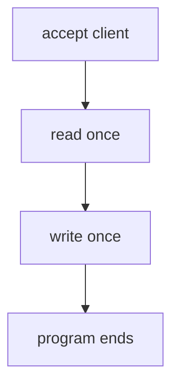
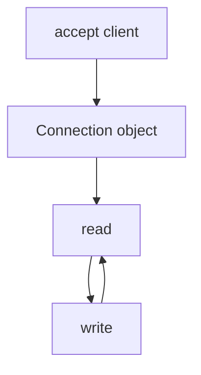
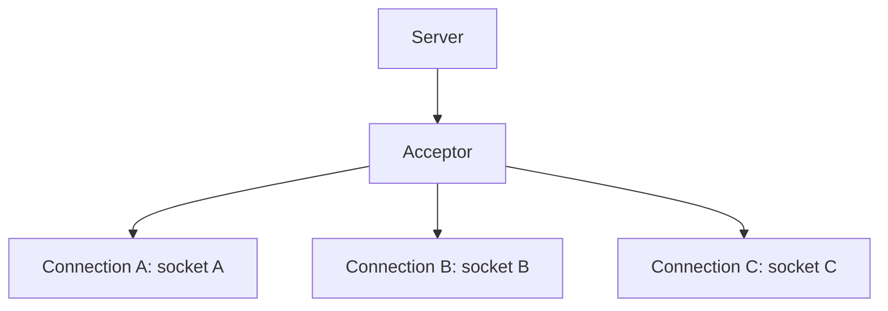
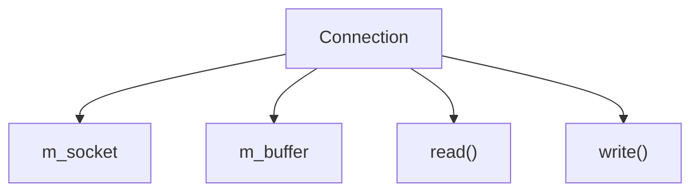
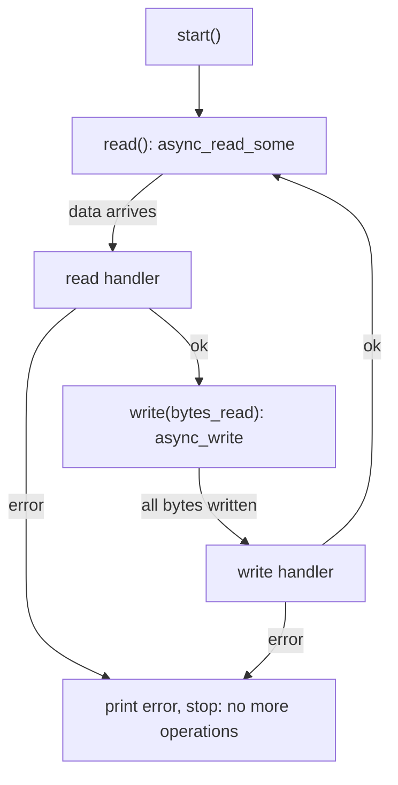
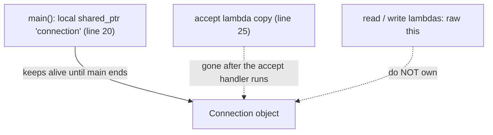
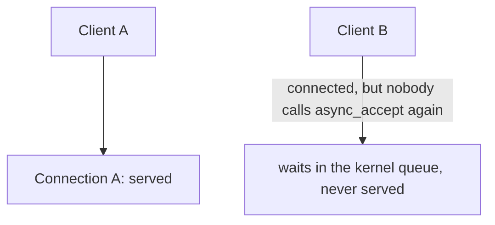
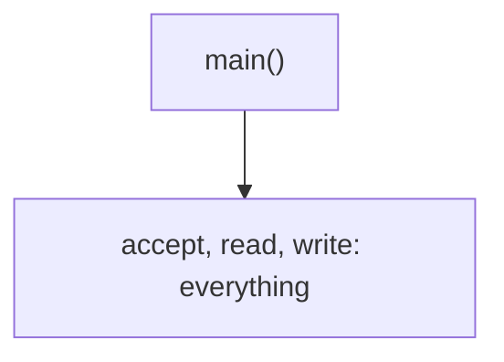
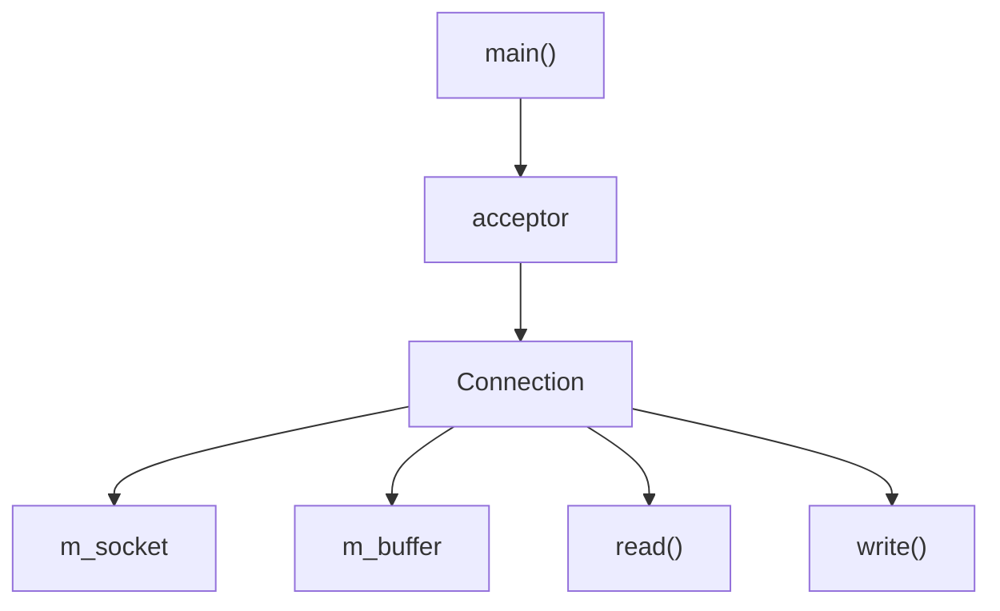
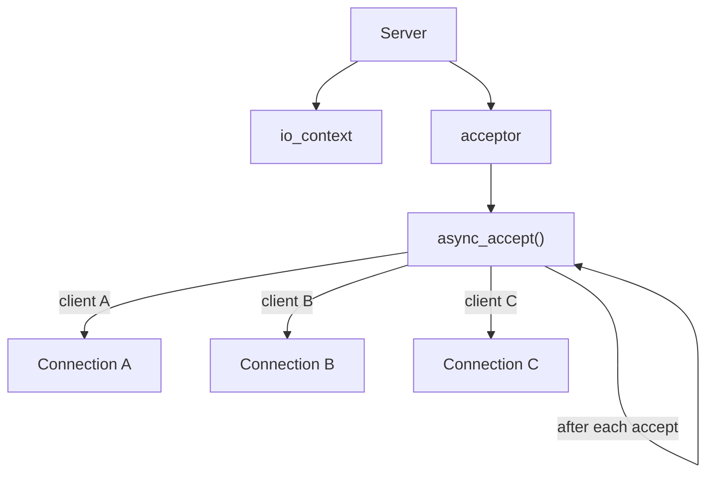

# Asio Echo Server: a `Connection` Object

Until now the Asio echo server was a demo that ran once: accept a client, read once, write once, exit. This lab turns it into the first real **architecture**: one object per client that reads and writes in a loop.

The main goal is to understand the **lifetime of a connection**: why every client needs its own object, and why `shared_ptr` matters in Asio.

## What we want

Before:



Now:



And later, with many clients:



## Files

| File | What it contains |
|---|---|
| [main.cpp](./main.cpp) | Creates the acceptor, creates one `Connection`, accepts one client and starts the connection. |
| [connection/Connection.hpp](./connection/Connection.hpp) | The `Connection` class declaration: the socket, the buffer and the read and write steps. |
| [connection/Connection.cpp](./connection/Connection.cpp) | The read / write loop. |
| [CMakeLists.txt](./CMakeLists.txt) | Builds the program `asio-tcp-server` from `main.cpp` and `connection/Connection.cpp`. |

The code is not repeated here. Open the files and follow the line links.

## Build and run

```bash
cmake -S . -B build
cmake --build build

./build/asio-tcp-server
```

Expected first line:

```text
Server started on port 8080
```

In another terminal:

```bash
nc 127.0.0.1 8080
```

Type `Hello` and press Enter. The server prints `Client connected!`, `Received 6 bytes` and `Sent 6 bytes`, and `nc` shows `Hello`. Type more lines and each one is echoed too.

## Why a `Connection` class?

Before, the socket, the buffer and the handlers were all inside `main()`. Now each client gets an object that owns what belongs to **one connection with one client**:



The buffer is now a **member** of the object. That solves the buffer lifetime problem from the previous lab in a simpler way: the buffer lives exactly as long as the `Connection` object, so there is no need for a separate `shared_ptr` just for the buffer.

## Walkthrough of [main.cpp](./main.cpp)

* [Line 4](./main.cpp#L4): includes `connection/Connection.hpp`.
* [Line 8](./main.cpp#L8): the `io_context`.
* [Lines 10 to 16](./main.cpp#L10-L16): the `tcp::acceptor`, IPv4 on port `8080`.
* [Line 18](./main.cpp#L18): prints `Server started on port 8080`.
* [Lines 20 to 21](./main.cpp#L20-L21): creates the `Connection` with `std::make_shared<Connection>(io)`. It is created **before** any client arrives, with an empty socket, and it lives on the heap. The variable `connection` is a `shared_ptr` to it.
* [Lines 23 to 24](./main.cpp#L23-L24): `async_accept(...)`. The socket that will receive the new client is `connection->socket()`, the socket **inside** the connection object. So when the accept completes, the client is already inside the object.
* [Line 25](./main.cpp#L25): the accept handler is a lambda with the capture `[connection]`. It takes a **copy of the `shared_ptr`**.
* [Lines 27 to 33](./main.cpp#L27-L33): if the accept failed, print the error and return.
* [Line 35](./main.cpp#L35): prints `Client connected!`.
* [Line 37](./main.cpp#L37): `connection->start()`. From here the `Connection` runs itself.
* [Line 41](./main.cpp#L41): `io.run()`. Nothing runs until here.

## Walkthrough of the `Connection` class

### [connection/Connection.hpp](./connection/Connection.hpp)

* [Line 9](./connection/Connection.hpp#L9): the constructor takes the `io_context`.
* [Line 11](./connection/Connection.hpp#L11): `socket()` returns a reference to the internal socket. `main.cpp` uses it as the target of `async_accept`.
* [Line 13](./connection/Connection.hpp#L13): `start()` is the only public action.
* [Lines 16 and 18](./connection/Connection.hpp#L16-L18): `read()` and `write(bytes_read)` are private. Only the connection drives its own loop.
* [Lines 21 and 22](./connection/Connection.hpp#L21-L22): the socket and the 1024-byte buffer are members.

### [connection/Connection.cpp](./connection/Connection.cpp)

* [Lines 5 to 8](./connection/Connection.cpp#L5-L8): the constructor creates the socket on the given `io_context`.
* [Lines 10 to 13](./connection/Connection.cpp#L10-L13): `socket()` returns `m_socket`.
* [Lines 15 to 18](./connection/Connection.cpp#L15-L18): `start()` just calls `read()`.
* [Lines 20 to 42](./connection/Connection.cpp#L20-L42): `read()`:
  * [Line 22](./connection/Connection.cpp#L22) and [line 23](./connection/Connection.cpp#L23): `async_read_some` into `m_buffer`.
  * [Line 24](./connection/Connection.cpp#L24): the handler lambda, with the capture `[this]`.
  * [Lines 27 to 33](./connection/Connection.cpp#L27-L33): on error, print `Read error: ...` and return. This **ends the loop**.
  * [Line 35](./connection/Connection.cpp#L35): prints `Received N bytes`.
  * [Line 39](./connection/Connection.cpp#L39): calls `write(bytes_read)`.
* [Lines 44 to 67](./connection/Connection.cpp#L44-L67): `write()`:
  * [Line 46](./connection/Connection.cpp#L46) and [line 48](./connection/Connection.cpp#L48): `asio::async_write` of the first `bytes_read` bytes of `m_buffer`.
  * [Line 49](./connection/Connection.cpp#L49): the handler lambda, `[this]`.
  * [Lines 52 to 58](./connection/Connection.cpp#L52-L58): on error, print `Write error: ...` and return.
  * [Line 60](./connection/Connection.cpp#L60): prints `Sent N bytes`.
  * [Line 64](./connection/Connection.cpp#L64): calls `read()` again. **This is the loop.**

### `asio::async_write` vs `async_write_some`

The previous lab used `socket.async_write_some()`, which may write only part of the data. This lab uses `asio::async_write()` ([line 46](./connection/Connection.cpp#L46)), which keeps writing until **all** the bytes are written (or an error happens). So partial writes, which we handled by hand in the `epoll` labs, are handled for us here.

The read is still `async_read_some`, which returns whatever is available, up to 1024 bytes. That is why we pass `bytes_read` to `write()`: we echo exactly what we read.

## The echo loop



Each handler starts the next operation as its last step. The loop continues as long as every operation succeeds. When one fails (for example the client disconnects), the handler returns without starting another operation, and the loop ends.

## Lifetime: who keeps the `Connection` alive?

This is the central question of the lab.

### What `[connection]` and `[this]` do

There are two different captures:

| Where | Capture | What the lambda holds |
|---|---|---|
| [main.cpp, line 25](./main.cpp#L25) | `[connection]` | A **copy of the `shared_ptr`**: it shares ownership. |
| [Connection.cpp, line 24](./connection/Connection.cpp#L24) and [line 49](./connection/Connection.cpp#L49) | `[this]` | A **raw pointer** to the object. It does **not** own it. |

`[this]` is only a pointer. It does not stop the object from being destroyed. If the `Connection` were destroyed while a read or write is pending, the handler would use a dangling `this` when it runs: undefined behavior.

### So what keeps the object alive?

Reading the code, the accept lambda holds a copy of the `shared_ptr`, but that lambda is destroyed right after it runs (it runs only once, at [line 25](./main.cpp#L25) to [38](./main.cpp#L38)). After that, the read and write handlers hold only `this`.

What keeps the `Connection` alive during all the later reads and writes is the **local variable `connection` in `main()`** ([line 20](./main.cpp#L20)). It exists until `main()` ends, and `main()` is blocked in `io.run()` ([line 41](./main.cpp#L41)) until all operations are finished.



(This is my reading of the code. I did not instrument it with `use_count`.)

### Why this design is fragile

It works here only because `main()` happens to keep a `shared_ptr` alive for the whole run. Nothing in `Connection` itself guarantees it. Two things would break it:

* If `main()` did not keep the variable (for example if there were a server that creates connections inside handlers and forgets them), the object would be destroyed after the accept handler, while the first read is still pending.
* If the `Connection` wanted to stay alive until *its own* loop ends, it has no way to say so.

The proper fix is `std::enable_shared_from_this`: the handlers capture `shared_from_this()` (a `shared_ptr` copy) instead of `this`. Then each pending operation owns the connection, the connection stays alive exactly as long as it has pending operations, and it is destroyed automatically when the loop ends. We do not use it yet. We first need to see the problem.

## Results

I built it with `-Wall -Wextra` (no warnings) and ran these tests with a Python client:

| Test | Result |
|---|---|
| Three messages from one client (`Hello`, `How are you?`, `third`) | Each one echoed correctly. The server logged `Received N` and `Sent N` for each. |
| Client closes the connection | The server prints `Read error: End of file`. |
| After the client closed | The server exits (`io.run()` returns). |
| 5000 bytes in one go | Echoed completely and correctly. The server read it in chunks: `1024, 1024, 1024, 1024, 904`, each echoed. |
| Threads in the process while running | **1**. |

A server log from the three-message test:

```text
Server started on port 8080
Client connected!
Received 6 bytes
Sent 6 bytes
Received 13 bytes
Sent 13 bytes
Received 6 bytes
Sent 6 bytes
Read error: End of file
```

`End of file` is the normal way a client disconnect appears: the read operation finishes with an `eof` error. It is not a failure of the server.

## Limitation: only one client

`async_accept()` is called **once** ([lines 23 to 39](./main.cpp#L23-L39)), and only one `Connection` is created ([line 20](./main.cpp#L20)). A second client is not served.

I tested it: while client A was connected, client B connected successfully (the kernel accepts the TCP handshake into the listen queue) and sent `hi`, but got **no reply**. Client A was still echoed normally. When client A closed, the server exited, and client B then got `ConnectionResetError`.



Also, because there is no new `async_accept()` pending, when client A leaves the server has nothing left to do, so `io.run()` returns and the program ends.

## Old and new structure

Before:



Now:



The pattern to remember:

> The **acceptor** is responsible for accepting connections. The **Connection** is responsible for the lifecycle of one connection.

## Next step: a `Server` class



`async_accept()` will start itself again after every accepted client, so the server accepts clients forever. Right after that we use `shared_from_this()`: it is the standard pattern for Asio asynchronous sessions, and it answers the question of who owns each connection while its operations are pending.

## References

* [Asio tutorial: asynchronous TCP daytime server](https://think-async.com/Asio/asio-1.36.0/doc/asio/tutorial/tutdaytime3.html)
* [Asio reference: `async_read_some`](https://think-async.com/Asio/asio-1.36.0/doc/asio/reference/basic_stream_socket/async_read_some.html)
* [Asio reference: `async_write`](https://think-async.com/Asio/asio-1.36.0/doc/asio/reference/async_write.html)

The links are for Asio `1.36.0`. The version installed here is `1.18.1`, so small details can differ.
