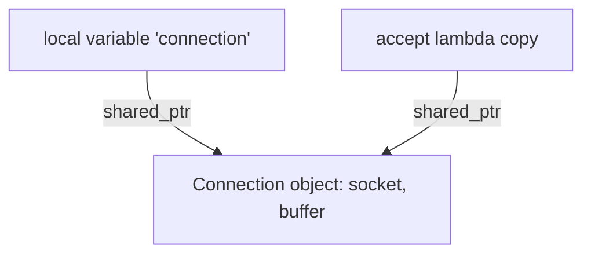
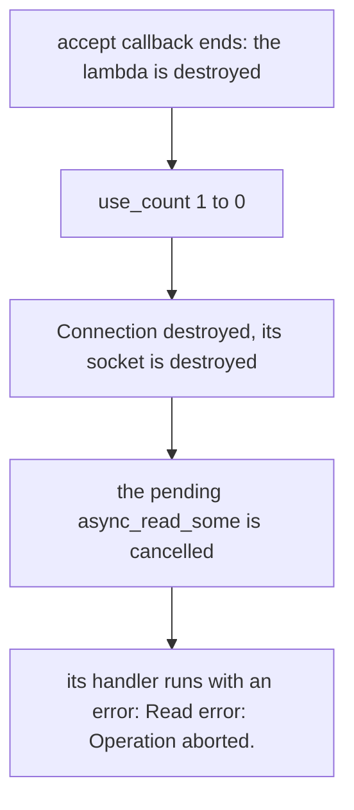
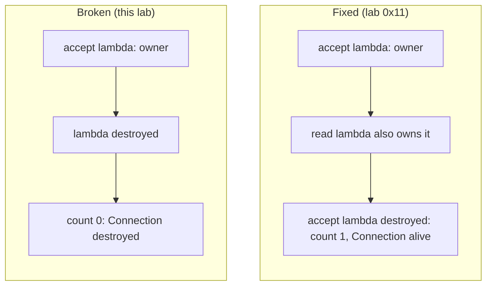
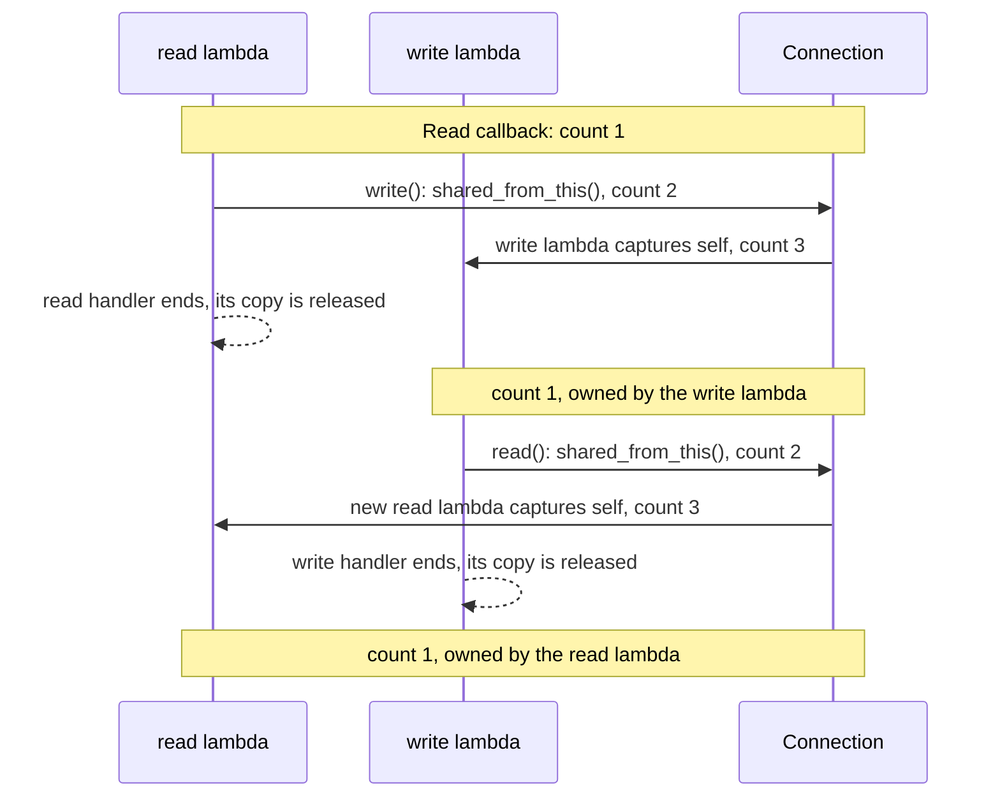
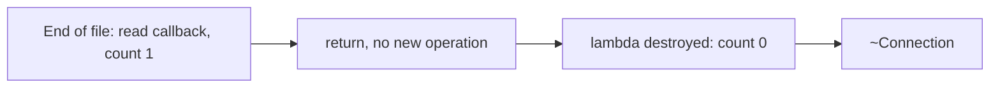

# Explaining the Issue Logs: Ownership and `use_count`

This note explains **why the `Connection` in [lab 0x10](./README.md) dies right after it is accepted**, by following the `shared_ptr` ownership and the `use_count` values in the debug logs. It then shows what changes after the fix in [lab 0x11](../0x11-asio-tcp-server/).

| Document | What it has |
|---|---|
| [TEST_DEBUG_LOGS.md](./TEST_DEBUG_LOGS.md) | The debug log of the broken run (this lab). |
| [issue.md](./issue.md) | The short explanation of the bug (in Arabic). |
| [../0x11-asio-tcp-server/README.md](../0x11-asio-tcp-server/README.md) | The fix. |
| [../0x11-asio-tcp-server/DEBUG_TRACE.md](../0x11-asio-tcp-server/DEBUG_TRACE.md) | The debug log of the fixed run, with the `use_count` after the fix. |

The code is not repeated here. Open the files and follow the line links.

## 1. Three things to tell apart

In [Server::accept()](./server/Server.cpp#L26) there are three different things:

| Thing | What it is |
|---|---|
| `connection` | A **local variable**, a `std::shared_ptr<Connection>` ([line 28](./server/Server.cpp#L28)). |
| The accept lambda | It captures `connection` **by copy** (`[this, connection]`, [line 33](./server/Server.cpp#L33)), so it holds a second `shared_ptr`. |
| The `Connection` object | The real object on the heap, with the socket and the buffer. |

Two `shared_ptr`s (the local variable and the lambda's copy) point to **one** object:



Copying a `shared_ptr` does not copy the `Connection`. It only adds an owner, so `use_count` goes up. The object is destroyed when the **last** owner disappears.

## 2. The broken version, step by step

This is the code in this folder. The read and write handlers in [Connection.cpp](./connection/Connection.cpp) capture only `[this]` ([line 29](./connection/Connection.cpp#L29) and [line 56](./connection/Connection.cpp#L56)), a raw pointer that is not an owner.

The log from [TEST_DEBUG_LOGS.md](./TEST_DEBUG_LOGS.md), for the first client (object `...6600`):

```text
Server.cpp:29  Server->accept method started   use_count= 1
Server.cpp:49  Server->accept method ended     use_count= 2
main.cpp:14    Main: IO context running
Server.cpp:35  Server->accept callback started use_count= 1
Client connected!
Connection.cpp:20  Connection starting
Connection.cpp:26  Connection->read method started
Connection.cpp:47  Connection->read method ended
   ... the next Connection (...6be0) is created and waits for a client ...
Server.cpp:46  Server->accept callback ended   use_count= 1
Read error: Operation aborted.
```

| Log line | `use_count` | Owners |
|---|---|---|
| [Server.cpp:29](./server/Server.cpp#L29) accept method started | **1** | The local variable. |
| [Server.cpp:49](./server/Server.cpp#L49) accept method ended | **2** | The local variable and the accept lambda's copy. |
| `accept()` returns (not printed) | 1 | The accept lambda only. The local variable is gone. |
| [Server.cpp:35](./server/Server.cpp#L35) accept callback started | **1** | The accept lambda that is running. |
| `read()` starts `async_read_some` | 1 | Still only the accept lambda. The read handler holds a raw `this`, which is **not** an owner. |
| [Server.cpp:46](./server/Server.cpp#L46) accept callback ended | **1** | The accept lambda that is about to finish. |
| The accept lambda is destroyed (not printed) | **0** | **Nobody.** The `Connection` is destroyed. |

Look at the line **`accept callback ended use_count= 1`**. In the fixed version, the same line shows `2` (see section 4). That one number is the whole bug: the pending read does not own the connection.



Note: `Connection` has no destructor log in this lab, so the destruction itself is not printed. That is why the log looks calm. A `DEBUG_PRINT` in the destructor (as in lab 0x11) would show `Connection destroyed` right after `accept callback ended`.

### Why `Read error: Operation aborted.` appears

Destroying the `Connection` destroys its socket, and closing a socket **cancels every pending operation** on it. The read handler is then called with an error, and the log shows `Read error: Operation aborted.`

You never see `Received N bytes` or `Sent N bytes`, because the connection is gone before any client data is processed. The client (`nc`) just sees the connection close.

### Why it did not crash in the logged run

The read handler still holds a dangling `this`, but its error path only prints the error message and returns ([lines 32 to 38](./connection/Connection.cpp#L32-L38)). It does not touch any member. That is **luck**, not safety.

If client data has already arrived when the connection dies, the pending read completes **with data** instead of an error. Then the handler runs the normal path and calls `write()` on the destroyed object. I tested this on a temporary copy of the code, with a client that sends `Hello` immediately after connecting:

```text
Client connected!
Connection destroyed
Received 6 bytes
Segmentation fault
```

Both outcomes are **undefined behavior**: a handler running on an object that no longer exists.

## 3. The fix

Every pending operation must own the connection. This is applied in [lab 0x11](../0x11-asio-tcp-server/README.md):

| Where | Change |
|---|---|
| [Connection.hpp, line 7](../0x11-asio-tcp-server/connection/Connection.hpp#L7) | `Connection` inherits `std::enable_shared_from_this<Connection>`. |
| [Connection.cpp, line 32](../0x11-asio-tcp-server/connection/Connection.cpp#L32) | In `read()`: `auto self = shared_from_this();`. |
| [Connection.cpp, line 37](../0x11-asio-tcp-server/connection/Connection.cpp#L37) | The read handler captures `[this, self]`. |
| [Connection.cpp, line 61](../0x11-asio-tcp-server/connection/Connection.cpp#L61) | In `write()`: `auto self = shared_from_this();`. |
| [Connection.cpp, line 67](../0x11-asio-tcp-server/connection/Connection.cpp#L67) | The write handler captures `[this, self]`. |

What the pieces do:

* **`shared_from_this()`** returns a **new** `shared_ptr` that shares ownership with the existing one. It adds one to `use_count`.
* **`self`** is captured by copy in the handler. The handler is stored in the pending operation, so the connection stays alive as long as the operation is pending.
* **`[this, self]`**: `this` is used to call members, `self` is the owner. `this` alone owns nothing.
* **A rule:** `shared_from_this()` works only if the object is **already** owned by a `shared_ptr`. Here that is true, because [Server.cpp, line 28](./server/Server.cpp#L28) creates it with `make_shared`. On an object that is not owned by a `shared_ptr` (for example a plain local `Connection`), it throws `std::bad_weak_ptr`.
* The handler may also call `self->write(...)` and capture only `[self]`. The lab 0x11 code keeps `this`. Both work, as long as `self` is captured.

## 4. After the fix: the ownership table

From the debug run of lab 0x11 (see [DEBUG_TRACE.md](../0x11-asio-tcp-server/DEBUG_TRACE.md)), for the first client:

| Step | `use_count` | Owners |
|---|---|---|
| `make_shared` in `accept()` | 1 | Local variable. |
| After `async_accept(...)` | 2 | Local variable and accept lambda. |
| `accept()` returns | 1 | Accept lambda. |
| Accept callback started | 1 | Accept lambda (running). |
| `read()`: after `self` is taken | 2 | Accept lambda and `self`. |
| `read()`: after `async_read_some` | **3** | Accept lambda, `self` and the read lambda. |
| `read()` returns | 2 | Accept lambda and the read lambda. |
| Accept callback ended | 2 | Accept lambda and the read lambda. **This is the line that showed `1` in the broken version.** |
| Accept lambda destroyed | **1** | The read lambda only. The connection survives. |
| Read callback started | 1 | The read lambda (running). |
| `write()`: after `async_write` | 3 | Read lambda (running), `self`, write lambda. |
| Read callback ended | 1 | The write lambda only. |

The numbers marked "after `async_write`" and "accept lambda destroyed" are not all printed in the log. They follow from the same rules and match the printed neighbors.

The key moment, **the accept handler ends**:



## 5. `read` to `write` to `read`: ownership is handed over

Every `shared_from_this()` creates a **new** `shared_ptr` that shares the same reference count. A `shared_ptr` is never "moved" from one operation to the next. Instead, each handler starts the next operation **before it ends**, and that operation takes its own copy.



So there is no gap in ownership: the old handler is still alive while the new operation is being started.

## 6. When the client disconnects

After the fix, a disconnect ends the connection cleanly:

1. The pending read finishes with `End of file`.
2. The read handler prints `Read error: ...` and `return`s. It does **not** start `write()` or `read()`, so no new operation and no new copy of `self`.
3. The handler lambda is destroyed after it runs. That releases the last `self`: `use_count` goes from 1 to **0**.
4. `~Connection` runs and the socket closes (RAII).



If some other `shared_ptr` still owned the connection, it would **not** be destroyed at this moment. In this design nobody else holds it, so the server needs no list of connections to keep them alive. A server that wants to manage all active connections in one place (statistics, closing everything at shutdown) would need an extra design for that.

## 7. Another lifetime: the `Server`

The accept lambda also captures `this`, a raw pointer to the `Server` ([Server.cpp, line 33](./server/Server.cpp#L33)). The `Connection` is protected by a `shared_ptr`, but the `Server` is not.

It is safe here because the `Server` is a local variable in [main.cpp](./main.cpp) and lives for the whole `io.run()`. If a `Server` were destroyed while handlers that hold its `this` were still pending, the same kind of use-after-free could happen.

So there are two separate lifetime rules:

| Object | What keeps it alive |
|---|---|
| `Connection` | The `shared_ptr` held by every pending read, write and accept. |
| `Server` | The local variable in `main()`, which outlives `io.run()`. |

Also note that `io.run()` returns when no work is left. If you later run the `io_context` from several threads, the handlers can run in parallel, and the lifetime and synchronization questions need a second look.

## 8. Try it

Build with the debug trace (see [BUILD.md](./BUILD.md)):

```bash
./debug.sh
./build/asio-tcp-server
```

Connect with `nc localhost 8080` and type `Hello`:

* **This lab (broken):** the log shows `accept callback ended use_count= 1`, then `Read error: Operation aborted.`, and no echo comes back.
* **Lab 0x11 (fixed):** the same line shows `use_count= 2`, the echo comes back, and after the client disconnects you see `Read error: End of file` followed by `Connection destroyed`.

What to check in the log: `Connection destroyed` must **not** appear before the last handler of that connection has finished.

## 9. Summary

* `use_count` counts the `shared_ptr` owners. A copy adds one, a destroyed copy removes one, and the object dies at zero.
* Asio keeps the **handler** of a pending operation, not the object the handler points to. A handler that holds only `this` does not keep the object alive.
* In the broken version the accept lambda was the last owner. When it ended, the count went to 0 while a read was pending.
* In the fixed version each pending operation owns a `self`, so the connection lives from its first operation to its last, and destroys itself when the loop ends.

## References

* [Boost.Asio: asynchronous operations](https://www.boost.org/doc/libs/release/doc/html/boost_asio/overview/core/async.html): the lifecycle of asynchronous operations and handlers.
* [cppreference: `std::shared_ptr`](https://en.cppreference.com/w/cpp/memory/shared_ptr): shared ownership and reference counting.
* [cppreference: `std::enable_shared_from_this`](https://en.cppreference.com/w/cpp/memory/enable_shared_from_this): getting a `shared_ptr` to the same object safely.
