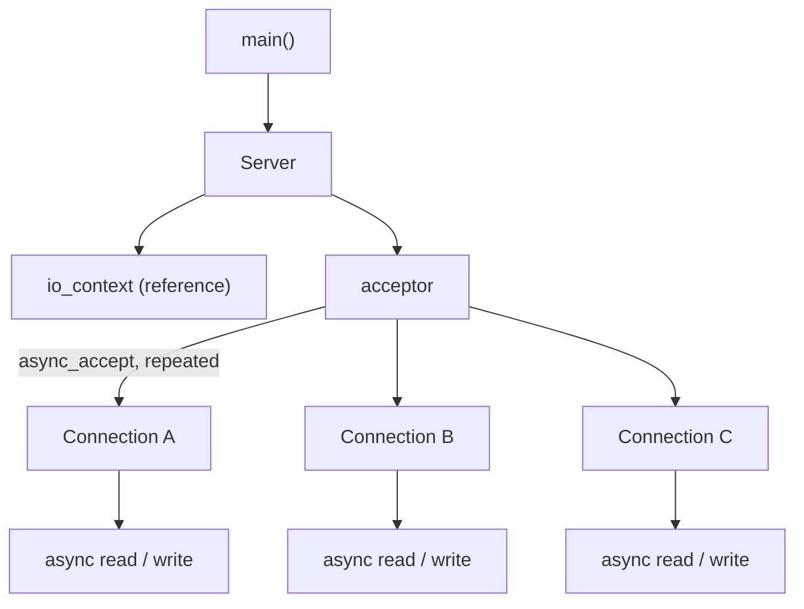
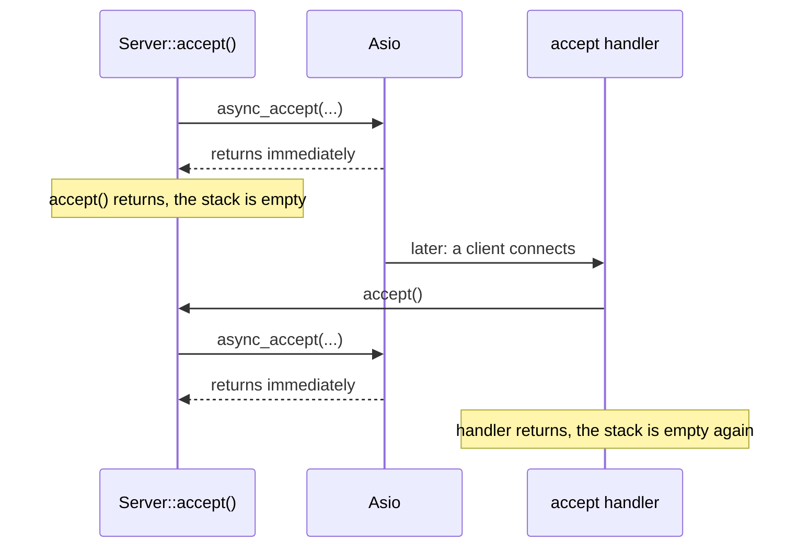
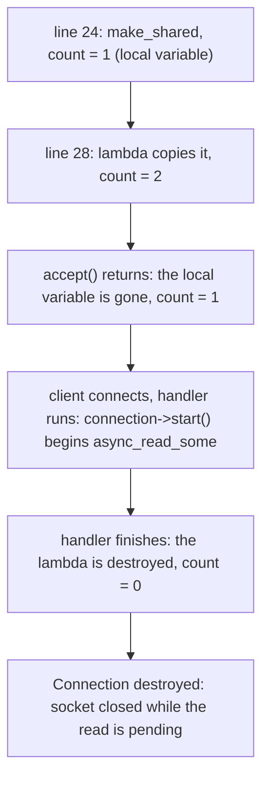
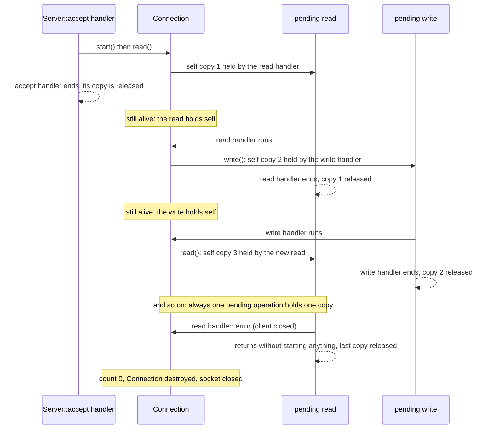

# Asio TCP Server: a `Server` Class and the Connection Lifetime Fix

This lab turns the single-connection demo into the shape of a real Asio server. It has two goals:

1. A `Server` class that owns the acceptor and **keeps accepting clients forever** (the accept loop).
2. Fixing the **lifetime of `Connection`** with `std::enable_shared_from_this`, because without it the connection is destroyed while its operations are still pending.

The second point is the real problem of this lab. The first thing you may hit, though, is a compile error, so that is explained first.

The code is not repeated here. Open the files and follow the line links.

## Files

| File | What it contains |
|---|---|
| [main.cpp](./main.cpp) | Creates the `io_context` and the `Server`, starts it and runs the loop. |
| [server/Server.hpp](./server/Server.hpp), [server/Server.cpp](./server/Server.cpp) | The `Server` class: owns the acceptor and runs the accept loop. |
| [connection/Connection.hpp](./connection/Connection.hpp), [connection/Connection.cpp](./connection/Connection.cpp) | One client: its socket, its buffer and the echo read/write loop. |
| [CMakeLists.txt](./CMakeLists.txt) | Builds `asio-tcp-server` from the three `.cpp` files. |
| [issue.md](./issue.md) | Your notes about why the `Connection` dies (in Arabic). |

## Build and run

```bash
cmake -S . -B build
cmake --build build

./build/asio-tcp-server
```

Then connect three clients, each from its own terminal:

```bash
nc 127.0.0.1 8080
```

Type a line in each one. With the lifetime fix applied, every client is echoed and the server keeps running.

## The architecture

Before, `main()` did everything. Now:



| Class | Responsibility |
|---|---|
| `Server` | Accept new clients. |
| `Connection` | Read, write and the lifetime of one connection. |

## Walkthrough of [main.cpp](./main.cpp)

`main()` is now very small. It does not know about the acceptor, the `Connection`, `async_accept` or sockets.

* [Line 6](./main.cpp#L6): creates the `io_context`.
* [Line 8](./main.cpp#L8): `Server server(io, 8080);` creates the server, passing the `io_context` and the port.
* [Line 10](./main.cpp#L10): `server.start();` begins listening and registers the first accept.
* [Line 12](./main.cpp#L12): `io.run();` runs everything.

## Walkthrough of the `Server` class

### [server/Server.hpp](./server/Server.hpp)

* [Line 8](./server/Server.hpp#L8): the constructor takes the `io_context` and a port.
* [Line 10](./server/Server.hpp#L10): `start()` is the only public action.
* [Line 13](./server/Server.hpp#L13): `accept()` is private. It is the accept loop.
* [Line 16](./server/Server.hpp#L16): `asio::io_context& m_io` is a **reference**. The server does not own the `io_context`; `main()` does.
* [Line 17](./server/Server.hpp#L17): `m_acceptor`, the object that accepts incoming TCP connections.

### [server/Server.cpp](./server/Server.cpp)

* [Lines 6 to 15](./server/Server.cpp#L6-L15): the constructor stores the reference and creates the acceptor on IPv4 and the given port. Creating it does the socket, bind and listen setup, as in the earlier labs.
* [Lines 17 to 20](./server/Server.cpp#L17-L20): `start()` just calls `accept()`.
* [Line 24](./server/Server.cpp#L24): `std::make_shared<Connection>(m_io)` creates a **new** `Connection` for the next client, before the client arrives. It owns an empty socket.
* [Lines 26 to 27](./server/Server.cpp#L26-L27): `async_accept(connection->socket(), handler)`. The new client will be accepted **into the socket that is inside this `Connection`**.
* [Line 28](./server/Server.cpp#L28): the accept handler, a lambda with `[this, connection]`: it keeps the server pointer and a copy of the `shared_ptr`.
* [Lines 30 to 33](./server/Server.cpp#L30-L33): if the accept failed, print the error.
* [Lines 34 to 38](./server/Server.cpp#L34-L38): otherwise print `Client connected!` and call `connection->start()`.
* [Line 39](./server/Server.cpp#L39): `accept();` again, whether the accept worked or not. This is the loop.

### Why the accept loop is not a stack overflow

`accept()` calls itself, but it is not recursion in the usual sense. In ordinary recursion the calls pile up on the same call stack. Here:



`async_accept()` does **not** call the handler right away. It registers the operation and returns. The handler runs later, from `io.run()`, on a fresh stack. Each accept is a new, separate step, an **asynchronous continuation**, so the stack never grows.

## Problem 1: the compile error

If you write `async_accept` with **only a handler**, the build fails with a huge error. The important lines are these (the rest is Asio template noise):

```text
error: static assertion failed: MoveAcceptHandler type requirements not met
error: no match for call to '(Server::accept()::<lambda(const error_code&)>) (const std::error_code&, asio::basic_stream_socket<asio::ip::tcp>)'
note:   candidate expects 1 argument, 2 provided
```

How to read it:

* **"required from here: Server.cpp:26"** points at the `async_accept(` call in our file. That is the line to look at.
* **"no match for call to ... (const error_code&, basic_stream_socket)"**: Asio tried to call our lambda with **two** arguments.
* **"candidate expects 1 argument, 2 provided"**: our lambda has only one parameter.

### The cause

`async_accept` has two overloads, and they expect different handlers:

| Call | New socket created by | Handler signature |
|---|---|---|
| `acceptor.async_accept(socket, handler)` | **you**, before the call | `void(error_code)` |
| `acceptor.async_accept(handler)` | **Asio**, which hands it to the handler | `void(error_code, tcp::socket)` |

The second one is the "move accept" overload: Asio creates the socket itself and moves it into the handler as the **second parameter**. Our lambda takes only `const asio::error_code&`, so it does not match, and the static assertion fires.

### The fix

Pass the socket **as the first argument**. This is what [Server.cpp lines 26 and 27](./server/Server.cpp#L26-L27) do now:

* we create the `Connection` first ([line 24](./server/Server.cpp#L24)),
* we pass `connection->socket()` to `async_accept`,
* the handler keeps its single `error_code` parameter ([line 28](./server/Server.cpp#L28)).

That also matches the design: the `Connection` already owns a socket, and the accepted client goes straight into it.

I reproduced the error on a temporary copy by deleting the `connection->socket(),` line: it gives the same `MoveAcceptHandler type requirements not met` error, and the failing call is at `Server.cpp:26`. The current code builds with `-Wall -Wextra` and no warnings.

An alternative would be to use the move-accept overload with a two-parameter lambda and give `Connection` a constructor that takes the moved `tcp::socket`. We do not do that here.

## Problem 2: the `Connection` dies too early (the main problem)

Even when the code compiles, the server does not work properly. [issue.md](./issue.md) describes the cause; this section shows what actually happens.

### What goes wrong

Asio keeps the **handler** of a pending operation. It does **not** keep the object the handler points to. The read and write handlers in [Connection.cpp (line 24)](./connection/Connection.cpp#L24) and [line 49](./connection/Connection.cpp#L49) capture `[this]`, a raw pointer, which does not own anything.

So who owns the `Connection`? Follow the reference count:



The difference from the previous lab: there, `main()` had a local `shared_ptr` that stayed alive until the end. Here the `Connection` is created **inside** `accept()`, so nothing else holds it.

### What I observed

I ran the current code (with a print in the destructor, on a temporary copy) and connected one client that sends `Hello` at once:

```text
Client connected!
Connection destroyed
Received 6 bytes
Segmentation fault
```

* `Connection destroyed` appears **right after** `Client connected!`, before the client has done anything.
* The pending read still completes, and its handler runs with a `this` that points to a destroyed object. It prints `Received 6 bytes`, then calls `write()` on the dead object, and the server **crashes** (segmentation fault).
* The client saw the connection closed (`EOF`).

If the client had not sent anything yet, the closing socket would instead cancel the pending read, and the handler would run with an `operation_aborted` error. That is the `Read error: ...` case in [issue.md](./issue.md). This path only prints the error and returns, so it happens not to touch `this`. It works by luck.

Both are **undefined behavior**: a handler running on an object that no longer exists.

## The fix: `enable_shared_from_this`

The idea: **every pending operation must own the `Connection`**, so the connection lives exactly as long as it has pending operations.

### The changes

Four kinds of changes, in `Connection` only. I tested them on a temporary copy; they are **not** applied in the repository yet:

```diff
 // connection/Connection.hpp
 #include <array>
+#include <memory>

-class Connection
+class Connection : public std::enable_shared_from_this<Connection>

 // connection/Connection.cpp, in read() and in write()
 void Connection::read()
 {
+    auto self = shared_from_this();
+
     m_socket.async_read_some(
         asio::buffer(m_buffer),
-        [this](const asio::error_code& error,
+        [this, self](const asio::error_code& error,
```

The same two changes go in `write()` (after [line 45](./connection/Connection.cpp#L45) and on [line 49](./connection/Connection.cpp#L49)).

| Where | Change | Why |
|---|---|---|
| [Connection.hpp, line 4](./connection/Connection.hpp#L4) | `#include <memory>` | For `std::enable_shared_from_this` and `std::shared_ptr`. |
| [Connection.hpp, line 6](./connection/Connection.hpp#L6) | `class Connection : public std::enable_shared_from_this<Connection>` | Gives the class `shared_from_this()`. |
| [Connection.cpp, start of `read()`](./connection/Connection.cpp#L21) | `auto self = shared_from_this();` | Makes a new `shared_ptr` to this same object. |
| [Connection.cpp, line 24](./connection/Connection.cpp#L24) | `[this, self]` | The read handler now owns the connection. |
| [Connection.cpp, start of `write()`](./connection/Connection.cpp#L45) | `auto self = shared_from_this();` | Same, for the write. |
| [Connection.cpp, line 49](./connection/Connection.cpp#L49) | `[this, self]` | The write handler now owns the connection. |

### What each piece does

**`std::enable_shared_from_this<Connection>`.** A base class that stores a hidden *weak* reference to the object's reference count. That weak reference is filled in the first time a `shared_ptr` takes ownership of the object, which already happens at [Server.cpp, line 24](./server/Server.cpp#L24) with `make_shared`.

**`shared_from_this()`.** Returns a **new `shared_ptr`** that shares ownership with the existing one, so the reference count goes up by one. It is not a second, independent owner.

Two rules:

* The object must **already** be owned by a `shared_ptr` when you call it. Otherwise it throws `std::bad_weak_ptr`. That is why we call it from `read()` and `write()` (after `make_shared` and `start()`), and never from the constructor.
* Do not use `std::shared_ptr<Connection>(this)`. That creates a second, unrelated reference count and a double delete.

**`auto self = shared_from_this();`.** A local copy. It is taken **before** the asynchronous call, so it is in hand when the lambda is created.

**`[this, self]`.** Both are captured **by copy**:

* `this` is the pointer used to call members (`write(...)`, `read()`, `m_buffer`, ...).
* `self` is the **owner**. The lambda is stored inside the pending operation, so `self` stays alive as long as the operation is pending. Nothing in the lambda body uses `self`. It is there only to keep the object alive. The compiler does not warn about it.

`this` alone does not own anything. `self` is what fixes the bug.

### The new lifetime



The ownership is passed from handler to handler. At every moment at least one pending operation holds a copy. When an error ends the loop (for example the client disconnects), the handler returns **without starting a new operation**, the last copy is released, and the connection cleans itself up. Its destructor closes the socket (RAII).

The connection's lifetime is: **from its first operation to its last operation**, with nobody managing it by hand.

The accept handler's `[this, connection]` at [Server.cpp line 28](./server/Server.cpp#L28) is still needed: the `Connection` must exist while the accept is **pending**, because its socket is the accept target. After `start()` the connection owns itself through its pending operations.

### Result of the fix

I applied the changes to a temporary copy (with a print in the destructor) and connected three clients at once. Each one sent two messages:

| Check | Result |
|---|---|
| Build with `-Wall -Wextra` | no warnings |
| Client 0, 1 and 2, each with two messages | all three `OK`, every message echoed correctly |
| Server after the clients left | still alive, waiting in `async_accept` |
| Threads in the process | **1** |

The server log ended like this:

```text
Read error: End of file
Connection destroyed
Read error: End of file
Connection destroyed
Read error: End of file
Connection destroyed
```

For each client: the client closes, the read gets `End of file`, the handler does not start another operation, and **right after** that the `Connection` is destroyed. The destruction happens exactly when the last operation ends.

## Summary

| Version | Behavior |
|---|---|
| `async_accept(handler)` with a one-parameter lambda | Does not compile (wrong overload). |
| `async_accept(connection->socket(), handler)` and `[this]` handlers | Compiles, but the `Connection` is destroyed right after the accept and the server crashes or drops the client. |
| The same with `enable_shared_from_this` and `[this, self]` | Works. Each connection lives exactly as long as it has pending operations. |

## Notes

1. **The accept handler restarts `accept()` even after an error** ([Server.cpp, line 39](./server/Server.cpp#L39)). If an error persists (for example the process runs out of file descriptors), the loop would repeat it immediately. A real server adds a short delay or stops.
2. **The include style in [Server.cpp, line 3](./server/Server.cpp#L3)** is `#include <../connection/Connection.hpp>`. It works because of the include directories in [CMakeLists.txt](./CMakeLists.txt), but the usual form is `#include "../connection/Connection.hpp"`.
3. **A client that never disconnects** keeps its `Connection` alive forever, because it always has a pending read. That is expected, and real servers add timeouts.
4. **One thread.** All handlers run on the thread that called `io.run()`, so the three clients are served concurrently without any locking.

## Next step

Apply the fix to `Connection` in the repository, then explore what else a connection needs: a clean shutdown, timeouts, and reading until a delimiter instead of echoing whatever arrives.

## References

* [Asio tutorial](https://think-async.com/Asio/asio-1.36.0/doc/asio/tutorial.html)
* [Asio tutorial: asynchronous TCP daytime server](https://think-async.com/Asio/asio-1.36.0/doc/asio/tutorial/tutdaytime3.html)
* [`std::enable_shared_from_this`](https://en.cppreference.com/w/cpp/memory/enable_shared_from_this)

The Asio links are for `1.36.0`. The version installed here is `1.18.1`, so small details can differ.
