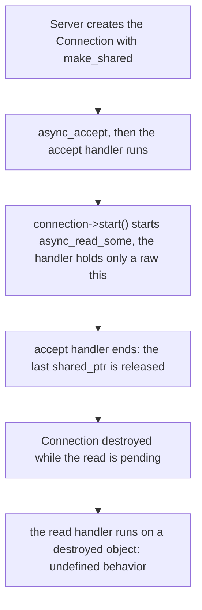
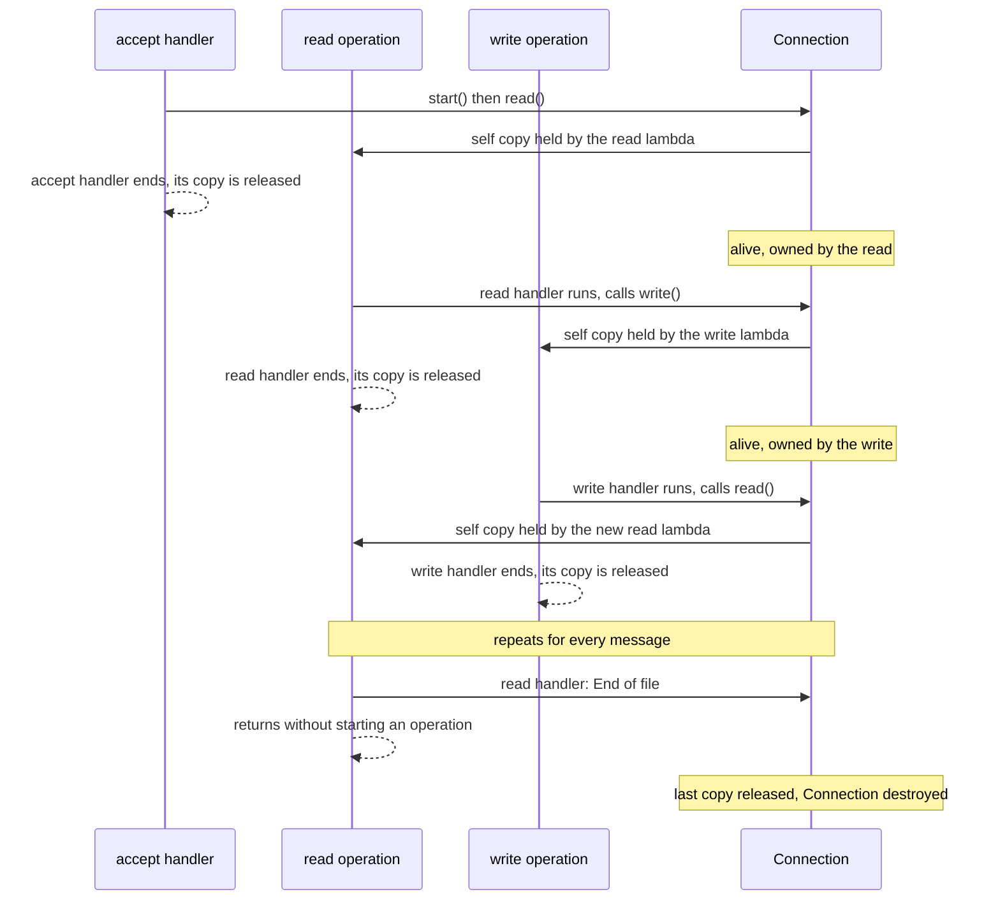

# Solving the Lab 0x10 Issue with `std::enable_shared_from_this`

In [lab 0x10](../0x10-asio-tcp-server/) the `Connection` was destroyed while its asynchronous operations were still pending, and the server crashed or dropped the client. This lab applies the fix: **every pending operation owns the `Connection`**.

The code is not repeated here. Open the files and follow the line links.

## The problem in one picture

In 0x10 the read and write handlers captured only `[this]`, a raw pointer that owns nothing. After the accept handler ended, nobody else owned the `Connection`:



The fix is to give the handlers a `shared_ptr` to the connection, so the object cannot die while an operation is pending.

## Files

| File | Role | Changed from 0x10? |
|---|---|---|
| [connection/Connection.hpp](./connection/Connection.hpp) | The `Connection` class. | **Yes** |
| [connection/Connection.cpp](./connection/Connection.cpp) | The echo read / write loop. | **Yes** |
| [server/Server.hpp](./server/Server.hpp), [server/Server.cpp](./server/Server.cpp) | The `Server` and its accept loop. | No |
| [main.cpp](./main.cpp) | Creates the `io_context` and the `Server`, then runs. | No |
| [CMakeLists.txt](./CMakeLists.txt) | Builds `asio-tcp-server`. | No |

## Build and run

```bash
cmake -S . -B build
cmake --build build

./build/asio-tcp-server
```

Connect from three terminals:

```bash
nc 127.0.0.1 8080
```

Type a line in each. Every client is echoed, and the server keeps running.

## What changed

Only `Connection` changed. There are six small edits:

| # | Where | Change | Purpose |
|---|---|---|---|
| 1 | [Connection.hpp, line 5](./connection/Connection.hpp#L5) | `#include <memory>` | Needed for `std::shared_ptr` and `std::enable_shared_from_this`. |
| 2 | [Connection.hpp, line 7](./connection/Connection.hpp#L7) | The class inherits `std::enable_shared_from_this<Connection>` | Gives the class `shared_from_this()`. |
| 3 | [Connection.cpp, line 22](./connection/Connection.cpp#L22) | `auto self = shared_from_this();` in `read()` | Makes a `shared_ptr` that points to this same object. |
| 4 | [Connection.cpp, line 26](./connection/Connection.cpp#L26) | The read handler captures `[this, self]` instead of `[this]` | The pending read now owns the connection. |
| 5 | [Connection.cpp, line 48](./connection/Connection.cpp#L48) | `auto self = shared_from_this();` in `write()` | Same, for the write. |
| 6 | [Connection.cpp, line 53](./connection/Connection.cpp#L53) | The write handler captures `[this, self]` instead of `[this]` | The pending write now owns the connection. |

[Server.cpp](./server/Server.cpp) is unchanged. It still creates the connection with `std::make_shared` ([line 24](./server/Server.cpp#L24)), which is exactly what `shared_from_this()` needs.

## How each piece works

### `std::enable_shared_from_this<Connection>`

A base class that stores a hidden **weak** reference to the object's reference count. The weak reference is filled the first time a `shared_ptr` takes ownership of the object, which happens at [Server.cpp, line 24](./server/Server.cpp#L24) with `make_shared`.

### `shared_from_this()`

Returns a **new `shared_ptr` that shares ownership** with the existing one. The reference count goes up by one. It does not create a second, independent owner.

Two rules:

* The object **must already be owned by a `shared_ptr`**. If it is not (for example a `Connection` created as a plain local variable and then started), the call throws `std::bad_weak_ptr`. That is why we call it from `read()` and `write()`, which run after `make_shared`, and never from the constructor.
* Never write `std::shared_ptr<Connection>(this)`. That creates a second, unrelated reference count and the object would be deleted twice.

### `auto self = shared_from_this();`

A local `shared_ptr` taken at the start of `read()` ([line 22](./connection/Connection.cpp#L22)) and `write()` ([line 48](./connection/Connection.cpp#L48)), **before** the asynchronous call. It is copied into the lambda, and the local one disappears when the function returns.

### `[this, self]`

Both are captured **by copy** ([line 26](./connection/Connection.cpp#L26) and [line 53](./connection/Connection.cpp#L53)):

| Capture | Role |
|---|---|
| `this` | A raw pointer, used to call members: `write(bytes_read)` ([line 41](./connection/Connection.cpp#L41)) and `read()` ([line 68](./connection/Connection.cpp#L68)). It does **not** own anything. |
| `self` | A `shared_ptr` copy. It **owns** the connection. |

The lambda is stored inside the pending operation, so `self` lives as long as the operation is pending. Nothing in the lambda body uses `self`. It is there only to keep the object alive, and the compiler does not warn about it.

> A handler could also call `self->write(...)` and capture only `[self]`. The code here keeps `this` and calls the members directly. Both work. What matters is that `self` is captured.

The difference between the two captures:

* `[this]`: "I will use the object, but I am not responsible for keeping it alive."
* `[this, self]`: "This asynchronous operation must keep the object alive until it finishes."

## The reference count, step by step

I measured this by adding prints to a temporary copy of the code (not the repository): one client, two messages, then the client closes. `use_count` is the number of `shared_ptr` owners of the `Connection`.

| Step | Where | `use_count` | Who owns it |
|---|---|---|---|
| 1 | `Server::accept()`, right after `make_shared` | 1 | The local variable. |
| 2 | `Server::accept()`, after `async_accept(...)` | 2 | The local variable and the accept lambda's copy. |
| 3 | `accept()` returns | 1 | The accept lambda only. The local variable is gone. |
| 4 | The client connects: accept handler starts | 1 | The accept lambda (the one running). |
| 5 | `read()`, after `async_read_some(...)` | **3** | The accept lambda, the local `self`, and the read lambda's copy. |
| 6 | The accept handler ends | **1** | The read lambda only. This is the moment where 0x10 had a count of 0. |
| 7 | The read handler starts | 1 | The read lambda (running). |
| 8 | `write()`, after `async_write(...)` | **3** | The read lambda (running), the local `self`, and the write lambda's copy. |
| 9 | The read handler ends | 1 | The write lambda only. |
| 10 | The write handler starts, then calls `read()` | 1, then 3 | Same pattern as steps 7 to 8. |
| 11 | The client closes: the read handler gets `End of file` and returns without starting an operation | 0 | Nobody. |
| 12 | `~Connection` runs | | The socket is closed automatically. |

The pattern: **ownership is handed from one handler to the next**. Before a handler ends it starts the next operation, which copies `self`, so at every moment at least one pending operation owns the connection. The count never reaches zero while the connection is in use.



## What happens when the client disconnects

1. The pending `async_read_some` finishes with an error, `End of file`.
2. The read handler prints `Read error: ...` and `return`s ([lines 29 to 35](./connection/Connection.cpp#L29-L35)). It does **not** call `write()` or `read()`, so no new operation, and no new copy of `self`, is created.
3. The lambda is destroyed after it runs. That releases the last `self`.
4. The count reaches 0, the `Connection` is destroyed, and its socket closes by RAII.

The same happens on a write error ([lines 56 to 62](./connection/Connection.cpp#L56-L62)).

In the trace the end of the log was:

```text
Read error: End of file
[trace] ~Connection (destroyed)
```

So the lifetime of a connection is **from its first operation to its last one**, with nobody managing it by hand.

## Results

I built the repository code out of tree with `-Wall -Wextra` and ran three clients at once, each sending two messages:

| Check | Result |
|---|---|
| Build | no warnings |
| Clients 0, 1 and 2, two messages each | all `OK`, every message echoed correctly |
| Server after the clients left | still alive, waiting in `async_accept` |
| Threads in the process | **1** |

Server log of that run:

```text
Client connected!
Client connected!
Client connected!
Received 8 bytes
Sent 8 bytes
...
Read error: End of file
Read error: End of file
Read error: End of file
```

The three `Read error: End of file` lines are the three clients closing normally. They are not failures.

## Is `Server` still involved?

The accept lambda in [Server.cpp, line 28](./server/Server.cpp#L28) still captures `[this, connection]`. That is still needed: the `Connection` must exist while the accept is **pending**, because its socket is the target of `async_accept`.

After `connection->start()` ([line 37](./server/Server.cpp#L37)) the server no longer needs the connection. The pending operations own it. The server does not keep a list of connections at all.

Right after each accepted client, [line 39](./server/Server.cpp#L39) calls `accept()` again, which creates the **next** `Connection` and waits for the next client. In the trace this shows up as `accept(): connection created: use_count=1` right after the first client connects. That waiting connection is owned by the pending accept.

## Notes

1. **An idle client keeps its connection forever.** It always has a pending read, so it always holds a copy of `self`. Real servers add a timeout.
2. **The ownership chain has no cycle.** The `Connection` does not own the lambda. The pending operation does, and the lambda is destroyed when the operation finishes, which releases `self`.
3. **`self` must be taken before the asynchronous call.** Both `read()` and `write()` do this as their first statement.
4. **Include style.** [Server.cpp, line 3](./server/Server.cpp#L3) uses `#include <../connection/Connection.hpp>`. It works because of the include directories in [CMakeLists.txt](./CMakeLists.txt), but `#include "../connection/Connection.hpp"` is the usual form.
5. **The accept loop restarts after an error** ([Server.cpp, line 39](./server/Server.cpp#L39)). If an error keeps happening (for example the process runs out of file descriptors), the loop would repeat it immediately.

## The rule to remember

> If an asynchronous handler uses an object, the operation must **own** that object until it finishes. For a class that manages its own asynchronous lifetime, that means `std::enable_shared_from_this`, `auto self = shared_from_this();`, and `self` captured in every handler.

This is the **session / connection lifetime pattern** you will see in most Asio code.

## Next step

Look at what a connection needs next: a clean shutdown, timeouts for idle clients, and reading until a delimiter instead of echoing whatever arrives.
