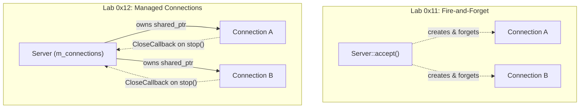
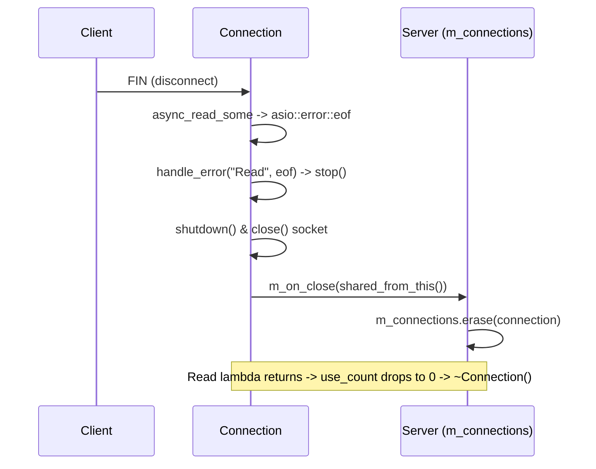
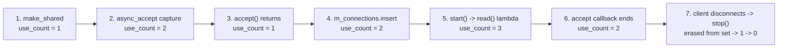

# Asio TCP Server: Connection Tracking, Error Classification, and Graceful Shutdown

In [lab 0x11](../0x11-asio-tcp-server/), we solved the premature destruction bug using `std::enable_shared_from_this`. This lab builds on that foundation to turn the server from a fire-and-forget echo loop into a managed server with active connection tracking, structured error handling, and graceful shutdown on `Ctrl+C`.

---

## 1. Reviewing Lab 0x11: Strengths and Missing Pieces

### What Lab 0x11 Got Right

1. **Object lifetime safety (`std::enable_shared_from_this`):**
   Capturing `auto self = shared_from_this();` by value (`[this, self]`) inside async lambdas ensures the `Connection` closure holds a `std::shared_ptr` copy. As long as an async operation is pending in the kernel (`epoll`), `use_count()` cannot drop to zero, preventing use-after-free crashes.
2. **No stack overflow in `accept()` and `read()`:**
   Although `read()` calls `write()` which calls `read()`, `async_read_some` and `async_write` return immediately after registering the operation. The call stack unwinds completely before `io_context::run()` invokes the next completion handler.

### What Was Missing in Lab 0x11

1. **Fire-and-forget connections:**
   In `Server::accept()`, `connection` was a local variable. Once the accept handler finished, `Server` lost all references to the `Connection`, which lived on its own until the client disconnected. As a result:
   - The server did not know how many clients were currently connected.
   - The server could not close open connections during shutdown.
   - The server could not enforce a maximum connection limit.
2. **No explicit `stop()` method:**
   On a read error, `read()` simply returned, letting the lambda die so `~Connection()` would close `m_socket`. That works when only a single operation is in flight, but once concurrent operations exist on the same connection (such as a timer or a write queue), failing to explicitly close `m_socket` leaves the other operations pending forever.
3. **Treating all errors the same:**
   Every error simply printed `error.message()` without distinguishing between a normal client disconnect (`EOF`), an abrupt crash/reset (`RST`), and a local cancellation (`operation_aborted`).



---

## 2. Under the Hood in Linux and Asio

### The 3 Core Errors in a TCP Socket Lifecycle

When `epoll_wait` reports readiness, Asio performs `read()` or `write()` and translates the result into an `asio::error_code`:

| Asio Error Code | Linux / TCP Equivalent | Meaning and How to Handle It |
| --- | --- | --- |
| `asio::error::eof` | `read()` returns `0` (`FIN` packet received) | The peer closed the connection cleanly (`close()` or `shutdown()`). This is a normal session end, not an unexpected failure. |
| `asio::error::connection_reset` | `errno = ECONNRESET` (`RST` packet received) | The peer terminated abruptly (crash/kill) or closed its socket with unread data still in its kernel receive buffer. |
| `asio::error::operation_aborted` | `errno = ECANCELED` (internal to Asio) | **Not from the network.** Triggered locally when our server calls `m_socket.close()` or `cancel()` while an `async_read_some` or `async_accept` is pending. Asio invokes the handler with this code so captured `shared_ptr`s are released. |

### The Ownership Dilemma Between `Server` and `Connection`

If `Server` stores active connections in `std::unordered_set<std::shared_ptr<Connection>> m_connections`, what happens when a client disconnects?

1. `read()` receives `eof` and returns.
2. The `shared_ptr` inside the read lambda is destroyed.
3. **However**, `m_connections` inside `Server` still holds a `shared_ptr` copy!
4. Result: `use_count()` stays at `1`, and the dead `Connection` leaks in memory forever.

**The Solution:**
`Server` passes a `CloseCallback` (`std::function<void(std::shared_ptr<Connection>)>`) to each `Connection`. When `Connection::stop()` runs, it invokes that callback so `Server` erases the `Connection` from `m_connections`, allowing `use_count()` to reach `0`.



---

## 3. Files and Code Walkthrough

| File | Role |
| --- | --- |
| [connection/Connection.hpp](./connection/Connection.hpp) | Declares `Connection`, `CloseCallback`, `stop()`, `handle_error()`, and `m_stopped`. |
| [connection/Connection.cpp](./connection/Connection.cpp) | Implements idempotent `stop()`, error classification, and the echo loop. |
| [server/Server.hpp](./server/Server.hpp) | Declares `Server`, `stop()`, `active_connections_count()`, and `m_connections`. |
| [server/Server.cpp](./server/Server.cpp) | Implements connection registration, removal on close, and full server shutdown. |
| [main.cpp](./main.cpp) | Sets up `io_context`, `Server`, and `asio::signal_set` (`SIGINT`, `SIGTERM`). |
| [debug/debug.hpp](./debug/debug.hpp) | Defines `DEBUG_PRINT` and `DEBUG_PRINT_ERR` when `DEBUG_TRACE` is enabled. |
| [debug.sh](./debug.sh) | Builds the project in `Debug` mode with `-DDEBUG_TRACE=ON`. |

### 1. [connection/Connection.hpp](./connection/Connection.hpp)

- [Line 9](./connection/Connection.hpp#L9): Defines `using CloseCallback = std::function<void(std::shared_ptr<Connection>)>;`.
- [Line 11](./connection/Connection.hpp#L11): The constructor now accepts `CloseCallback on_close` alongside `asio::io_context&`.
- [Lines 15–16](./connection/Connection.hpp#L15-L16): Deletes the copy constructor and copy assignment operator (`Connection` wraps a unique kernel socket).
- [Line 21](./connection/Connection.hpp#L21) & [Line 26](./connection/Connection.hpp#L26): Adds `stop()` and `handle_error()`.
- [Lines 31–32](./connection/Connection.hpp#L31-L32): Stores `m_on_close` and the idempotency flag `m_stopped{false}`.

### 2. [connection/Connection.cpp](./connection/Connection.cpp)

- **Idempotent `stop()` ([lines 30–54](./connection/Connection.cpp#L30-L54)):**
  - [Lines 33–37](./connection/Connection.cpp#L33-L37): Checks `if (m_stopped) return;` and sets `m_stopped = true` so calling `stop()` multiple times is safe.
  - [Lines 41–44](./connection/Connection.cpp#L41-L44): Calls `m_socket.shutdown(asio::ip::tcp::socket::shutdown_both, ignored_ec)` and `m_socket.close(ignored_ec)`. Closing the socket cancels any pending async operations with `asio::error::operation_aborted`.
  - [Lines 47–53](./connection/Connection.cpp#L47-L53): Moves `m_on_close` into a local variable before invoking `callback(shared_from_this())` to notify `Server` and prevent any reference cycles.
- **Read and Write handlers ([lines 56–106](./connection/Connection.cpp#L56-L106)):**
  - Both `read()` and `write()` delegate error handling to `handle_error("Read", error)` ([line 68](./connection/Connection.cpp#L68)) and `handle_error("Write", error)` ([line 94](./connection/Connection.cpp#L94)).
- **Error classification in `handle_error()` ([lines 108–131](./connection/Connection.cpp#L108-L131)):**
  - Distinguishes `asio::error::operation_aborted`, `asio::error::eof`, `asio::error::connection_reset`, and unexpected errors, then calls `stop()` ([line 130](./connection/Connection.cpp#L130)).

### 3. [server/Server.hpp](./server/Server.hpp) and [server/Server.cpp](./server/Server.cpp)

- **Tracking active connections:**
  - `m_connections` ([Server.hpp line 24](./server/Server.hpp#L24)) is an `std::unordered_set<std::shared_ptr<Connection>>`.
  - In `Server::accept()` ([Server.cpp lines 55–61](./server/Server.cpp#L55-L61)), each new `Connection` is given a lambda that calls `handle_connection_close(closed_connection)`.
  - When `async_accept` succeeds ([Server.cpp lines 83–86](./server/Server.cpp#L83-L86)), the connection is inserted into `m_connections` and started.
  - When a connection stops, `handle_connection_close()` ([Server.cpp lines 47–51](./server/Server.cpp#L47-L51)) erases it from `m_connections`.
- **Stopping the server (`Server::stop()`, [Server.cpp lines 26–40](./server/Server.cpp#L26-L40)):**
  - Closes `m_acceptor` ([line 31](./server/Server.cpp#L31)), which causes the pending `async_accept` to complete with `asio::error::operation_aborted`.
  - Copies `m_connections` into `connections_copy` ([line 35](./server/Server.cpp#L35)) before calling `conn->stop()` in a loop. Iterating over a copy avoids iterator invalidation when `conn->stop()` triggers `m_connections.erase(connection)`.
- **Stopping the accept loop cleanly:**
  - In the accept callback ([Server.cpp lines 73–76](./server/Server.cpp#L73-L76)), if `ec == asio::error::operation_aborted`, the handler returns early instead of calling `accept()` again.
  - Before starting the next `accept()`, [line 89](./server/Server.cpp#L89) also checks `if (m_acceptor.is_open())`.

### 4. [main.cpp](./main.cpp)

- [Lines 16–26](./main.cpp#L16-L26): Registers an `asio::signal_set` on `SIGINT` (`Ctrl+C`) and `SIGTERM`. When a signal arrives, the handler calls `server.stop()`.
- Once `server.stop()` closes the acceptor and all active sockets, all pending handlers complete with `operation_aborted`, `io.run()` ([line 29](./main.cpp#L29)) runs out of work, and `main()` exits cleanly.

---

## 4. Tracing `use_count()` in the New Design

When compiled with `-DDEBUG_TRACE=ON` (via `./debug.sh`), a connection's `shared_ptr` reference count follows these exact steps:



1. **Inside `Server::accept()`:** `make_shared<Connection>` creates the connection → `use_count = 1`.
2. **`async_accept` registration:** The accept lambda captures `connection` by value → `use_count = 2`.
3. **`Server::accept()` returns:** The local `connection` variable goes out of scope → `use_count = 1` (held only by the accept handler).
4. **Client connects:** Inside the accept callback, `m_connections.insert(connection)` stores a copy in the set → `use_count = 2`.
5. **`connection->start()` → `read()`:** Inside `read()`, `local self` + the `async_read_some` lambda capture briefly bring the count to `4` before `read()` returns, leaving the accept lambda, `m_connections`, and the read lambda → `use_count = 3` at the end of the accept callback.
6. **Accept callback finishes:** The accept lambda is destroyed → `use_count = 2` (`1` in `m_connections` + `1` in the pending `async_read_some` handler).
7. **Client disconnects:**Inside the read callback (`use_count = 2`), `handle_error()` calls `stop()`, which erases the connection from `m_connections` (dropping the count to `1`), and when the read callback returns, the last `shared_ptr` is destroyed → `use_count = 0` → `~Connection()` runs immediately.

---

## 5. How to Build and Test on Linux

### Build with Debug Tracing

Note that all console output in this lab uses `DEBUG_PRINT`, so build with `./debug.sh` (`-DDEBUG_TRACE=ON`) to see the logs:

```bash
./debug.sh
./build/asio-tcp-server
```

### Practical Test with 3 Terminals

1. **Terminal 1 (Server):**
   ```bash
   ./build/asio-tcp-server
   ```
2. **Terminal 2 (Client 1):**
   ```bash
   nc 127.0.0.1 8080
   ```
   Type `hello`. The server logs `Client connected, active connections: 1` and echoes `hello`.
3. **Terminal 3 (Client 2):**
   ```bash
   nc 127.0.0.1 8080
   ```
   Type `world`. The server logs `Client connected, active connections: 2` and echoes `world`.
4. **Test 1 — Graceful Client Disconnect:**
   Close Client 1 (`Ctrl+D` or `Ctrl+C`). The server logs:
   - `[Read] Client disconnected gracefully (EOF).`
   - `Connection stopping...`
   - `Connection removed. Active connections: 1`
   - `Connection destroyed...`
   Meanwhile, Client 2 remains connected and continues echoing normally.
5. **Test 2 — Graceful Server Shutdown:**
   With Client 2 still connected, press `Ctrl+C` in Terminal 1 (the server). You will see:
   - `Signal 2 received. Initiating graceful shutdown...`
   - `Server stopping... closing acceptor and all active connections...`
   - `Connection stopping...` and `Connection removed. Active connections: 0`
   - `Acceptor closed, stopping accept loop.`
   - `[Read] Operation cancelled locally (Socket closed).`
   - `Connection destroyed...`
   - `Event loop exited cleanly.`

---

## 6. What We Gained and What Comes Next (Write Queue)

### What We Gained in Lab 0x12

- **Full lifecycle control (zero leaks):** Neither the server forgets active connections nor does `m_connections` leak disconnected ones.
- **True graceful shutdown:** Pressing `Ctrl+C` closes the acceptor and all client sockets cleanly so `io.run()` exits with zero leaked blocks.
- **Clear error diagnostics:** The server distinguishes between `eof`, `connection_reset`, and local `operation_aborted`.

### What Problem Remains for the Next Lab (Write Queue)?

Suppose we want to add a public `send(std::string msg)` method on `Connection` so the server can send a welcome message on connect, broadcast messages to all clients in `m_connections`, or send multiple messages back-to-back:

```cpp
conn->send("Welcome!\n");
conn->send("Server time is 12:00\n");
```

With our current single-buffer design, doing this causes two serious bugs:

1. **Buffer overwrite / corruption:** If a second write starts before the first finishes, `m_buffer` is overwritten while the kernel is still sending the first message.
2. **Interleaved writes in Asio:** `asio::async_write` is a **composed operation** that may split a large message into multiple `async_write_some` calls if the kernel TCP send buffer fills up. Calling `asio::async_write` twice concurrently on the same socket can interleave chunks from both messages on the wire.

In the next lab, we will decouple reading from writing and introduce a **per-connection write queue (`std::deque<std::string>`)** so at most one `asio::async_write` is active on a socket at any time.
