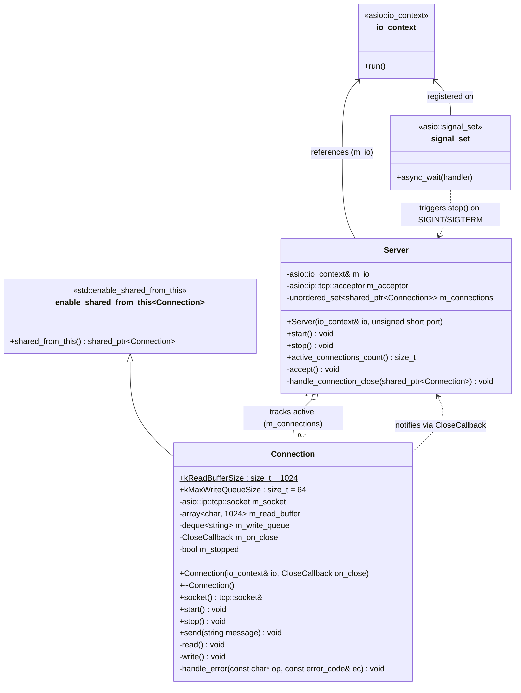
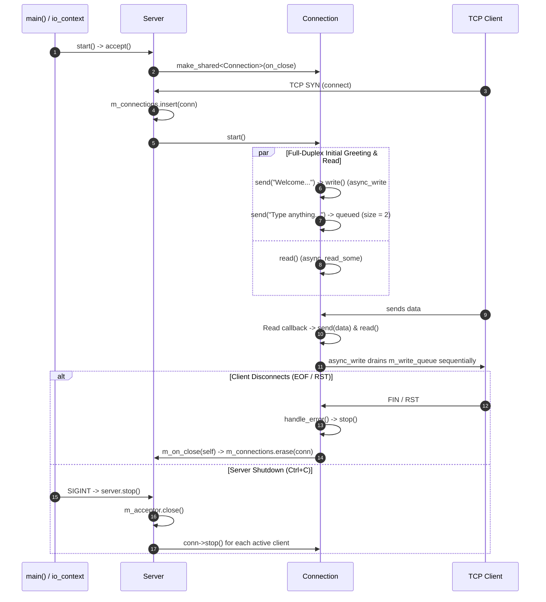

# Architecture Overview (Lab 0x13)

This document describes the architecture of the asynchronous, single-threaded, full-duplex TCP server in Lab 0x13.

---

## 1. UML Class Diagram

---

## 2. Core Components and Responsibilities

### 1. Bootstrap & Event Loop ([main.cpp](./main.cpp))
- Owns the single `asio::io_context` reactor instance that drives all asynchronous I/O on one thread.
- Instantiates `Server` on port `8080` and registers an `asio::signal_set` for `SIGINT` and `SIGTERM`.
- When a termination signal arrives, invokes `server.stop()`, cancelling all pending operations so `io.run()` exits cleanly.

### 2. Acceptor & Connection Manager ([server/Server.hpp](./server/Server.hpp), [server/Server.cpp](./server/Server.cpp))
- **Acceptor Loop (`accept()`):** Pre-allocates a `std::shared_ptr<Connection>` and waits asynchronously via `m_acceptor.async_accept()`. Once a client connects, inserts the connection into `m_connections`, starts the session, and immediately chains the next `accept()`.
- **Active Set (`m_connections`):** Holds `std::shared_ptr<Connection>` for all connected clients, giving the server visibility into the active client count and the ability to close them all during shutdown.
- **Decoupled Cleanup (`handle_connection_close()`):** Passed as a lambda (`CloseCallback`) to each `Connection` so a closing connection can remove itself from `m_connections` without `Connection` depending on `Server`.

### 3. Full-Duplex Client Session ([connection/Connection.hpp](./connection/Connection.hpp), [connection/Connection.cpp](./connection/Connection.cpp))
- **Self-Managed Lifetime:** Inherits `std::enable_shared_from_this<Connection>`. Every in-flight `async_read_some` and `async_write` lambda captures `self = shared_from_this()`, guaranteeing the object outlives its kernel I/O operations.
- **Independent Read Loop (`read()`):** Reads into `m_read_buffer` (`1024` bytes), forwards the payload to `send()`, and immediately re-arms `async_read_some` without waiting for the write to finish.
- **Serialized Write Queue (`send()` & `write()`):** Pushes outbound messages into `m_write_queue` (`std::deque<std::string>`). Only one `asio::async_write` runs at a time; when it finishes, its callback pops the front message and starts the next write if the queue is non-empty.
- **Backpressure Guard (`kMaxWriteQueueSize = 64`):** If a slow client causes `m_write_queue` to reach `64` pending messages, `send()` aborts the session via `stop()` to bound memory usage.
- **Idempotent Shutdown (`stop()`):** Protected by `m_stopped`. Shuts down and closes `m_socket` (cancelling pending handlers with `operation_aborted`) and invokes `m_on_close` once to release the server's `shared_ptr`.

---

## 3. Runtime Interaction & Lifecycle

---

## 4. Key Architectural Invariants

| Invariant | Mechanism |
| --- | --- |
| **No dangling pointers (`use-after-free`)** | Every async handler captures `self = shared_from_this()`. |
| **No memory leaks on disconnect** | `Connection::stop()` moves and invokes `m_on_close`, erasing the entry from `Server::m_connections`. |
| **No interleaved `async_write` calls** | `write()` is only started when `m_write_queue` transitions from empty to non-empty, or inside the write completion callback. |
| **Stable write buffer addresses** | `std::deque<std::string>` never invalidates `m_write_queue.front()` when `push_back()` adds new messages. |
| **Bounded per-client memory** | `kMaxWriteQueueSize` caps queued messages and disconnects slow consumers. |

---

## 5. UML Notation and Symbols Guide

### A. Class Box Anatomy

Each box in the **Class Diagram** is divided into three compartments:

1. **Top compartment (Header):**
   - `<<...>>` (**Stereotype / Annotation**): Indicates an external library type or template base class (e.g., `<<asio::io_context>>`, `<<std::enable_shared_from_this>>`).
   - **Class Name:** The C++ class name (`Server`, `Connection`).
2. **Middle compartment (Attributes / Data Members):**
   - Lists member variables and constants with their types (e.g., `-asio::ip::tcp::socket m_socket`).
3. **Bottom compartment (Operations / Member Functions):**
   - Lists constructors, destructors, and methods with parameters and return types (e.g., `+send(string message) void`).

### B. Member Visibility and Modifiers

| Symbol | Meaning in UML | C++ Equivalent in Code |
| --- | --- | --- |
| `+` | **Public** member (accessible from outside the class) | `public:` (`start()`, `stop()`, `send()`) |
| `-` | **Private** member (internal to the class) | `private:` (`m_socket`, `m_write_queue`, `read()`, `write()`) |
| `#` | **Protected** member (accessible to derived classes) | `protected:` |
| `$` (underlined in rendered UML) | **Static** member (belongs to the class, not an instance) | `constexpr static` (`kReadBufferSize`, `kMaxWriteQueueSize`) |
| `~T~` | **Generic / Template parameter** in Mermaid syntax | `T<...>` in C++ (e.g., `deque~string~` renders as `deque<string>`) |

### C. Relationship Arrows in the Class Diagram

| Arrow Syntax | Visual Shape | UML Relationship | What It Means in Our Code |
| --- | --- | --- | --- |
| `A <\|-- B` | Solid line with **hollow triangle** pointing to `A` | **Inheritance (Generalization)** | `B` inherits from `A` (`class Connection : public std::enable_shared_from_this<Connection>`). |
| `A "1" o-- "0..*" B` | Solid line with **hollow diamond** at `A` | **Aggregation ("has-a" / shared ownership)** | `Server` holds a collection of `Connection` objects via `std::shared_ptr` (`m_connections`), but `Connection` can also outlive `Server`'s reference while an async handler is running. |
| `A *-- B` | Solid line with **filled diamond** at `A` | **Composition (strong ownership)** | `A` exclusively owns `B` by value (e.g., `Server` owns `m_acceptor`, and `Connection` owns `m_socket` and `m_write_queue`). |
| `A <-- B` | Solid line with **open arrowhead** pointing to `A` | **Directed Association** | `B` holds a reference or pointer to `A` (`Server` stores `asio::io_context& m_io`). |
| `A ..> B` | **Dashed line** with open arrowhead pointing to `B` | **Dependency ("uses / notifies")** | A weaker link where `A` invokes or notifies `B` without owning it (`Connection` invokes `CloseCallback` to notify `Server`; `signal_set` triggers `server.stop()`). |

### D. Multiplicity Labels

| Label | Meaning | Example in Diagram |
| --- | --- | --- |
| `"1"` | Exactly one instance | One `Server` instance manages the connections. |
| `"0..*"` | Zero or more instances | A `Server` can have `0` clients (idle) or many concurrent `Connection` instances. |

### E. Sequence Diagram Symbols

| Symbol / Block | Meaning |
| --- | --- |
| `A->>B` | Synchronous call or event registration from `A` to `B`. |
| `par ... and ... end` | **Parallel / Concurrent activities:** Operations that are registered to run concurrently in the event loop (initial `send()` queue draining alongside `read()`). |
| `alt ... else ... end` | **Alternative paths (if / else):** Mutually exclusive scenarios (client-initiated `EOF/RST` disconnect vs. server-initiated `Ctrl+C` shutdown). |

