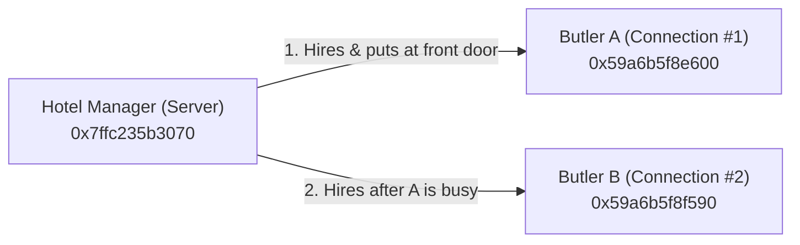
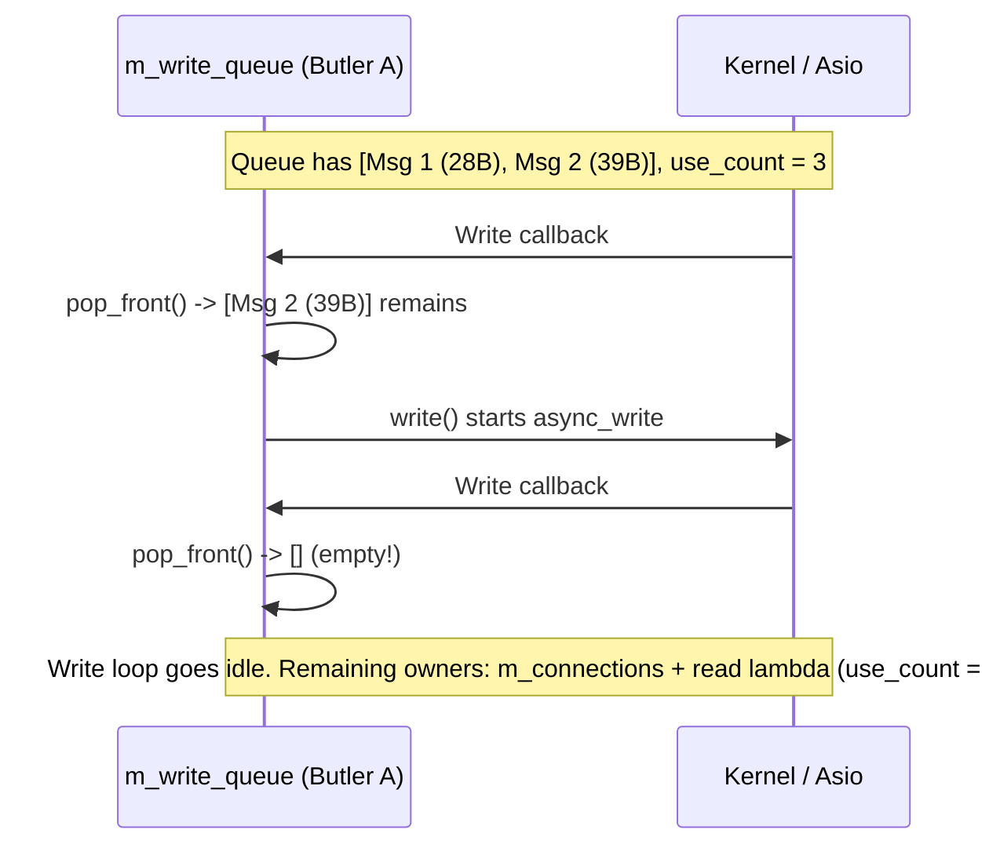

# The Story of a Single Run: Tracing Lab 0x13 Debug Logs

This note explains the full debug output of `./build/asio-tcp-server` by telling it as a short story. Every memory address and `use_count` number in your terminal log is a character or a keycard in this story.

---

## Cast of Characters (Memory Addresses)

| Character | Address in Log | What It Actually Is |
| --- | --- | --- |
| **The Hotel Manager (`Server`)** | `0x7ffc235b3070` | The `Server` instance living on the stack in [main.cpp](./main.cpp#L12). |
| **Butler A (`Connection #1`)** | `0x59a6b5f8e600` | The first `Connection` allocated on the heap. Serves our first guest. |
| **Butler B (`Connection #2`)** | `0x59a6b5f8f590` | The second `Connection` allocated on the heap. Waits at the door for a second guest until the hotel closes. |
| **Keycards (`use_count`)** | `1 → 2 → 3 → 4 → 5 ... → 0` | Each `std::shared_ptr` copy is a **keycard** to a Butler. A Butler stays alive as long as at least one keycard exists (`use_count > 0`) and is destroyed (`[Destructor]`) the instant the last keycard is dropped (`use_count == 0`). |

> كلمة Butler بالإنجليزي معناها "خادم شخصي" أو "مسؤول خدمة الضيوف".



---

## Act 1: Opening the Hotel and Preparing for the First Guest

```text
Server.cpp:17      [Constructor] Server created, this(Server)= 0x7ffc235b3070
Server.cpp:22-23   Start Server::start() method / Server starting
Server.cpp:64      Start Server::accept() method
Connection.cpp:11  [Constructor] Connection created, this(Connection)= 0x59a6b5f8e600
Server.cpp:73      Server->accept method started, conn= 0x59a6b5f8e600 use_count= 1
Connection.cpp:21  Start/End Connection::socket() method
Server.cpp:109     End Server::accept() method
Server.cpp:25      End Server::start()
main.cpp:29        Server running on port 8080. Press Ctrl+C to stop.
```

### What Happened
1. The **Hotel Manager (`0x7ffc235b3070`)** opens port `8080` ([Server.cpp:17](./server/Server.cpp#L17)) and calls `start()` → `accept()` ([Server.cpp:22–24](./server/Server.cpp#L22-L24)).
2. Before any guest arrives, the Manager hires **Butler A (`0x59a6b5f8e600`)** via `std::make_shared<Connection>` ([Server.cpp:65](./server/Server.cpp#L65)).
   - Right now, only the local variable `connection` inside `accept()` holds a keycard → **`use_count = 1`** ([Server.cpp:73](./server/Server.cpp#L73)).
3. The Manager registers `m_acceptor.async_accept()` ([Server.cpp:76–78](./server/Server.cpp#L76-L78)), handing a copy of the keycard to the accept callback lambda (`[this, connection]`). That briefly raises the count to `2`, and when `accept()` finishes ([Server.cpp:109](./server/Server.cpp#L109)), the local variable disappears, leaving **1 keycard** inside the waiting `async_accept` operation.
4. `io.run()` starts waiting ([main.cpp:30](./main.cpp#L30)). The hotel is quiet, and Butler A is standing at the front door.

---

## Act 2: Guest #1 Arrives — The Write Queue in Action!

A client connects (`nc 127.0.0.1 8080`). Now watch the keycards (`use_count`) and the write queue (`m_write_queue`) during `Connection::start()`:

```text
Server.cpp:80      Server->accept callback, conn= 0x59a6b5f8e600 use_count= 1
Server.cpp:93      Server->accept: Client connection added to active connections. conn= 0x59a6b5f8e600 use_count= 2
Server.cpp:94      Client connected, active connections: 1
Connection.cpp:28  Start Connection::start() method
Connection.cpp:40  Start Connection::send() method
Connection.cpp:57  Queued message, queue_size=1 write_in_progress=0 this=0x59a6b5f8e600
Connection.cpp:125 Start Connection::write() method
Connection.cpp:127 Connection->write method started, queue_size= 1 msg_len= 28 ... use_count= 3
Connection.cpp:156 Connection->write method ended, ... use_count= 4
Connection.cpp:40  Start Connection::send() method
Connection.cpp:57  Queued message, queue_size=2 write_in_progress=1 this=0x59a6b5f8e600
Connection.cpp:96  Start Connection::read() method
Connection.cpp:98  Connection->read method started, ... use_count= 4
Connection.cpp:120 Connection->read method ended, ... use_count= 5
Connection.cpp:36  End Connection::start() method
```

### Step-by-Step Breakdown
1. **The Front Door Opens (`use_count = 1 → 2`):**
   - The accept callback wakes up holding its single keycard (`use_count = 1`, [Server.cpp:80](./server/Server.cpp#L80)).
   - The Manager records Butler A in the hotel guestbook `m_connections.insert(connection)` ([Server.cpp:92](./server/Server.cpp#L92)). Now the guestbook also holds a keycard → **`use_count = 2`** ([Server.cpp:93](./server/Server.cpp#L93)).
2. **First Greeting (`"Welcome to Asio TCP Server!\n"`, 28 bytes):**
   - `start()` calls `send()` ([Connection.cpp:32](./connection/Connection.cpp#L32)).
   - Was the tray (`m_write_queue`) empty? Yes (`write_in_progress = 0`), and the message is placed on the tray (`queue_size = 1`, [Connection.cpp:57](./connection/Connection.cpp#L57)).
   - Because no write was running, `send()` calls `write()` ([Connection.cpp:61–62](./connection/Connection.cpp#L61-L62)).
   - Inside `write()`, `auto self = shared_from_this()` creates a local keycard (`use_count = 3`, [Connection.cpp:127](./connection/Connection.cpp#L127)), and `asio::async_write` copies `self` into its lambda (`use_count = 4`, [Connection.cpp:156](./connection/Connection.cpp#L156)). When `write()` returns, the local `self` is dropped, so the count goes back to **`3`** (accept lambda + `m_connections` + pending `async_write`).
3. **Second Greeting (`"Type anything and I will echo it back!\n"`, 39 bytes):**
   - `start()` immediately calls `send()` a second time ([Connection.cpp:33](./connection/Connection.cpp#L33)).
   - This time the tray is **not** empty! It logs **`queue_size=2 write_in_progress=1`** ([Connection.cpp:57](./connection/Connection.cpp#L57)) and returns **without** calling `write()`. This prevents overlapping `async_write` calls.
4. **Starting to Listen (`read()`):**
   - `start()` calls `read()` ([Connection.cpp:35](./connection/Connection.cpp#L35)).
   - Inside `read()`, `local self` brings `use_count` to **`4`** ([Connection.cpp:98](./connection/Connection.cpp#L98)), and the `async_read_some` lambda capture brings it to **`5`** ([Connection.cpp:120](./connection/Connection.cpp#L120)). When `read()` returns, `local self` dies, leaving **`4`**.

---

## Act 3: Hiring Butler B & Draining the Greeting Queue

```text
Server.cpp:64      Start Server::accept() method
Connection.cpp:11  [Constructor] Connection created, this(Connection)= 0x59a6b5f8f590
Server.cpp:73      Server->accept method started, conn= 0x59a6b5f8f590 use_count= 1
Server.cpp:109     End Server::accept() method
Server.cpp:103     Server->accept callback ended, conn= 0x59a6b5f8e600 use_count= 4
Connection.cpp:137 Connection Write callback, bytes_written=28 ... use_count= 3
Connection.cpp:145 Sent 28 bytes
Connection.cpp:127 Connection->write method started, queue_size= 1 msg_len= 39 ... use_count= 4
Connection.cpp:156 Connection->write method ended, ... use_count= 5
Connection.cpp:137 Connection Write callback, bytes_written=39 ... use_count= 3
Connection.cpp:145 Sent 39 bytes
```

### What Happened
1. **Butler B (`0x59a6b5f8f590`) takes the front door:**
   - Before the accept callback for Butler A ends, the Manager calls `accept()` ([Server.cpp:99](./server/Server.cpp#L99)), creating **Butler B (`0x59a6b5f8f590`)** to wait for the next guest.
   - Then Butler A's accept callback finishes ([Server.cpp:103](./server/Server.cpp#L103), `use_count = 4`) and destroys its lambda copy, dropping Butler A's keycards from `4` to **`3`**:
     1. `Server::m_connections` (the guestbook)
     2. The pending `async_read_some` lambda
     3. The pending `async_write` lambda
2. **Greeting #1 finishes (`28 bytes`) → Greeting #2 starts (`39 bytes`):**
   - `Connection Write callback` runs for Greeting #1 (`bytes_written=28`, `use_count=3`, [Connection.cpp:137](./connection/Connection.cpp#L137)).
   - It pops Greeting #1 from the front of `m_write_queue` ([Connection.cpp:148](./connection/Connection.cpp#L148)), sees Greeting #2 (`39 bytes`) still waiting in the queue ([Connection.cpp:150](./connection/Connection.cpp#L150)), and calls `write()` ([Connection.cpp:152](./connection/Connection.cpp#L152)).
   - Greeting #2 is then written (`bytes_written=39`, [Connection.cpp:137](./connection/Connection.cpp#L137)) and popped. Now the queue is empty, so the write chain stops!
   - With no write in flight anymore, Butler A's keycard count drops from `3` to **`2`** (`Server::m_connections` + the pending `async_read_some` lambda).



---

## Act 4: The Guest Speaks (19 Bytes Echoed)

```text
Connection.cpp:105 Connection Read callback, this(Connection)= 0x59a6b5f8e600 use_count= 2
Connection.cpp:112 Received 19 bytes
Connection.cpp:40  Start Connection::send() method
Connection.cpp:57  Queued message, queue_size=1 write_in_progress=0 this=0x59a6b5f8e600
Connection.cpp:127 Connection->write method started, queue_size= 1 msg_len= 19 ... use_count= 3
Connection.cpp:156 Connection->write method ended, ... use_count= 4
Connection.cpp:98  Connection->read method started, ... use_count= 4
Connection.cpp:120 Connection->read method ended, ... use_count= 5
Connection.cpp:137 Connection Write callback, bytes_written=19 ... use_count= 3
Connection.cpp:145 Sent 19 bytes
```

### What Happened
1. The guest types an 18-character message + Enter (`19 bytes`).
2. `Connection Read callback` wakes up ([Connection.cpp:105](./connection/Connection.cpp#L105)). At this instant `use_count = 2` (`m_connections` + the running read lambda).
3. **Full-Duplex in action:**
   - The read callback calls `send()` ([Connection.cpp:114](./connection/Connection.cpp#L114)), which sees an empty queue (`write_in_progress=0`) and starts `async_write` for the `19` bytes.
   - Immediately after `send()`, the read callback calls `read()` ([Connection.cpp:116](./connection/Connection.cpp#L116)) to listen for the next message **before** the 19-byte write has even finished!
4. Next, `Connection Write callback` completes (`Sent 19 bytes`, [Connection.cpp:145](./connection/Connection.cpp#L145)), pops the queue, sees it is empty, and goes idle. Butler A is back to **`use_count = 2`**.

---

## Act 5: Guest #1 Checks Out (`EOF`)

```text
Connection.cpp:105 Connection Read callback, this(Connection)= 0x59a6b5f8e600 use_count= 2
Connection.cpp:162 Start Connection::handle_error() method
Connection.cpp:171 [Read] Client disconnected gracefully (EOF).
Connection.cpp:69  Start Connection::stop() method
Connection.cpp:77  Connection stopping, this(Connection)= 0x59a6b5f8e600
Server.cpp:56      Start Server::handle_connection_close() method
Server.cpp:58      Connection removed. Active connections: 0
Server.cpp:59      End Server::handle_connection_close() method
Connection.cpp:91  End Connection::stop() method
Connection.cpp:185 End Connection::handle_error() method
Connection.cpp:16  [Destructor] Connection destroyed, this(Connection)= 0x59a6b5f8e600
```

### What Happened
1. The guest closes `nc` (`FIN` packet).
2. `Connection Read callback` wakes up with `asio::error::eof` (`use_count = 2`, [Connection.cpp:105](./connection/Connection.cpp#L105)).
3. `handle_error()` logs `[Read] Client disconnected gracefully (EOF).` ([Connection.cpp:171](./connection/Connection.cpp#L171)) and calls `stop()` ([Connection.cpp:184](./connection/Connection.cpp#L184)).
4. `stop()` shuts down and closes the socket, then invokes `m_on_close` → `Server::handle_connection_close()`, which erases Butler A from `m_connections` ([Server.cpp:57](./server/Server.cpp#L57)).
   - That destroys the hotel guestbook's keycard (`use_count` drops from `2` to **`1`**).
5. The read callback finishes and its lambda is destroyed, dropping the **last** keycard (`use_count` drops from `1` to **`0`**).
6. Immediately, `[Destructor] Connection destroyed, this(Connection)= 0x59a6b5f8e600` runs ([Connection.cpp:16](./connection/Connection.cpp#L16)). Zero leaked objects!

---

## Act 6: Closing the Hotel (`Ctrl+C` Graceful Shutdown)

```text
^C
main.cpp:23        Signal 2 received. Initiating graceful shutdown...
Server.cpp:30      Start Server::stop() method
Server.cpp:31      Server stopping, this(Server)= 0x7ffc235b3070, closing acceptor and all active connections...
Server.cpp:44      End Server::stop() method
Server.cpp:80      Server->accept callback, conn= 0x59a6b5f8f590 use_count= 1
Server.cpp:84      Acceptor closed, stopping accept loop.
Connection.cpp:16  [Destructor] Connection destroyed, this(Connection)= 0x59a6b5f8f590
main.cpp:31        Event loop exited cleanly.
```

### What Happened
1. Remember **Butler B (`0x59a6b5f8f590`)** from Act 3? He is still standing patiently at the front door inside `m_acceptor.async_accept()`, holding `1` keycard.
2. You press `Ctrl+C` (`SIGINT`, Signal `2`).
3. `asio::signal_set` catches it ([main.cpp:23](./main.cpp#L23)) and calls `server.stop()` ([main.cpp:24](./main.cpp#L24)).
4. `Server::stop()` closes `m_acceptor` ([Server.cpp:34](./server/Server.cpp#L34)).
5. Closing the acceptor cancels the pending `async_accept`, waking up its callback with `ec == asio::error::operation_aborted` and `use_count = 1` ([Server.cpp:80](./server/Server.cpp#L80)).
6. The callback prints `Acceptor closed, stopping accept loop.` and returns early ([Server.cpp:84–85](./server/Server.cpp#L84-L85)) without calling `accept()` again.
7. When that accept lambda is destroyed, Butler B's last keycard is dropped (`use_count: 1 → 0`), and **Butler B (`0x59a6b5f8f590`) is destroyed** ([Connection.cpp:16](./connection/Connection.cpp#L16)).
8. With zero pending operations left in `io_context`, `io.run()` returns and prints `Event loop exited cleanly.` ([main.cpp:31](./main.cpp#L31)).
