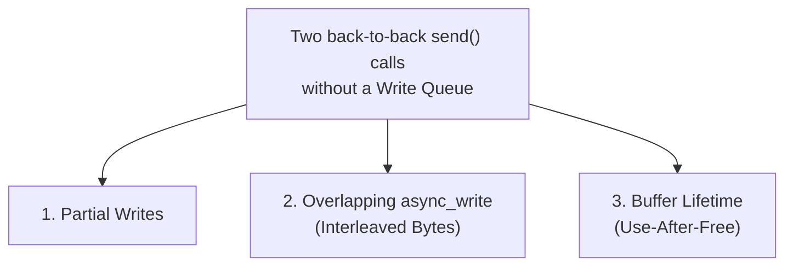
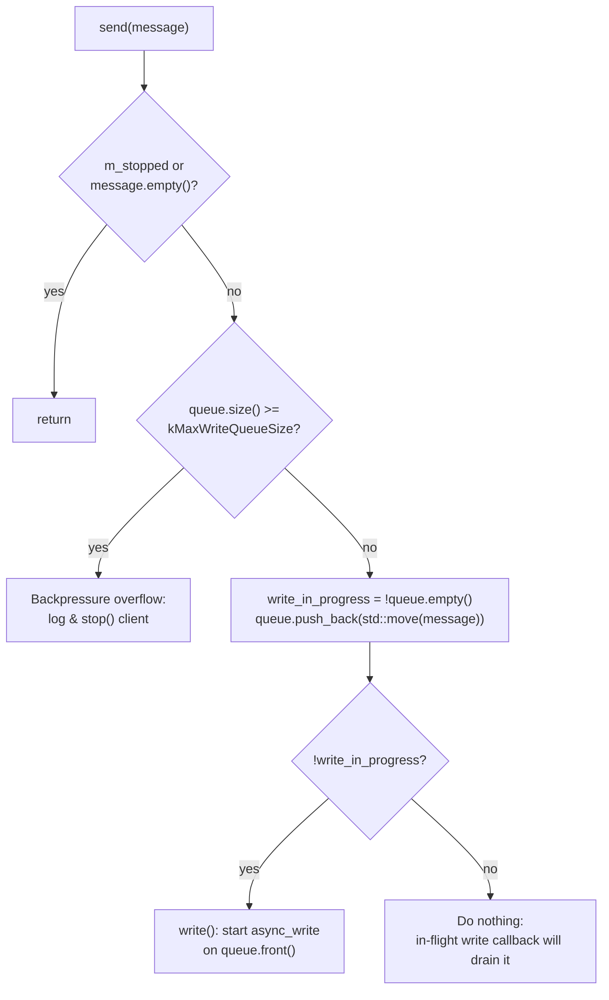
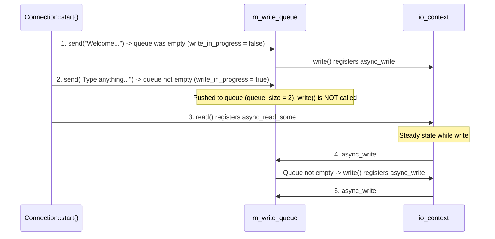

# Asio TCP Server: Full-Duplex Write Queue and Backpressure

In [lab 0x12](../0x12-asio-tcp-server/), the server operated in **ping-pong (half-duplex)** mode:
`read()` → waits for data → calls `write()` → waits for the write to finish → calls `read()` again.

In real-world systems, a server does not only reply to incoming data; it may push data at any time (broadcasts, notifications, or multiple consecutive replies) through a public API:

```cpp
void Connection::send(std::string message);
```

This lab decouples reading from writing, adds a per-connection **write queue** to serialize outbound messages safely, and introduces **backpressure** to protect server memory from slow consumers.

---

## 1. Why Lab 0x12 Would Break on Back-to-Back Sends

Suppose we call `send()` twice in a row:

```cpp
conn->send("Message 1: Hello World\n");
conn->send("Message 2: Welcome to Server\n");
```

If `send()` called `asio::async_write` directly without a queue, three bugs would occur under the hood:



### A. `async_write_some` vs. `asio::async_write` (Partial Writes)

Writing to a TCP socket copies bytes into the **kernel socket send buffer (`SO_SNDBUF`)**, not directly onto the wire.

- Suppose you want to send `100 KB`, but only `32 KB` of space is available in `SO_SNDBUF` (because the client is slow and the TCP window is full).
- **`m_socket.async_write_some()`** copies the `32 KB` that fit (`write()` / `send()` syscall) and immediately invokes your callback with `bytes_written = 32768`. You are responsible for sending the remaining `68 KB`—a **partial write**.
- **`asio::async_write()`** is a **composed operation** (an internal Asio state machine). It repeatedly calls `async_write_some` across multiple `EPOLLOUT` readiness events until all `100 KB` are written (or an error occurs), and only then invokes your completion handler once.

### B. Overlapping `async_write` Calls (Interleaved Bytes)

Because `asio::async_write` runs across multiple steps (`async_write_some` + waiting for `EPOLLOUT`), calling `asio::async_write` for Message 2 while Message 1 is still waiting for buffer space causes their chunks to interleave:

1. `async_write` #1 writes the first part of Message 1.
2. `async_write` #2 writes Message 2 in the middle.
3. `async_write` #1 writes the remainder of Message 1.

The client receives corrupted, interleaved bytes. Boost.Asio / standalone Asio therefore enforces a strict rule:

> **Never start a new `asio::async_write` on the same socket before the completion handler of the previous `asio::async_write` has been invoked.**

### C. Buffer Lifetime

`asio::buffer(msg)` **does not copy** the `std::string`; it only creates a lightweight view (`void* data` + `std::size_t size`, like `std::string_view`). If `msg` is a local variable that gets destroyed before the kernel finishes sending the bytes, Asio reads from freed memory.

---

## 2. The Engineering Solution: Write Queue + Backpressure

To solve all three problems at once, we use the standard Asio write-queue pattern:



1. **Full-Duplex Decoupling (`read` vs. `write`):**
   When `read()` receives data, it forwards the data to `send()` and immediately calls `read()` again without waiting for the write to complete.
2. **Per-Connection Write Queue (`m_write_queue`):**
   - When `send(msg)` is called, we check whether the queue was already non-empty (`const bool write_in_progress = !m_write_queue.empty();`) and push `msg` to the back of the queue.
   - **If the queue was empty (`!write_in_progress`):** No write is currently running, so we call `write()` immediately on `m_write_queue.front()`.
   - **If the queue was not empty (`write_in_progress`):** An `async_write` is already in flight. We do nothing; when the in-flight write finishes, its callback pops the front message (`pop_front()`) and, if more messages remain, calls `write()` again.
   - **Why `std::deque<std::string>`?** Pushing to the back (`push_back`) and popping from the front (`pop_front`) are both $O(1)$, and `m_write_queue.front()` remains at a stable memory address even while new messages are pushed to the back during an in-flight `async_write`.
3. **Memory Protection (Backpressure & Max Queue Size):**
   If the server produces data faster than a slow or frozen client reads it, `SO_SNDBUF` fills up and `m_write_queue` would grow without bound until the Linux OOM killer terminates the server.
   - We cap the queue at `kMaxWriteQueueSize = 64`. If the queue reaches this limit when a new message arrives, the server logs a write-queue overflow and disconnects the slow client via `stop()`.

---

## 3. Files and Code Walkthrough

| File | Role |Changed from 0x12? |
| --- | --- | --- |
| [connection/Connection.hpp](./connection/Connection.hpp) | Declares `kReadBufferSize`, `kMaxWriteQueueSize`, `send()`, `m_read_buffer`, and `m_write_queue`. | **Yes** |
| [connection/Connection.cpp](./connection/Connection.cpp) | Implements `send()`, the queue-draining `write()`, and full-duplex `read()`. | **Yes** |
| [server/Server.hpp](./server/Server.hpp), [server/Server.cpp](./server/Server.cpp) | Acceptor loop, active connection set (`m_connections`), and server `stop()`. | No |
| [main.cpp](./main.cpp) | `io_context`, `Server`, and `asio::signal_set` (`SIGINT`, `SIGTERM`). | No |
| [debug/debug.hpp](./debug/debug.hpp), [debug.sh](./debug.sh) | Debug tracing macros and build script (`-DDEBUG_TRACE=ON`). | No |

### 1. [connection/Connection.hpp](./connection/Connection.hpp)

- [Lines 12–13](./connection/Connection.hpp#L12-L13): Defines `kReadBufferSize = 1024` and `kMaxWriteQueueSize = 64`.
- [Line 26](./connection/Connection.hpp#L26): Declares the public `void send(std::string message);` method.
- [Lines 34–35](./connection/Connection.hpp#L34-L35): Renames the input buffer to `m_read_buffer` (making it clear it is used only for reads) and adds `m_write_queue` for outbound messages.

> **Note on [connection/Connection.hpp](./connection/Connection.hpp):**
> Make sure the header declarations match [connection/Connection.cpp](./connection/Connection.cpp):
> 1. On [line 30](./connection/Connection.hpp#L30), `void write(std::size_t bytes_read);` should be `void write();` to match `void Connection::write()` in [Connection.cpp line 106](./connection/Connection.cpp#L106).
> 2. On [line 6](./connection/Connection.hpp#L6) and [line 35](./connection/Connection.hpp#L35), use `#include <deque>` and `std::deque<std::string> m_write_queue;` because [Connection.cpp line 48](./connection/Connection.cpp#L48) and [line 130](./connection/Connection.cpp#L130) call `push_back()` and `pop_front()`.

### 2. [connection/Connection.cpp](./connection/Connection.cpp)

- **Greeting on connect (`Connection::start()`, [lines 24–33](./connection/Connection.cpp#L24-L33)):**
  - Calls `send("Welcome to Asio TCP Server!\n")` ([line 29](./connection/Connection.cpp#L29)) and `send("Type anything and I will echo it back!\n")` ([line 30](./connection/Connection.cpp#L30)) back-to-back before calling `read()` ([line 32](./connection/Connection.cpp#L32)), immediately exercising the write queue.
- **Queueing and backpressure (`Connection::send()`, [lines 35–58](./connection/Connection.cpp#L35-L58)):**
  - [Lines 36–38](./connection/Connection.cpp#L36-L38): Ignores empty messages or calls after `m_stopped`.
  - [Lines 41–46](./connection/Connection.cpp#L41-L46): Enforces backpressure—if `m_write_queue.size() >= kMaxWriteQueueSize`, logs an overflow error and calls `stop()`.
  - [Lines 49–57](./connection/Connection.cpp#L49-L57): Checks `write_in_progress = !m_write_queue.empty()`, moves `message` into `m_write_queue`, and starts `write()` only if `!write_in_progress`.
- **Full-duplex reading (`Connection::read()`, [lines 79–104](./connection/Connection.cpp#L79-L104)):**
  - When data arrives, passes `std::string(m_read_buffer.data(), bytes_read)` to `send()` ([line 99](./connection/Connection.cpp#L99)) and immediately calls `read()` again ([line 101](./connection/Connection.cpp#L101)) without waiting for the write to finish.
- **Draining the queue (`Connection::write()`, [lines 106–139](./connection/Connection.cpp#L106-L139)):**
  - Calls `asio::async_write` on `asio::buffer(m_write_queue.front())` ([lines 113–115](./connection/Connection.cpp#L113-L115)).
  - In the completion handler ([lines 116–136](./connection/Connection.cpp#L116-L136)), pops the sent message via `m_write_queue.pop_front()` ([line 130](./connection/Connection.cpp#L130)) and, if `!m_write_queue.empty() && !m_stopped`, calls `write()` again ([lines 132–135](./connection/Connection.cpp#L132-L135)) to send the next queued message in order.

---

## 4. Tracing `start()` with `DEBUG_TRACE`

When a client connects with `nc 127.0.0.1 8080`, the sequence inside `start()` unfolds as follows:



1. **First `send("Welcome...")`:**
   - The queue was empty (`write_in_progress = false`).
   - Message 1 is pushed (`queue_size = 1`), and `write()` registers the first `async_write`.
2. **Second `send("Type anything...")`:**
   - The queue is not empty (`write_in_progress = true`).
   - Message 2 is pushed (`queue_size = 2`), and `write()` is **not** called.
3. **`read()` is called:**
   - While both the read and the first write are pending, `use_count()` is **`3`** once the accept callback finishes:
     1. One copy in `Server::m_connections`.
     2. One copy in the `read()` lambda (`self`).
     3. One copy in the `write()` lambda (`self`).
4. **First `async_write` completes:**
   - The write callback calls `m_write_queue.pop_front()`, sees `!m_write_queue.empty()`, and calls `write()` to send the second welcome message in order.

---

## 5. How to Test the Write Queue and Backpressure on Linux

### Test 1: Back-to-Back Messages on Connect

Build and run the server, then connect with `nc`:

```bash
./debug.sh
./build/asio-tcp-server
```

In a second terminal:

```bash
nc 127.0.0.1 8080
```

Both welcome lines arrive in order without interleaving:

```text
Welcome to Asio TCP Server!
Type anything and I will echo it back!
```

In the server debug output, you will see `write_in_progress=0` for the first message and `write_in_progress=1` for the second.

### Test 2: Simulating a Slow Consumer (Backpressure Overflow)

To trigger the backpressure guard in [Connection::send() lines 41–46](./connection/Connection.cpp#L41-L46):

1. Temporarily lower `kMaxWriteQueueSize` in [Connection.hpp line 13](./connection/Connection.hpp#L13) to `5` (or send more than `64` messages in a loop inside `Connection::start()`):
   ```cpp
   for (int i = 0; i < 10; ++i) {
       send("Message number " + std::to_string(i) + "\n");
   }
   ```
2. With `kMaxWriteQueueSize = 5`, the first 5 messages fill the queue in the same event-loop tick before `async_write` drains them, and the 6th message triggers the backpressure check:
   ```text
   Write queue overflow (5 messages)! Disconnecting slow client...
   ```
   The server immediately closes that client connection to protect its memory.

---

## 6. What We Gained and What Comes Next (Protocol Framing)

### What We Gained in Lab 0x13

- **True full-duplex I/O:** Reading and writing run independently in parallel.
- **Serialized writes:** At most one `asio::async_write` is active per socket at any time, regardless of how many times `send()` is called.
- **Buffer lifetime safety:** Every outbound string lives inside `m_write_queue` until `asio::async_write` finishes sending it.
- **Bounded memory (backpressure):** Slow or frozen clients are disconnected once their outbound queue reaches `kMaxWriteQueueSize`.

### What Problem Remains for Lab 0x14? (TCP Is a Byte Stream, Not Message-Based)

In `Connection::read()`, we currently treat whatever bytes `async_read_some` returns as a standalone message:

1. **Message fragmentation:** If a client sends a `2000-byte` message, `m_read_buffer` (`1024 bytes`) or network MTU segmentation splits it across multiple `async_read_some` calls. The server treats each chunk as a separate message.
2. **Message coalescing (Nagle's algorithm):** If a client calls `send("CMD1")` followed immediately by `send("CMD2")`, the TCP stack may merge them into a single segment. `async_read_some` reads `"CMD1CMD2"` (`8 bytes`) in one call and treats both commands as a single message.

In the next lab, we will demonstrate this byte-stream behavior in practice and implement **protocol framing** so the server knows the exact boundaries of every message regardless of how TCP splits or merges packets.

