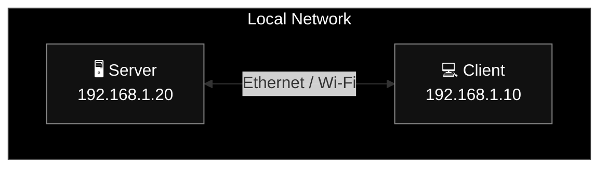

# الدرس الأول: Networking Fundamentals & OSI Model

المستوى: من الأساسيات — مع تطبيق عملي على Linux

## 1. يعني إيه Network أصلًا؟

الـ Computer Network هي مجموعة أجهزة متصلة ببعض، تقدر تتبادل البيانات باستخدام وسائل اتصال وقواعد متفق عليها.

مثلًا، عندك جهازين:



> مثال افتراضي: الجهازان موجودان على نفس الشبكة المحلية.

لو الـ Client عايز يبعت رسالة للسيرفر، محتاجين نجاوب على أسئلة مختلفة:

- مين التطبيق اللي هيبعت البيانات؟ مثلًا برنامج C++.
- مين العملية اللي هتستقبلها؟ نحددها عادةً باستخدام IP وPort.
- إزاي البيانات هتتنقل بشكل موثوق؟ ممكن نستخدم TCP.
- إزاي الجهاز يعرف يوصل للجهاز التاني؟ باستخدام IP وRouting.
- إزاي البيانات تنتقل على الوصلة المحلية؟ باستخدام Ethernet أو Wi-Fi.

لاحظ إن كل سؤال من دول بيخص وظيفة مختلفة. وهنا بتظهر أهمية الـ OSI Model.

## 2. ليه أصلًا عندنا OSI Model؟

تخيّل لو كل برنامج لازم يعرف تفاصيل كارت الشبكة، وطريقة نقل الإشارات، وإزاي يكتشف الأخطاء، وإزاي يعيد إرسال البيانات لو ضاعت.

كان تطوير البرامج هيبقى معقد جدًا.

الحل هو تقسيم مسؤوليات الاتصال إلى طبقات. كل طبقة بتقدم وظائف للطبقة اللي فوقها، وبتعتمد على خدمات الطبقات اللي تحتها.

الـ OSI Model بيقسّم الوظائف دي إلى 7 Layers، وده بيساعدنا نفهم النظام ونحدد مكان المشكلة عند الـ debugging.

## 3. افهم الـ 7 Layers بدل ما تحفظهم

هنشوف كل Layer بتعمل إيه، وإيه علاقتها باللي بتدرسه في Linux وC++.

<p align="center">
  
</p>

فيه ملحوظة مهمة: الـ OSI نموذج مرجعي، مش شرط تلاقي كل Layer مطبّقة كوحدة مستقلة في Linux. وفي نموذج TCP/IP المستخدم عمليًا على الإنترنت، بعض وظائف OSI بتتجمع في طبقة واحدة.

مرجع: [Cisco — What Is the OSI Model?](https://www.cisco.com/c/en/us/support/docs/lan-switching/ethernet/7039-1.html?utm_source=chatgpt.com).

## 4. نربط الطبقات برحلة Request حقيقية

خلينا نفترض إن عندك برنامج Client عايز يبعت `Hello` لسيرفر C++ على جهاز تاني باستخدام TCP.

<p align="center">
  
</p>

إضافة headers أثناء نزول البيانات بين الطبقات اسمها Encapsulation. وعلى الجهاز المستقبل، كل طبقة بتتعامل مع المعلومات الخاصة بيها وتسلّم المحتوى للطبقة الأعلى.

لاحظ إننا ركزنا على Layers 7 و4 و3 و2 و1؛ لأن دول هيساعدونا نفهم التنفيذ العملي. أما Layers 5 و6 فهنرجع لهم في سياق البروتوكولات والتطبيقات لما يكون ده مفيد.

مرجع إضافي: [RFC 1122 — Requirements for Internet Hosts](https://www.rfc-editor.org/rfc/rfc1122.html?utm_source=chatgpt.com).

## 5. نطبّق على Linux

قبل ما نكتب كود، خلينا نتعرف على الجهاز نفسه.

نفّذ الأوامر دي في Terminal:

```
ip addr
```

ده هيعرض الـ interfaces وعناوين IP.

```
ip route
```

ده هيعرض الـ routing table، ومنها المسار الافتراضي لو موجود.

```
ip link
```

ده هيعرض خصائص الـ interfaces، ومنها الـ MTU.

```
ss -lnt
```

ده هيعرض منافذ TCP اللي في حالة الاستماع.

كل أمر بيكشف جزءًا مختلفًا من الشبكة. مش مطلوب تفهم كل التفاصيل من أول مرة؛ هنفك مخرجاتها واحدة واحدة.
