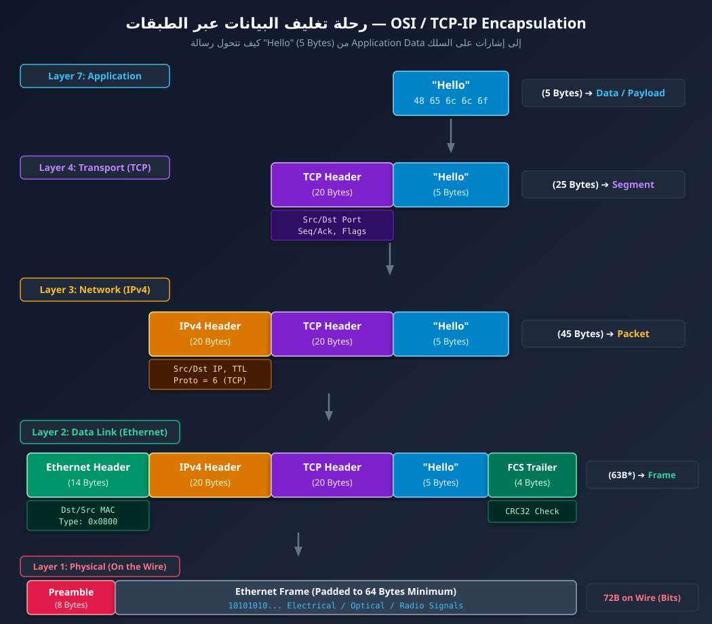
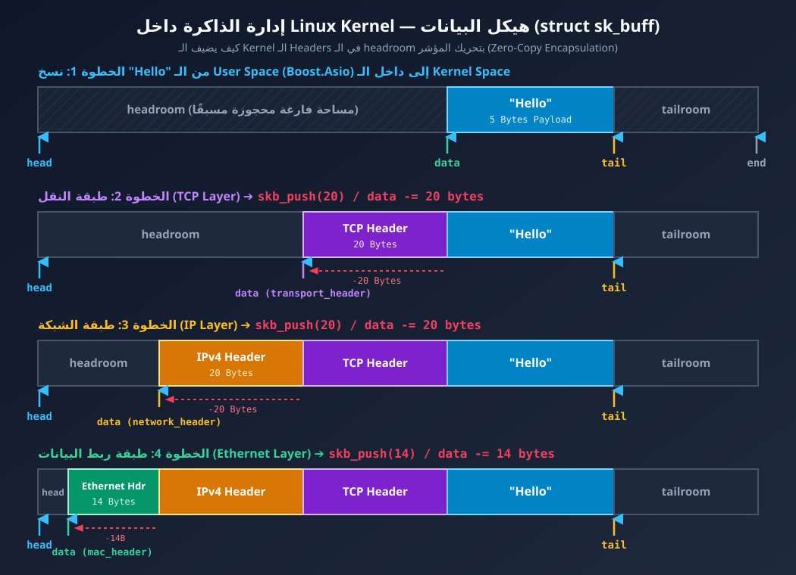
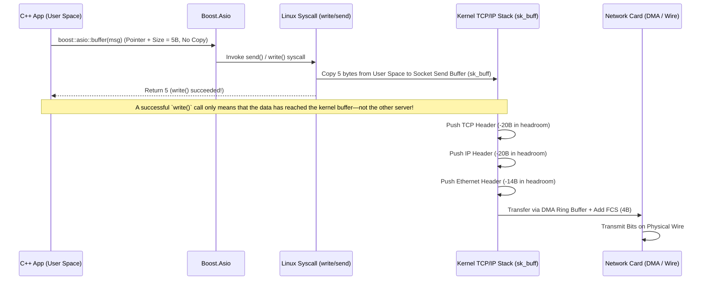

# الدرس الثاني: تشريح الـ Encapsulation، الـ PDUs، ورحلة البيانات داخل Linux

المستوى: تأسيسي عملي — ربط الشبكات بـ Linux Kernel و C++ (Boost.Asio)

---

## مراجعة سريعة لإجابات أسئلة الدرس الأول

1. **Network Layer (Layer 3):** مسؤولة عن عناوين الـ IP والـ Routing.
2. **Transport Layer (Layer 4):** تحتوي على بروتوكولات الـ TCP والـ UDP.
3. **Data Link Layer (Layer 2):** مرتبطة بشكل أساسي بعنوان الـ MAC Address.
4. **لأ، الطبقات الأدنى بتتعامل مع تفاصيل النقل:** الكود الخاص بك يتحدث مع الـ Socket API فقط، بينما يتولى الـ Linux Kernel والـ Hardware بقية التفاصيل.

---

## 1. الفرق بين الـ PDUs (Protocol Data Units)

في عالم الشبكات، أثناء نزول البيانات عبر الطبقات يتغير اسمها وشكلها لأن كل طبقة تغلفها بـ **Header** خاص بها (وأحياناً **Trailer** في النهاية). كل شكل من هذه الأشكال يُسمى **PDU (Protocol Data Unit)**:

| الطبقة (Layer) | اسم وحدة البيانات (PDU) | ما الذي يُضاف في الـ Header؟ | حجم الـ Header المعتاد | الوظيفة الأساسية |
| :--- | :--- | :--- | :--- | :--- |
| **Application (L7)** | **Data / Payload** | حسب البروتوكول (HTTP مثلاً) | متغير | البيانات الفعلية التي يريد البرنامج إرسالها |
| **Transport (L4)** | **Segment** (TCP) / **Datagram** (UDP) | Source/Dest Ports, Seq/Ack Numbers, Checksum | **20 Bytes** (TCP بدون Options) أو **8 Bytes** (UDP) | توصيل البيانات للـ Process الصحيحة وضمان سلامتها |
| **Network (L3)** | **Packet** | Source/Dest IP, TTL, Protocol ID | **20 Bytes** (IPv4 بدون Options) | توجيه البيانات (Routing) بين الشبكات المختلفة |
| **Data Link (L2)** | **Frame** | Dest/Source MAC, EtherType + **FCS (Trailer)** | **14 Bytes** Header + **4 Bytes** Trailer | نقل البيانات بين جهازين على نفس الوصلة المحلية (Hop-to-Hop) |
| **Physical (L1)** | **Bits** | Preamble & Start Frame Delimiter (SFD) | **8 Bytes** (على السلك) | تحويل الـ Frame لإشارات كهربائية أو ضوئية أو لاسلكية |

---

## 2. رسم توضيحي: كيف تكبر رسالة `"Hello"` عبر الطبقات؟ (Encapsulation)

لنفترض أن برنامج C++ الخاص بك يرسل كلمة `"Hello"` (حجمها **5 Bytes** فقط):


<p align="center">
    
<p>

> **ملحوظة (*):** الحد الأدنى لحجم الـ Ethernet Frame هو **64 Bytes**، لذلك إذا كان المجموع 63 بايت، يقوم كارت الشبكة بإضافة 1 بايت حشو (**Padding = `0x00`**) قبل الإرسال الفعلي على السلك.

---

## 3. ماذا يحدث فعلياً داخل الـ Linux Kernel؟ (`struct sk_buff`)

عند قراءة الكتب النظرية، قد تتخيل أن كل طبقة تأخذ البيانات، تحجز مساحة ذاكرة جديدة أكبر، وتنسخ فيها الـ Header الجديد مع البيانات القديمة. **لو كان Linux يفعل ذلك فعلاً، لكان الأداء كارثياً بسبب عمليات الـ Memory Allocations والـ Copying المستمرة!**

في الحقيقة، يستخدم الـ Linux Kernel هيكل بيانات عبقري اسمه **`sk_buff`** (اختصار لـ Socket Buffer):
1. بمجرد دخول البيانات إلى الـ Kernel، يتم حجز مساحة ذاكرة واحدة كبيرة نسبياً، وتُوضع بيانات التطبيق في المنتصف، مع ترك مساحة فارغة في البداية تُسمى **`headroom`** ومساحة في النهاية تُسمى **`tailroom`**.
2. عندما تنزل البيانات لطبقة الـ **TCP**، يقوم الـ Kernel فقط بتحريك مؤشر البداية (`data pointer`) للخلف داخل الـ `headroom` بمقدار 20 بايت ويكتب الـ TCP Header **بدون أي نسخ للبيانات الأصلية (Zero-copy header insertion)**.
3. عندما تنزل لطبقة الـ **IP**، يحرك المؤشر للخلف 20 بايت إضافية ويكتب الـ IP Header، ونفس الأمر مع الـ **Ethernet Header**!

### رسم حركة المؤشرات داخل `sk_buff` في الذاكرة:

<p align="center">
    
<p>

---

## 4. الربط مع C++ و Boost.Asio

عندما تكتب هذا السطر في مشروعك باستخدام Boost.Asio:

```cpp
std::string msg = "Hello";
boost::asio::write(socket, boost::asio::buffer(msg));
```

### رحلة التنفيذ خطوة بخطوة:



1. **في الـ User Space:** الدالة `boost::asio::buffer` لا تنسخ `"Hello"`، بل تُنشئ غلافاً خفيفاً يحتوي على مؤشر (`Pointer`) لمكان النص في الـ RAM وحجمه (5 بايت).
2. **الـ System Call:** تستدعي Asio في النهاية دالة النظام في Linux مثل `send()` أو `write()`.
3. **الانتقال للـ Kernel Space:** هنا تحدث عملية النسخ الوحيدة للـ 5 بايت من ذاكرة برنامجك (User Space) إلى الـ **Socket Send Buffer** داخل الـ Kernel (في هيكل `sk_buff`).
4. **بداية الـ Encapsulation:** يتولى الـ Kernel تركيب الـ TCP Header، ثم الـ IP Header، ثم الـ Ethernet Frame، ويسلمها لـ Driver كارت الشبكة (NIC) عن طريق الـ Ring Buffer والـ DMA لتخرج على السلك.

> **قاعدة ذهبية للـ Debugging:** نجاح دالة `boost::asio::write` أو `async_write` في الكود الخاص بك **لا يعني** أن الرسالة وصلت للطرف الآخر! هذا يعني فقط أن كود C++ سلّم البيانات بنجاح إلى الـ **Kernel Socket Send Buffer** في جهازك، والـ Kernel سيتولى رحلة الإرسال في الخلفية.

---

## 5. تجربة عملية: شاهد الـ Encapsulation بعينك على Linux

لرؤية هذه الطبقات عملياً، سنستخدم أداة `tcpdump` على كارت الشبكة الداخلي (`lo` - Loopback)، ونرسل كلمة `"Hello"`.

افتح **شاشَتَي Terminal** على جهازك:

### في الـ Terminal الأول (المراقب - Sniffer):
شغّل الأمر التالي لمراقبة أي حركة بيانات على المنفذ `9999` وعرض الـ Headers كاملة بالـ Hex والـ ASCII:

```bash
sudo tcpdump -i lo -nn -XX -v port 9999
```
* `-i lo`: راقب كارت الشبكة الداخلي (Loopback).
* `-nn`: اعرض عناوين الـ IP وأرقام الـ Ports كأرقام صريحة دون تحويلها لأسماء.
* `-XX`: اعرض محتوى الـ Frame بالكامل (بما في ذلك الـ Ethernet Header) بالـ Hex والـ ASCII.

### في الـ Terminal الثاني (المرسل والمستقبل):
شغّل سيرفر بسيط يستمع على المنفذ `9999` وأرسل إليه `"Hello"` (أو استخدم سيرفر Boost.Asio الخاص بك):

```bash
nc -l -p 9999 &
echo -n "Hello" | nc 127.0.0.1 9999
```

### تشريح مخرجات `tcpdump` (كيف تقرأ الـ Hex Dump؟):

ابحث في المخرجات عن الحزمة التي تحتوي على `length 5` (وهي الـ 5 حروف الخاصة بكلمة `"Hello"`):

```text
0x0000:  0000 0000 0000 0000 0000 0000 0800 4500  ..............E.
0x0010:  002d 3a1b 4000 4006 028e 7f00 0001 7f00  .-:.@.@.........
0x0020:  0001 c814 270f 1a2b 3c4d 5e6f 7a8b 5018  ....'..+<M^oz.P.
0x0030:  0200 fe21 0000 4865 6c6c 6f              ...!..Hello
```

| نطاق البايتات | البايتات بالـ Hex | التفسير الهندسي |
| :--- | :--- | :--- |
| **أول 14 بايت** (`0x0000` - `0x000d`) | `0000 0000 0000 0000 0000 0000 0800` | **Ethernet Header:** عناوين الـ MAC أصفار لأننا على الـ Loopback، وآخر بايتين `0800` هما الـ EtherType ويعنيان أن البروتوكول بالداخل هو **IPv4**. |
| **الـ 20 بايت التالية** (`0x000e` - `0x0021`) | `4500 002d ... 7f00 0001 7f00 0001` | **IPv4 Header:** يبدأ بـ `45` (IPv4 + طول الـ Header هو $5 \times 4 = 20$ بايت). وتظهر فيه `7f00 0001` مرتين وهي `127.0.0.1` بالـ Hex (Source & Dest IP). |
| **الـ 20 بايت التالية** (`0x0022` - `0x0035`) | `c814 270f ... 5018 0200 fe21 0000` | **TCP Header:** البورت المرسل `0xc814`، والبورت المستقبل `0x270f` (وهو `9999` بالـ Decimal!). |
| **آخر 5 بايت** (`0x0036` - `0x003a`) | `4865 6c6c 6f` | **Application Payload:** حروف كلمة **`Hello`** بالـ ASCII (`0x48`='H', `0x65`='e', `0x6c`='l', `0x6c`='l', `0x6f`='o'). |

---

## 6. أسئلة عن ال Topic ده قبل ما نتعمق

1. عندما يرسل كود C++ رسالة حجمها 5 بايت (`"Hello"`) عبر TCP فوق IPv4 وEthernet، لماذا يتجاوز حجم الـ Frame الذي يسير على السلك 50 بايت؟
2. لماذا يستخدم الـ Linux Kernel مساحة الـ `headroom` داخل هيكل `sk_buff` بدلاً من عمل `malloc` أو `new` في كل طبقة من طبقات الشبكة؟
3. نفّذ أوامر الدرس الأول (`ip addr` و `ip link` و `ip route`) أو تجربة `tcpdump` على جهازك، لنستخرج منها الـ **MTU** والـ **MAC Address** ونبني عليها **المرحلة الثانية (Ethernet & Local Networks)**.