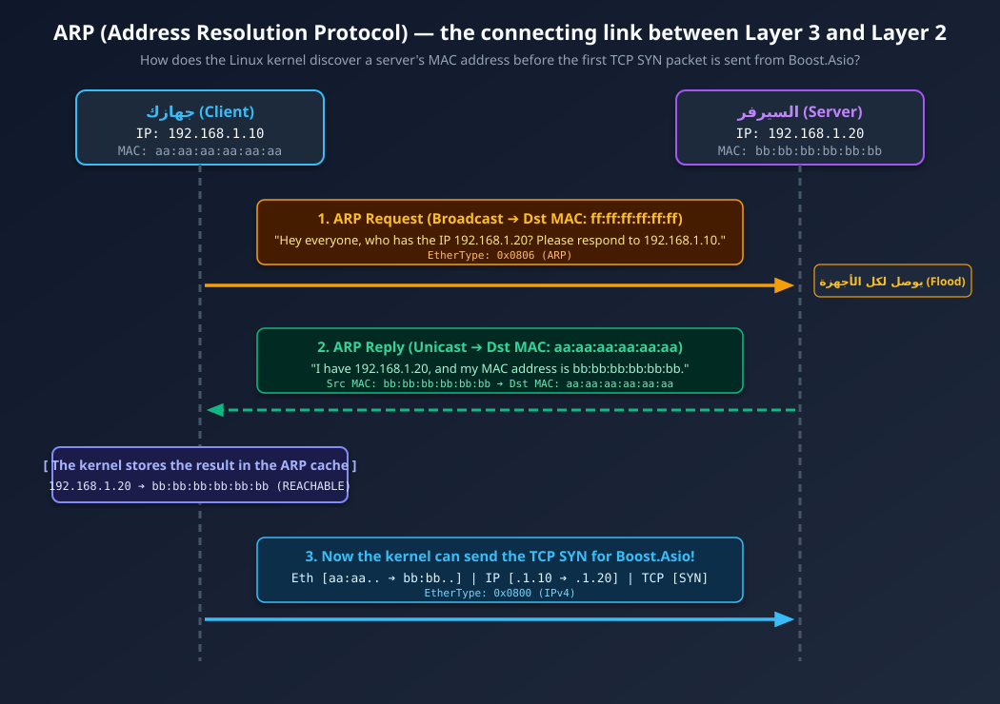

### أولاً: إجابات أسئلة الدرس ["encapsulation-linux"](./1_encapsulation-linux.md):

**1. ليه لما نبعت 5 بايت (`"Hello"`) حجم الـ Frame على السلك بيبقى أكبر من 50 بايت؟**
بسبب عملية الـ **Encapsulation** في كل طبقة، بالإضافة للحد الأدنى لحجم الـ Ethernet Frame:

* **5 Bytes:** حجم البيانات الأصلية (`"Hello"`).
* **+ 20 Bytes (TCP Header):** (أو 32 بايت لو الـ TCP Timestamps شغالة على Linux) لتحديد الـ Ports والـ Sequence Numbers.
* **+ 20 Bytes (IPv4 Header):** لتحديد عناوين الـ Source/Destination IP.
* **+ 14 Bytes (Ethernet Header) + 4 Bytes (FCS Trailer):** لتحديد الـ MAC Addresses واختبار سلامة الـ Frame.
* **المجموع = 63 بايت.** وبما أن بروتوكول Ethernet بيشترط إن أقل حجم لأي Frame هو **64 بايت** (من غير الـ 8 بايت Preamble)، كارت الشبكة بيضيف **1 بايت Padding (أصفار)**، فيوصل الحجم لـ 64 بايت (و72 بايت بالإشارات الفيزيائية على السلك).

**2. ليه الـ Linux Kernel بيستخدم الـ `headroom` في الـ `sk_buff` بدل ما يعمل `malloc` أو `new` في كل طبقة؟**
لأن حجز الذاكرة الديناميكية (Memory Allocation) ونسخ البيانات (Memory Copying) من أبطأ العمليات بالنسبة للـ CPU. لو الكيرنل عمل Allocation و Copy في كل طبقة (TCP ثم IP ثم Ethernet) مع ملايين الـ Packets في الثانية، الـ CPU هيقضي وقته كله في نسخ الرامات والـ Throughput هينهار. بفضل الـ `headroom`، الكيرنل بيحجز الميموري مرة واحدة بس، وكل طبقة بتحرك Pointer للخلف (`skb_push`) وتكتب الـ Header بتاعها في لمح البصر بتكلفة $O(1)$ وبدون أي نسخ للبيانات (**Zero-Copy Overhead**).

---

## Ethernet & Local Networks (MAC, ARP, Switches, MTU)

في المرحلة الأولى عرفنا إن الـ **IP Packet** بتتغلف جوه **Ethernet Frame** عشان تمشي في الشبكة المحلية (Layer 2). لكن هنا بيظهر سؤال جوهري:
لما تكتب في كود الـ C++ بتاعك:

```cpp
socket.connect(asio::ip::tcp::endpoint(asio::ip::make_address("192.168.1.20"), 8080));

```

إنت اديت للـ Linux Kernel عنوان **IP** (`192.168.1.20`) ورقم **Port** (`8080`). لكن كارت الشبكة والـ Switch في Layer 2 مبيعرفوش يقرأوا IPs خالص؛ هم مبيفهموش غير **MAC Addresses**! إزاي الـ Kernel بيجيب الـ MAC Address بتاع الجهاز التاني قبل ما يبعت أول بايت؟

---

### 1. الفرق الهندسي بين الـ IP Address والـ MAC Address

عشان متتلخبطش أبداً في ليه عندنا عنوانين (IP و MAC)، افتكر القاعدة دي:

| وجه المقارنة | عنوان الـ IP (Layer 3) | عنوان الـ MAC (Layer 2) |
| --- | --- | --- |
| **الوظيفة الأساسية** | **End-to-End Delivery:** بيحدد البداية النهائية والوجهة النهائية للرحلة عبر الإنترنت. | **Hop-to-Hop Delivery:** بيحدد مين الجهاز اللي هيسلّم لمين في **الوصلة المحلية الحالية فقط**. |
| **هل بيتغير أثناء الرحلة؟** | **ثابت** طول الرحلة من جهازك للسيرفر (إلا لو فيه NAT في الراوتر). | **بيتغير في كل محطة (Router/Hop)**! كل راوتر بيشيل الـ Ethernet Header القديم ويحط MAC جديد للمحطة اللي بعده. |
| **حجمه وشكله** | 32-bit (4 Bytes) في IPv4 مثل `192.168.1.10`. | 48-bit (6 Bytes) مكتوب بالـ Hex مثل `00:1a:2b:3c:4d:5e`. |
| **الـ Broadcast Address** | `255.255.255.255` (أو الـ Subnet Broadcast). | `ff:ff:ff:ff:ff:ff` (يوصل لكل كروت الشبكة على نفس الـ Switch). |

---

### 2. إزاي الـ Switch بيشتغل؟ (MAC Address Table)

الـ Switch هو جهاز **Layer 2**؛ يعني لما بيدخله Frame من سلك، بيبص فقط على أول 14 بايت (الـ Ethernet Header):

1. **التعلّم (Learning):** يبص على الـ **Source MAC** ويسجل عنده في جدول داخلي (CAM Table): *"الجهاز صاحب الـ MAC الفلاني متوصل عندي على Port رقم 1"*.
2. **التوجيه (Forwarding):** يبص على الـ **Destination MAC**:
* لو لقاه مسجل في الجدول على Port رقم 3 ➔ يبعت الـ Frame لبورت 3 **فقط** (Unicast).
* لو ملقاهوش في الجدول (Unknown Unicast) أو كان العنوان `ff:ff:ff:ff:ff:ff` (Broadcast) ➔ ينسخ الـ Frame ويبعته لكل البورتات ما عدا البورت اللي جاي منه (**Flooding**).


---

### 3. بروتوكول ARP (Address Resolution Protocol): حلقة الوصل بين L3 و L2

نرجع لسؤالنا: الكود بتاعك طلب الاتصال بـ `192.168.1.20`. الـ Kernel نزل لـ Layer 2 عشان يبني الـ Ethernet Header، فلقى نفسه معاه:

* **Source IP:** `192.168.1.10`
* **Destination IP:** `192.168.1.20`
* **Source MAC:** `aa:aa:aa:aa:aa:aa` (بتاع كارت شبكتك)
* **Destination MAC:** **؟؟؟ (مجهول!)**

هنا الـ Linux Kernel بيوقف إرسال الـ TCP SYN packet مؤقتاً في طابور انتظار صغير، ويشغّل بروتوكول **ARP**:

<p align="center">
       
</p>

* عشان الكيرنل ميعملش ARP Request مع كل Packet، بيحفظ النتيجة في جدول في الميموري اسمه **ARP Cache / Neighbor Table** لمدة دقايق.
* ملاحظة: في الـ Ethernet Header، حقل الـ `EtherType` بيكون `0x0800` لو شايل جواه IPv4، وبيكون **`0x0806`** لو شايل جواه رسالة ARP!

---

### 4. الـ MTU (Maximum Transmission Unit) وعلاقته بالكود بتاعك

لما بتشغل الأمر `ip link` على Linux، بتلاقي جنب كارت الشبكة كلمة **`mtu 1500`**. يعني إيه؟

* **الـ MTU = 1500 Bytes:** هو أقصى حجم للـ **Payload بتاع Layer 2** (يعني الـ IP Header + TCP Header + Application Data مع بعض من غير الـ Ethernet Header) يقدر يمشي في Frame واحد على كارت الشبكة.
* نحسبها بالورقة والقلم:

$$\text{Max TCP Data (MSS)} = 1500 \text{ (MTU)} - 20 \text{ (IP Header)} - 20 \text{ (TCP Header)} = \mathbf{1460\text{ Bytes}}$$


* الرقم ده (**1460 بايت**) اسمه **MSS (Maximum Segment Size)**.

#### إيه علاقة ده بكود الـ C++ و Boost.Asio في مشروعك؟

في مشروع الـ TCP Server اللي بنيناه سوا، لو ناديت في الكود بتاعك:

```cpp
std::string big_message(5000, 'A'); // رسالة حجمها 5000 بايت
conn->send(big_message);

```

إنت سلمت الـ Kernel 5000 بايت في استدعاء `asio::async_write` واحد. لكن كارت الشبكة الـ MTU بتاعه 1500 بايت بس!


* The TCP layer in the kernel will automatically divide the 5000 bytes into **4 segments**:
    * First: 1460 bytes of data (+ 20 TCP + 20 IP = **1500 bytes**).
    * Second: 1460 bytes of data.
    * Third: 1460 bytes of data.
    * Fourth: 620 bytes of data.


> **مفاجأة في الـ Loopback (`lo`):** لو بصيت على `ip link` لكارت الـ `lo` (`127.0.0.1`)، هتلاقي الـ MTU بتاعه **`65536` (64 KB)** مش 1500! لأن الداتا بتمشي جوه الميموري في الـ Kernel ومش بتخرج على سلك حقيقي.

---

### 5. تطبيق عملي على Linux (نفّذه دلوقتي)

شغّل الأوامر دي في الـ Terminal عشان تشوف الـ MAC Address، والـ MTU، وجدول الـ ARP Cache الفعلي على جهازك:

**1. استخراج الـ MAC Address والـ MTU:**

```bash
ip -br link

```

*(أمر مختصر ومنظم هيعرضلك كل كارت شبكة، وحالته، والـ MAC Address بتاعه، ولو شلت `-br` وكتبت `ip link` هتشوف الـ `mtu 1500` والـ `mtu 65536`)*.

**2. عرض جدول الـ ARP Cache (Neighbor Table) في الـ Kernel:**

```bash
ip neigh

```

هتشوف قائمة بالـ IPs اللي جهازك كلمها مؤخراً على الشبكة المحلية (زي الراوتر بتاعك)، وجنب كل IP عنوان الـ MAC المقابل ليه (`lladdr`) وحالته (`REACHABLE` أو `STALE`).

**3. صيد الـ ARP Packets باستخدام `tcpdump`:**
لو عايز تشوف الـ ARP Request والـ Reply بعينك، امسح إدخال من الـ ARP cache أو اعمل `ping` لـ IP جديد في شبكتك وأنت مشغل:

```bash
sudo tcpdump -i any -nn arp

```

هتشوف سطر بيقول: `Request who-has 192.168.1.x tell 192.168.1.y` والسطر اللي تحته: `Reply 192.168.1.x is-at xx:xx:xx:xx:xx:xx`.

---

### أسئلة عن ال lesson ده:

1. لو جهازك (`192.168.1.10`) عايز يبعت Packet لسيرفر جوجل (`8.8.8.8`)، السيرفر ده مش معاك في الشبكة المحلية (مش واصل على نفس الـ Switch). لما جهازك يبني الـ Ethernet Frame، هيحط الـ **Destination MAC** بتاع مين؟ (بتاع سيرفر جوجل ولا بتاع الراوتر/Default Gateway بتاعك؟)
2. ليه لما بتختبر السيرفر بتاعك على `127.0.0.1` بيبعت رسائل كبيرة (مثلاً 10 KB) في Packet واحدة، لكن لما ترفعه على شبكة حقيقية الـ 10 KB بيتقطعوا لـ 7 أو 8 أجزاء في `async_read_some`؟
3. لو شغلت `ip -br link` و `ip neigh` على جهازك، إيه اللي طلعلك؟
