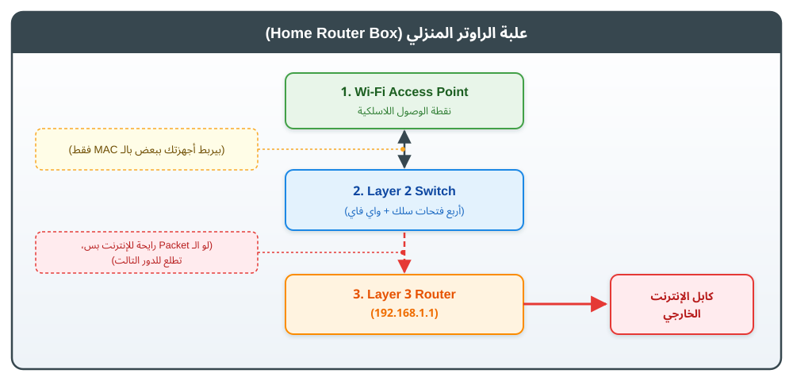

# إيه معنى إن الاتصال هيكون مباشر مش عن طريق الـ Router لما أكون عايز أتواصل مع جهاز داخل الشبكة؟

## الفكرة ببساطة

تخيّل إن عندك جهاز كمبيوتر وموبايل متصلين بنفس شبكة الـ Wi-Fi في البيت.

- الكمبيوتر عنوانه `192.168.1.21`
- الموبايل عنوانه `192.168.1.13`
- عنوان الـ Router داخل الشبكة هو `192.168.1.1`

لو الكمبيوتر عايز يبعث بيانات للموبايل، والجهازان موجودان في **نفس الـ Subnet**، فالكمبيوتر يقدر يرسل البيانات للموبايل عبر الشبكة المحلية. في الحالة المعتادة، الـ Router **مش محتاج يوجّه حزمة الـ IP** بين شبكتين.

أما لو الكمبيوتر عايز يتواصل مع سيرفر على الإنترنت، مثل `8.8.8.8`، فالوجهة خارج الشبكة المحلية، وبالتالي يرسل الكمبيوتر البيانات أولًا إلى الـ **Default Gateway**، وهو غالبًا الـ Router المنزلي.

> **كلمة «مباشر» لا تعني أن الجهازين لازم يكون بينهما كابل مباشر.** ممكن البيانات تعدّي عبر الـ Wi-Fi Access Point أو الـ Switch. المقصود إن الـ Router لا يقوم بوظيفة توجيه الـ IP في المسار المحلي المعتاد.

---

## 1. إيه الموجود داخل علبة الراوتر المنزلي؟

في أجهزة منزلية كثيرة، وظائف الشبكة دي بتكون مدمجة في علبة واحدة:

<p align="center">
    
</p>


الرسم **توضيحي ومبسّط**؛ مش شرط تكون الوظائف دي دوائر منفصلة حرفيًا أو مرتبة داخليًا بالشكل ده.

- **Wi-Fi Access Point:** يسمح للأجهزة اللاسلكية بالاتصال بالشبكة المحلية.
- **Layer 2 Switch:** يمرّر الـ Frames داخل الشبكة المحلية اعتمادًا على عناوين MAC.
- **Layer 3 Router:** يوجّه حزم IP من شبكة إلى شبكة أخرى، مثلًا من شبكة البيت إلى الإنترنت.

## 2. الحالة الأولى: جهاز بيتواصل مع جهاز في نفس الشبكة

لنفترض إن الكمبيوتر `192.168.1.21` عايز يبعث بيانات للموبايل `192.168.1.13`.

### الخطوة 1: الكمبيوتر يحدد هل الوجهة محلية أم خارج الشبكة

نظام التشغيل يفحص عنوان الوجهة وجدول التوجيه (Routing Table). لو عنوان الوجهة داخل نفس الـ Subnet، يختار إرسال البيانات على واجهة الشبكة المحلية بدل إرسالها إلى الـ Default Gateway.

### الخطوة 2: الكمبيوتر يحتاج عنوان الـ MAC للموبايل

عنوان IP يحدد الجهاز المقصود على مستوى الشبكة، لكن إرسال الـ Frame داخل شبكة Ethernet/Wi-Fi يحتاج عنوان MAC للوجهة المحلية.

لو الكمبيوتر لا يعرف الـ MAC المقابل لـ `192.168.1.13`، يستخدم **ARP** في شبكات IPv4 ليسأل: «مين عنده عنوان IP ده؟». يرد الموبايل بعنوان MAC الخاص به.

### الخطوة 3: الكمبيوتر يرسل البيانات للموبايل عبر الشبكة المحلية

بعد معرفة عنوان MAC، تكون عناوين الوجهة كالتالي:

| الحقل | القيمة في المثال | معناه |
|---|---|---|
| Destination IP | `192.168.1.13` | عنوان الموبايل المستهدف |
| Destination MAC | MAC الموبايل | عنوان الـ MAC للجهاز المستهدف على الوصلة المحلية |

الـ Switch أو الـ Access Point يوصل الـ Frame للجهة الصحيحة داخل الشبكة المحلية. **الـ Layer 2 Switch العادي لا يحتاج إلى توجيه حزمة IP إلى شبكة أخرى.**

لاحظ أن إشارة الـ Wi-Fi قد تصل فعلًا إلى علبة الراوتر المنزلي، لكن هذا لا يعني أن وظيفة الـ Router نفسها وجّهت الحزمة؛ قد يكون دور الجهاز هنا هو تمرير الاتصال داخل الـ LAN.

### مسار الحالة الأولى


---

## 3. الحالة الثانية: الكمبيوتر بيتواصل مع سيرفر على الإنترنت

لنفترض إن الكمبيوتر عايز يتواصل مع `8.8.8.8`.

### الخطوة 1: الكمبيوتر يكتشف أن الوجهة خارج الشبكة المحلية

من خلال جدول التوجيه، يعرف الكمبيوتر أن الوجهة لا تقع داخل الـ Subnet المحلية؛ لذلك يرسل البيانات إلى الـ **Default Gateway**، مثل `192.168.1.1`.

### الخطوة 2: الكمبيوتر يجهّز الـ Frame للـ Router

في أول وصلة محلية، تكون العناوين كالتالي:

| الحقل | القيمة في المثال | معناه |
|---|---|---|
| Destination IP | `8.8.8.8` | عنوان السيرفر البعيد الذي نريد الوصول إليه |
| Destination MAC | MAC واجهة الـ Router المحلية | عنوان الـ MAC للـ Gateway الذي سيستقبل الـ Frame |

**خد بالك من الفرق:** الـ IP يظل عنوان الوجهة النهائية (`8.8.8.8`)، لكن الـ MAC هنا هو عنوان الـ Router لأنه الـ Next Hop على الوصلة المحلية.

### الخطوة 3: الـ Router يوجّه الحزمة إلى الشبكة التالية

الـ Router يفحص عنوان IP ويختار المسار التالي. في IPv4، يقلّل قيمة TTL عند التوجيه، ثم يرسل الحزمة في Frame جديد مناسب للوصلة التالية، بعناوين Layer 2 الخاصة بهذه الوصلة.

قد يستخدم الراوتر المنزلي **NAT** عند الخروج إلى الإنترنت، حسب إعداد الشبكة. لكن NAT مش هو نفس الـ Routing، ومش شرط يكون موجودًا في كل شبكة تستخدم التوجيه.

### مسار الحالة الثانية


---

## 4. الفرق المهم في سطر واحد

- **وجهة داخل نفس الـ Subnet:** الكمبيوتر يرسل الـ Frame إلى **MAC الجهاز المستهدف**.
- **وجهة خارج الـ Subnet:** الكمبيوتر يرسل الـ Frame إلى **MAC الـ Default Gateway**، والـ IP يظل عنوان الوجهة البعيدة.

| وجه المقارنة | جهاز داخل نفس الـ Subnet | سيرفر خارج الشبكة |
|---|---|---|
| Destination IP | IP الجهاز المحلي | IP السيرفر البعيد |
| Destination MAC في أول Frame | MAC الجهاز المحلي | MAC الـ Default Gateway |
| هل يحتاج الكمبيوتر إلى الـ Gateway في المسار المعتاد؟ | لا | نعم |
| هل يتم توجيه حزمة IP إلى شبكة أخرى؟ | لا، إذا كانت الوجهة فعلًا على نفس الشبكة المحلية | نعم |

---

## 5. جرّب بنفسك على Linux

### أ) افحص جدول التوجيه

```bash
ip route
```

ممكن تشوف نتيجة شبيهة بالتالي:

```text
192.168.1.0/24 dev wlan0 proto kernel scope link
 default via 192.168.1.1 dev wlan0
```

المعنى:

- `192.168.1.0/24 dev wlan0`: عناوين هذا النطاق تُرسل مباشرة عبر واجهة الشبكة `wlan0`.
- `default via 192.168.1.1`: الوجهات التي لا يوجد لها مسار أكثر تحديدًا تُرسل إلى الـ Gateway `192.168.1.1`.

قد تختلف أسماء الواجهات والعناوين عندك؛ مثلًا قد تكون `eth0` بدل `wlan0`.

### ب) اسأل Linux عن المسار الذي سيختاره

```bash
ip route get 192.168.1.13
ip route get 8.8.8.8
```

في الحالة المعتادة، النتيجة الأولى ستوضح أن الوجهة المحلية تُرسل عبر واجهتك، بينما الثانية ستتضمن `via 192.168.1.1` أو عنوان الـ Gateway الفعلي عندك.

### ج) افحص عنوان MAC الذي تعلّمه الجهاز

```bash
ping -c 1 192.168.1.13
ip neigh show 192.168.1.13
```

استبدل `192.168.1.13` بعنوان جهاز موجود فعلًا على نفس الشبكة. الأمر `ip neigh` يعرض معلومات الجيران المحليين، ومنها عنوان MAC عندما يكون معروفًا.

قد لا يظهر عنوان MAC لو الجهاز غير متصل، أو لم يرد، أو كانت الشبكة تمنع اتصال الأجهزة ببعضها باستخدام خاصية مثل **Client Isolation**. كذلك، فشل `ping` وحده لا يثبت بالضرورة أن المسار غير صحيح؛ فقد يكون الرد محجوبًا.

---

## الخلاصة النهائية

لما نقول إن الاتصال «مباشر» داخل الشبكة، نقصد أن الجهاز المرسل يقدر يوصّل الـ Frame إلى MAC الجهاز الآخر عبر شبكة الـ Layer 2 المحلية، من غير ما يحتاج الـ Router يوجّه حزمة IP إلى شبكة مختلفة.

أما لو الوجهة خارج الشبكة، فالكمبيوتر يرسل أول Frame إلى MAC الـ Default Gateway، والـ Router يتولى توجيه حزمة IP نحو الشبكة التالية.

**احفظ القاعدة دي:** عنوان الـ IP يحدد الوجهة على مستوى الشبكة، وعنوان الـ MAC يحدد الجهة التالية على الوصلة المحلية الحالية.
