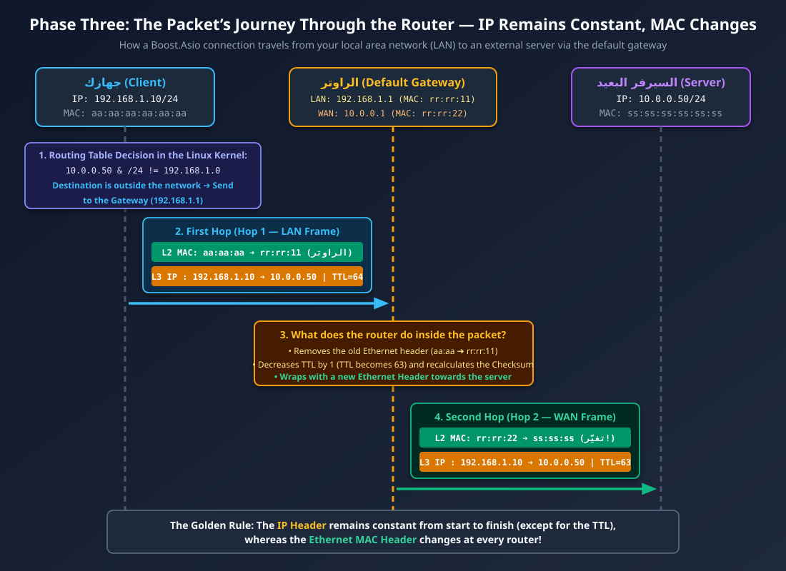
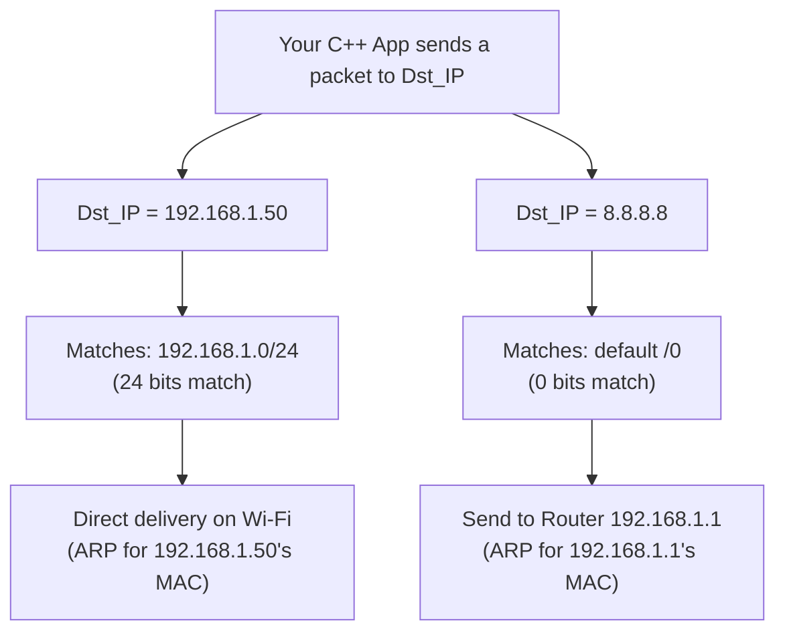
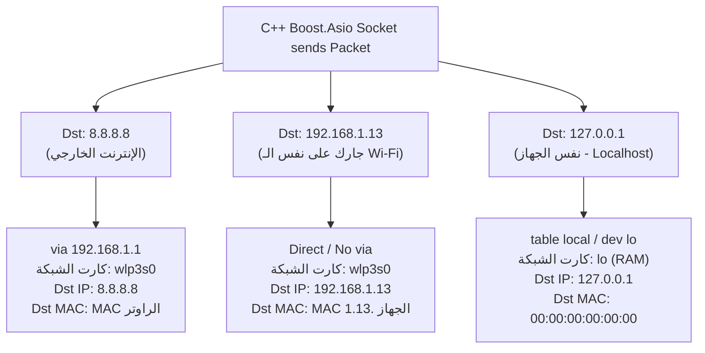

### أولاً: إجابات أسئلة [ethernet-and-local-network lesson](./2_ethernet-and-local-network.md) (Ethernet & ARP & MTU)

**1. لو جهازك (`192.168.1.10`) عايز يبعت Packet لسيرفر جوجل (`8.8.8.8`)، لما جهازك يبني الـ Ethernet Frame، هيحط الـ Destination MAC بتاع مين؟**

* هيحط الـ **Destination MAC بتاع الراوتر بتاعك (الـ Default Gateway)** مش بتاع سيرفر جوجل!
* **ليه؟** لأن الـ Ethernet والـ MAC Addresses ليهم صلاحية محلية فقط (على نفس السلك أو الـ Wi-Fi المحلّي). جهازك بيبص على الـ IP بتاع جوجل (`8.8.8.8`)، يلاقيه برا شبكته المحلية، فيعمل ARP Request يسأل فيه عن الـ MAC بتاع **الراوتر** (`192.168.1.1`)، ويسلّم الفريم للراوتر، والراوتر هو اللي يتصرف ويوصلها للمحطة اللي بعدها. (الرسمة اللي هنا  [3. ماذا يحدث للـ Packet عندما تعبر الراوتر](#3-ماذا-يحدث-للـ-packet-عندما-تعبر-الراوتر)).

**2. ليه لما بتختبر السيرفر بتاعك على `127.0.0.1` بيبعت رسائل كبيرة (مثلاً 10 KB) في Packet واحدة، لكن على شبكة حقيقية الـ 10 KB بيتقطعوا لـ 7 أو 8 أجزاء في `async_read_some`؟**

* لأن كارت الـ Loopback (`lo` - `127.0.0.1`) هو كارت افتراضي جوه رامات الـ Kernel، والـ **MTU** بتاعه في Linux هو **`65536` بايت (64 KB)**، فالـ 10 KB كلهم بيتحطوا في `sk_buff` واحد ويوصلوا لـ `async_read_some` في خبطة واحدة.
* أما على كارت الشبكة الحقيقي (`eth0` أو `wlan0`)، الـ **MTU** القياسي هو **`1500` بايت** فقط (يعني أقصى داتا لـ TCP في الفريم الواحد `MSS = 1460` بايت). فالـ 10 KB (10240 بايت) غصب عن الكيرنل بيتقطعوا لـ **8 TCP Segments** منفصلة، وكل ما فريم يوصل كارت الشبكة، `epoll` يصحي `async_read_some` في الكود بتاعك عشان تقرأ الجزء اللي وصل!


**3. إيه اللي بيطلع من أوامر `ip -br link` و `ip neigh`؟**

* `ip -br link`: بيطلع كارت `lo` وعنوانه `00:00:00:00:00:00`، وكارت الشبكة الحقيقي (مثل `eth0` أو `enp3s0` أو `wlan0`) وحالته `UP` وجنبه الـ MAC Address الحقيقي (6 بايت بالـ Hex).
* `ip neigh`: بيطلع جدول الـ ARP Cache، وأهم سطر فيه هو عنوان الراوتر بتاعك (مثلاً `192.168.1.1 dev wlan0 lladdr xx:xx:xx:xx:xx:xx REACHABLE`).

---

#  IP and Routing — How does Linux choose the path across networks?

**(IPv4/IPv6, Subnetting, Default Gateway, Routing Tables, ICMP, Path MTU Discovery)**

في المرحلة اللي فاتت عرفنا إزاي بننقل Frame جوه نفس الأوضة (نفس الـ Switch). دلوقتي هنجاوب على السؤال الأكبر: **لما كود الـ C++ بتاعك يطلب الاتصال بأي IP في العالم، إزاي الـ Linux Kernel بيعرف في جزء من الملي ثانية هل الـ IP ده جوه شبكتي المحلية ولا بره؟ وإزاي الـ Packet بتسافر عبر الراوترات لحد ما توصل؟**

---

### 1. What do "subnetting" and "/24" mean in the context of C++ and bitwise operations?

لما بتشوف عنوان IP مكتوب جنبه `/24` (ده اسمه **CIDR Notation**)، زي:
`192.168.1.10/24`

الـ IPv4 عبارة عن رقم **32-bit unsigned integer (`uint32_t`)** متقسم لـ 4 بايتات عشان البشر يعرفوا يقرأوه.
معنى `/24` إن **أول 24 بت من الشمال (أول 3 بايت)** هم عنوان الشبكة (**Network Prefix**)، و**آخر 8 بت (آخر بايت)** هم رقم الجهاز جوه الشبكة (**Host ID**).

الـ Kernel بيترجم `/24` لقناع بتات (**Subnet Mask**) عبارة عن 24 واحد وجنبهم 8 أصفار:

* بالـ Binary: `11111111.11111111.11111111.00000000`
* بالـ Decimal: `255.255.255.0`
* بالـ Hex: `0xFFFFFF00`

#### المعادلة اللي بينفذها الـ Linux Kernel في سطر واحد (Bitwise AND `&`):

عشان الكيرنل يعرف هل السيرفر اللي إنت رايحله (`Dst_IP`) معاك في نفس الشبكة المحلية ولا لأ، بيعمل عملية `&` (Bitwise AND) سريعة جداً في الـ CPU:

```cpp
bool is_same_subnet(uint32_t my_ip, uint32_t dst_ip, uint32_t subnet_mask) {
    return (my_ip & subnet_mask) == (dst_ip & subnet_mask);
}
```

* **First case (same network):** Your device `192.168.1.10` wants to talk to `192.168.1.20` and the caller `255.255.255.0`:
    * `192.168.1.10 & 255.255.255.0` = `192.168.1.0`
    * `192.168.1.20 & 255.255.255.0` = `192.168.1.0`
    * **The result is identical (`true`)!** ➔ The kernel says: *"This is running on the same Switch, send him a direct ARP Request and get his MAC!"*


* **Second case (external network):** Your device `192.168.1.10` wants to talk to server `10.0.0.50`:
    * `192.168.1.10 & 255.255.255.0` = `192.168.1.0`
    * `10.0.0.50 & 255.255.255.0` = `10.0.0.0`
    * **The result is different (`false`)!** ➔ The kernel says: *"This is outside my network, I have to go back to the routing table to see which router is going to it!"*


---

### 2. جدول التوجيه في لينكس (Linux Routing Table) وقاعدة LPM

لما تشغل الأمر `ip route` على جهازك، بيطلعلك جدول زي ده:

```text
default via 192.168.1.1 dev wlan0 proto dhcp metric 600
192.168.1.0/24 dev wlan0 proto kernel scope link src 192.168.1.10 metric 600

```

إزاي الـ Kernel بيقرأ الجدول ده؟ بيستخدم خوارزمية اسمها **LPM (Longest Prefix Match)**، يعني **"أطول تطابق في عدد البتات هو اللي يكسب"**:

1. السطر التاني (`192.168.1.0/24`): طوله **24 بت**. لو الـ IP اللي رايحله أوله `192.168.1`، السطر ده يكسب لأن 24 أكبر من 0. الكيرنل يبعته مباشرة على كارت `wlan0` (`scope link` يعني بدون راوتر).
2. السطر الأول (`default` اللي هي `0.0.0.0/0`): طوله **0 بت** (يتطابق مع أي IP في الكوكب). لو مفيش أي سطر تاني أدق انطبق على العنوان (زي لما تبعت لـ `10.0.0.50` أو `8.8.8.8`)، السطر ده يكسب!
* كلمة **`via 192.168.1.1`** معناها: *"احتفظ بـ `Destination IP` زي ما هو في Layer 3، بس روح هات الـ MAC Address بتاع الراوتر `192.168.1.1` وحطه في Layer 2 كـ `Destination MAC` وابعتله الفريم!"*


---

### 3. ماذا يحدث للـ Packet عندما تعبر الراوتر؟

تتبع في الرسمة دي إزاي عناوين الـ **IP** في Layer 3 بتفضل ثابتة (ما عدا عداد الـ **TTL** اللي بينقص 1)، بينما عناوين الـ **MAC** في Layer 2 بتتغير بالكامل عند عبور الراوتر:

<p align="center">
    
</p>

---

### 4. تشريح أهم حقول الـ IPv4 Header (الـ 20 بايت)

لما الكيرنل بيبني الـ IPv4 Header في الـ `sk_buff`، فيه 4 حقول حيوية لازم تبقى عارفهم عشان الـ Debugging في C++:

1. **TTL (Time To Live - 1 Byte):** رقم بيبدأ في Linux عادةً بـ **`64`**. كل راوتر الـ Packet تعدي عليه ينقص الرقم ده بـ `1`.
* **ليه موجود؟** عشان لو حصل خطأ في إعدادات الراوترات (Routing Loop) وقعدوا يحدفوا الـ Packet لبعض، متفضلش تلف في الإنترنت للأبد! أول ما الـ TTL يوصل لـ **`0`**، الراوتر يرمي الـ Packet ويبعتلك رسالة خطأ ICMP اسمها `Time Exceeded` (ودي الفكرة العبقريّة اللي مبني عليها أمر `traceroute`!).


2. **Protocol (1 Byte):** رقم بيعرّف طبقة الـ IP إيه اللي مستخبي جواها في Layer 4 عشان تسلمه للـ Handler الصح في الكيرنل عند الوصول:
* `6` = **TCP**
* `17` = **UDP**
* `1` = **ICMP**


3. **Flags & Fragment Offset:** فيها بت مهم جداً اسمه **DF (Don't Fragment)**. في Linux الحديث، أي TCP Packet بتطلع بيكون محطوط عليها `DF = 1` (ممنوع تقطيع الـ IP Packet في الراوترات).
4. **Source IP & Destination IP (4 Bytes each):** عناوين البداية والنهاية.

---

### 5. بروتوكول ICMP و Path MTU Discovery (PMTUD)

**يعني إيه ICMP (Internet Control Message Protocol)؟**
الـ IP لوحده بروتوكول "أخرس"؛ لو Packet وقعت أو مسار اتقفل، الـ IP مفيش فيه آلية يبلغ بيها المرسل. عشان كده اتعمل **ICMP** كمساعد لطبقة الـ IP (بيشتغل فوق الـ IP مباشرة بـ `Protocol = 1`، ومالوش Ports!).
أشهر رسايله:

* **Echo Request / Echo Reply:** اللي بيستخدمهم أمر `ping`.
* **Destination Unreachable:** لما الراوتر أو السيرفر ميكونش قادر يوصل للوجهة (وساعتها كود الـ Asio بتاعك بيطلعله `asio::error::host_unreachable` أو `network_unreachable`!).
* **Fragmentation Needed (Type 3, Code 4):** ودي بتشغل آلية **Path MTU Discovery (PMTUD)**:
* تخيل كارت شبكتك الـ MTU بتاعه `1500`، فبعتّ TCP Packet حجمها `1500` وعليها علامة `DF = 1` (ممنوع التقطيع).
* في نص الطريق، فيه راوتر قديم أو نفق VPN الـ MTU بتاعه `1400` بس!
* الراوتر ده مش هيقدر يعدي الـ 1500، وممنوع يقطعها بسبب `DF = 1`، فيروح رامي الـ Packet ويبعت لجهازك رسالة **ICMP: Fragmentation Needed (Next-Hop MTU = 1400)**.
* الـ Linux Kernel عندك يستلم رسالة الـ ICMP دي، وفوراً يقلل الـ **MSS** بتاع اتصال الـ TCP ده من `1460` إلى `1360` ويعيد إرسال الداتا من غير ما كود الـ C++ بتاعك يحس بأي مشكلة!


---

### 6. الربط مع C++ و Boost.Asio: كيف يغير عنوان الـ Bind سلوك السيرفر؟

في كود السيرفر بتاعك في `Server.cpp`، إنت كتبت السطر ده في الـ Constructor:

```cpp
m_acceptor(io, asio::ip::tcp::endpoint(asio::ip::tcp::v4(), port))

```

إيه معنى `asio::ip::tcp::v4()` هنا تحت الـ Hood في طبقة الـ IP؟

* دي بترجع عنوان الـ IP الخاص **`0.0.0.0`** (اللي اسمه في اللينكس `INADDR_ANY`).
* لما السيرفر يعمل `bind()` على `0.0.0.0:8080`، إنت بتقول للـ Linux Kernel: **"استقبل أي اتصال جاي على بورت 8080 سواء جه من كارت الـ Loopback (`127.0.0.1`)، أو من كارت الـ Wi-Fi (`192.168.1.10`)، أو من كارت الـ Ethernet، أو من VPN interface!"**
* لكن لو غيرتها في الكود لـ:
```cpp
asio::ip::make_address("127.0.0.1")

```


كده الكيرنل هيربط السيرفر بكارت الـ Loopback **فقط**. لو جهاز تاني معاك على نفس الـ Wi-Fi حاول يعمل `connect` على `192.168.1.10:8080`، الكيرنل هيرفض الاتصال فوراً بـ `Connection Refused (RST)` لأن السيرفر مش بيستمع على الـ IP بتاع الـ Wi-Fi!

---

### 7. تجربة عملية على Linux (نفذها دلوقتي)

جرب الـ 3 أوامر دول في الـ Terminal عشان تشوف الـ Routing Engine بتاع الـ Linux Kernel وهو بيفكر:

**1. اسأل الـ Kernel مباشر: "لو عايز أروح للـ IP ده، هتمشيني منين؟"**

```bash
ip route get 8.8.8.8
ip route get 127.0.0.1

```

*(في الأولى هيقولك: هخرج من `src 192.168.1.x` عن طريق كارت `wlan0` وأرميها للراوتر `via 192.168.1.1`، وفي التانية هيقولك هروح من كارت `lo` مباشرة!)*

**2. اكتشف الراوترات اللي بينك وبين أي سيرفر باستخدام الـ TTL:**

```bash
tracepath -n 8.8.8.8

```

*(الأمر ده بيبعت Packets بـ `TTL=1` فيرد الراوتر الأول بتاع بيتك، وبعدين `TTL=2` فيرد راوتر شركة الإنترنت، وهكذا، وكمان بيعرضلك الـ `pmtu 1500`!).*

---

### أسئلة المرحلة الثالثة للتأكد من الفهم (قبل ما ندخل في المرحلة الرابعة: الـ Transport Layer و الـ TCP بعمق):

1. لو جهازك عنوانه `192.168.1.10/24` (يعني الماسك `255.255.255.0`)، وعايز يبعت Packet للجهاز `192.168.2.10`، هل الجهاز ده معاك في نفس الشبكة المحلية (يبعتله ARP مباشر) ولا لازم يروح للـ Default Gateway؟ وليه؟
2. لو الـ Packet خارجة من جهازك بـ `TTL = 64`، وعدت على 5 راوترات في الطريق لحد ما وصلت للسيرفر، قيمة الـ `TTL` في الـ IP Header لما توصل للسيرفر هتكون كام؟
3. لو عميل حاول يعمل `connect()` بـ Boost.Asio على IP بتاع شبكة مفصولة ومفيش ليها طريق في الـ Routing Table، إيه البروتوكول اللي في Layer 3 اللي هيرجع رسالة الخطأ لجهاز العميل؟


# LAB using `ip route`

## Understanding Your Linux Routing Table (`ip route`)

When your C++ program sends data over the network, the Linux Kernel looks at a map called the **Routing Table** to decide where to send each packet. 

Below is the exact output from your machine, broken down in simple English.

---

### 1. Your Raw `ip route` Output

```text
default via 192.168.1.1 dev wlp3s0 proto dhcp metric 600 
10.226.148.0/24 dev mpqemubrzone1 proto kernel scope link src 10.226.148.1 linkdown 
10.226.149.0/24 dev mpqemubrzone2 proto kernel scope link src 10.226.149.1 linkdown 
10.226.150.0/24 dev mpqemubrzone3 proto kernel scope link src 10.226.150.1 linkdown 
169.254.0.0/16 dev virbr0 scope link metric 1000 linkdown 
172.17.0.0/16 dev docker0 proto kernel scope link src 172.17.0.1 linkdown 
172.18.0.0/16 dev br-48192929ea8a proto kernel scope link src 172.18.0.1 linkdown 
192.168.1.0/24 dev wlp3s0 proto kernel scope link src 192.168.1.21 metric 600 
192.168.122.0/24 dev virbr0 proto kernel scope link src 192.168.122.1 linkdown
```

#### The Big Picture
Even though you have **9 lines** in your table, **only 2 lines are active right now** (the ones without `linkdown` at the end). The other 7 lines belong to virtual networks created by Docker and Virtual Machine tools (like QEMU/KVM) that are currently turned off.

---

### 2. Key Vocabulary (What the Words Mean)

Before reading line by line, here is what each keyword means:

* **`dev <name>` (Device):** The network card (interface) the Kernel will use to send the packet. For example, `wlp3s0` is your Wi-Fi card.
* **`via <IP>`:** The router (gateway) that will forward your packet to outside networks.
* **`proto <name>` (Protocol):** Who added this rule to the table?
  * `proto dhcp`: Your home router gave you this rule automatically when you connected to Wi-Fi.
  * `proto kernel`: The Linux Kernel created this rule automatically when the network card got an IP address.
* **`scope link`:** Means "Local Network." The destination is on the same local network, so your computer can talk to it directly (using ARP and MAC addresses) without needing a router.
* **`src <IP>` (Source IP):** The IP address your computer puts in the `Source IP` field of the packet header when sending data through this path.
* **`metric <number>`:** The "cost" or priority of this path. Lower numbers win. If you plug in an Ethernet cable (usually `metric 100`), Linux will prefer it over Wi-Fi (`metric 600`).
* **`linkdown`:** This virtual network cable is currently "unplugged" (no containers or VMs are running on it right now), so the Kernel ignores this route.

---

### 3. The 2 Active Routes on Your Machine (Wi-Fi)

Your Wi-Fi card is named **`wlp3s0`**, and your computer's local IP address is **`192.168.1.21`**.

#### Route A: Your Local Network (LAN)
```text
192.168.1.0/24 dev wlp3s0 proto kernel scope link src 192.168.1.21 metric 600
```
* **What it means:** If you send data to any IP starting with `192.168.1.x` (from `192.168.1.1` to `192.168.1.254`), they are your neighbors on the same Wi-Fi.
* **Action:** Send the packet directly out of the Wi-Fi card (`wlp3s0`) without using a router (`scope link`), and stamp the packet with your IP (`src 192.168.1.21`).

#### Route B: The Internet (Default Gateway)
```text
default via 192.168.1.1 dev wlp3s0 proto dhcp metric 600
```
* **What it means:** `default` means `0.0.0.0/0` (any IP address in the world that does not match any other rule in this table, like Google `8.8.8.8`).
* **Action:** Send the packet to your home router (`via 192.168.1.1`) using your Wi-Fi card (`wlp3s0`). Your router will take care of sending it to the internet.

---

### 4. The 7 Inactive Routes (Virtual Networks)

You have virtualization and container tools installed on your Linux machine. These tools create "virtual switches" inside your Kernel so containers and virtual machines can talk to your host computer:

| Route Prefix | Interface (`dev`) | Your Host IP (`src`) | What is it for? | Why is it `linkdown`? |
| :--- | :--- | :--- | :--- | :--- |
| `172.17.0.0/16` | `docker0` | `172.17.0.1` | Default **Docker** bridge network. | No Docker containers are currently running. |
| `172.18.0.0/16` | `br-48192929ea8a` | `172.18.0.1` | Custom **Docker Compose** network. | The Docker Compose project is currently stopped. |
| `192.168.122.0/24` | `virbr0` | `192.168.122.1` | **libvirt / KVM** virtual machines network. | No KVM virtual machines are running right now. |
| `169.254.0.0/16` | `virbr0` | *(None)* | **Link-Local** fallback IP range for `virbr0`. | `virbr0` has no active VMs attached. |
| `10.226.148.0/24` *(+149, +150)* | `mpqemubrzone1..3` | `10.226.x.1` | **QEMU / Multipass** virtual bridge zones. | No QEMU virtual machines are running in these zones. |

> **Tip:** As soon as you run a Docker container (e.g., `docker run -it ubuntu`), the word `linkdown` next to `docker0` will disappear!

---

### 5. How the Kernel Chooses a Route (Longest Prefix Match)

When your C++ code connects to an IP address, the Kernel uses a simple rule called **Longest Prefix Match (LPM)**—the most specific rule wins:



---

### 6. How This Connects to Your C++ / Boost.Asio Code

In your `Server.cpp`, you initialized your acceptor like this:

```cpp
m_acceptor(io, asio::ip::tcp::endpoint(asio::ip::tcp::v4(), port))
```

Because `asio::ip::tcp::v4()` binds to **`0.0.0.0` (All Interfaces)**, your C++ server is automatically listening on **all** the `src` IP addresses shown in your `ip route` table:

1. **From your own laptop:** You can connect to `127.0.0.1:8080`.
2. **From another phone/laptop on your home Wi-Fi:** You can connect to `192.168.1.21:8080`.
3. **From inside a Docker container on your laptop:** A container can connect to your C++ server using `172.17.0.1:8080`!

#### Quick Commands to Test This Yourself

You can ask the Linux Kernel which route it will pick for any IP address using `ip route get`:

```bash
# 1. Ask how to reach Google DNS (Internet -> goes via Router 192.168.1.1)
ip route get 8.8.8.8

# 2. Ask how to reach another device on your Wi-Fi (Direct -> no "via" router)
ip route get 192.168.1.50

# 3. Ask how to reach your own machine (Loopback -> dev lo)
ip route get 127.0.0.1
```

## تحليل مخرجات الأمر `ip route get`: السيناريوهات الثلاثة لحركة الـ Packets في Linux

عندما تكتب الأمر `ip route get IP` في الـ Terminal، فأنت تسأل الـ Linux Kernel سؤالاً مباشراً:

> **"لو أراد برنامج إرسال Packet إلى هذا العنوان الآن، ما هو القرار الهندسي الذي ستتخذه بناءً على جدول التوجيه (Routing Table)؟"**

الأوامر الثلاثة التي نفذتها على جهازك تغطي **جميع السيناريوهات الممكنة** لأي حزمة بيانات تخرج من جهازك:

```bash
❯ ip route get 8.8.8.8
8.8.8.8 via 192.168.1.1 dev wlp3s0 src 192.168.1.21 uid 1000 
    cache 
❯ ip route get 127.0.0.1
local 127.0.0.1 dev lo table local src 127.0.0.1 uid 1000 
    cache <local> 
❯ ip route get 192.168.1.13
192.168.1.13 dev wlp3s0 src 192.168.1.21 uid 1000 
    cache 
```

### 1. السيناريو الأول: السفر إلى الإنترنت الخارجي (`8.8.8.8`)

```
❯ ip route get 8.8.8.8
8.8.8.8 via 192.168.1.1 dev wlp3s0 src 192.168.1.21 uid 1000 
    cache 
```

قام الـ Kernel بفحص جدول التوجيه (`ip route`)، فوجد أن العنوان `8.8.8.8` لا ينتمي إلى شبكتك المحلية (`192.168.1.0/24`)، لذلك اختار مسار البوابة الافتراضية (**`default`**) وخرج بالقرار التالي:

* **`8.8.8.8`**: The final destination; this is what will be written in the `Destination IP` field within the **IPv4 Header (Layer 3)**.

* **`via 192.168.1.1`**: **The most important part of the line!** It means "via the router." Since `8.8.8.8` is outside your local network, the kernel will send an ARP request to determine the **MAC address** of the router (`192.168.1.1`) and place it in the `Destination MAC` field within the **Ethernet Frame (Layer 2)**, allowing the router to receive the packet and forward it toward the internet.

* **`dev wlp3s0`**: The packet will be sent out via your device's Wi-Fi interface.

* **`src 192.168.1.21`**: The kernel will place your device's Wi-Fi address (`192.168.1.21`) in the `Source IP` field, so that Google's server knows where to send the response.

### 2. السيناريو الثاني: الاتصال داخل نفس الجهاز (`127.0.0.1`)

```
❯ ip route get 127.0.0.1
local 127.0.0.1 dev lo table local src 127.0.0.1 uid 1000 
    cache <local> 
```

هنا يتحدث جهازك مع نفسه (مثلما تشغل الـ Client والـ Server الخاصين بـ Boost.Asio على نفس الجهاز أثناء التطوير):

* **`local 127.0.0.1`** and **`<local>`**: The kernel has detected that the address belongs to **the same machine locally**.

* **`dev lo`**: The packet will not go to the Wi-Fi card at all and will not go out into the air! Rather, it will pass through the default **Loopback (`lo`)** card inside the RAM in the kernel (which is why it is very fast and its MTU size is `65536` bytes instead of `1500`!).

* **`table local`**: In Linux, besides the primary routing table (`main` which we see with the `ip route` command), there is an internal high-priority table named **`local`** (which you can view with the `ip route show table local` command). This table contains the IP addresses of your device itself so that the kernel can capture them immediately before searching any other table.

* **`src 127.0.0.1`**: The sender address will also be written as `127.0.0.1`.

### 3. السيناريو الثالث: جارك في نفس الشبكة المحلية (`192.168.1.13`)

```
❯ ip route get 192.168.1.13
192.168.1.13 dev wlp3s0 src 192.168.1.21 uid 1000 
    cache 
```

قارن هذا السطر بالسطر الأول الخاص بـ `8.8.8.8`.. **لاحظ ما الذي اختفى هنا:**

* **The phrase `via 192.168.1.1` has completely disappeared!**

* **Why did it disappear?** Because the kernel performed a bitwise AND (`&`) operation with the subnet mask (`255.255.255.0`) and determined that both `192.168.1.13` and `192.168.1.21` reside on the **same local network (`192.168.1.0/24`)**.

* **The kernel’s technical decision:** "This device is on the same network! I won’t send the packet to the router (`192.168.1.1`); instead, I’ll issue an ARP request to find the MAC address of the device `192.168.1.13` itself, and then send the Ethernet frame directly to it via the `wlp3s0` interface!"

### 4. ما معنى `uid 1000` وكلمة `cache` في نهاية كل مخرج؟

* **`uid 1000` (User ID):** This is the identification number for your user account in Linux (the first regular user in Ubuntu is assigned the number `1000`, while the `root` user is assigned `0`).

* **Why does the routing table care about user identity?** Because Linux supports an advanced feature called **Policy-Based Routing**, which allows you to configure the kernel to route traffic for a specific user (e.g., `uid 1000`) through a VPN tunnel, while routing traffic for another user through a standard Wi-Fi connection!

* **`cache`:** This indicates that the kernel has already calculated the result for this route and prepared its properties (such as the Path MTU determined for this specific path).

### 5. رسم ومقارنة شاملة للسيناريوهات الثلاثة



### جدول المقارنة السريع

<div dir="rtl">

<table>
  <thead>
    <tr>
      <th><strong>الوجهة (Destination)</strong></th>
      <th><strong>هل يمر عبر راوتر (via)؟</strong></th>
      <th><strong>الكارت المستخدم (dev)</strong></th>
      <th><strong>عنوان Source IP المختار</strong></th>
      <th><strong>عنوان Destination MAC في الـ Frame</strong></th>
    </tr>
  </thead>
  <tbody>
    <tr>
      <td><strong><code>8.8.8.8</code></strong> (إنترنت)</td>
      <td><strong>نعم</strong> (<code>via 192.168.1.1</code>)</td>
      <td><code>wlp3s0</code> (Wi-Fi)</td>
      <td><code>192.168.1.21</code></td>
      <td>الـ MAC الخاص <strong>بالراوتر (<code>192.168.1.1</code>)</strong></td>
    </tr>
    <tr>
      <td><strong><code>192.168.1.13</code></strong> (شبكة محلية)</td>
      <td><strong>لا</strong> (اتصال مباشر)</td>
      <td><code>wlp3s0</code> (Wi-Fi)</td>
      <td><code>192.168.1.21</code></td>
      <td>الـ MAC الخاص <strong>بالجهاز <code>192.168.1.13</code> نفسه</strong></td>
    </tr>
    <tr>
      <td><strong><code>127.0.0.1</code></strong> (نفس الجهاز)</td>
      <td><strong>لا</strong> (<code>table local</code>)</td>
      <td><code>lo</code> (Loopback)</td>
      <td><code>127.0.0.1</code></td>
      <td>أصفار (<code>00:00:00:00:00:00</code>)</td>
    </tr>
  </tbody>
</table>

</div>

## PART TWO OF THIS LESSON IS HERE: [3.1 How Devices Communicate on a LAN](./3_1_How-Devices-Communicate-on-a-LAN.md)

