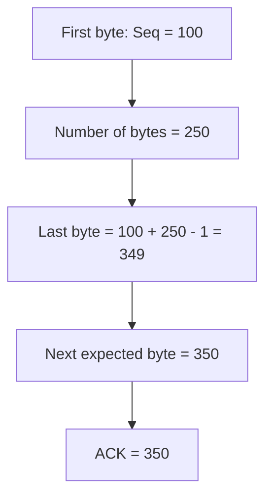
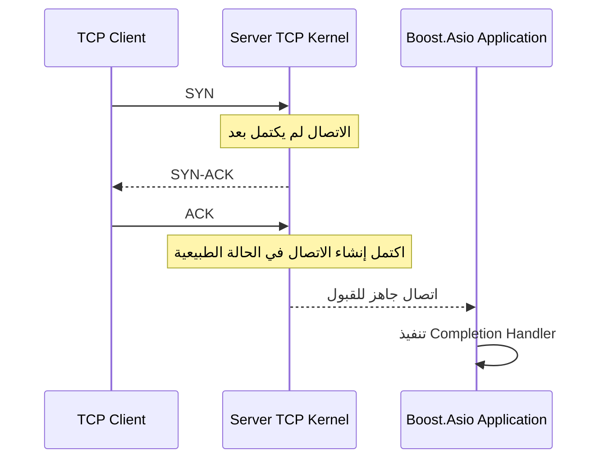
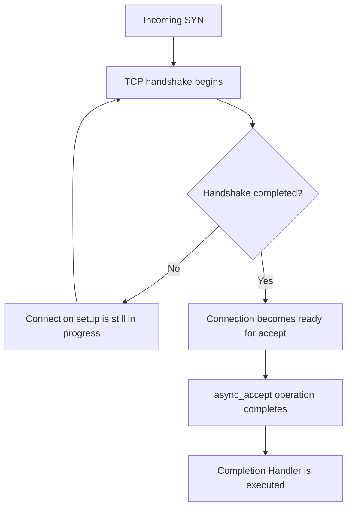
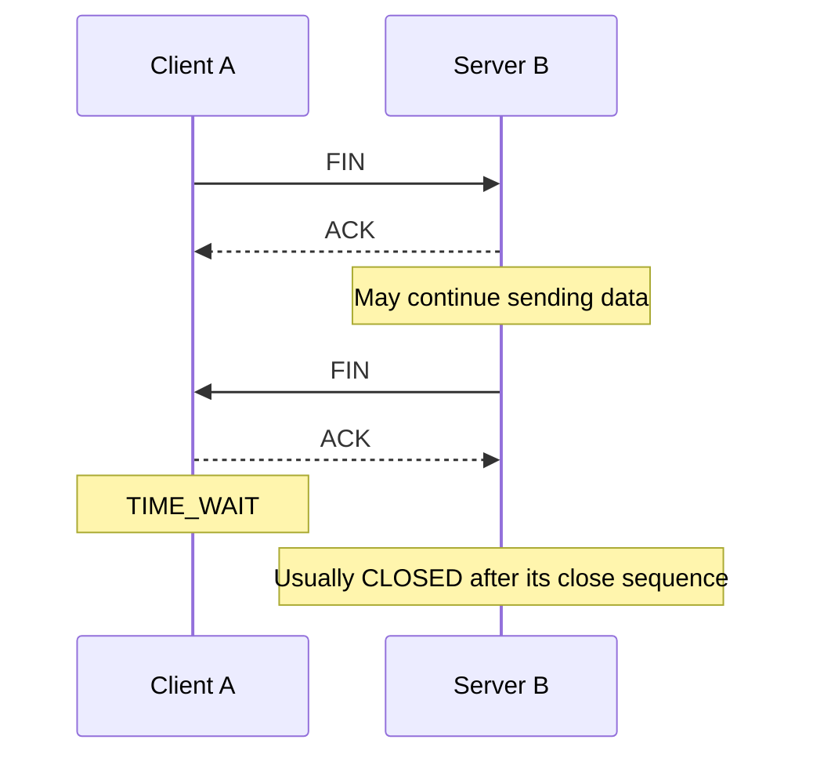
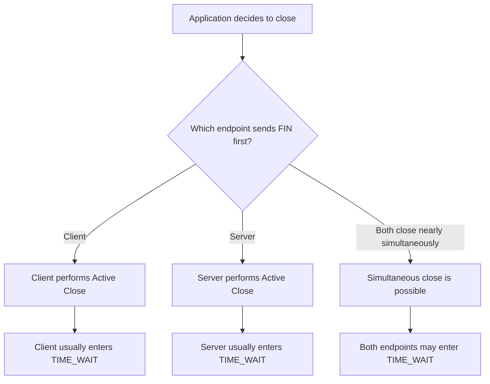
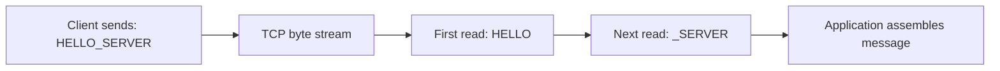
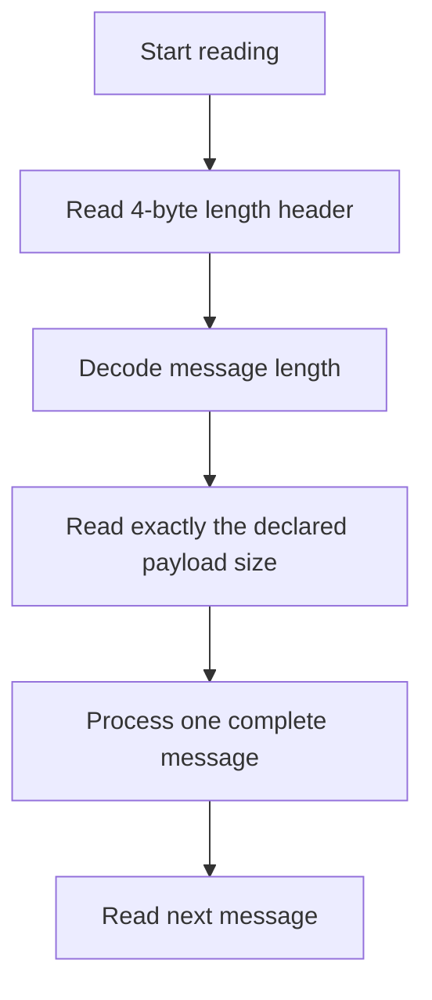

# TCP Fundamentals — 4 أسئلة مهمة مع Boost.Asio

## مقدمة

الملف ده بيشرح أربع مفاهيم أساسية في TCP:

1. حساب `ACK` باستخدام `Sequence Number`.
2. العلاقة بين `SYN` و`async_accept()`.
3. إغلاق اتصال TCP وحالة `TIME_WAIT`.
4. لماذا لا تضمن `async_read_some()` قراءة رسالة تطبيق كاملة.

---

# 1. حساب ACK من Sequence Number

## السؤال

إذا أرسل العميل `Seq = 100` ومعه `250 bytes` من البيانات، فما قيمة `ACK` التالية التي تؤكد استلام كل البايتات؟

## الإجابة

قيمة `ACK` هي:

```text
ACK = 100 + 250 = 350
```

بشرط أن تكون البيانات قد وصلت كاملة وبالترتيب، وأننا نتحدث عن بيانات عادية وليست بايتات تستهلكها أعلام مثل `SYN` أو `FIN`.

## شرح المصطلحات

<div dir="rtl">
<ul>
  <li><strong>Sequence Number (<code>Seq</code>):</strong> رقم يحدد موضع أول بايت من البيانات داخل تدفق TCP.</li>
  <li><strong>Acknowledgment Number (<code>ACK</code>):</strong> رقم البايت التالي الذي يتوقع المستقبل استلامه. وبذلك يؤكد استلام كل البايتات السابقة له بالترتيب.</li>
  <li><strong>Byte Stream:</strong> تدفق متتابع من البايتات ينقله TCP مع الحفاظ على ترتيبها.</li>
</ul>
</div>

## مثال بالأرقام

إذا كان أول بايت رقمه `100`، وأرسل المرسل `250 bytes`، فإن نطاق الأرقام يكون من `100` إلى `349`.

```text
First byte = 100
Last byte  = 349
Total      = 250 bytes

Next expected byte = 350
ACK = 350
```



**قاعدة مهمة:** `ACK = 350` لا يعني أن البايت رقم `350` وصل بالفعل، بل يعني أن المستقبل يتوقع البايت `350` بعد استلام كل البايتات السابقة بالترتيب.

---

# 2. لماذا لا يعني وصول أول SYN أن async_accept() سيعمل فورًا؟

## السؤال

لماذا لا يعني وصول أول `SYN` أن Completion Handler الخاص بـ `async_accept()` سيعمل فورًا؟

## الإجابة

لأن `SYN` هو بداية إنشاء اتصال TCP، وليس دليلًا على أن عملية الاتصال اكتملت.

يستخدم TCP عادةً آلية تسمى **Three-Way Handshake** لإنشاء الاتصال.

## شرح المصطلحات

<div dir="rtl">
<ul>
  <li><strong>SYN:</strong> علم(flag) في TCP يُستخدم لبدء إنشاء الاتصال ومزامنة أرقام التسلسل.</li>
  <li><strong>SYN-ACK:</strong> رد من الطرف الآخر يؤكد استلام <code dir="ltr">SYN</code> ويبدأ بدوره مزامنة الاتصال.</li>
  <li><strong>Three-Way Handshake:</strong> تبادل ثلاث خطوات لإنشاء اتصال TCP.</li>
  <li><strong><code dir="ltr">async_accept()</code>:</strong> عملية غير متزامنة في Boost.Asio لانتظار اتصال وارد وقبوله.</li>
  <li><strong>Completion Handler:</strong> دالة ينفذها Boost.Asio عند اكتمال العملية غير المتزامنة أو فشلها.</li>
  <li><strong><code dir="ltr">io_context::run()</code>:</strong> يشغّل معالجة العمليات غير المتزامنة وتنفيذ الـ Handlers الجاهزة.</li>
</ul>
</div>

## مخطط إنشاء الاتصال



هذا المخطط توضيحي للسلوك المعتاد؛ فالتفاصيل الداخلية وترتيب إتاحة الاتصال للبرنامج تعتمد على نظام التشغيل وآلية القبول المستخدمة.

## مثال من Boost.Asio

```cpp
acceptor.async_accept(
    socket,
    [](const boost::system::error_code& ec)
    {
        if (!ec)
        {
            // The connection was accepted successfully.
        }
    }
);
```

عند استدعاء `async_accept()`، يسجّل البرنامج عملية قبول اتصال غير متزامنة بدلًا من الانتظار المتزامن لانتهائها.

وصول أول `SYN` وحده لا يعني أن العملية قد اكتملت. عندما يصبح الاتصال جاهزًا للقبول وتكتمل العملية، تصبح معالجة الـ Completion Handler ممكنة من خلال `io_context`.

**ملاحظة:** حتى إذا كانت العملية جاهزة عند استدعاء `async_accept()`، فإن الـ Completion Handler لا يُستدعى مباشرةً من داخل استدعاء `async_accept()` نفسه.

## SYN Queue وAccept Queue

في تطبيقات Linux، من المفيد التمييز بين:

<div dir="rtl">
<ul>
  <li><strong dir="ltr">SYN Queue / SYN Backlog:</strong> طلبات اتصال لم يكتمل الـ Handshake الخاص بها بعد، وفق آلية التنفيذ وإعداداته.</li>
  <li><strong dir="ltr">Accept Queue:</strong> اتصالات اكتمل إنشاؤها وأصبحت جاهزة لكي يقبلها التطبيق.</li>
</ul>
</div>



**الخلاصة:** وصول `SYN` بداية الاتصال، أما `async_accept()` فتعالج قبول اتصال جاهز، وليس مجرد وصول أول حزمة.

---

# 3. من يدخل TIME_WAIT؟ وهل يمكن أن يتغير الطرف الذي يبدأ الإغلاق؟

## السؤال

أي طرف يدخل عادةً في `TIME_WAIT`: الطرف الذي بدأ الإغلاق أم الطرف الذي استقبل أول `FIN`؟ وهل يمكن أن يتغير الطرف الذي يبدأ الإغلاق حسب طريقة إنهاء التطبيق؟

## الإجابة

في حالة الإغلاق الطبيعي المعتاد، الطرف الذي يبدأ الإغلاق بإرسال أول `FIN` يدخل غالبًا في `TIME_WAIT`.

لكن هذا ليس قانونًا بأن العميل هو الذي يدخلها دائمًا أو أن السيرفر هو الذي يدخلها دائمًا؛ فالطرف الذي يبدأ الإغلاق يعتمد على سلوك التطبيق.

## شرح المصطلحات

<div dir="rtl">
<ul>
  <li><strong dir="ltr">FIN:</strong> علم(flag) في TCP يشير إلى أن المرسل انتهى من إرسال البيانات في اتجاه الإرسال الخاص به.</li>
  <li><strong dir="ltr">Active Close:</strong> الطرف الذي يبدأ إغلاق الاتصال بإرسال أول <code dir="ltr">FIN</code> في سيناريو الإغلاق المعتاد.</li>
  <li><strong dir="ltr">Passive Close:</strong> الطرف الذي يستقبل أول <code dir="ltr">FIN</code>، ويؤكده، وقد يستمر في إرسال بياناته قبل الإغلاق.</li>
  <li><strong dir="ltr">TIME_WAIT:</strong> حالة يحتفظ فيها TCP بمعلومات الاتصال لفترة محددة للمساعدة في التعامل مع إعادة إرسال <code dir="ltr">FIN</code> وضمان عدم تأثير الحزم القديمة المتأخرة في اتصال جديد.</li>
  <li><strong dir="ltr">RST:</strong> علم لإعادة ضبط الاتصال بصورة غير طبيعية، وهو يختلف عن الإغلاق الطبيعي باستخدام <code dir="ltr">FIN</code>.</li>
</ul>
</div>

## مثال: العميل يبدأ الإغلاق



في هذا المثال:

1. يرسل العميل `FIN`.
2. يؤكد السيرفر استلامه باستخدام `ACK`.
3. عندما يصبح السيرفر مستعدًا، يرسل `FIN`.
4. يرسل العميل `ACK` الأخير، ويدخل عادةً في `TIME_WAIT`.

قد تختلف الحالة النهائية للطرفين بحسب تسلسل الأحداث، وأي أخطاء أو عمليات إغلاق أخرى.

## هل يمكن أن يبدأ السيرفر الإغلاق بدل العميل؟

أيوه. إذا قرر السيرفر إنهاء الاتصال وأرسل أول `FIN`، فقد يصبح السيرفر هو الطرف الذي يدخل `TIME_WAIT`.



## ماذا عن close() في Boost.Asio؟

يجب التمييز بين إغلاق الاتصال طبيعيًا وإجبار النظام على إنهائه.

<div dir="rtl">
<ul>
  <li><code dir="ltr">socket.shutdown(...)</code> يطلب إيقاف الإرسال أو الاستقبال أو كليهما، حسب القيمة المختارة.</li>
  <li><code dir="ltr">socket.close()</code> يغلق الـ Socket المحلي، لكن ذلك لا يعني ضمان حدوث تبادل <code dir="ltr">FIN</code> طبيعي في كل الحالات.</li>
  <li>قد تؤثر حالة الاتصال والبيانات غير المقروءة أو الأخطاء وطريقة الإغلاق في النتيجة.</li>
  <li>الإغلاق باستخدام <code dir="ltr">RST</code> يختلف عن الإغلاق الطبيعي باستخدام <code dir="ltr">FIN</code>.</li>
</ul>
</div>

**الخلاصة:** الذي يبدأ الإغلاق هو الطرف الذي يرسل أول `FIN` في الحالة المعتادة، وقد يكون العميل أو السيرفر. وعند الإغلاق المتزامن، من الممكن أن يدخل الطرفان في `TIME_WAIT`.

---

# 4. لماذا لا تضمن async_read_some() قراءة رسالة تطبيق كاملة؟

## السؤال

لماذا لا يمكن الاعتماد على استدعاء واحد لـ `async_read_some()` لقراءة رسالة تطبيق كاملة؟

## الإجابة

لأن TCP هو **Byte Stream Protocol**، وليس **Message-Oriented Protocol**.

ال TCP يضمن ترتيب البايتات التي تصل بصورة سليمة، لكنه لا يعرف حدود الرسائل التي يعرّفها تطبيق C++.

## شرح المصطلحات

<div dir="rtl">
<ul>
  <li><strong dir="ltr">Byte Stream:</strong> تدفق متصل من البايتات، دون حدود رسائل يحددها TCP.</li>
  <li><strong dir="ltr">Message Framing:</strong> آلية يعرّفها التطبيق لمعرفة بداية الرسالة ونهايتها.</li>
  <li><strong dir="ltr">Buffer:</strong> مساحة ذاكرة تُكتب فيها البيانات المستقبلة.</li>
  <li><code dir="ltr">async_read_some()</code>: عملية غير متزامنة تقرأ بعض البيانات المتاحة، وقد تقرأ عددًا أقل من حجم الـ Buffer.</li>
  <li><code dir="ltr">async_read()</code>: عملية مركبة في Boost.Asio تواصل القراءة حتى تستوفي الحجم المطلوب أو يحدث خطأ؛ وهي مفيدة عندما يكون عدد البايتات المطلوب معروفًا.</li>
</ul>
</div>

## مثال: العميل يرسل رسالة

لنفترض أن العميل يرسل:

```text
HELLO_SERVER
```

قد يقرأ السيرفر البيانات على دفعات مختلفة.

### الحالة الأولى: استلام جزء من الرسالة



### الحالة الثانية: استلام بيانات رسالتين في قراءة واحدة

إذا أرسل العميل رسالتين مثل `HELLO` و`BYE` دون تعريف لطريقة فصل الرسائل، فقد يستقبل التطبيق البايتات بالشكل التالي:

```text
HELLOBYE
```

قد يتم تقسيم البيانات أو تجميعها في قراءات مختلفة؛ لذلك لا يمكن اعتبار كل نتيجة من `async_read_some()` رسالة تطبيق واحدة.

## مثال برمجي

```cpp
char buffer[1024];

socket.async_read_some(
    boost::asio::buffer(buffer),
    [&socket, &buffer](
        const boost::system::error_code& ec,
        std::size_t bytes_transferred)
    {
        if (ec)
        {
            // Handle disconnect or another error.
            return;
        }

        // Process exactly bytes_transferred bytes.
        // Do not assume this is one complete application message.
    }
);
```

النقطة المهمة هي أن `bytes_transferred` يحدد عدد البايتات التي قرأتها العملية فعلًا، وليس بالضرورة طول رسالة التطبيق.

في الكود الحقيقي، يجب أيضًا ضمان بقاء الـ Buffer صالحًا طوال مدة العملية غير المتزامنة، وعدم بدء عملية قراءة جديدة على نفس الـ Socket بطريقة تخالف تصميم إدارة القراءة في البرنامج.

## كيف نعرف نهاية الرسالة؟

هناك عدة طرق شائعة لعمل **Message Framing**:

<div dir="rtl">
<table>
  <thead>
    <tr>
      <th>الأسلوب</th>
      <th>الفكرة</th>
      <th>مثال</th>
    </tr>
  </thead>
  <tbody>
    <tr>
      <td dir="ltr">Fixed-size</td>
      <td>كل رسالة لها حجم ثابت معروف</td>
      <td>كل رسالة 32 بايتًا</td>
    </tr>
    <tr>
      <td dir="ltr">Delimiter-based</td>
      <td>وجود فاصل يدل على نهاية الرسالة</td>
      <td><code dir="ltr">HELLO\n</code></td>
    </tr>
    <tr>
      <td dir="ltr">Length-prefixed</td>
      <td>إرسال طول الرسالة قبل محتواها</td>
      <td><code dir="ltr">0005HELLO</code></td>
    </tr>
  </tbody>
</table>
</div>

### مثال على Length-prefixed framing

لنفترض أن بروتوكول التطبيق يرسل طول الرسالة أولًا في حقل طوله 4 بايتات، ثم يرسل محتوى الرسالة.



إذا كان الحقل يشير إلى طول `5`، فإن التطبيق يعرف أنه يحتاج إلى قراءة 5 بايتات للمحتوى بعد قراءة الرأس.

يمكن في Boost.Asio استخدام `boost::asio::async_read()` للحصول على العدد المطلوب من البايتات، مثل الرأس أولًا ثم محتوى الرسالة. لكنها لا تُعرّف بروتوكول الرسائل بدلًا من التطبيق؛ يجب أن يتفق الطرفان على تنسيق الطول وطريقة ترميزه وحدود الحجم المقبول.

**الخلاصة:** `async_read_some()` وسيلة لاستقبال بايتات TCP، وليست وسيلة مضمونة لاستقبال رسالة تطبيق كاملة. التطبيق هو المسؤول عن تعريف حدود الرسائل وتجميع البيانات عند الحاجة.

---

# ملخص سريع للمراجعة

<div dir="rtl">
<table>
  <thead>
    <tr>
      <th>السؤال</th>
      <th>القاعدة الأساسية</th>
    </tr>
  </thead>
  <tbody>
    <tr>
      <td>حساب ACK</td>
      <td>إذا بدأنا من <code dir="ltr">Seq = 100</code> واستقبلنا 250 بايتًا بالترتيب، فالقيمة التالية هي <code dir="ltr">ACK = 350</code>.</td>
    </tr>
    <tr>
      <td><span dir="ltr">SYN</span> و<span dir="ltr">async_accept</span></td>
      <td>وصول أول <code dir="ltr">SYN</code> لا يعني اكتمال الـ Handshake أو اكتمال عملية القبول.</td>
    </tr>
    <tr>
      <td><span dir="ltr">TIME_WAIT</span></td>
      <td>الطرف الذي يبدأ الإغلاق يدخلها عادةً، لكن الطرف الذي يبدأ الإغلاق قد يكون العميل أو السيرفر، والإغلاق المتزامن قد يؤدي إلى دخول الطرفين فيها.</td>
    </tr>
    <tr>
      <td><span dir="ltr">async_read_some</span></td>
      <td>قد تقرأ جزءًا من رسالة أو بيانات تتضمن أكثر من رسالة؛ لذلك نحتاج إلى <span dir="ltr">Message Framing</span>.</td>
    </tr>
  </tbody>
</table>
</div>

## مراجع موثوقة

1. [RFC 9293 — Transmission Control Protocol (TCP)](https://www.rfc-editor.org/rfc/rfc9293.html)
2. [Boost.Asio — async_accept](https://www.boost.org/latest/doc/html/boost_asio/reference/basic_socket_acceptor/async_accept.html)
3. [Boost.Asio — async_read_some](https://www.boost.org/doc/libs/release/doc/html/boost_asio/reference/basic_stream_socket/async_read_some.html)
4. [Boost.Asio — async_read](https://www.boost.org/doc/libs/release/doc/html/boost_asio/reference/async_read.html)
5. [Linux tcp(7) Manual](https://man7.org/linux/man-pages/man7/tcp.7.html)
