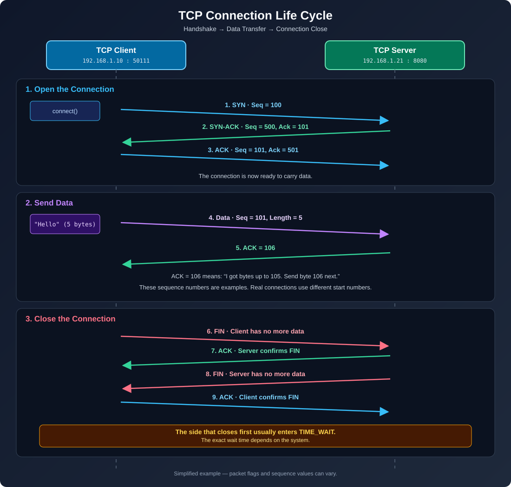

# Stage 4 — Transport Layer: TCP, Ports, and Boost.Asio

This note connects IP routing to the Transport Layer and explains how TCP works with Linux sockets and Boost.Asio.

## أولاً: إجابات أسئلة المرحلة الثالثة (IP & Routing)

### 1. هل الجهاز يستخدم ARP مباشرة أم يرسل إلى الـ Default Gateway؟

لنفترض أن جهازك لديه العنوان `192.168.1.10/24` ويريد إرسال Packet إلى `192.168.2.10`.

**الإجابة: يرسل إلى الـ Default Gateway**، إذا كان لديه مسار مناسب عبره.

السبب أن `/24` تعني أن أول 24 بت تحدد الشبكة:

- عنوان جهازك: `192.168.1.10` → الشبكة `192.168.1.0/24`
- عنوان الهدف: `192.168.2.10` → الشبكة `192.168.2.0/24`

العنوانان في شبكتين مختلفتين، لذلك لا يحاول جهازك عادةً معرفة MAC الخاص بالجهاز البعيد باستخدام ARP. بدلًا من ذلك، يبحث عن مسار في جدول التوجيه ويرسل الـ Ethernet frame إلى MAC الخاص بالـ next hop، وغالبًا يكون الـ Default Gateway مثل `192.168.1.1`.

**تذكّر:** عنوان IP للوجهة يظل `192.168.2.10`، لكن عنوان MAC على الوصلة المحلية الأولى يكون عنوان الـ Gateway.

### 2. ما قيمة TTL بعد المرور عبر 5 Routers؟

إذا بدأت حزمة IPv4 بقيمة `TTL = 64` ومرّت عبر خمسة Routers، فالقيمة المتوقعة عند الوصول هي:

`64 - 5 = 59`

كل Router يمرّر حزمة IPv4 ينقص قيمة TTL بمقدار واحد. أما الـ Layer 2 Switch العادي فلا ينقص TTL لأنه لا يوجّه حزمة IP بين شبكات. هذه القاعدة تخص IPv4؛ في IPv6 يوجد الحقل المقابل باسم **Hop Limit**.

### 3. ماذا يحدث إذا لم يوجد طريق إلى الشبكة المطلوبة عند استخدام Boost.Asio؟

يعتمد الخطأ على مكان اكتشاف المشكلة:

- إذا لم يكن لدى Linux مسار محلي مناسب، فقد يفشل `connect()` بخطأ محلي مثل `network_unreachable` من دون إرسال Packet إلى الشبكة أصلًا.
- إذا أرسل الجهاز الحزمة ثم أعاد Router رسالة ICMP من نوع Destination Unreachable، فقد يترجم نظام التشغيل النتيجة إلى خطأ مثل `network_unreachable` أو `host_unreachable`.

في Boost.Asio، افحص `error_code` الذي يصل إلى Completion Handler؛ لا تفترض أن كل فشل اتصال يعني أن رسالة ICMP وصلت بالفعل.

---

## لماذا نحتاج إلى Transport Layer؟

طبقة IP توصل الحزم بين الأجهزة، لكنها لا تقدم وحدها قناة موثوقة ومنظمة بين برنامجين. على الجهاز الواحد قد تعمل برامج كثيرة في الوقت نفسه، وقد تتأخر حزمة أو تضيع أو تصل خارج الترتيب.

طبقة النقل تساعد في تحديد البرنامج المقصود باستخدام **Ports**. ويضيف TCP آليات مثل ترتيب البيانات، والإقرار باستلامها، وإعادة الإرسال عند الحاجة، والتحكم في التدفق والازدحام. أما UDP فيوفر Datagram transport أبسط من دون ضمانات TCP نفسها.

## 1. Ports and the 5-Tuple

رقم الـ Port هو قيمة 16-bit، لذلك يمتد نطاقه من `0` إلى `65535`. في الاستخدام المعتاد، تُخصص الأرقام `1–1023` غالبًا للخدمات المعروفة أو ذات الامتيازات، بينما يُستخدم نطاق آخر للمنافذ المؤقتة (Ephemeral Ports). النطاق الفعلي الذي يستخدمه Linux قابل للتغيير؛ اعرضه على جهازك هكذا:

```bash
cat /proc/sys/net/ipv4/ip_local_port_range
```

غالبًا يفتح السيرفر منفذًا معروفًا، مثل `8080`. عندما يتصل عميل من دون اختيار منفذ محلي، يختار Kernel منفذًا مؤقتًا متاحًا.

### كيف يقبل السيرفر عدة عملاء على المنفذ نفسه؟

الاتصال لا يُميَّز برقم Port الوجهة وحده. يمكن تمييز تدفق TCP باستخدام **5-Tuple**:

`{ Protocol, Source IP, Source Port, Destination IP, Destination Port }`

مثال:

```text
Client A: { TCP, 192.168.1.10, 50111, 192.168.1.21, 8080 }
Client B: { TCP, 192.168.1.10, 50112, 192.168.1.21, 8080 }
```

العميلان يتصلان بالعنوان والمنفذ نفسيهما على السيرفر، لكن منفذ المصدر مختلف. لذلك يستطيع Kernel إدارة اتصالين مستقلين، ولكل اتصال مقبول Socket وFile Descriptor خاص به في عملية السيرفر. أما Listening Socket فيبقى مسؤولًا عن قبول اتصالات جديدة.

## 2. TCP Three-Way Handshake

TCP بروتوكول Connection-Oriented. قبل نقل بيانات التطبيق، ينشئ الطرفان حالة اتصال ويتبادلان رسائل:

1. **SYN:** يطلب العميل بدء الاتصال ويعلن رقم البداية الخاص به.
2. **SYN-ACK:** يرد السيرفر برقم البداية الخاص به ويؤكد رقم العميل.
3. **ACK:** يؤكد العميل رقم بداية السيرفر.

بعد ذلك يصبح الاتصال جاهزًا لنقل البيانات. الأرقام في رسمة `tcp-lifecycle.svg` أمثلة تعليمية وليست أرقامًا ثابتة لكل اتصال؛ أرقام البداية الحقيقية تتغير بين الاتصالات.

### ما علاقة ذلك بـ `async_accept()`؟

عندما ينادي كود C++ الدالة `async_accept()`، فإنه يطلب من Boost.Asio إشعاره عند توفر اتصال مقبول. في Linux، تمر اتصالات TCP الواردة عادةً بمرحلة SYN غير المكتملة، ثم تصبح اتصالات مكتملة بانتظار `accept()` بعد اكتمال الـ Handshake.

لذلك **لا يعني وصول SYN وحده أن Completion Handler الخاص بـ `async_accept()` سيعمل**. بعد اكتمال الاتصال ووصوله إلى طابور الاتصالات المكتملة، يمكن أن يقبل Kernel الاتصال ويوقظ عملية الانتظار، ثم ينفذ Asio الـ Handler وفقًا لـ `io_context`.

## 3. Sequence Numbers and ACKs

TCP يقدّم للتطبيق **Byte Stream**، وليس رسائل منفصلة. أرقام Sequence وAcknowledgment تساعده في ترتيب البايتات ومعرفة الجزء الذي ينتظره من الطرف الآخر.

للتبسيط، افترض أن العميل أرسل `Hello`، وهي خمسة بايتات، ابتداءً من `Seq = 101`:

```text
Seq = 101, Length = 5
Bytes: 101 102 103 104 105
```

إذا استلم السيرفر تلك البايتات كلها، فسيكون رقم الإقرار التالي `ACK = 106`، أي: **استلمت البايتات حتى 105، والبايت التالي الذي أنتظره هو 106**.

ملاحظة: الـ SYN والـ FIN يستهلك كل منهما رقم Sequence واحدًا أيضًا؛ لذلك فإن أرقام المثال في الرسمة تبسيط متناسق للشرح، وليست وصفًا لكل حقل في كل Packet.

### ماذا يحدث إذا ضاعت البيانات أو وصلت خارج الترتيب؟

- **فقدان Packet:** يستطيع TCP إعادة إرسال البيانات التي لم يتم الإقرار باستلامها، وفقًا لآليات وتوقيتات إعادة الإرسال داخل Kernel.
- **وصول البيانات خارج الترتيب:** يحتفظ TCP بالبيانات التي وصلت مبكرًا إلى أن تتوفر الفجوة المفقودة، ثم يسلّم البايتات للتطبيق بالترتيب الصحيح.
- **حدود الرسائل:** لأن TCP Byte Stream، فقد تعيد عملية `async_read_some()` جزءًا من رسالة التطبيق، أو بيانات من أكثر من رسالة في قراءة واحدة. لذلك يحتاج التطبيق إلى بروتوكول Framing، مثل Length-Prefixed Messages أو delimiter واضح.

لا يعني ذلك أن دالة `async_read_some()` ستعيد دائمًا كل البيانات المتاحة مرة واحدة؛ فهي تعيد ما توفر ضمن حدود الـ buffer وشروط العملية.

## 4. TCP Connection Life Cycle

توضح الصورة دورة الاتصال بثلاث مراحل: فتح الاتصال، وإرسال البيانات، ثم إغلاق الاتصال.

<p align="center">
    
</p>

### الإغلاق الطبيعي: FIN وEOF

عندما يغلق الطرف إرسال البيانات بصورة طبيعية، يستخدم TCP علامة `FIN`. وعندما ينتهي التطبيق من قراءة البيانات التي سبقت FIN، يمكن أن يتلقى Boost.Asio الخطأ `asio::error::eof` ليشير إلى نهاية تدفق البيانات من الطرف الآخر.

يظل على كود التطبيق التعامل مع نهاية الاتصال وتنظيف الموارد. إذا وصل `eof` إلى Connection Handler، فيجب أن تكون سياسة الإغلاق واضحة، وألا تظل الاتصالات والـ File Descriptors محفوظة بلا داعٍ.

### الإغلاق غير الطبيعي: RST

ال `RST` تعني أن الاتصال أُعيد ضبطه بدلًا من إغلاقه عبر تبادل FIN الطبيعي. قد يظهر ذلك في Asio مثل `asio::error::connection_reset`. السبب الدقيق يعتمد على سلوك التطبيق ونظام التشغيل وما حدث على الشبكة.

### ما هي حالة `TIME_WAIT`؟

عادةً ما يدخل الطرف الذي بدأ الإغلاق النشط في `TIME_WAIT` بعد خطوات إغلاق TCP. تساعد هذه الحالة في السماح بإعادة إرسال آخر ACK عند الحاجة، وفي حماية الاتصالات الجديدة من الحزم القديمة المتأخرة.

لا تفترض أن مدة `TIME_WAIT` ثابتة في كل الأنظمة أو الظروف. كذلك، `TIME_WAIT` ليست هي `CLOSE_WAIT`: الأولى حالة ضمن إنهاء TCP، أما الثانية فتعني أن الطرف الآخر أرسل FIN وأن التطبيق المحلي لم يُنهِ إغلاق جهته بعد.

### متى نستخدم `SO_REUSEADDR`؟

هذا الخيار قد يسمح بإعادة ربط عنوان/منفذ محلي في وجود حالات قديمة مثل `TIME_WAIT` وفق قواعد النظام. في Boost.Asio، بعض مُنشئات `tcp::acceptor` التي تستقبل Endpoint تفعّل `reuse_address` افتراضيًا؛ أما عند استخدام `open()` و`bind()` يدويًا، فيمكن ضبط الخيار صراحةً قبل `bind()`:

```cpp
boost::asio::ip::tcp::acceptor acceptor(io_context);
auto endpoint = boost::asio::ip::tcp::endpoint(
    boost::asio::ip::tcp::v4(), 8080);

acceptor.open(endpoint.protocol());
acceptor.set_option(boost::asio::ip::tcp::acceptor::reuse_address(true));
acceptor.bind(endpoint);
acceptor.listen();
```

`SO_REUSEADDR` لا يعني أن أي برنامجين يمكنهما حجز العنوان والمنفذ نفسيهما بلا قيود؛ سلوك إعادة الاستخدام يتبع قواعد نظام التشغيل وعناوين الربط المستخدمة.

## 5. Flow Control vs. Congestion Control

| Comparison | Flow Control | Congestion Control |
|---|---|---|
| What does it protect? | The receiver from receiving more data than it can handle | The network from excessive congestion |
| Primary mechanism | Receive Window (`rwnd`) | Congestion Window (`cwnd`) and congestion control algorithms |
| Concept | The receiver advertises the amount of available space for incoming data | The sender limits the amount of unacknowledged data based on an estimate of network congestion |
| Relation to the application | Stopping data consumption can fill up receive buffers, causing the receive window to shrink | Managed by TCP in the kernel, based on network behavior and the specific algorithm in use |

يمكن تبسيط الحد الأعلى للبيانات غير المؤكدة أثناء الإرسال إلى أنه يتأثر بكل من `rwnd` و`cwnd`. لكن التفاصيل العملية تشمل أيضًا حدودًا أخرى مثل بيانات غير مؤكدة بالفعل وخيارات TCP وحالة الاتصال.

## 6. TCP vs. UDP

| Feature | TCP | UDP |
|---|---|---|
| Mode of Operation | Connection-oriented | Connectionless |
| Data Format | Byte stream; does not preserve application message boundaries | Datagram; preserves the boundaries of each datagram upon receipt (unless truncation occurs) |
| Ordering and Retransmission | Provides reliable, ordered byte transmission, assuming the connection remains intact | Does not guarantee delivery, ordering, or retransmission |
| Base Header Size | At least 20 bytes | 8 bytes |
| Examples | HTTP/1.1, HTTP/2, SSH, databases | DNS (in common scenarios), real-time streaming, gaming; HTTP/3 uses QUIC over UDP |


TCP لا يضمن أن التطبيق البعيد عالج البيانات أو حفظها؛ هو يوفر آلية نقل موثوقة ومرتبة بين الطرفين ما دام الاتصال قادرًا على الاستمرار. وUDP لا يعني بالضرورة أنه أسرع دائمًا؛ الاختيار يعتمد على متطلبات التطبيق.

## 7. Hands-on: Inspect TCP with Linux

شغّل سيرفر Asio على المنفذ `8080`، ثم في Terminal آخر اتصل به عبر `nc`:

```bash
nc 127.0.0.1 8080
```

في Terminal ثالث، اعرض اتصالات TCP التي تستخدم المنفذ:

```bash
ss -tanp '( dport = :8080 or sport = :8080 )'
```

راقب ما يلي:

- `LISTEN`: الـ Listening Socket الذي ينتظر الاتصالات الجديدة.
- `ESTAB` أو `ESTABLISHED`: اتصال TCP مكتمل بين طرفين.
- المنافذ المحلية والبعيدة: ستلاحظ غالبًا منفذًا مؤقتًا عند العميل ومنفذ `8080` عند السيرفر.
- `Recv-Q` و`Send-Q`: المعنى يختلف بين Socket في حالة `LISTEN` واتصال نشط؛ عند الاتصال النشط تساعدك القيم في رؤية بيانات موجودة في الطوابير ولم يستهلكها الطرف المقابل بعد. في حالة `LISTEN` تعبّر `Recv-Q` عن الاتصالات المكتملة التي تنتظر `accept()`، بينما يعبّر `Send-Q` عن حد طابور الانتظار.

جرّب إنهاء `nc` ثم نفّذ الأمر مرة أخرى. قد ترى حالة `TIME-WAIT`، حسب الطرف الذي بدأ الإغلاق والوقت الذي مرّ منذ إغلاق الاتصال.

## 8. Questions to Check Your Understanding

1. إذا أرسل العميل `Seq = 100` مع `250 bytes` من البيانات، فما قيمة ACK التالية التي تؤكد استلام هذه البايتات كلها؟
2. لماذا لا يعني وصول أول `SYN` أن Completion Handler الخاص بـ `async_accept()` سيعمل فورًا؟
3. أي طرف يدخل عادةً في `TIME_WAIT`: الطرف الذي بدأ الإغلاق أم الطرف الذي استقبل أول `FIN`؟ وهل يمكن أن يتغير الطرف الذي يبدأ الإغلاق حسب طريقة إنهاء التطبيق؟
4. لماذا لا يمكن الاعتماد على استدعاء واحد لـ `async_read_some()` لقراءة رسالة تطبيق كاملة؟

THE ASWERS ARE IN [4_1_TCP-Fundamentals-Four-Questions.md](./4_1_TCP-Fundamentals-Four-Questions.md)

## What to Study Next

الخطوة العملية المقترحة هي بناء **Length-Prefixed Framing** في مشروع C++/Boost.Asio، ثم تجربة إرسال عدة رسائل في دفعة واحدة ورسالة كبيرة تصل على عدة قراءات. هذه التجربة تربط مفهوم TCP Byte Stream مباشرةً بالكود.

بعدها يمكن دراسة كيفية ارتباط `socket()`, `bind()`, `listen()`, `accept()`, `epoll`, و`io_context` ببعضها داخل Linux.

## References

- [RFC 9293 — Transmission Control Protocol (TCP)](https://www.rfc-editor.org/rfc/rfc9293/): المرجع الأساسي لسلوك TCP وSequence/ACK وأعلام الاتصال وحالات الإغلاق.
- [Boost.Asio — `basic_socket_acceptor` constructor](https://www.boost.org/latest/doc/html/boost_asio/reference/basic_socket_acceptor/basic_socket_acceptor/overload5.html): يوضح أن مُنشئ Endpoint يفعّل `reuse_address` افتراضيًا في هذا الـ overload، ويمكن التحكم في ذلك بالوسيط `reuse_addr`.
- [Linux Kernel — IP sysctl documentation](https://www.kernel.org/doc/html/latest/networking/ip-sysctl.html): مرجع إعدادات الشبكة في Linux، ومنها نطاق المنافذ المحلية المؤقتة.
