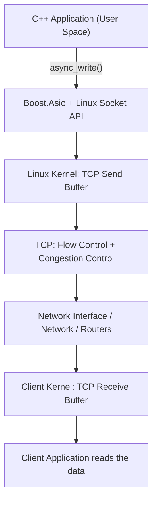
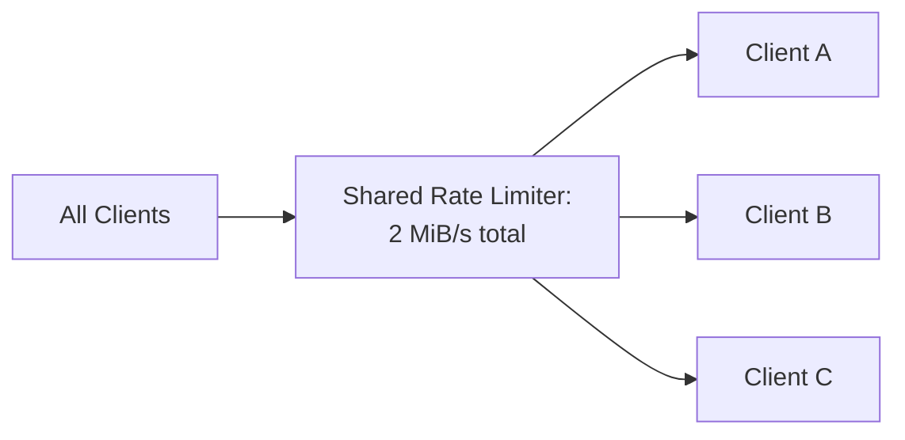
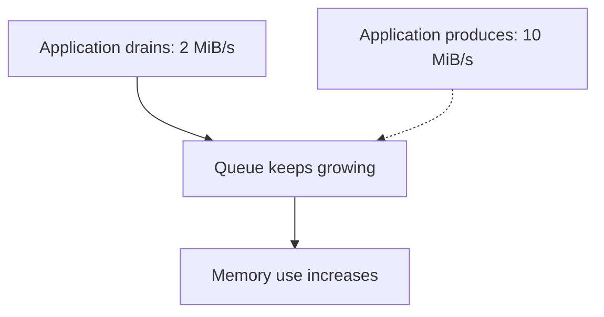
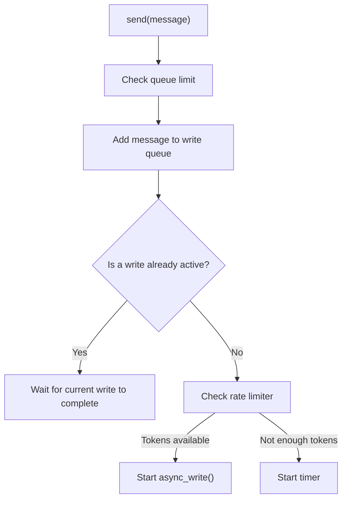

# Controlling TCP Sending Rate from C++ and Boost.Asio

> **الفكرة الأساسية:** تقدر تتحكم في سلوك تطبيقك ومعدل البيانات التي يقدّمها إلى الـ Socket، وتقدر في Linux تطلب تحديد معدل TCP pacing. لكنك لا تستطيع ضمان سرعة وصول ثابتة إلى الـ Client؛ لأن السرعة النهائية تتأثر أيضًا بالـ TCP والـ Kernel والشبكة والطرف المستقبِل.

## المحتويات

1. [الأسئلة والإجابات](#1-الأسئلة-والإجابات)
2. [مسار البيانات من التطبيق إلى العميل](#2-مسار-البيانات-من-التطبيق-إلى-العميل)
3. [كيف نقيس السرعة؟](#3-كيف-نقيس-السرعة)
4. [ما الذي يحدد معدل النقل؟](#4-ما-الذي-يحدد-معدل-النقل)
5. [ما الذي يمكن التحكم فيه من User Space؟](#5-ما-الذي-يمكن-التحكم-فيه-من-user-space)
6. [التحكم في التطبيق باستخدام Rate Limiting](#6-التحكم-في-التطبيق-باستخدام-rate-limiting)
7. [Write Queue وBackpressure في Boost.Asio](#7-write-queue-وbackpressure-في-boostasio)
8. [ضبط Socket Buffers](#8-ضبط-socket-buffers)
9. [Linux TCP Pacing باستخدام SO_MAX_PACING_RATE](#9-linux-tcp-pacing-باستخدام-so_max_pacing_rate)
10. [خطة تطبيق عملية لمشروعك](#10-خطة-تطبيق-عملية-لمشروعك)
11. [مراجع موثوقة](#11-مراجع-موثوقة)

---

## 1. الأسئلة والإجابات

### السؤال الأول: إزاي أعرف السرعة اللي هكلم بيها الـ Client؟

مفيش قيمة واحدة تقدر تقرأها وتعتبرها السرعة المضمونة للاتصال كله. الأول لازم نحدد إحنا بنقيس إيه:

| Term | Definition |
|---|---|
| **Link Speed** | The theoretical or negotiated speed of a network link, such as 1 Gbps for Ethernet |
| **Network Throughput** | The rate at which data actually passes through the network |
| **Application Throughput** | The rate at which an application processes data over a given period of time |
| **TCP Pacing Rate** | The transmission rate at which TCP attempts to regulate the outflow of packets, provided that pacing is supported and enabled |

مثلًا، لو كارت الشبكة عند السيرفر يدعم `1 Gbps`، فهذا لا يعني أن كل Client سيستقبل بياناتك بمعدل `1 Gbps`. قد تكون وصلة العميل أبطأ، أو تكون الشبكة مزدحمة، أو يكون برنامج العميل بطيئًا في قراءة البيانات.

#### قياس معدل النقل من التطبيق

لو التطبيق تعامل مع `10 MiB` خلال ثانيتين، يكون متوسط المعدل:

$$
\text{Throughput} = \frac{\text{Bytes}}{\text{Elapsed Time}}
$$

$$
\frac{10\ \text{MiB}}{2\ \text{s}} = 5\ \text{MiB/s}
$$

لكن لازم تحدد **أي بايتات تقيس**. حساب البايتات التي أكمل `async_write()` كتابتها لا يثبت أن برنامج العميل قرأها أو عالجها؛ هو يقيس مرحلة الكتابة المحلية إلى الـ stream، وليس تأكيدًا على مستوى التطبيق البعيد.

#### مراقبة اتصال TCP في Linux

```bash
ss -tinp '( sport = :8080 or dport = :8080 )'
```

- `ss`: يعرض معلومات الـ sockets.
- `-t`: يعرض TCP.
- `-i`: يعرض معلومات TCP الداخلية المتاحة.
- `-n`: يعرض الأرقام بدل محاولة تحويلها إلى أسماء.
- `-p`: يحاول عرض العملية المرتبطة بالاتصال.

حسب إصدار Linux و`iproute2`، قد تظهر قيم مثل:

- `rtt`: تقدير زمن الذهاب والعودة للحزم والتأكيدات.
- `cwnd`: نافذة الازدحام.
- `pacing_rate`: معدل pacing الذي يستخدمه TCP أو يطلبه.
- `delivery_rate`: تقدير لمعدل تسليم البيانات.
- `rwnd_limited` أو `sndbuf_limited`: مؤشرات قد تساعد على معرفة هل الاتصال مقيّد بنافذة الاستقبال أو بقدرة الإرسال.

هذه المؤشرات تساعد في فهم حالة الاتصال، لكنها ليست ضمانًا لمعدل وصول ثابت إلى تطبيق العميل. قد تختلف الحقول بين إصدارات النظام.

### السؤال الثاني: إيه اللي بيحدد سرعة نقل البيانات؟

السرعة الفعلية ناتجة عن عدة عوامل تعمل معًا، وليس عن رقم واحد فقط.

#### 1. سعة الوصلة والشبكة

لو إحدى الوصلات بين السيرفر والعميل أبطأ من باقي الوصلات، فقد تصبح هي عنق الزجاجة (Bottleneck).

#### 2. TCP Congestion Control

يستخدم TCP متغيرًا اسمه `cwnd`، اختصارًا لـ **Congestion Window**، لتنظيم كمية البيانات غير المؤكدة التي يمكن أن تكون قيد الإرسال بسبب حالة الشبكة. يمكن لخوارزمية الازدحام أن تغيّر هذه النافذة بمرور الوقت.

#### 3. TCP Flow Control

العميل لديه Receive Buffer داخل الـ Kernel. يعلن TCP عن مساحة الاستقبال المتاحة باستخدام نافذة اسمها `rwnd`، اختصارًا لـ **Receive Window**.

لو برنامج العميل بطيء في قراءة البيانات، فقد يمتلئ الـ Receive Buffer. وقتها يستطيع TCP تقليل الإرسال أو إيقافه مؤقتًا حتى تصبح هناك مساحة جديدة.

الفرق المهم:

- `cwnd`: تتحكم في الإرسال من ناحية ازدحام الشبكة.
- `rwnd`: تعكس مساحة الاستقبال المتاحة عند الطرف الآخر.

وللتبسيط، كمية البيانات غير المؤكدة التي يمكن أن تكون قيد الإرسال تتأثر بالحد الأصغر بين النافذتين، مع وجود عوامل وآليات TCP أخرى.

#### 4. زمن الذهاب والعودة (RTT)

كلما كان RTT كبيرًا، احتاج الاتصال إلى نافذة أكبر كي يحافظ على معدل نقل مرتفع. لذلك، يمكن استخدام التقريب التالي لتكوين فكرة أولية:

\[
\text{Approximate Throughput} \approx
\frac{\min(cwnd, rwnd)}{RTT}
\]

افترض مثلًا:

- `cwnd = 64 KiB`
- `rwnd = 128 KiB`
- `RTT = 0.1 seconds`

في هذه الحالة:

$$
\frac{64\ \text{KiB}}{0.1\ \text{s}} \approx 640\ \text{KiB/s}
$$

ده **تقريب تعليمي فقط**، وليس توقعًا مضمونًا للسرعة الفعلية. يفترض أن النافذة يمكن استغلالها باستمرار، ولا يحسب كل العوامل الأخرى مثل فقد الحزم، والـ pacing، وسعة الوصلة، وتكلفة بروتوكولات الشبكة، وأداء التطبيق.

#### 5. أداء برنامج العميل والسيرفر

تخيل أن السيرفر ينتج بيانات بمعدل `10 MiB/s`، لكن برنامج العميل يقرأها بمعدل `2 MiB/s` فقط. قد تتراكم البيانات في الـ buffers والـ queues، وبعدها يتدخل Flow Control، أو يزيد استهلاك الذاكرة، أو يضطر التطبيق إلى إبطاء إنتاج البيانات.

**النتيجة:** معدل النقل الفعلي يتأثر بالشبكة، والـ TCP، والـ Kernel، وأداء التطبيقين.

### السؤال الثالث: هل أقدر أعمل Control من الـ User Space؟

نعم. عندك أكثر من مستوى للتحكم، وكل مستوى له وظيفة مختلفة.

| الوسيلة | ماذا تتحكم فيه؟ | ما الذي لا تضمنه؟ |
|---|---|---|
| **Application Rate Limiter** | معدل البيانات التي يسمح التطبيق بتقديمها للـ Socket | لا يضمن معدل وصول ثابتًا إلى العميل |
| **Write Queue Limit** | الحد الأقصى للبيانات المنتظرة في التطبيق | لا يزيد سعة الشبكة |
| **Backpressure** | إبطاء أو إيقاف إنتاج بيانات جديدة عند تراكم الطابور | لا يجعل العميل البطيء أسرع |
| **`SO_SNDBUF` / `SO_RCVBUF`** | سعة بعض buffers الخاصة بالـ Socket المحلي | لا يحددان سرعة الإرسال وحدهما |
| **`SO_MAX_PACING_RATE` في Linux** | يطلب حدًا أقصى لمعدل TCP pacing على الـ Socket | لا يضمن الـ payload throughput نفسه عند العميل |

أهم فكرة: **إنت تتحكم في سياسة تطبيقك، وتضبط بعض سلوك الـ Socket، لكنك لا تتحكم بشكل مطلق في الشبكة أو في جهاز العميل.**

---

## 2. مسار البيانات من التطبيق إلى العميل

عندما يستدعي تطبيق C++ عملية كتابة على TCP، فالمسار المفاهيمي يكون كالتالي:



لاحظ أن هناك فرقًا بين هذه المراحل:

1. **التطبيق طلب الكتابة.**
2. **عملية الكتابة في Asio اكتملت.**
3. **ال TCP أكد وصول البيانات إلى الطرف الآخر.**
4. **برنامج العميل قرأ البيانات وعالجها.**

هذه ليست لحظة واحدة. اكتمال `async_write()` لا يعني أن البيانات وصلت إلى برنامج العميل أو أنه انتهى من معالجتها.

للحصول على تأكيد من مستوى التطبيق، يجب أن يعرّف بروتوكولك رسالة رد أو ACK على مستوى التطبيق، مثل: `MESSAGE_PROCESSED`.

---

## 3. كيف نقيس السرعة؟

الأفضل أن تجمع بين قياس التطبيق ومراقبة TCP.

### قياس Application Throughput

احسب عدد البايتات خلال فترة زمنية معروفة:

```text
bytes_transferred = total bytes counted by your application
elapsed_seconds   = measured elapsed time

throughput = bytes_transferred / elapsed_seconds
```

في كود C++، استخدم ساعة monotonic مثل `std::chrono::steady_clock` لقياس الزمن. وحدد بوضوح هل العدّاد يحسب:

- البايتات التي طلب التطبيق إرسالها.
- البايتات التي اكتملت كتابتها محليًا.
- البايتات التي أكد الطرف الآخر استقبالها على مستوى TCP.
- البايتات التي أكد تطبيق العميل معالجتها.

لا تخلط بين المقاييس؛ لأنها تجيب عن أسئلة مختلفة.

### مراقبة TCP

```bash
ss -tinp '( sport = :8080 or dport = :8080 )'
```

راقب الحقول المتاحة مثل `rtt` و`cwnd` و`pacing_rate` و`delivery_rate`. بعد ذلك كرر القياس في ظروف مختلفة، مثل عميل سريع وآخر بطيء، وقارن النتائج.

---

## 4. ما الذي يمكن التحكم فيه من User Space؟

### أ. Application-Level Rate Limiting

يمكنك تحديد معدل أقصى للبيانات التي يسمح تطبيقك بإرسالها.

مثال: تريد أن يقدّم التطبيق بيانات لكل Client بمعدل لا يتجاوز `2 MiB/s`.

الفكرة:

1. يحتفظ التطبيق ببيانات الإرسال في Write Queue.
2. يسمح Rate Limiter بإرسال مقدار محدد خلال فترة زمنية.
3. يبدأ التطبيق عملية الكتابة لهذا الجزء.
4. عندما يُسمح بإرسال جزء آخر، يبدأه التطبيق.
5. إذا لم تتوفر ميزانية إرسال كافية، ينتظر التطبيق باستخدام `asio::steady_timer` بدل أن يرسل بلا حدود.

الـ Rate Limiter يحدد **معدل تقديم البيانات من التطبيق إلى الـ Socket**. لا يضمن أن البيانات ستصل للعميل بالمعدل نفسه.

### ب. Token Bucket

من الطرق الشائعة لتنفيذ Rate Limiter خوارزمية اسمها **Token Bucket**.

تخيّل أن عندك bucket تمثل رصيدًا من البايتات المسموح إرسالها:

- الرصيد يزيد بمرور الوقت حسب المعدل المحدد.
- كل بايت يسمح التطبيق بإرساله يستهلك من الرصيد.
- الرصيد له حد أقصى لتحديد حجم الـ burst المسموح.
- إذا لم يوجد رصيد كافٍ، ينتظر التطبيق حتى يتكوّن الرصيد.

مثال عند معدل `2 MiB/s`:

\[
2\ \text{MiB/s} = 2 \times 1024 \times 1024\ \text{bytes/s}
\]

خلال `10 ms`، ينتج عن هذا المعدل ميزانية نظرية تقارب `20 KiB`.

هذا مجرد مثال حسابي؛ التنفيذ الحقيقي يجب أن يحسب الوقت المنقضي، والرصيد الحالي، وحجم الـ burst، والبيانات الموجودة بالفعل في قائمة الانتظار.

### ج. تحديد معدل لكل Client أو للسيرفر كله

هناك فرق مهم بين الحالتين:

**حد لكل اتصال:**

```text
Client A -> Rate limit: 2 MiB/s
Client B -> Rate limit: 2 MiB/s
Client C -> Rate limit: 2 MiB/s
```

كل اتصال له ميزانيته المستقلة؛ وبالتالي قد يتجاوز إجمالي إرسال السيرفر `2 MiB/s`.

**حد إجمالي للسيرفر:**



لو هدفك ألا يتجاوز إجمالي إرسال التطبيق `2 MiB/s` عبر كل العملاء، فأنت تحتاج إلى Limiter مشترك بين الاتصالات، وليس Limiter مستقلًا لكل `Connection`.

---

## 5. ما العلاقة بين Rate Limiting وBoost.Asio؟

افترض أن عندك:

```cpp
connection.send(message);
```

وأن `send()` تضيف الرسالة إلى `Write Queue`.

لو التطبيق يستقبل طلبات وينتج ردودًا بمعدل أسرع من معدل الإرسال، يمكن أن يحدث هذا:



لذلك تحتاج إلى أكثر من Rate Limiter فقط؛ تحتاج إلى حد واضح لحجم الـ Queue.

### قاعدة مهمة عند استخدام `async_write()`

عملية `async_write()` تحاول كتابة كل البيانات التي مررتها لها، وقد تستخدم واحدة أو أكثر من عمليات `async_write_some()` داخليًا. يجب ألا تبدأ عملية كتابة أخرى على الـ stream نفسه حتى تكتمل العملية الحالية، ويجب أن تظل الذاكرة التي تشير إليها الـ buffers صالحة حتى استدعاء Completion Handler.

مرجع: [Boost.Asio — `async_write()`](https://www.boost.org/doc/libs/latest/doc/html/boost_asio/reference/async_write/overload1.html)

لهذا، في كلاس `Connection`، يكون التصميم المعتاد:



هذا رسم منطقي للتصميم، وليس كودًا جاهزًا للتجميع. في التنفيذ، يجب أيضًا مراعاة سلامة الـ buffers، وإدارة عمر `Connection`، والتعامل مع الإلغاء والأخطاء وإغلاق الـ Socket.

---

## 6. التحكم في التطبيق باستخدام Rate Limiting

### مثال شبه برمجي (Pseudocode)

```cpp
void Connection::write()
{
    // 1. Return if a write is already active.
    // 2. Return if the queue is empty.
    // 3. Ask the rate limiter how many bytes may be sent now.
    // 4. If no budget is available:
    //      schedule an asio::steady_timer
    //      resume write() when the timer expires.
    // 5. Otherwise, start one async_write() for an allowed portion.
    // 6. Keep the buffer alive until the handler runs.
    // 7. On success, update the queue and resume do_write().
    // 8. On error, stop or close the connection safely.
}
```

### لماذا لا نرسل كل الرسالة ثم نستخدم Timer؟

لو وضعت الرسالة الكبيرة كلها في `async_write()`، فالعملية ستحاول كتابة كل البيانات المطلوبة قبل اكتمالها. لا يمكنك اعتبار `async_write()` نفسها محددًا لمعدل البايتات على الشبكة.

للتطبيق البسيط، من الأسهل أن يحدد الـ Rate Limiter الجزء الذي يسمح التطبيق بتمريره في كل مرة، مع الحفاظ على ترتيب البيانات وعدم تشغيل كتابات متزامنة على الـ Socket نفسه.

### ماذا يحدث لو امتلأت الـ Queue؟

حدد سياسة صريحة. مثلًا:

- إيقاف إنتاج بيانات جديدة مؤقتًا.
- إبطاء مصدر البيانات.
- إسقاط الرسائل القديمة أو غير الضرورية، إذا كان بروتوكول التطبيق يسمح بذلك.
- فصل العميل إذا استمر في البطء وتجاوز حدًا محددًا.

اختيار السياسة يعتمد على نوع البيانات. إسقاط رسالة قد يكون مقبولًا في تحديثات حالة متكررة، لكنه قد يكون غير مقبول لملف يجب نقله كاملًا.

---

## 7. Write Queue وBackpressure في Boost.Asio

**Backpressure** معناها أن بطء مرحلة لاحقة في النظام يجعل المرحلة السابقة تقلل إنتاج البيانات أو توقفه مؤقتًا، بدلًا من ترك البيانات تتراكم باستمرار.

في سيرفر TCP:

- إذا كان الـ Client بطيئًا في القراءة، فقد يتباطأ TCP في الإرسال.
- إذا لم يبطئ التطبيق إنتاج البيانات، فقد تكبر Write Queue.
- إذا تجاوزت الـ Queue الحد المحدد، يجب أن يتخذ التطبيق إجراءً بدلًا من استهلاك الذاكرة بلا نهاية.

مثال مبسط:


نصائح عملية:

1. ضع حدًا أقصى لحجم الـ Write Queue، ويفضل قياسه بالبايتات وليس بعدد الرسائل فقط؛ لأن أحجام الرسائل قد تختلف.
2. احتفظ بعملية كتابة غير متزامنة واحدة نشطة لكل Connection.
3. استخدم `asio::steady_timer` للانتظار بين أجزاء الإرسال عند تطبيق Rate Limiting.
4. لا تعتبر اكتمال الكتابة المحلية تأكيدًا على معالجة العميل للبيانات.
5. إذا كنت تريد حدًا إجماليًا لمعدل السيرفر، استخدم Rate Limiter مشتركًا بين الاتصالات.
6. تجنّب تأخير الكتابة مع السماح للـ Queue بالنمو بلا حدود؛ فهذا قد ينقل المشكلة إلى استهلاك الذاكرة.

---

## 8. ضبط Socket Buffers

يوفر Linux خيارات مثل:

- `SO_SNDBUF`: يضبط حجم Send Buffer الخاص بالـ Socket المحلي.
- `SO_RCVBUF`: يضبط حجم Receive Buffer الخاص بالـ Socket المحلي.

يمكن استخدام `setsockopt()` لضبط خيارات الـ Socket على Linux.

مثال لضبط Send Buffer:

```cpp
#include <sys/socket.h>
#include <cstdio>

// `fd` is a valid socket file descriptor.
int send_buffer_size = 256 * 1024;

if (::setsockopt(
        fd,
        SOL_SOCKET,
        SO_SNDBUF,
        &send_buffer_size,
        sizeof(send_buffer_size)) == -1) {
    std::perror("setsockopt(SO_SNDBUF)");
}
```

في Boost.Asio يمكنك الوصول إلى الـ native socket handle باستخدام `socket.native_handle()`، أو استعمال خيارات Asio المقابلة متى كانت متاحة.

**مهم:**

- الـ Buffer هو مساحة تخزين مؤقتة، وليس محدد سرعة.
- زيادة `SO_SNDBUF` لا تعني أن الشبكة ستنقل البيانات أسرع.
- ضبط `SO_RCVBUF` على سيرفرك يخص استقبال السيرفر المحلي؛ ولا يغيّر تلقائيًا Receive Buffer الموجود عند جهاز العميل.
- Linux قد يغيّر القيمة الفعلية أو يتعامل مع حجم الـ Buffer وفق حدود النظام؛ راجع التوثيق الرسمي.

مرجع: [Linux `socket(7)`](https://man7.org/linux/man-pages/man7/socket.7.html)

---

## 9. Linux TCP Pacing باستخدام SO_MAX_PACING_RATE

بالإضافة إلى التحكم في التطبيق، يوفّر Linux خيار Socket باسم:

`SO_MAX_PACING_RATE`

هذا الخيار يسمح للتطبيق بطلب وضع حد أقصى لمعدل TCP pacing على Socket معيّن. القيمة تُعبّر عن **بايتات في الثانية**.

مثال مبدئي خاص بـ Linux مع Boost.Asio:

```cpp
#include <boost/asio.hpp>
#include <cstdint>
#include <cstdio>
#include <sys/socket.h>

// `socket` is an already-open TCP socket.
// Set a requested pacing limit of 2 MiB/s.
std::uint32_t max_rate = 2U * 1024U * 1024U;

if (::setsockopt(
        socket.native_handle(),
        SOL_SOCKET,
        SO_MAX_PACING_RATE,
        &max_rate,
        sizeof(max_rate)) == -1) {
    std::perror("setsockopt(SO_MAX_PACING_RATE)");
}
```

### ما الذي يجب معرفته عن هذا الخيار؟

1. هذا الخيار خاص بـ Linux، وليس واجهة محمولة تعمل بنفس الطريقة على كل أنظمة التشغيل.
2. يجب تطبيقه على الـ Socket المقصود. في السيرفر، يمكنك ضبطه على الـ connected socket الذي يمثل اتصال العميل.
3. لكي يتم تطبيق pacing فعليًا بالطريقة المتوقعة، يعتمد ذلك على إعدادات الشبكة وـ queuing discipline؛ توثيق Linux يشرح دور `fq` في احترام متطلبات pacing.
4. قيمة `2 MiB/s` هي معدل pacing مطلوب، وليست ضمانًا أن الـ Client سيستقبل payload بمعدل `2 MiB/s`.
5. قد تكون السرعة الفعلية أقل بسبب الـ RTT أو فقد الحزم أو Flow Control أو Congestion Control أو بطء التطبيق المستقبِل.
6. لو عملية `setsockopt()` فشلت، اطبع الخطأ وتعامل معه. لا تفترض أن الخيار مدعوم لمجرد وجود الكود.

لفهم إعداد الـ queuing discipline:

```bash
tc qdisc show dev eth0
```

استبدل `eth0` باسم واجهة الشبكة عندك. هذا الأمر يعرض الإعداد الحالي؛ لا يغيّره.

لا تبدأ بتغيير الـ qdisc أو إعدادات النظام في جهاز Production قبل فهم أثر ذلك على حركة الشبكة الأخرى؛ فقد يؤثر إعداد الواجهة في اتصالات أو تطبيقات أخرى.

مراجع:
- [Linux `tc-fq(8)` — FQ pacing](https://man7.org/linux/man-pages/man8/tc-fq.8.html)
- [Linux `socket(7)`](https://man7.org/linux/man-pages/man7/socket.7.html)

---

## 10. خطة تطبيق عملية لمشروعك

بما إن عندك `Server` و`Connection` وWrite Queue في مشروع Boost.Asio، الأفضل تتدرج بهذا الترتيب:

### الخطوة الأولى: قياس الأداء

- احسب إجمالي البايتات التي يتعامل معها التطبيق خلال فترة محددة.
- استخدم `std::chrono::steady_clock`.
- راقب حالة TCP باستخدام `ss -tinp`.
- لا تعتبر أرقام `ss` ضمانًا لمعدل وصول البيانات إلى برنامج العميل.

### الخطوة الثانية: حماية الـ Write Queue

- احتفظ بحد أقصى لحجم الرسائل المنتظرة.
- امنع تراكم البيانات بلا حدود.
- تعامل مع كل مسار من مسارات الإغلاق والأخطاء.
- حافظ على عملية كتابة نشطة واحدة لكل Connection.

### الخطوة الثالثة: اختبار Slow Client

اختبر عميلًا يقرأ ببطء، وراقب:

- حجم الـ Write Queue.
- استهلاك الذاكرة.
- سلوك `async_write()`.
- قيم TCP التي تعرضها أداة `ss`.
- هل التطبيق يقلل إنتاج البيانات عند امتلاء الـ Queue؟

### الخطوة الرابعة: إضافة Application Rate Limiter

بعد أن تصبح الـ Queue محدودة وسلوك الكتابة واضحًا:

- أضف Token Bucket.
- استخدم `asio::steady_timer` عندما لا تتوفر ميزانية إرسال كافية.
- اختبر حدًا لكل Client إذا كنت تريد عدالة بين الاتصالات.
- أضف Limiter مشتركًا إذا كنت تريد سقفًا إجماليًا لمعدل السيرفر.

### الخطوة الخامسة: قيّم الحاجة إلى Linux pacing

جرّب `SO_MAX_PACING_RATE` فقط إذا كان عندك سبب واضح للتحكم في معدل pacing على مستوى TCP، وتأكد من دعم Kernel وإعدادات الـ qdisc، ثم قارن النتائج بقياسات قبل التغيير وبعده.

---

## 11. مراجع موثوقة

1. [Boost.Asio — `async_write()`](https://www.boost.org/doc/libs/latest/doc/html/boost_asio/reference/async_write/overload1.html) — يشرح متى تكتمل عملية الكتابة، وضرورة بقاء الذاكرة المستخدمة في الـ buffers صالحة، وعدم تشغيل عملية كتابة أخرى على الـ stream نفسه حتى تكتمل.
2. [Linux `socket(7)`](https://man7.org/linux/man-pages/man7/socket.7.html) — مرجع لخيارات الـ Socket، ومنها `SO_SNDBUF` و`SO_RCVBUF`.
3. [Linux `tc-fq(8)`](https://man7.org/linux/man-pages/man8/tc-fq.8.html) — يشرح FQ ودوره في per-flow pacing واحترام حدود pacing المطلوبة على الـ Socket.
4. [RFC 5681 — TCP Congestion Control](https://www.rfc-editor.org/rfc/rfc5681.html) — مرجع معياري لآليات التحكم في ازدحام TCP.
5. [Linux `ss(8)`](https://man7.org/linux/man-pages/man8/ss.8.html) — مرجع لأداة عرض الـ Sockets ومعلوماتها على Linux.

---

## الخلاصة

- **Rate Limiting في User Space** يتحكم في معدل تقديم التطبيق للبيانات.
- **Write Queue Limit وBackpressure** يحميان التطبيق من تراكم البيانات واستهلاك الذاكرة.
- **`SO_SNDBUF` و`SO_RCVBUF`** يضبطان سعة buffers محلية، وليسا وحدهما أدوات لتحديد السرعة.
- **`SO_MAX_PACING_RATE`** يسمح بطلب حد أقصى لمعدل TCP pacing في Linux، لكن فعاليته تعتمد على إعدادات النظام ولا يضمن معدل وصول معينًا.
- **TCP Flow Control وCongestion Control** يظلان جزءًا من تحديد معدل النقل الفعلي.
- **اكتمال `async_write()` لا يعني أن تطبيق العميل استلم البيانات وعالجها.** لو احتجت تأكيدًا على مستوى التطبيق، صمّم رسالة ACK خاصة ببروتوكولك.

أفضل نقطة بداية لمشروعك هي: **قياس الأداء → وضع حد للـ Write Queue → إضافة Backpressure → تطبيق Rate Limiting → اختبار الحاجة إلى TCP pacing**.
