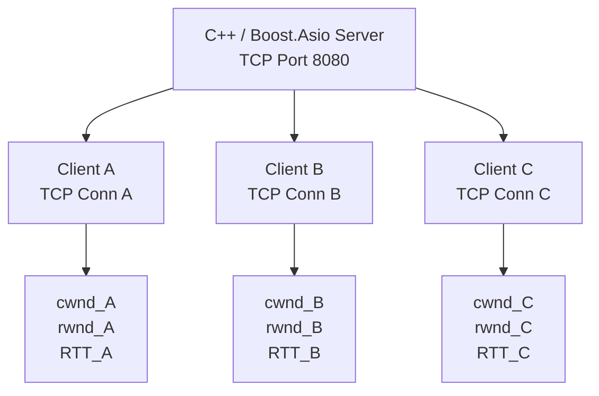

# إزاي سرعة كل TCP Client بتتغير مع الوقت؟ ومن المسؤول عن تحديثها؟

> **الفكرة الأساسية:** مفيش مكوّن واحد بيقيس «السرعة» ويحدّثها كل مرة. الـ Linux Kernel يدير TCP لكل اتصال، بينما تطبيق C++ يقدر يقيس معدل النقل الفعلي ويطبّق سياسة خاصة به، مثل تحديد حد أقصى لكل Client.

## المحتويات

1. [المشهد الأساسي: عدة Clients](#1-المشهد-الأساسي-عدة-clients)
2. [مين المسؤول عن السرعة؟](#2-مين-المسؤول-عن-السرعة)
3. [مصطلحات مهمة في Networking](#3-مصطلحات-مهمة-في-networking)
4. [إزاي السرعة بتتغير مع الوقت؟](#4-إزاي-السرعة-بتتغير-مع-الوقت)
5. [الـ Kernel مقابل User Space](#5-الـ-kernel-مقابل-user-space)
6. [تجربة عملية على Linux](#6-تجربة-عملية-على-linux)
7. [إزاي أتحكم في سرعة كل Client في C++ وBoost.Asio؟](#7-إزاي-أتحكم-في-سرعة-كل-client-في-c++-وboostasio)
8. [قصة توضيحية](#8-قصة-توضيحية)
9. [ملخص سريع](#9-ملخص-سريع)
10. [مصادر موثوقة](#10-مصادر-موثوقة)

---

## 1. المشهد الأساسي: عدة Clients

تخيّل إن عندك TCP Server مكتوب بـ C++ وBoost.Asio، بيسمع على Port `8080`، ومتصل بيه 3 Clients:

- **Client A:** معدل النقل الحالي حوالي `2 MB/s`.
- **Client B:** معدل النقل الحالي حوالي `3 MB/s`.
- **Client C:** معدل النقل الحالي حوالي `500 KB/s`.

الأرقام دي أمثلة للتوضيح، وليست سرعات مضمونة أو ثابتة. بعد فترة، ممكن A ينخفض إلى `1.5 MB/s`، وB يزيد إلى `3.2 MB/s`، وC يفضل بطيئًا.

### هل كل Client له اتصال مستقل؟

أيوه. كل TCP Connection لها حالة مستقلة في الـ Kernel، رغم إن الاتصالات ممكن تشترك في نفس كارت الشبكة أو وصلة الإنترنت أو الراوتر.



كل اتصال له حالة TCP الخاصة به، لكن ده **لا يعني** إن كل Client له سرعة مضمونة أو إن سرعاتهم لا تؤثر في بعضها. لو الاتصالات بتتنافس على وصلة مشتركة، ممكن اتصال يؤثر في الباقي.

---

## 2. مين المسؤول عن السرعة؟

مفيش «عداد سرعة» واحد مسؤول عن كل حاجة. كل جزء له دور مختلف:

| المكوّن | مسؤوليته |
|---|---|
| **TCP في Linux Kernel** | يدير إرسال واستقبال البيانات، وأرقام التسلسل، والـ ACKs، وإعادة الإرسال، وحالة الاتصال |
| **Congestion Control** | يغيّر سلوك الإرسال استجابةً لمؤشرات الازدحام وفق الخوارزمية المستخدمة |
| **TCP Flow Control** | يراعي نافذة الاستقبال التي يعلن عنها الطرف الآخر |
| **Client** | يرسل ACKs ويعلن عن Receive Window؛ وقراءة التطبيق للبيانات تساعد على تحرير مساحة الاستقبال |
| **Boost.Asio** | يوفّر واجهة C++ للتعامل مع الـ sockets والعمليات المتزامنة وغير المتزامنة |
| **تطبيقك في User Space** | يحدد كمية البيانات التي يريد إرسالها، وينظم الـ queues، ويمكنه قياس Throughput وتطبيق Rate Limiting |
| **الشبكة الفعلية** | تفرض قيودًا مثل سعة الروابط، والازدحام، والتأخير، وفقد الحزم |
| **`ss`** | يعرض معلومات عن sockets وTCP؛ هو أداة مراقبة، وليس المسؤول عن التحكم في السرعة |

**نقطة مهمة:** وصول ACK لا يعني إن الـ Kernel يحسب رقمًا نهائيًا للسرعة بعد كل ACK. لكنه يستخدم معلومات TCP لتحديث حالة الاتصال، وخوارزمية الازدحام تتفاعل مع الأحداث وفق تصميمها.

---

## 3. مصطلحات مهمة في Networking

### 3.1 Bandwidth — سعة الرابط

الـ Bandwidth هو سعة الرابط لنقل البيانات، وغالبًا بنقيسه بالـ bits per second.

مثال: وصلة `100 Mbps` لا تضمن إن تطبيقك هيحقق `100 Mbps` كبيانات مفيدة؛ لأن فيه overhead وقيودًا أخرى، وقد تتشارك اتصالات كثيرة في نفس الوصلة.

### 3.2 Throughput — معدل النقل الفعلي

هو مقدار البيانات المنقولة خلال فترة زمنية محددة.

مثال: لو التطبيق نقل `6 MB` خلال 3 ثوانٍ:

$$
\text{Throughput} = \frac{6\ \text{MB}}{3\ \text{s}} = 2\ \text{MB/s}
$$

الـ Throughput يتغير مع الوقت، ولا يلزم أن يساوي الـ Bandwidth النظري.

**الوحدات مهمة:**
- `2 MB/s` تساوي `16 Mbps` باستخدام الوحدات العشرية.
- `2 MiB/s` تساوي تقريبًا `16.78 Mbps`.

### 3.3 Goodput — معدل البيانات المفيدة

هو معدل البيانات التي تهم التطبيق فعلًا، بعد استبعاد ما لا يُعد جزءًا من بيانات التطبيق المفيدة، مثل بعض الـ protocol overhead أو إعادة إرسال البيانات. طريقة الحساب الدقيقة تعتمد على نقطة القياس وتعريف البيانات المفيدة.

### 3.4 RTT — Round-Trip Time

هو الزمن الذي تستغرقه البيانات أو الإشارة للوصول للطرف الآخر والعودة باستجابة، مثل ACK.

```text
Server  -------------------->  Client
                 Data

Server  <--------------------  Client
                  ACK
```

لو RTT حوالي `100 ms`، فالذهاب والإياب يستغرقان تقريبًا 100 ملي ثانية وفق القياس الحالي. الـ RTT ممكن يتغير بسبب المسار أو الازدحام أو الـ queueing delay.

### 3.5 `cwnd` — Congestion Window

نافذة الازدحام التي يديرها TCP وفق خوارزمية الـ Congestion Control. وهي تحد كمية البيانات التي يمكن أن تكون قيد الإرسال ولم يتم تأكيدها بعد، من ناحية التحكم في الازدحام.

مثال توضيحي:

```text
Client A: cwnd = 32 KB
Client B: cwnd = 128 KB
```

ده **لا يعني** إن B أسرع أربع مرات. لازم نعرف RTT، و`rwnd`، وحالة الشبكة، وهل التطبيق لديه بيانات جاهزة للإرسال.

### 3.6 `rwnd` — Receive Window

نافذة الاستقبال التي يعلن عنها الطرف المستقبِل في TCP، وتعكس مقدار مساحة الاستقبال المتاحة وفق آلية TCP.

مثال توضيحي:

```text
Client A: rwnd = 256 KB
Client B: rwnd =  16 KB
```

قد تكون نافذة الاستقبال الصغيرة هي العامل المحدِّد للإرسال إلى B، حتى لو كانت `cwnd` كبيرة.

**قاعدة مبسطة:** كمية البيانات التي يمكن أن تبقى غير مؤكدة الإرسال تتأثر بكل من `cwnd` و`rwnd`، إضافةً إلى قيود أخرى.

### 3.7 Bytes in Flight — بيانات أُرسلت ولم يتم تأكيدها

مثال مبسط:

```text
Sent:              100 KB
ACKed:              60 KB
Bytes in Flight:    40 KB
```

أي إن 40 KB أُرسلت لكنها لم تُؤكَّد بعد. المصطلح يرتبط بحالة TCP وليس بمعدل السرعة نفسه.

### 3.8 ACK Clocking — تنظيم الإرسال مع وصول ACKs

في كثير من آليات TCP، وصول ACKs يساعد على تنظيم إرسال مزيد من البيانات. لكنه لا يعني بالضرورة أن كل ACK يسمح بإرسال Segment واحد فقط؛ التفاصيل تعتمد على خوارزمية TCP والتنفيذ.

### 3.9 Retransmission — إعادة الإرسال

لو TCP اكتشف فقد بيانات، يمكن للـ Kernel إعادة إرسالها دون أن يكتب التطبيق كود إعادة إرسال TCP بنفسه. الفقد قد يؤدي أيضًا إلى تغيير سلوك Congestion Control، وبالتالي يتأثر معدل النقل.

### 3.10 Pacing و`pacing_rate`

الـ Pacing هو توزيع إرسال الحزم على الزمن بدلًا من إرسال دفعة كبيرة دفعة واحدة. إذا كان مدعومًا ومفعّلًا، يساعد في تنظيم توقيت الإرسال. قيمة `pacing_rate` التي تعرضها أدوات Linux ليست ضمانًا لمعدل وصول البيانات المفيدة إلى التطبيق الآخر.

### 3.11 RTO — Retransmission Timeout

مهلة يستخدمها TCP لإعادة إرسال بيانات عند عدم وصول التأكيد المطلوب في الوقت المناسب. لا تعني إن TCP ينتظر RTO في كل حالة فقد؛ توجد آليات أخرى لاكتشاف الفقد والتعامل معه.

### 3.12 Congestion Control مقابل Flow Control

| المصطلح | ما الذي يحميه؟ | إشارة مهمة |
|---|---|---|
| **Congestion Control** | الشبكة من الازدحام | `cwnd` ومؤشرات الفقد/التسليم حسب الخوارزمية |
| **Flow Control** | المستقبِل من استقبال بيانات أكثر من قدرته | `rwnd` |

الاتنين ممكن يقيّدوا الإرسال في نفس الوقت، لكنهما يحلان مشكلتين مختلفتين.

---

## 4. إزاي السرعة بتتغير مع الوقت؟

### الحالة الأولى: حصل ازدحام أو فقد في مسار Client A

1. TCP يلاحظ إشارات مثل فقد الحزم أو ACKs تشير إلى فجوات في البيانات.
2. خوارزمية الازدحام تعدّل سلوك الإرسال، وقد تقلل `cwnd`.
3. قد يعيد TCP إرسال البيانات المفقودة.
4. معدل النقل الفعلي لـ A قد ينخفض.

Client B وC قد لا يتأثران مباشرة إذا كان المسار مختلفًا، لكن لو فيه وصلة مشتركة مزدحمة فقد يتأثران أيضًا.

### الحالة الثانية: Client C بطيء في قراءة البيانات

1. بيانات TCP تصل إلى جهاز C.
2. تطبيق C لا يقرأ البيانات بسرعة كافية.
3. مساحة الاستقبال المتاحة تقل.
4. قد يعلن TCP عن `rwnd` أصغر.
5. السيرفر قد يضطر إلى إبطاء إرسال بيانات جديدة إلى C.

إذن، البطء لا يعني دائمًا إن الإنترنت ضعيف؛ أحيانًا التطبيق المستقبِل نفسه لا يستهلك البيانات بالسرعة الكافية.

### الحالة الثالثة: العملاء يشتركون في نفس وصلة الشبكة

لو الوصلة المشتركة أصبحت مشغولة، فقد يتنافس العملاء على سعتها. لا يضمن TCP أن كل Client سيأخذ ثلث السرعة، ولا أن أبطأ Client سيحصل على حصة ثابتة.

لو محتاج توزيعًا عادلًا أو حصصًا محددة، ممكن تنفّذ سياسة على مستوى التطبيق أو تستخدم أدوات إدارة المرور في النظام أو الشبكة.

---

## 5. الـ Kernel مقابل User Space

### ما الذي يديره الـ Kernel تلقائيًا؟

- TCP Sequence Numbers وACKs.
- إعادة إرسال بيانات TCP عند الحاجة.
- إدارة حالة الاتصال.
- Flow Control باستخدام معلومات نافذة الاستقبال.
- Congestion Control وفق الخوارزمية الفعالة.
- معلومات وتقديرات مثل RTT، وفق آليات TCP.

تطبيق Boost.Asio لا يحتاج إلى تنفيذ هذه الوظائف يدويًا عند استخدام TCP sockets العادية.

### ما الذي يمكن أن يديره تطبيق C++؟

- تحديد مقدار البيانات التي يريد إنتاجها وإرسالها.
- تنظيم الـ Write Queue لكل اتصال.
- منع الـ Queue من النمو بلا حدود.
- قياس Throughput على فترات زمنية.
- وضع حد أقصى لمعدل الإرسال لكل Client.
- وضع حد إجمالي مشترك لكل العملاء.
- جدولة إرسال البيانات بين العملاء بسياسة يحددها التطبيق.

### هل التحديث يحدث كل ثانية؟

ليس بالضرورة. الـ Kernel يتفاعل مع الأحداث والمؤقتات الداخلية، وليس مع مؤقت `watch` الذي يحدّث الشاشة كل ثانية.

يمكنك قياس Throughput كل ثانية في التطبيق، لكن ذلك مجرد فترة القياس التي اخترتها، وليس معدل تحديث TCP.

### هل يمكن لتطبيق C++ قراءة معلومات TCP؟

نعم، على Linux يمكنك قراءة بعض معلومات الاتصال عبر `getsockopt()` وخيار `TCP_INFO`، كما يمكن لأداة `ss -i` عرض معلومات متاحة عن TCP.

قراءة هذه المعلومات لا تجعل التطبيق هو المسؤول عن تحديثها؛ الـ Kernel ما زال يدير TCP. يستطيع التطبيق استخدام المعلومات لاتخاذ قرارات خاصة به، إذا صممت هذه السياسة.

---

## 6. تجربة عملية على Linux

### 6.1 اعرف خوارزمية الازدحام الافتراضية

```bash
sysctl net.ipv4.tcp_congestion_control
```

اعرض الخوارزميات المتاحة:

```bash
sysctl net.ipv4.tcp_available_congestion_control
```

الإعداد الافتراضي للنظام لا يعني بالضرورة أن كل Socket يستخدم الإعداد نفسه؛ قد توجد إعدادات خاصة بالاتصال.

### 6.2 راقب اتصالات Port 8080

```bash
ss -tinp '( sport = :8080 or dport = :8080 )'
```

لتحديث العرض كل ثانية:

```bash
watch -n 1 "ss -tinp '( sport = :8080 or dport = :8080 )'"
```

ابحث عن الحقول التي تظهر في إصدارك، مثل:

| Field | What it tells you |
|---|---|
| `rtt` | Round-trip time estimate |
| `cwnd` | Congestion window |
| `pacing_rate` | Advertised pacing rate, if available |
| `delivery_rate` | Estimated data delivery rate, if available |
| Receive window indicators | May help determine if the receiver is limiting transmission |

ليست كل الحقول متاحة في كل إصدار من Linux و`iproute2`.

### 6.3 قِس Throughput داخل التطبيق

داخل كل `Connection`، احتفظ بعداد للبايتات التي أكملت عملية الكتابة، واستخدم `std::chrono::steady_clock` لحساب معدلها على فترة زمنية.

انتبه: اكتمال `async_write` يعني أن البيانات تم تمريرها بنجاح عبر عملية الكتابة إلى الـ socket وفق دلالات النظام؛ لا يعني وحده أن العميل استلم البيانات أو أن تطبيق العميل عالجها.

إذا كنت تحتاج إلى معرفة أن التطبيق عند العميل استلم البيانات، صمّم Application-Level ACK في بروتوكولك.

---

## 7. إزاي أتحكم في سرعة كل Client في C++ وBoost.Asio؟

هناك فرق بين **مراقبة السرعة** و**التحكم في السرعة**.

### الحالة A: أريد TCP أن يتكيف مع الشبكة

اترك الـ Kernel يدير `cwnd` و`rwnd` وإعادة الإرسال وخوارزمية الازدحام. في التطبيق، اهتم بقياس الأداء وإدارة الـ queues ومنع تراكم البيانات.

### الحالة B: أريد حدًا أقصى لكل Client

مثلًا:

```text
Client A: maximum 2 MB/s
Client B: maximum 3 MB/s
Client C: maximum 500 KB/s
```

يمكنك تنفيذ **Application-Level Rate Limiter** مستقل لكل `Connection`.

الفكرة:

1. احسب كمية البيانات التي يُسمح لهذا العميل بإرسالها خلال فترة معينة.
2. إذا استهلك العميل حصته الحالية، أجّل إرسال بيانات إضافية.
3. عندما تتجدد الحصة، استأنف الكتابة.
4. أبقِ الـ Write Queue محدودة حتى لا تتحول السرعة المحدودة إلى تراكم هائل في الذاكرة.

الحد هنا سقف يفرضه التطبيق؛ ليس ضمانًا أن العميل سيستقبل بهذا المعدل. قد يكون TCP أو الشبكة أو العميل أبطأ من الحد الذي حددته.

### الحالة C: أريد حدًا إجماليًا لكل السيرفر

لو مجموع البيانات المسموح بإرسالها لكل العملاء يجب أن يظل ضمن حد معين، استخدم **Global Rate Limiter** مشتركًا، بالإضافة إلى الحدود الفردية إذا كنت تحتاجها.

مثال:

```text
Global limit: 10 MB/s

Client A: up to 2 MB/s
Client B: up to 3 MB/s
Client C: up to 1 MB/s
Other clients: share the remaining allowed rate
```

هذه مجرد سياسة مثال، ويمكن أن تحتاج إلى Scheduler عادل حتى لا يحتكر عميل واحد الموارد المتاحة.

### Backpressure — منع تراكم البيانات

لو تطبيقك ينتج البيانات أسرع من قدرة الاتصال على إرسالها، لا تستمر في وضع بيانات بلا حدود في الـ Queue. استخدم حدًا أعلى للـ Queue، وعندما يصل إليه التطبيق أبطئ إنتاج البيانات أو أوقفه مؤقتًا أو طبّق سياسة إسقاط مناسبة لطبيعة البيانات.

**ملاحظة:** `SO_SNDBUF` و`SO_RCVBUF` يؤثران في تخزين البيانات داخل الـ Kernel، لكن تغيير حجم الـ buffers ليس طريقة مباشرة لضمان معدل إرسال ثابت لكل Client.

---

## 8. قصة توضيحية: ثلاثة عملاء وطريق واحد

تخيّل إنك مدير شركة توصيل، وعندك مستودع يرسل طرودًا إلى ثلاثة فروع: A وB وC.

- **المستودع:** هو الـ C++ Server.
- **كل شاحنة:** تمثل TCP Connection.
- **الطريق:** يمثل الشبكة.
- **سعة الطريق:** تمثل Bandwidth.
- **الوقت اللازم للذهاب والعودة:** يمثل RTT.
- **قدرة الفرع على استلام الطرود وتفريغها:** تمثل Receive Window وسلوك التطبيق المستقبِل.
- **قواعد تنظيم الشاحنات عند الازدحام:** تمثل Congestion Control.
- **مدير المستودع الذي يضع سقفًا لكل فرع:** يمثل Application-Level Rate Limiter.

### بداية اليوم

الطريق هادئ، والفروع جاهزة لاستلام الطرود. الشاحنات الثلاث تتحرك بمعدلات مختلفة حسب المسار وقدرة كل فرع.

في مثالنا، الفرع A يستقبل بمعدل `2 MB/s`، والفرع B بمعدل `3 MB/s`، والفرع C بمعدل `500 KB/s`.

هذه ليست أرقامًا ثابتة مطبوعة على الشاحنات؛ إنها معدلات تم قياسها خلال فترة معينة.

### فجأة، الطريق المؤدي إلى A أصبح مزدحمًا

بدأت الشاحنات تواجه تأخيرًا وفقدًا في بعض الطرود. نظام TCP في الاتصال A يلاحظ مؤشرات المشكلة ويعدّل الإرسال وفق خوارزمية الازدحام.

قد ينخفض معدل A. لا يحتاج مدير المستودع إلى الدخول يدويًا وتغيير `cwnd` مع كل حدث؛ الـ Kernel يدير TCP.

### الفرع C لم يعد يفرّغ الطرود بسرعة

الطريق إلى C ليس مزدحمًا بالضرورة، لكن عمال الفرع أصبحوا بطيئين في تفريغ الشاحنات. بدأت منطقة الاستقبال تمتلئ، فيعلن TCP عن مساحة استقبال أقل.

هنا يمكن أن يتباطأ إرسال بيانات جديدة إلى C حتى لو كان الطريق نفسه جيدًا.

**الدرس:** أحيانًا المشكلة في الشبكة، وأحيانًا في قدرة الطرف المستقبِل.

### مدير المستودع يريد ألا يحتكر فرع واحد كل الشاحنات

قرر المدير وضع سقف: A لا يتجاوز `2 MB/s`، وB لا يتجاوز `3 MB/s`، مع حد إجمالي لكل المستودع.

ده يشبه Application-Level Rate Limiting. التطبيق يقرر متى يرسل وكمية البيانات المسموح بها لكل عميل.

لكن حتى لو سمح المدير لـ B بمعدل `3 MB/s`، فإن ازدحام الطريق أو بطء الفرع قد يمنع وصول الطرود بهذا المعدل.

### نهاية اليوم

المدير يقيس عدد الطرود التي وصلت بالفعل خلال كل دقيقة. هذا هو القياس الفعلي لمعدل النقل. وفي الوقت نفسه، نظام TCP يتعامل مع ACKs، والنوافذ، وإعادة الإرسال، وحالة الشبكة.

إذن، هناك فرق بين:

- **سعة الطريق:** Bandwidth.
- **معدل الطرود التي وصلت خلال فترة:** Throughput.
- **قواعد TCP للتعامل مع الازدحام:** Congestion Control.
- **قدرة الفرع على استقبال الطرود:** Flow Control.
- **الحد الذي وضعه المدير لكل فرع:** Application-Level Rate Limiting.
- **توقيت خروج الشاحنات:** Pacing.

القصة توضح لماذا لا يوجد رقم سرعة واحد يتحكم فيه طرف واحد فقط.

---

## 9. ملخص سريع

1. كل TCP Connection لها حالة TCP مستقلة، لكن الاتصالات قد تشترك في موارد الشبكة.
2. الـ Kernel يدير TCP، بما يشمل ACKs وإعادة الإرسال وFlow Control وCongestion Control.
3. `cwnd` و`rwnd` وRTT مؤشرات مهمة، لكنها ليست السرعة الفعلية نفسها.
4. الـ Throughput هو معدل البيانات المنقولة خلال فترة زمنية؛ ويمكن أن يتغير باستمرار.
5. `ss` و`TCP_INFO` يساعدان في المراقبة، لكنهما لا يفرضان وحدهما سرعة الاتصال.
6. تطبيق C++ يستطيع قياس معدل النقل وتطبيق Rate Limiting وBackpressure.
7. الحد الذي تضعه في التطبيق هو سقف أو سياسة إرسال، وليس ضمانًا لمعدل الاستقبال.
8. تغيير حجم الـ Socket Buffers ليس بديلًا عن Rate Limiting.
9. لو تحتاج إلى عدالة بين العملاء، صمّم سياسة توزيع واضحة، مثل per-client limits مع global limit وscheduler.

---

## 10. مصادر موثوقة

- [RFC 9293 — Transmission Control Protocol (TCP)](https://www.rfc-editor.org/rfc/rfc9293.html): مواصفات TCP الأساسية.
- [RFC 5681 — TCP Congestion Control](https://www.rfc-editor.org/rfc/rfc5681.html): آليات التحكم في الازدحام.
- [RFC 9438 — CUBIC for Fast and Long-Distance Networks](https://www.rfc-editor.org/rfc/rfc9438.html): خوارزمية CUBIC.
- [RFC 6298 — Computing TCP's Retransmission Timer](https://www.rfc-editor.org/rfc/rfc6298.html): تقدير مهلة إعادة الإرسال.
- [`ss(8)` Linux manual](https://manpages.debian.org/unstable/iproute2/ss.8.en.html): عرض معلومات الـ sockets.
- [Linux `tcp(7)` manual](https://man7.org/linux/man-pages/man7/tcp.7.html): واجهة TCP في Linux، بما فيها `TCP_INFO` وخيارات TCP.
- [Boost.Asio documentation](https://www.boost.org/doc/libs/release/doc/html/boost_asio.html): توثيق Boost.Asio.

