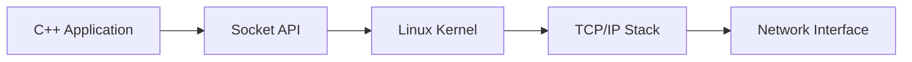
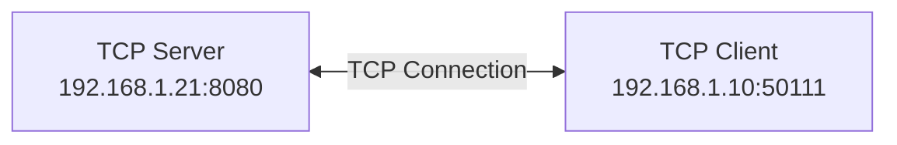
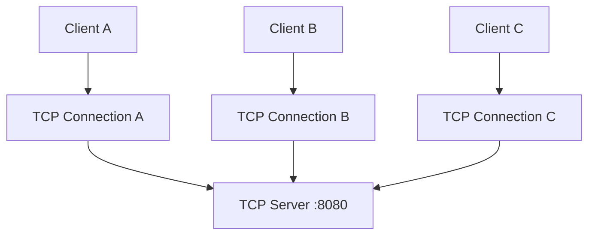

# Linux `ss` Command — شرح اتصالات الشبكة وTCP

## 1. ما هو الأمر ss؟

الأمر `ss` اختصار لـ **Socket Statistics**، ويُستخدم لعرض معلومات عن الـ Sockets واتصالات الشبكة في Linux.

من خلاله، تستطيع معرفة:

- المنافذ التي يستمع عليها البرنامج.
- اتصالات TCP وUDP الحالية.
- حالة كل اتصال.
- عناوين IP وأرقام المنافذ للطرفين.
- طوابير الإرسال والاستقبال.
- معلومات TCP مثل `RTT` و`cwnd` و`RTO`.
- العمليات التي تستخدم الـ Sockets.

يُعد `ss` بديلًا حديثًا ومفيدًا لأمر `netstat` في كثير من مهام مراقبة الشبكة.

### ما هو Socket؟

الـ **Socket** هو واجهة يستخدمها البرنامج للتواصل مع الشبكة من خلال نظام التشغيل.

على سبيل المثال، إذا كان لديك TCP Server مكتوب بلغة C++ ويستمع على المنفذ `8080`، يمكنك استخدام `ss` لفحص المنفذ ومعرفة الاتصالات المرتبطة به.



---

## 2. الأوامر الأساسية

### عرض اتصالات TCP

```bash
ss -t
```

يعرض معلومات عن اتصالات TCP.

### عرض منافذ TCP التي تستمع للاتصالات

```bash
ss -ltn
```

شرح الخيارات:

<div dir="rtl">
<table>
  <thead>
    <tr>
      <th>الخيار</th>
      <th>المعنى</th>
    </tr>
  </thead>
  <tbody>
    <tr>
      <td><code dir="ltr">-l</code></td>
      <td>عرض الـ <span dir="ltr">Listening Sockets</span></td>
    </tr>
    <tr>
      <td><code dir="ltr">-t</code></td>
      <td>عرض <span dir="ltr">Sockets</span> الخاصة بـ <span dir="ltr">TCP</span></td>
    </tr>
    <tr>
      <td><code dir="ltr">-n</code></td>
      <td>عرض عناوين <span dir="ltr">IP</span> وأرقام المنافذ بصورة رقمية</td>
    </tr>
  </tbody>
</table>
</div>

### عرض اتصالات TCP مع معلومات العمليات

```bash
ss -tnp
```

الخيار `-p` يحاول عرض معلومات العمليات المرتبطة بالـ Sockets، وقد تحتاج إلى صلاحيات إضافية لرؤية جميع العمليات.

### عرض جميع حالات TCP

```bash
ss -tan
```

الخيار `-a` يشمل الـ Listening Sockets والاتصالات الأخرى التي تظهر في جدول الـ Sockets، وليس الاتصالات النشطة فقط.

### عرض ملخص عن الـ Sockets

```bash
ss -s
```

يعرض ملخصًا لأعداد الـ Sockets حسب الأنواع والحالات.

---

## 3. تحليل الأمر الأساسي

سنركز على هذا الأمر:

```bash
ss -tinp '( sport = :8080 or dport = :8080 )'
```

هذا الأمر يعرض معلومات تفصيلية عن اتصالات TCP التي يطابق فيها منفذ المصدر أو منفذ الوجهة الرقم `8080`.

### شرح كل جزء

<div dir="rtl">
<table>
  <thead>
    <tr>
      <th>الجزء</th>
      <th>المعنى</th>
    </tr>
  </thead>
  <tbody>
    <tr>
      <td><code dir="ltr">ss</code></td>
      <td>عرض إحصائيات الـ <span dir="ltr">Sockets</span></td>
    </tr>
    <tr>
      <td><code dir="ltr">-t</code></td>
      <td>اختيار <span dir="ltr">TCP</span></td>
    </tr>
    <tr>
      <td><code dir="ltr">-i</code></td>
      <td>عرض معلومات <span dir="ltr">TCP</span> الداخلية</td>
    </tr>
    <tr>
      <td><code dir="ltr">-n</code></td>
      <td>عرض العناوين والمنافذ بأرقامها</td>
    </tr>
    <tr>
      <td><code dir="ltr">-p</code></td>
      <td>عرض معلومات العمليات المرتبطة بالـ <span dir="ltr">Sockets</span></td>
    </tr>
    <tr>
      <td><code dir="ltr">sport = :8080</code></td>
      <td>اختيار الـ <span dir="ltr">Sockets</span> التي يكون منفذ المصدر فيها <code dir="ltr">8080</code></td>
    </tr>
    <tr>
      <td><code dir="ltr">dport = :8080</code></td>
      <td>اختيار الـ <span dir="ltr">Sockets</span> التي يكون منفذ الوجهة فيها <code dir="ltr">8080</code></td>
    </tr>
    <tr>
      <td><code dir="ltr">or</code></td>
      <td>يكفي تحقق أحد الشرطين</td>
    </tr>
    <tr>
      <td><code dir="ltr">'(...)'</code></td>
      <td>تجميع شرط التصفية وتمريره إلى <code dir="ltr">ss</code> كوسيط واحد</td>
    </tr>
  </tbody>
</table>
</div>

الأقواس المفردة مهمة حتى يتعامل الـ Shell مع شرط التصفية بوصفه نصًا واحدًا.

### ما المقصود بـ sport وdport؟

لنفترض أن لدينا اتصال TCP بين السيرفر والعميل:



في الاتصال من منظور السيرفر:

- ال `sport` هو منفذ المصدر، ويكون `8080`.
- ال `dport` هو منفذ الوجهة، ويكون `50111`.

أما من منظور العميل، فسيكون المنفذ المحلي `50111` والمنفذ البعيد `8080`.

لذلك، استخدام الشرطين مع `or` يسمح بعرض الـ Sockets التي يظهر فيها المنفذ `8080` سواء كان منفذ المصدر أو منفذ الوجهة.

**ملاحظة:** هذا الشرط لا يعرض السيرفر فقط؛ بل يعرض أي Socket يطابق شرط المنفذ، بما في ذلك اتصالات العملاء.

---

## 4. كيف نقرأ ناتج الأمر؟

لنفترض أن الأمر أعاد النتيجة التالية:

```text
State  Recv-Q  Send-Q  Local Address:Port    Peer Address:Port
ESTAB  0       0       192.168.1.21:8080     192.168.1.10:50111
```

هذه نتيجة توضيحية وليست ناتجًا حقيقيًا من جهاز المستخدم.

### State — حالة الاتصال

ال `ESTAB` اختصار `ESTABLISHED`، وتعني أن اتصال TCP قائم.

من الحالات الأخرى:

<div dir="rtl">
<ul>
  <li><code dir="ltr">LISTEN</code>: الـ Socket ينتظر اتصالات واردة.</li>
  <li><code dir="ltr">TIME-WAIT</code>: الاتصال في مرحلة الانتظار بعد الإغلاق.</li>
  <li><code dir="ltr">SYN-SENT</code>: أُرسل طلب بدء الاتصال، وينتظر الطرف الرد.</li>
  <li><code dir="ltr">CLOSE-WAIT</code>: استقبل الطرف طلب الإغلاق من الطرف الآخر، وينتظر أن ينهي التطبيق الإغلاق المحلي.</li>
</ul>
</div>

### Recv-Q — طابور الاستقبال

في اتصال TCP قائم، تمثل هذه القيمة عادةً عدد البايتات المستلمة التي لم يقرأها التطبيق بعد.

إذا كانت القيمة `0`، فلا توجد بيانات متراكمة في طابور الاستقبال وقت أخذ القياس.

إذا كانت القيمة تزداد باستمرار، فقد يكون التطبيق لا يقرأ البيانات بالسرعة الكافية، لكن يجب فحص السياق قبل الجزم بالسبب.

### Send-Q — طابور الإرسال

في اتصال TCP قائم، تمثل هذه القيمة عادةً البيانات المرسلة التي لم يؤكد الطرف البعيد استلامها بعد.

ارتفاع القيمة قد يشير إلى أن الطرف الآخر أو الشبكة لا يقدمان تأكيدات بالسرعة المطلوبة، لكنه ليس دليلًا منفردًا على وجود مشكلة محددة.

**تنبيه:** تفسير `Recv-Q` و`Send-Q` يختلف في حالة `LISTEN`؛ فلا ينبغي اعتبارهما دائمًا عدد البايتات.

### Local Address:Port — العنوان والمنفذ المحليان

العنوان المحلي الخاص بالـ Socket على الجهاز الذي نفّذ الأمر.

في المثال:

```text
192.168.1.21:8080
```

### Peer Address:Port — عنوان ومنفذ الطرف الآخر

عنوان الطرف المقابل في الاتصال:

```text
192.168.1.10:50111
```

---

## 5. كيف نعرف أي عملية تستخدم الـ Socket؟

عند إضافة الخيار `-p`، قد يظهر جزء مثل:

```text
users:(("my-server",pid=1234,fd=8))
```

المعاني:

<div dir="rtl">
<table>
  <thead>
    <tr>
      <th>المصطلح</th>
      <th>المعنى</th>
    </tr>
  </thead>
  <tbody>
    <tr>
      <td><code dir="ltr">my-server</code></td>
      <td>اسم العملية</td>
    </tr>
    <tr>
      <td><code dir="ltr">pid=1234</code></td>
      <td>رقم العملية في <span dir="ltr">Linux</span></td>
    </tr>
    <tr>
      <td><code dir="ltr">fd=8</code></td>
      <td>رقم واصف الملف الذي تستخدمه العملية للـ <span dir="ltr">Socket</span></td>
    </tr>
  </tbody>
</table>
</div>

في Linux، الـ Socket يُمثَّل داخل العملية بواسطة **File Descriptor**، وهو رقم يستخدمه البرنامج للوصول إلى مورد مفتوح.

قد تحتاج إلى استخدام `sudo` لرؤية معلومات بعض العمليات:

```bash
sudo ss -tnp
```

---

## 6. أهم معلومات TCP التي تظهر مع الخيار -i

عند تنفيذ الأمر:

```bash
ss -tinp '( sport = :8080 or dport = :8080 )'
```

يضيف الخيار `-i` معلومات داخلية عن TCP، حسب حالة الاتصال وإصدار النظام.

مثال توضيحي:

```text
cubic rto:204 rtt:2.4/0.7 mss:1448 cwnd:10
```

### شرح المصطلحات

<div dir="rtl">
<table>
  <thead>
    <tr>
      <th>المصطلح</th>
      <th>المعنى العلمي المبسط</th>
    </tr>
  </thead>
  <tbody>
    <tr>
      <td><code dir="ltr">cubic</code></td>
      <td>اسم خوارزمية التحكم في ازدحام <span dir="ltr">TCP</span></td>
    </tr>
    <tr>
      <td><code dir="ltr">RTT</code></td>
      <td>زمن الرحلة ذهابًا وإيابًا بين طرفي الاتصال</td>
    </tr>
    <tr>
      <td><code dir="ltr">RTO</code></td>
      <td>المهلة الزمنية التي يستخدمها <span dir="ltr">TCP</span> عند الحاجة إلى إعادة إرسال البيانات لعدم وصول التأكيد المتوقع</td>
    </tr>
    <tr>
      <td><code dir="ltr">MSS</code></td>
      <td>أقصى حجم لبيانات <span dir="ltr">TCP</span> داخل مقطع واحد، دون احتساب ترويسات <span dir="ltr">TCP</span> و<span dir="ltr">IP</span></td>
    </tr>
    <tr>
      <td><code dir="ltr">cwnd</code></td>
      <td>نافذة الازدحام التي تتحكم في كمية البيانات التي يمكن إرسالها دون انتظار تأكيدات جديدة</td>
    </tr>
    <tr>
      <td><code dir="ltr">pacing_rate</code></td>
      <td>معدل الإرسال الذي يستخدمه <span dir="ltr">TCP</span> لتنظيم توقيت إرسال البيانات، إذا كانت هذه المعلومة متاحة</td>
    </tr>
  </tbody>
</table>
</div>

### RTT — Round-Trip Time

هو الزمن اللازم لانتقال البيانات أو الإشارة إلى الطرف الآخر وعودة التأكيد.

مثلًا، إذا كان:

```text
rtt:2.4/0.7
```

ففي صيغة العرض الشائعة لـ `ss -i` تمثل القيمة الأولى تقدير RTT، والثانية تباينه، وعادةً تكون القيم بالمللي ثانية.

### RTO — Retransmission Timeout

هو المهلة التي يعتمد عليها TCP في إعادة إرسال البيانات إذا لم يصل التأكيد المتوقع في الوقت المناسب.

لا يعني ذلك أن TCP ينتظر دائمًا مدة ثابتة؛ إذ تتغير المهلة وفق آليات حساب التوقيت في TCP.

### MSS — Maximum Segment Size

هو الحد الأقصى لحجم بيانات TCP في مقطع واحد، دون احتساب ترويسات TCP وIP.

مثلًا، ظهور:

```text
mss:1448
```

يعني أن قيمة MSS المعروضة هي `1448 bytes`.

### cwnd — Congestion Window

نافذة الازدحام هي متغير يستخدمه TCP للتحكم في كمية البيانات التي يمكن أن تكون قيد الإرسال دون انتظار تأكيدات إضافية، وفق خوارزمية التحكم في الازدحام.

ظهور:

```text
cwnd:10
```

لا يعني أن سرعة الاتصال تساوي 10 ميجابايت في الثانية؛ بل يشير إلى قيمة نافذة الازدحام بوحدتها التي تعرضها الأداة، والتي تكون عادةً عدد مقاطع TCP.

---

## 7. هل يستطيع ss قياس سرعة كل Client؟

يمكن استخدام `ss` لفهم حالة اتصالات TCP ومؤشرات الإرسال، لكنه ليس وحده أداة قياس دقيقة لمعدل البيانات المفيدة التي يستقبلها تطبيق العميل.

لنفترض أن ثلاثة عملاء متصلون بالسيرفر:



كل اتصال TCP له حالة خاصة به، ولذلك قد تختلف قيم `RTT` و`cwnd` وغيرها بين الاتصالات.

يجب التمييز بين المصطلحات التالية:

<div dir="rtl">
<ul>
  <li><strong><span dir="ltr">Pacing Rate</span> — معدل الإرسال المنظم:</strong> معدل يستخدمه <span dir="ltr">TCP</span> لتنظيم توقيت إرسال البيانات.</li>
  <li><strong><span dir="ltr">Throughput</span> — معدل النقل الفعلي:</strong> كمية البيانات التي تنتقل خلال فترة زمنية.</li>
  <li><strong><span dir="ltr">Goodput</span> — معدل البيانات المفيدة:</strong> كمية بيانات التطبيق المفيدة التي تصل خلال فترة زمنية، دون احتساب بيانات البروتوكولات الإضافية أو عمليات إعادة الإرسال ضمن البيانات المفيدة.</li>
</ul>
</div>

إذا كنت تريد قياس سرعة التطبيق لكل عميل، يمكنك قياس عدد البايتات المفيدة التي أرسلها أو استقبلها التطبيق خلال فترة معلومة.

على سبيل المثال:

```text
Throughput = Transferred bytes / Elapsed seconds
```

إذا استقبل التطبيق `10 MB` خلال `5 seconds`:

```text
Throughput = 10 / 5 = 2 MB/s
```

هذا مثال على معدل النقل خلال الفترة المقاسة، ولا يعني أن السرعة كانت ثابتة طوال الوقت.

أما `ss` فيساعدك على تفسير هذا المعدل بالاطلاع على مؤشرات TCP وحالة الاتصال.

**مهم:** قيم `cwnd` و`pacing_rate` وحدها لا تضمن سرعة محددة للعميل، ولا تعني بالضرورة أن التطبيق استلم البيانات أو عالجها.

---

## 8. أوامر عملية لتصحيح أخطاء TCP Server

نفترض أن السيرفر مكتوب باستخدام C++ وBoost.Asio ويستمع على المنفذ `8080`.

### التأكد من أن السيرفر يستمع على المنفذ

```bash
ss -ltnp 'sport = :8080'
```

يفيدك في التأكد من ظهور منفذ الاستماع، وفي معرفة العملية المرتبطة به عند توافر الصلاحيات.

### عرض الاتصالات ومعلومات TCP

```bash
ss -tinp '( sport = :8080 or dport = :8080 )'
```

استخدمه لمعرفة الاتصالات القائمة وحالة الإرسال والاستقبال ومعلومات TCP.

### تحديث العرض كل ثانية

```bash
watch -n 1 "ss -tinp '( sport = :8080 or dport = :8080 )'"
```

يفيدك في ملاحظة تغير القيم مع الوقت أثناء إرسال البيانات.

### عرض الاتصالات في TIME_WAIT

```bash
ss -tan state time-wait
```

يفيدك في معرفة الاتصالات الموجودة حاليًا في حالة `TIME_WAIT`.

### عرض ملخص إحصائيات الـ Sockets

```bash
ss -s
```

يعرض ملخصًا للأعداد والحالات.

---

## 9. تجربة عملية مقترحة

نفّذ التجربة التالية لتربط بين `ss` وTCP وBoost.Asio.

### الخطوة الأولى: تشغيل السيرفر

شغّل TCP Server الذي يستمع على المنفذ `8080`.

### الخطوة الثانية: التحقق من منفذ الاستماع

```bash
ss -ltnp 'sport = :8080'
```

تأكد من ظهور المنفذ `8080` في حالة `LISTEN`.

### الخطوة الثالثة: الاتصال من العميل

شغّل TCP Client ليتصل بالسيرفر.

### الخطوة الرابعة: فحص الاتصال القائم

```bash
ss -tinp '( sport = :8080 or dport = :8080 )'
```

ابحث عن الاتصال الذي يظهر فيه عنوان السيرفر ومنفذه `8080`، وعنوان العميل ومنفذه المؤقت.

### الخطوة الخامسة: إرسال بيانات

أرسل كمية من البيانات من العميل إلى السيرفر، ثم راقب المخرجات:

```bash
watch -n 1 "ss -tinp '( sport = :8080 or dport = :8080 )'"
```

لاحظ أن بعض القيم قد تتغير سريعًا، وقد لا ترى طوابير غير صفرية إذا كان النظام يرسل البيانات ويعالجها بسرعة.

### الخطوة السادسة: إنهاء الاتصال

أنه الاتصال بصورة طبيعية، ثم افحص:

```bash
ss -tan state time-wait
```

قد ترى الاتصال في `TIME_WAIT` لفترة، بحسب الطرف الذي بدأ الإغلاق وظروف الاتصال وسياسات النظام.

---

## 10. الخلاصة

يمكن النظر إلى `ss` باعتباره أداة تعرض معلومات نواة Linux عن الـ Sockets واتصالات الشبكة في لحظة معينة.

- استخدم `-l` لفحص منافذ الاستماع.
- استخدم `-t` لتصفية اتصالات TCP.
- استخدم `-n` لرؤية العناوين والمنافذ رقميًا.
- استخدم `-p` لمعرفة العمليات المرتبطة بالـ Sockets.
- استخدم `-i` لفهم بعض مؤشرات TCP.
- استخدم فلاتر المنافذ والحالات للتركيز على المشكلة التي تحاول تحليلها.

أفضل أمر للبدء في مشروع Boost.Asio هو:

```bash
ss -tinp '( sport = :8080 or dport = :8080 )'
```

شغّله أثناء وجود عميل متصل، وراقب حالة الاتصال والطوابير ومعلومات TCP أثناء تبادل البيانات.

## المراجع

1. [Linux `ss(8)` Manual](https://man7.org/linux/man-pages/man8/ss.8.html)
2. [Linux `tcp(7)` Manual](https://man7.org/linux/man-pages/man7/tcp.7.html)
3. [RFC 9293 — Transmission Control Protocol](https://www.rfc-editor.org/rfc/rfc9293.html)
4. [Boost.Asio Documentation](https://www.boost.org/doc/libs/release/doc/html/boost_asio.html)
