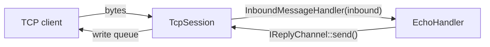
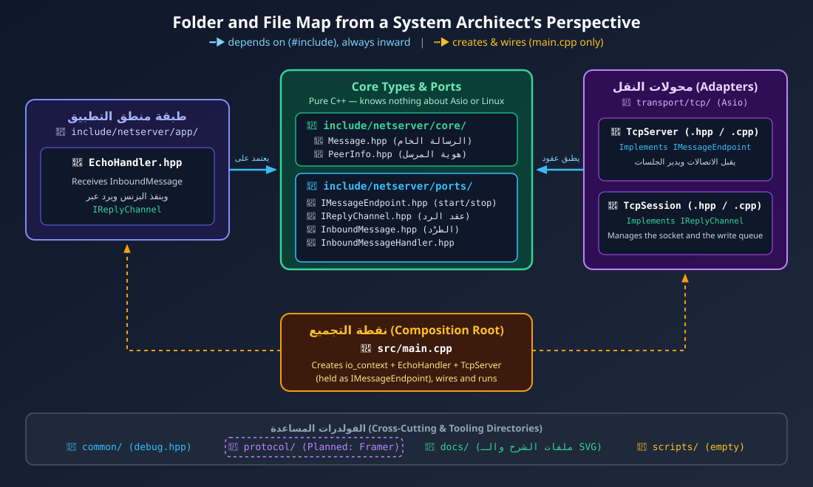

# 0x14 — Networking Basics + Asio TCP Server (Ports & Adapters)

اللاب ده فيه جزأين:

<div dir="rtl">
<ol>
  <li>
    <strong><a href="Networking-basics/" dir="ltr">Networking-basics/</a>:</strong>
    دروس نظرية عن أساسيات الشبكات، من <span dir="ltr">OSI model</span> لحد <span dir="ltr">TCP</span> وإزاي بنراقبه على <span dir="ltr">Linux</span>.
  </li>
  <li>
    <strong><a href="tcp-server-asio/" dir="ltr">tcp-server-asio/</a>:</strong>
    إعادة تصميم سيرفر <a href="../0x13-asio-tcp-server/" dir="ltr">lab 0x13</a> بمعمارية
    <strong><span dir="ltr">Hexagonal (Ports &amp; Adapters)</span></strong>،
    بحيث يتفصل منطق التطبيق عن طبقة النقل (<span dir="ltr">TCP</span>).
  </li>
</ol>
</div>

---

## 1. Networking Basics

الدروس مرتبة، وكل درس بيبني على اللي قبله:

<div dir="rtl">
<table dir="rtl">
  <thead>
    <tr>
      <th style="text-align: center;">#</th>
      <th style="text-align: center;">الدرس</th>
      <th style="text-align: center;">المحتوى</th>
    </tr>
  </thead>
  <tbody>
    <tr>
      <td>0</td>
      <td><a href="Networking-basics/0_OSI-model.md" dir="ltr">OSI Model</a></td>
      <td>الطبقات السبعة ودور كل طبقة.</td>
    </tr>
    <tr>
      <td>1</td>
      <td><a href="Networking-basics/1_encapsulation-linux.md" dir="ltr">Encapsulation</a> في <span dir="ltr">Linux</span></td>
      <td>الـ <span dir="ltr">PDUs</span> ورحلة البيانات جوه الـ <span dir="ltr">kernel</span> و<code dir="ltr">sk_buff</code>.</td>
    </tr>
    <tr>
      <td>2</td>
      <td><a href="Networking-basics/2_ethernet-and-local-network.md" dir="ltr">Ethernet</a> والشبكة المحلية</td>
      <td>إجابات أسئلة الدرس السابق، و<span dir="ltr">MAC</span>، و<span dir="ltr">ARP</span>، والـ <span dir="ltr">Switches</span>، والـ <span dir="ltr">MTU</span>.</td>
    </tr>
    <tr>
      <td>3</td>
      <td><a href="Networking-basics/3_IP-routing.md" dir="ltr">IP Routing</a></td>
      <td>إزاي <span dir="ltr">Linux</span> بيختار المسار بين الشبكات.</td>
    </tr>
    <tr>
      <td>3.1</td>
      <td><a href="Networking-basics/3_1_How-Devices-Communicate-on-a-LAN.md">التواصل داخل الـ <span dir="ltr">LAN</span></a></td>
      <td>إمتى الاتصال بيكون مباشر من غير <span dir="ltr">Router</span>.</td>
    </tr>
    <tr>
      <td>4</td>
      <td><a href="Networking-basics/4_transport-layer-TCP.md"><span dir="ltr">Transport Layer: TCP</span></a></td>
      <td><span dir="ltr">TCP</span> والـ <span dir="ltr">Ports</span> وربطهم بـ <span dir="ltr">Boost.Asio</span>.</td>
    </tr>
    <tr>
      <td>4.1</td>
      <td><a href="Networking-basics/4_1_TCP-Fundamentals-Four-Questions.md"><span dir="ltr">TCP Fundamentals — 4 أسئلة</span></a></td>
      <td>أسئلة وأجوبة على أساسيات <span dir="ltr">TCP</span> مع <span dir="ltr">Asio</span>.</td>
    </tr>
    <tr>
      <td>5</td>
      <td><a href="Networking-basics/5_Controlling-TCP-Throughput-with-Cpp-and-Boost-Asio.md">التحكم في سرعة الإرسال</a></td>
      <td>التحكم في معدل إرسال <span dir="ltr">TCP</span> من <span dir="ltr">C++</span> و<span dir="ltr">Asio</span>.</td>
    </tr>
    <tr>
      <td>6</td>
      <td><a href="Networking-basics/6_TCP-Client-Speed-Control-and-Congestion-Control.md" dir="ltr">Congestion Control</a></td>
      <td>إزاي سرعة كل <span dir="ltr">client</span> بتتغير مع الوقت ومين المسؤول عنها.</td>
    </tr>
    <tr>
      <td>7</td>
      <td><a href="Networking-basics/7_Linux-ss-Network-Socket-Debugging.md">أمر <code dir="ltr">ss</code> في <span dir="ltr">Linux</span></a></td>
      <td>فحص الـ <span dir="ltr">sockets</span> واتصالات <span dir="ltr">TCP</span>.</td>
    </tr>
  </tbody>
</table>
</div>

الرسومات التوضيحية موجودة في [Networking-basics/imgs/](Networking-basics/imgs/).

---

## 2. TCP Server بمعمارية Ports & Adapters

### الفكرة

في lab 0x13، كلاس `Connection` كان بيقرا البيانات من الـ socket **وكمان** بيقرر يرد بإيه. هنا الدورين اتفصلوا:

<div dir="rtl">
<table dir="rtl">
  <thead>
    <tr>
      <th style="text-align: center;">المكوّن</th>
      <th style="text-align: center;">المسؤولية</th>
    </tr>
  </thead>
  <tbody>
    <tr>
      <td><code dir="ltr">TcpServer</code></td>
      <td>يقبل الاتصالات ويتابع الجلسات (يطبّق <code dir="ltr">IMessageEndpoint</code>).</td>
    </tr>
    <tr>
      <td><code dir="ltr">TcpSession</code></td>
      <td>يدير socket عميل واحد، والقراءة، وطابور الكتابة (يطبّق <code dir="ltr">IReplyChannel</code>).</td>
    </tr>
    <tr>
      <td><code dir="ltr">EchoHandler</code></td>
      <td>منطق التطبيق: يقرر الرد ويبعته عن طريق <code dir="ltr">IReplyChannel</code>، من غير ما يعرف أي حاجة عن <span dir="ltr">TCP</span>.</td>
    </tr>
    <tr>
      <td><code dir="ltr">main.cpp</code></td>
      <td>الـ <span dir="ltr">Composition Root</span>: ينشئ المكونات ويربطها ببعض ويشغّل الـ <span dir="ltr">event loop</span>.</td>
    </tr>
  </tbody>
</table>
</div>



### هيكل المشروع

```
tcp-server-asio/
├── CMakeLists.txt
├── docs/
│   ├── ARCHITECTURE.md                 # شرح تفصيلي بالـ UML (English)
│   ├── system_architecture_guide.md    # شرح المعمارية والمجلدات (عربي)
│   ├── EXTENDING.md                    # إزاي تضيف Handler أو UDP أو Framing
│   ├── PROTOCOL_EXTENSIBILITY.md       # حدود المعمارية وخطة دعم بروتوكولات جديدة
│   └── imgs/system_blueprint.svg
├── include/netserver/
│   ├── core/        Message, PeerInfo               (مش بيعتمد على أي حاجة)
│   ├── ports/       IMessageEndpoint, IReplyChannel,
│   │                InboundMessage, InboundMessageHandler
│   ├── app/         EchoHandler                     (بيعتمد على ports بس)
│   ├── transport/
│   │   └── tcp/     TcpServer, TcpSession           (Asio)
│   └── common/      debug.hpp
├── src/
│   ├── main.cpp
│   └── transport/tcp/
└── scripts/         (فاضي حاليًا)
```

<p align="center">
  
</p>

### الخصائص

- ال **Write queue** بيضمن إن مفيش أكتر من `async_write` شغالة في نفس الوقت، وإن الرسائل بتتبعت بالترتيب.
- ال **Backpressure** بثلاث حدود: 64 رسالة في الطابور، و1 MiB إجمالي بايتات، و64 KiB للرسالة الواحدة. لو العميل بطيء وعدّى أي حد منهم، الجلسة بتتقفل.
- **إدارة عمر الجلسة** بـ `shared_from_this()`، فالجلسة بتفضل عايشة طول ما فيه عملية async محتاجاها.
- **إغلاق نظيف** مع `SIGINT` و`SIGTERM`: الـ acceptor بيتقفل، وبعده كل الجلسات النشطة.

### البناء والتشغيل

المتطلبات: CMake 3.22+، ومترجم يدعم C++17، و[standalone Asio](https://think-async.com/Asio/) (`asio.hpp`) متاح في الـ include path.

```bash
cd tcp-server-asio
cmake -S . -B build -DDEBUG_TRACE=ON   # شيل DEBUG_TRACE لو مش عايز رسائل الـ debug
cmake --build build
./build/asio-tcp-server
```

السيرفر بيسمع على البورت `8080`. تقدر تجربه من terminal تانية:

```bash
nc 127.0.0.1 8080
```

هيبعتلك رسالتين ترحيب، وبعد كدا أي حاجة تكتبها هترجعلك (echo). اضغط `Ctrl+C` في terminal السيرفر عشان يقفل بشكل نظيف.

### القيود الحالية

<div dir="rtl">
<ul>
  <li><strong>النقل والبروتوكول متلزقين في <code dir="ltr">TcpSession</code>:</strong> أي بروتوكول جديد فوق <span dir="ltr">TCP</span> معناه تعديل في <code dir="ltr">read()</code> و<code dir="ltr">send()</code> جوه الجلسة نفسها، ومفيش طريقة تختار بيها بروتوكول مختلف لكل بورت.</li>
  <li><strong>مفيش <span dir="ltr">Protocol Framing</span>:</strong> كل قراءة من <code dir="ltr">async_read_some()</code> بتتعامل كرسالة، لكن <span dir="ltr">TCP</span> بيوصل <span dir="ltr">byte stream</span>، فالرسالة ممكن توصل مقسومة أو ملزوقة في رسالة تانية.</li>
  <li><strong>رسائل الترحيب جوه طبقة النقل:</strong> <code dir="ltr">TcpSession::start()</code> بيبعت نص خاص بالتطبيق، وده هيبوّظ أي بروتوكول فيه <span dir="ltr">handshake</span> أو <span dir="ltr">header</span>.</li>
  <li><strong>مفيش <span dir="ltr">timers</span>:</strong> مفيش <span dir="ltr">idle timeout</span>، فأي عميل يتصل ومايبعتش حاجة بيفضل ماسك جلسة للأبد.</li>
  <li><strong>التطبيق مش بيعرف دورة حياة الاتصال:</strong> مفيش <code dir="ltr">on_open</code> ولا <code dir="ltr">on_close</code>، و<code dir="ltr">IReplyChannel</code> فيه <code dir="ltr">send()</code> بس من غير <code dir="ltr">close()</code>.</li>
  <li><strong><span dir="ltr">Thread</span> واحد:</strong> <code dir="ltr">io.run()</code> شغالة على <span dir="ltr">thread</span> واحد، والكود مش <span dir="ltr">thread-safe</span> لو اشتغل على <span dir="ltr">thread pool</span>.</li>
  <li><strong><span dir="ltr">TCP</span> بس:</strong> <code dir="ltr">TransportType::Udp</code> موجود كقيمة في الـ <span dir="ltr">enum</span>، لكن مفيش <code dir="ltr">UdpServer</code> لسه.</li>
</ul>
</div>

القائمة الكاملة (13 حد) وتفاصيل كل حد وأثره موجودة في [PROTOCOL_EXTENSIBILITY.md](tcp-server-asio/docs/PROTOCOL_EXTENSIBILITY.md#4-حدود-المعمارية-الحالية-limitations).

### الخطوات الجاية

الخطة دي **مخططة ولسه متنفذتش**. كل خطوة لوحدها، والسيرفر لازم يفضل شغال بعدها:

<div dir="rtl">
<ol>
  <li>طلّع رسائل الترحيب من <code dir="ltr">TcpSession</code>.</li>
  <li>اعمل مجلد <code dir="ltr">protocols/</code> فيه <code dir="ltr">IStreamProtocol</code> و<code dir="ltr">RawStreamProtocol</code>، و<code dir="ltr">TcpServer</code> ياخد <span dir="ltr">factory</span> للبروتوكول، من غير أي تغيير في السلوك.</li>
  <li>ضيف <code dir="ltr">LengthPrefixProtocol</code> ومعاه <span dir="ltr">unit tests</span>.</li>
  <li>ضيف <span dir="ltr">idle timeout</span> للجلسة.</li>
  <li>اعمل <code dir="ltr">UdpServer</code> بـ <code dir="ltr">IDatagramProtocol</code>.</li>
  <li>ضيف <code dir="ltr">IReplyChannel::close()</code> ونوع الرسالة (<span dir="ltr">text/binary</span>)، وبعدهم <code dir="ltr">WebSocketProtocol</code>.</li>
</ol>
</div>

سبب الترتيب ده والبدائل اللي اتقارنت موجودين في [PROTOCOL_EXTENSIBILITY.md](tcp-server-asio/docs/PROTOCOL_EXTENSIBILITY.md#8-خطة-التنفيذ).

### للقراءة أكتر

<div dir="rtl">
<table dir="rtl">
  <thead>
    <tr>
      <th style="text-align: center;">المستند</th>
      <th style="text-align: center;">هتلاقي فيه</th>
    </tr>
  </thead>
  <tbody>
    <tr>
      <td><a href="tcp-server-asio/docs/ARCHITECTURE.md" dir="ltr">ARCHITECTURE.md</a></td>
      <td>الـ <span dir="ltr">UML</span>، وتسلسل رسالة الـ <span dir="ltr">echo</span>، والملكية، والإغلاق، والمقارنة مع <span dir="ltr">0x13</span>.</td>
    </tr>
    <tr>
      <td><a href="tcp-server-asio/docs/system_architecture_guide.md" dir="ltr">system_architecture_guide.md</a></td>
      <td>شرح المعمارية السداسية وسبب تسمية كل مجلد وملف.</td>
    </tr>
    <tr>
      <td><a href="tcp-server-asio/docs/EXTENDING.md" dir="ltr">EXTENDING.md</a></td>
      <td>قواعد الاعتمادية، وخطوات إضافة <span dir="ltr">Handler</span> أو <span dir="ltr">UDP</span> أو <span dir="ltr">Framing</span>، و<span dir="ltr">Checklist</span> قبل الـ <span dir="ltr">commit</span>.</td>
    </tr>
    <tr>
      <td><a href="tcp-server-asio/docs/PROTOCOL_EXTENSIBILITY.md" dir="ltr">PROTOCOL_EXTENSIBILITY.md</a></td>
      <td>هل المعمارية تستحمل بروتوكولات جديدة فوق <span dir="ltr">TCP</span> و<span dir="ltr">UDP</span> زي <span dir="ltr">WebSocket</span>؟ حدود الكود الحالي، وطريقة التفكير، والحل المقترح، وخطة التنفيذ.</td>
    </tr>
  </tbody>
</table>
</div>
