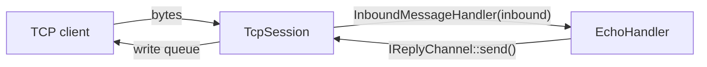

# 0x14 — Networking Basics + Asio TCP Server (Ports & Adapters)

اللاب ده فيه جزأين:

1. **[Networking-basics/](Networking-basics/):** دروس نظرية عن أساسيات الشبكات، من OSI model لحد TCP وإزاي بنراقبه على Linux.
2. **[tcp-server-asio/](tcp-server-asio/):** إعادة تصميم سيرفر [lab 0x13](../0x13-asio-tcp-server/) بمعمارية **Hexagonal (Ports & Adapters)**، بحيث يتفصل منطق التطبيق عن طبقة النقل (TCP).

---

## 1. Networking Basics

الدروس مرتبة، وكل درس بيبني على اللي قبله:

| # | الدرس | المحتوى |
|---|---|---|
| 0 | [OSI Model](Networking-basics/0_OSI-model.md) | الطبقات السبعة ودور كل طبقة. |
| 1 | [Encapsulation في Linux](Networking-basics/1_encapsulation-linux.md) | الـ PDUs ورحلة البيانات جوه الـ kernel و`sk_buff`. |
| 2 | [Ethernet والشبكة المحلية](Networking-basics/2_ethernet-and-local-network.md) | إجابات أسئلة الدرس السابق، وMAC، وARP، والـ Switches، والـ MTU. |
| 3 | [IP Routing](Networking-basics/3_IP-routing.md) | إزاي Linux بيختار المسار بين الشبكات. |
| 3.1 | [التواصل داخل الـ LAN](Networking-basics/3_1_How-Devices-Communicate-on-a-LAN.md) | إمتى الاتصال بيكون مباشر من غير Router. |
| 4 | [Transport Layer: TCP](Networking-basics/4_transport-layer-TCP.md) | TCP والـ Ports وربطهم بـ Boost.Asio. |
| 4.1 | [TCP Fundamentals — 4 أسئلة](Networking-basics/4_1_TCP-Fundamentals-Four-Questions.md) | أسئلة وأجوبة على أساسيات TCP مع Asio. |
| 5 | [التحكم في سرعة الإرسال](Networking-basics/5_Controlling-TCP-Throughput-with-Cpp-and-Boost-Asio.md) | التحكم في معدل إرسال TCP من C++ وAsio. |
| 6 | [Congestion Control](Networking-basics/6_TCP-Client-Speed-Control-and-Congestion-Control.md) | إزاي سرعة كل client بتتغير مع الوقت ومين المسؤول عنها. |
| 7 | [أمر `ss` في Linux](Networking-basics/7_Linux-ss-Network-Socket-Debugging.md) | فحص الـ sockets واتصالات TCP. |

الرسومات التوضيحية موجودة في [Networking-basics/imgs/](Networking-basics/imgs/).

---

## 2. TCP Server بمعمارية Ports & Adapters

### الفكرة

في lab 0x13، كلاس `Connection` كان بيقرا البيانات من الـ socket **وكمان** بيقرر يرد بإيه. هنا الدورين اتفصلوا:

| المكوّن | المسؤولية |
|---|---|
| `TcpServer` | يقبل الاتصالات ويتابع الجلسات (يطبّق `IMessageEndpoint`). |
| `TcpSession` | يدير socket عميل واحد، والقراءة، وطابور الكتابة (يطبّق `IReplyChannel`). |
| `EchoHandler` | منطق التطبيق: يقرر الرد ويبعته عن طريق `IReplyChannel`، من غير ما يعرف أي حاجة عن TCP. |
| `main.cpp` | الـ Composition Root: ينشئ المكونات ويربطها ببعض ويشغّل الـ event loop. |



### هيكل المشروع

```
tcp-server-asio/
├── CMakeLists.txt
├── docs/
│   ├── ARCHITECTURE.md                 # شرح تفصيلي بالـ UML (English)
│   ├── system_architecture_guide.md    # شرح المعمارية والمجلدات (عربي)
│   ├── EXTENDING.md                    # إزاي تضيف Handler أو UDP أو Framing
│   └── imgs/system_blueprint.svg
├── include/netserver/
│   ├── core/        Message, PeerInfo               (مش بيعتمد على أي حاجة)
│   ├── ports/       IMessageEndpoint, IReplyChannel,
│   │                InboundMessage, InboundMessageHandler
│   ├── app/         EchoHandler                     (بيعتمد على ports بس)
│   ├── transport/
│   │   └── tcp/     TcpServer, TcpSession           (Asio)
│   └── common/      debug.hpp
├── src/
│   ├── main.cpp
│   └── transport/tcp/
└── scripts/         (فاضي حاليًا)
```

<p align="center">
  
</p>

### الخصائص

- **Write queue** بيضمن إن مفيش أكتر من `async_write` شغالة في نفس الوقت، وإن الرسائل بتتبعت بالترتيب.
- **Backpressure** بثلاث حدود: 64 رسالة في الطابور، و1 MiB إجمالي بايتات، و64 KiB للرسالة الواحدة. لو العميل بطيء وعدّى أي حد منهم، الجلسة بتتقفل.
- **إدارة عمر الجلسة** بـ `shared_from_this()`، فالجلسة بتفضل عايشة طول ما فيه عملية async محتاجاها.
- **إغلاق نظيف** مع `SIGINT` و`SIGTERM`: الـ acceptor بيتقفل، وبعده كل الجلسات النشطة.

### البناء والتشغيل

المتطلبات: CMake 3.22+، ومترجم يدعم C++17، و[standalone Asio](https://think-async.com/Asio/) (`asio.hpp`) متاح في الـ include path.

```bash
cd tcp-server-asio
cmake -S . -B build -DDEBUG_TRACE=ON   # شيل DEBUG_TRACE لو مش عايز رسائل الـ debug
cmake --build build
./build/asio-tcp-server
```

السيرفر بيسمع على البورت `8080`. تقدر تجربه من terminal تانية:

```bash
nc 127.0.0.1 8080
```

هيبعتلك رسالتين ترحيب، وبعد كدا أي حاجة تكتبها هترجعلك (echo). اضغط `Ctrl+C` في terminal السيرفر عشان يقفل بشكل نظيف.

### القيود الحالية

- **مفيش Protocol Framing:** كل قراءة من `async_read_some()` بتتعامل كرسالة، لكن TCP بيوصل byte stream، فالرسالة ممكن توصل مقسومة أو ملزوقة في رسالة تانية. ده هو الـ step الجاي (`LengthPrefixFramer`).
- **Thread واحد:** `io.run()` شغالة على thread واحد، والكود مش thread-safe لو اشتغل على thread pool.
- **TCP بس:** `TransportType::Udp` موجود كقيمة في الـ enum، لكن مفيش `UdpServer` لسه.

### للقراءة أكتر

| المستند | هتلاقي فيه |
|---|---|
| [ARCHITECTURE.md](tcp-server-asio/docs/ARCHITECTURE.md) | الـ UML، وتسلسل رسالة الـ echo، والملكية، والإغلاق، والمقارنة مع 0x13. |
| [system_architecture_guide.md](tcp-server-asio/docs/system_architecture_guide.md) | شرح المعمارية السداسية وسبب تسمية كل مجلد وملف. |
| [EXTENDING.md](tcp-server-asio/docs/EXTENDING.md) | قواعد الاعتمادية، وخطوات إضافة Handler أو UDP أو Framing، وChecklist قبل الـ commit. |
