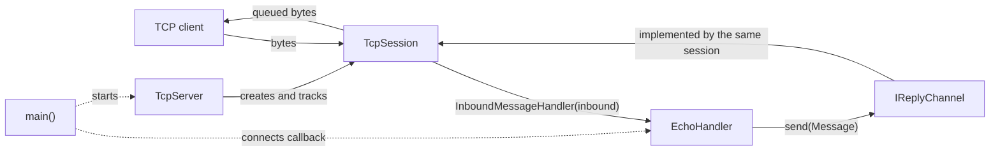
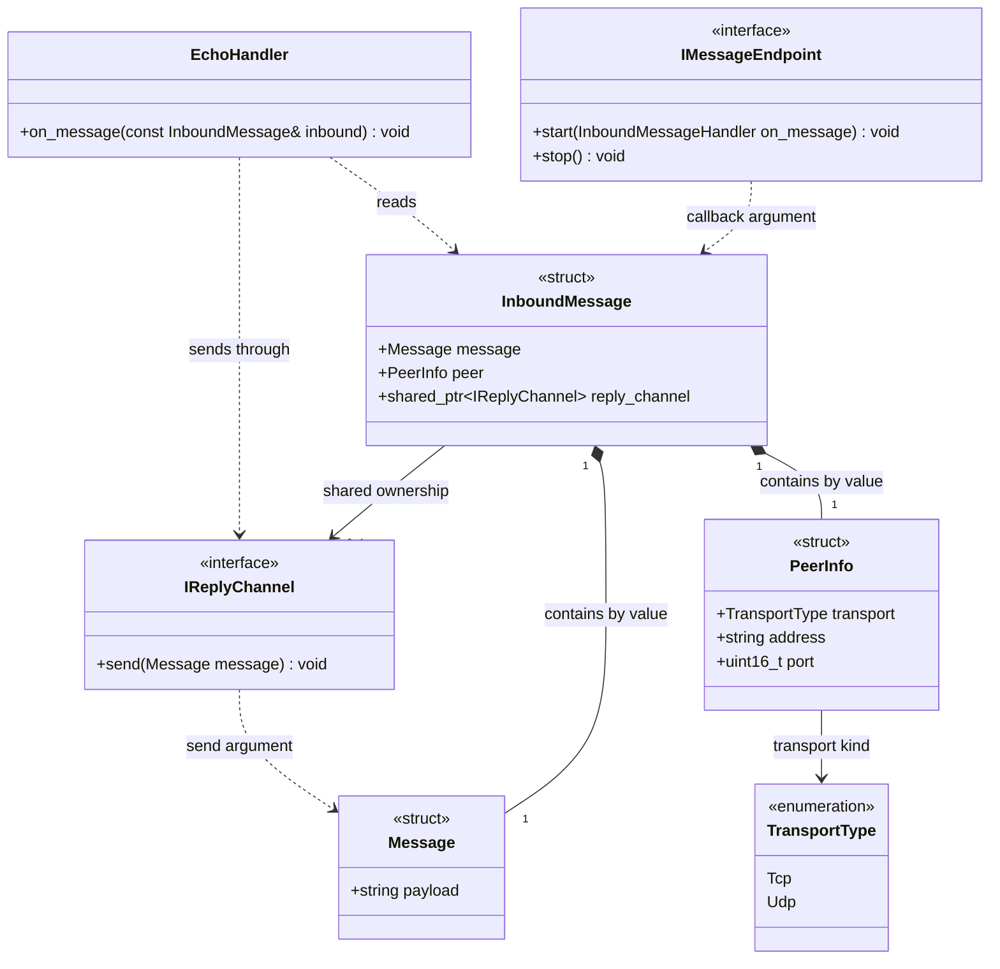
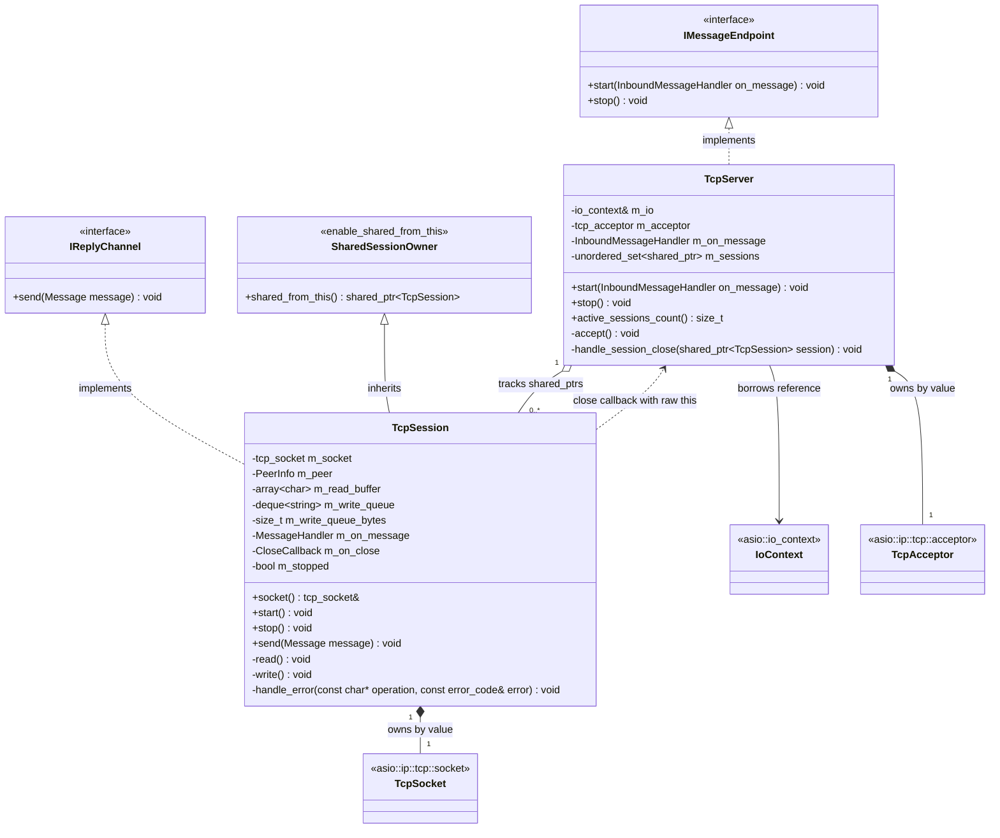
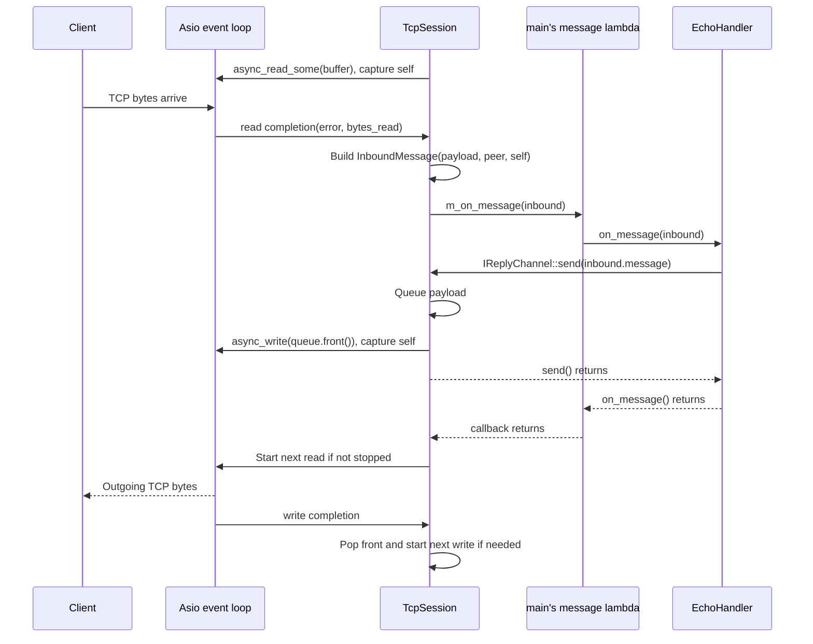

# Architecture: TCP Transport and Application Logic

## 1. The Main Idea

This server accepts several TCP clients and echoes their data. The important change in this lesson is **where each responsibility lives**:

- `TcpServer` accepts clients and tracks their sessions.
- `TcpSession` manages one client's socket, reads, and queued writes.
- `EchoHandler` decides what to do with incoming data: send it back.
- Small interfaces connect the application to the transport without exposing a TCP socket.

**Transport** means the code that moves bytes between computers. **Application logic** means the code that decides what those bytes mean and what to do next.

> **Small story: the service desk**
>
> A receptionist accepts visitors. Each visitor gets a session worker who carries notes back and forth. A specialist reads each note and decides the answer. The specialist does not need to operate the building's telephone system.
>
> Here, the receptionist is `TcpServer`, the worker is `TcpSession`, and the specialist is `EchoHandler`.

The design uses **ports and adapters** on a small scale. A port is a C++ interface describing a capability. An adapter implements it using a particular technology, here TCP and standalone Asio. This is a useful separation, not a claim that the project already has every feature of a full architecture framework.

## 2. The Source Map

All application types below live in the `netserver` namespace.

| Area | Source | Responsibility |
| --- | --- | --- |
| Wiring | [../src/main.cpp](../src/main.cpp) | Construct objects, connect callbacks, handle signals, run the event loop. |
| Data | [../include/netserver/core/Message.hpp](../include/netserver/core/Message.hpp) | Store the payload. |
| Data | [../include/netserver/core/PeerInfo.hpp](../include/netserver/core/PeerInfo.hpp) | Describe the remote peer and transport kind. |
| Ports | [../include/netserver/ports/InboundMessage.hpp](../include/netserver/ports/InboundMessage.hpp) | Combine payload, peer information, and a reply channel. |
| Ports | [../include/netserver/ports/InboundMessageHandler.hpp](../include/netserver/ports/InboundMessageHandler.hpp) | The callback type through which a transport invokes the application. |
| Ports | [../include/netserver/ports/IMessageEndpoint.hpp](../include/netserver/ports/IMessageEndpoint.hpp) | Define how to start and stop a message source. |
| Ports | [../include/netserver/ports/IReplyChannel.hpp](../include/netserver/ports/IReplyChannel.hpp) | Define how to send a reply. |
| Application | [../include/netserver/app/EchoHandler.hpp](../include/netserver/app/EchoHandler.hpp) | Implement the echo decision. |
| TCP listener | [../include/netserver/transport/tcp/TcpServer.hpp](../include/netserver/transport/tcp/TcpServer.hpp), [../src/transport/tcp/TcpServer.cpp](../src/transport/tcp/TcpServer.cpp) | Accept and track sessions. |
| TCP session | [../include/netserver/transport/tcp/TcpSession.hpp](../include/netserver/transport/tcp/TcpSession.hpp), [../src/transport/tcp/TcpSession.cpp](../src/transport/tcp/TcpSession.cpp) | Own a client socket and perform asynchronous I/O. |

The `common` directory provides debug logging. It is a supporting utility, not another message-processing layer.

## 3. The Big Picture



There are two different directions:

1. **Incoming:** TCP bytes become an `InboundMessage`, delivered through a callback.
2. **Outgoing:** the application calls `IReplyChannel::send()`, which reaches the appropriate session's write queue.

The callback and the reply interface are not extra network connections. They are ordinary C++ calls inside the server process.

## 4. UML: Contracts and Message Data



`InboundMessageHandler` is a type alias in its own header, not a separate class:

```cpp
using InboundMessageHandler = std::function<void(const InboundMessage&)>;
```

It means: "store a callable that takes an incoming message and returns nothing." In this program, that callable is the lambda created in `main()`.

It lives in its own header so that `TcpSession` can use the callback type without depending on `IMessageEndpoint`, the server lifecycle interface. `TcpSession::MessageHandler` is a local alias for it.

Two different boundaries exist here:

- `IMessageEndpoint` is the **transport control** interface: start and stop a transport.
- `InboundMessageHandler` is the **application boundary**: the call through which an adapter invokes application logic.

### `Message`: What Are We Sending?

`Message` owns one `std::string`, named `payload`. There is no socket, parser, length header, or serialization algorithm inside it.

A string can store bytes including embedded zero bytes; it is not inherently limited to a null-terminated text message. However, wrapping bytes in `Message` does **not** establish message boundaries on TCP.

### `PeerInfo`: Who Sent It?

`PeerInfo` stores `transport`, `address`, and `port`. The transport defaults to `Tcp`, the address starts empty, and the port starts at zero.

`TcpSession::start()` asks the socket for its remote endpoint once. If that succeeds, it fills these fields. The port is the client's source port, not the server's listening port `8080`.

`TransportType::Udp` is an enum value only. There is no UDP server or UDP session implementation in this lesson.

### `InboundMessage`: The Delivery Envelope

`InboundMessage` combines three things:

| Field | Simple question | Storage |
| --- | --- | --- |
| `message` | What arrived? | An owned `Message` value. |
| `peer` | Who sent it? | An owned `PeerInfo` value. |
| `reply_channel` | How can I answer? | A `shared_ptr<IReplyChannel>`. |

> **Small story: a note with a return address**
>
> A note arrives at a desk. It contains the text, the sender's details, and a way to return the answer. The specialist can answer without searching through every visitor in the building.
>
> The reply channel is stronger than a written address: it is a reference to the object that can actually send the answer.

The session builds this envelope as a local variable in its read callback. It copies the valid received bytes into an owned string and copies the peer information. Its `shared_ptr<TcpSession>` converts to `shared_ptr<IReplyChannel>` because `TcpSession` implements that interface.

**That conversion does not create a second session or a second socket.** Both pointers share ownership of the same session object.

### `IMessageEndpoint`: Where Messages Enter

This interface promises `start(InboundMessageHandler)` and `stop()`. It does not expose an acceptor, a socket, a port number, or an Asio type.

`TcpServer` implements it. Starting the server stores the callback and begins accepting. Each new session receives a copy of that callback.

`EchoHandler` does not inherit from this interface. The endpoint produces incoming messages; the handler consumes them. The lambda in `main()` connects those two roles.

### `IReplyChannel`: How Answers Leave

This interface promises `send(Message)`. `TcpSession` implements it.

The application can ask for a reply without knowing about `asio::async_write`, queue management, or the concrete session class. In this implementation, `send()` queues work; it does not wait until the client receives the message.

Both port interfaces have virtual destructors, so destruction through an interface pointer is supported.

### `EchoHandler`: The Application Decision

Its `on_message()` logs the payload size and peer, checks that a reply channel exists, and sends the same message through it.

It does not own a socket, maintain a client registry, or call Asio. It has no stored state in the current implementation.

An important detail: the callback receives `const InboundMessage&`. `EchoHandler` uses it immediately. A future handler that defers work must copy the needed data or the envelope; it must not retain a reference to this local variable after the callback returns.

## 5. UML: The TCP Implementation

The diagrams show the important members and operations. Constructors, destructors, and deleted copy operations are omitted to keep them readable. Standard-library type names are shortened.



`SharedSessionOwner`, `IoContext`, `TcpAcceptor`, and `TcpSocket` are diagram labels for standard-library/Asio types, not new project classes. `SharedSessionOwner` represents `std::enable_shared_from_this<TcpSession>`.

`m_sessions` is exactly `std::unordered_set<std::shared_ptr<TcpSession>>`. The session's read buffer has **1024 bytes**. Its queue is limited to **64 entries** and **1 MiB** of total payload, including the front entry being written. A single outgoing message may not exceed **64 KiB**.

### Reading the UML Symbols

| Symbol | Meaning here |
| --- | --- |
| `+` / `-` | Public / private member. |
| `<<interface>>` | An abstract contract with pure virtual operations. |
| `<|..` | Implements an interface; the triangle points toward the interface. |
| `<|--` | Inherits from a base class; the triangle points toward the base. |
| `*--` | Composition: the object contains and owns that member by value. |
| `o--` | Aggregation: the server holds sessions, but other shared owners can keep them alive. |
| `-->` | Association: an object refers to another object or type. |
| `..>` | Dependency: uses another type or calls it indirectly. |
| `1`, `0..1`, `0..*` | Exactly one, optional one, zero or more. |
| `~T~` | Mermaid's notation for a template type, such as `shared_ptr<T>`. |

The ownership labels matter: UML arrows alone do not specify C++ smart-pointer semantics.

## 6. `TcpServer`: The Receptionist

Source: [../src/transport/tcp/TcpServer.cpp](../src/transport/tcp/TcpServer.cpp).

### What It Holds

- `m_io`: a reference to the event loop owned by `main()`.
- `m_acceptor`: the listening acceptor, constructed for IPv4 on the supplied port.
- `m_on_message`: the application callback to give to new sessions.
- `m_sessions`: shared ownership of accepted, active sessions.

### What Happens During Accept

1. `start()` stores the callback and calls the private `accept()` method.
2. `accept()` creates a `TcpSession` with `std::make_shared`.
3. It gives that session the message callback and a close callback that refers back to this server.
4. It starts `async_accept()` into the session's socket. The completion handler captures the session by value.
5. On success, the handler inserts the session into `m_sessions`, then calls `session->start()`.
6. If the acceptor is still open, it schedules the next accept.

There is usually a session waiting for the next accept, as well as the active sessions. The waiting session is held by the accept handler but is **not yet in `m_sessions`**. Therefore, `active_sessions_count()` does not include it.

An aborted accept ends that accept callback. Other accept errors are logged, and accepting is retried if the acceptor remains open.

> **Small story: preparing the next desk**
>
> The receptionist prepares an empty desk before the next visitor arrives. A prepared desk is not an active visitor. Once a visitor arrives, the desk joins the active list, and another empty desk is prepared.

The server does not decide the echo response. Its message callback is passed into sessions; it does not look up the sender in `m_sessions` for every reply.

## 7. `TcpSession`: One Client's I/O

Source: [../src/transport/tcp/TcpSession.cpp](../src/transport/tcp/TcpSession.cpp).

### Starting the Session

`start()` records the peer information, queues two welcome messages, and starts the read loop. The welcome messages still live in the transport class in this version. Moving the echo decision out of the session is a real improvement, but application-specific text has not been completely removed from transport code.

### Receiving Data

`read()` obtains `self = shared_from_this()` and starts `async_read_some()` using the member buffer. Its completion handler captures `[this, self]`.

On success, it constructs an `InboundMessage` from the valid `bytes_read`, attaches the peer and reply channel, then calls `m_on_message(inbound)`. After the application callback returns, it starts another read unless the session has stopped.

On a read error, it calls `handle_error()`, which logs the error category and calls `stop()`.

The payload copy is important: the next read reuses `m_read_buffer`, but a queued reply must retain its own bytes.

### Sending Data Without Overlapping Writes

`send(Message)` follows this sequence:

1. Ignore the request if the session is stopped or the payload is empty.
2. If the payload exceeds `kMaxMessageSize` (64 KiB), stop the session.
3. If the queue already has 64 entries, or adding the payload would exceed `kMaxWriteQueueBytes` (1 MiB), stop the session instead of adding another entry.
4. Record whether the queue was already nonempty.
5. Move the message's payload into the back of the queue and add its size to `m_write_queue_bytes`.
6. Start `write()` only if the queue was previously empty.

`write()` gives `asio::async_write()` the front string's buffer. This is a composed operation: Asio handles the lower-level writes needed to transfer that buffer, until completion or error.

On success, the callback subtracts the front entry's size from `m_write_queue_bytes` and removes it. If more entries remain and the session has not stopped, it starts the next write. On error, it stops the session.

> **Small story: one outgoing tray**
>
> Three replies are waiting: A, B, and C. The worker sends A while B and C stay in order. A stays on the tray until its send operation completes. Only then is A removed and B started.
>
> Starting a new write for every reply would bypass this ordering rule. Removing A too early would also remove the bytes that the unfinished operation still needs.

The queue front includes the in-flight message. Its storage remains valid while the operation uses it; neither `send()` nor `stop()` clears that front buffer.

A read and a write may be outstanding at the same time. There is still at most one write operation at a time per session under the current single-threaded usage. The next read does not wait for the previous echo write to finish.

Successful write completion means the buffer was written through the local socket operation, not that the remote application has processed it.

## 8. One Echo, Step by Step

This sequence starts after accepting a client. It omits the initial greetings and shows the case where the outgoing queue is empty.



`m_on_message(inbound)` and `EchoHandler::on_message()` are synchronous calls inside the read completion handler. The architecture does not create an application worker thread or post these calls to a separate task queue.

A slow application handler would delay other callbacks on this event-loop thread.

## 9. Ownership: Who Keeps Objects Alive?

### Objects Owned by `main()`

`main()` constructs `io`, `echo_handler`, `server`, and `signals` as local variables, then calls `io.run()`. In the normal shutdown path, they stay alive while callbacks run.

The server's stored message lambda captures `echo_handler` by reference. The signal handler captures `server` by reference. Session-close and accept callbacks capture the server's raw `this` pointer. **None of these captures owns its target.** Their safety depends on the surrounding lifetime arrangement in `main()`.

`main()` owns the server through `std::unique_ptr<IMessageEndpoint>`. Only the construction line names `TcpServer`; starting, stopping, and the signal handler use the interface. A future `UdpServer` can be created the same way.

### Shared Session Ownership

A session can be kept alive by several owners:

| Owner | When it matters |
| --- | --- |
| Accept callback's captured `session` | While accepting a client into the new session. |
| `TcpServer::m_sessions` | While tracking an accepted, active session. |
| Read/write callback's captured `self` | While an asynchronous operation still needs the session and its buffers. |
| `InboundMessage::reply_channel` | While that envelope, or a copied reply channel, exists. |
| A temporary shutdown snapshot | While the server iterates over sessions to stop them. |

`enable_shared_from_this` does not create an independent owner by itself. It lets a session already managed by `shared_ptr` obtain another shared owner of the same object. That is why the server constructs sessions with `make_shared` before calling their asynchronous methods.

`[this]` allows member access; `[self]` supplies ownership. The session is destroyed only after the last shared owner releases it, not necessarily when it is removed from the server's set.

> **Small story: finishing the paperwork**
>
> A visitor leaves, so the receptionist removes their name from the active list. The worker may still be finishing cancellation paperwork. Removing the name does not make the worker disappear halfway through that work.
>
> The active set and the callback captures serve different purposes: tracking clients and preserving object lifetime.

The close callback points back to the server through raw `this`; it does not form a `shared_ptr` ownership cycle. A copied reply channel can keep a **stopped** session alive, but it cannot reopen its closed socket.

## 10. Stopping the Server and Sessions

### Stopping One Session

`TcpSession::stop()` checks `m_stopped`, sets it, shuts down and closes the socket, then invokes the close callback if present. Repeated calls return immediately.

The close callback is moved into a local variable before invocation, consuming the stored callback. It calls `TcpServer::handle_session_close()`, which erases that session from `m_sessions`.

Pending I/O callbacks can still run after the socket is closed, commonly reporting `operation_aborted`. Their captured `self` keeps the session and buffers alive until they finish. A completion that was already ready can also arrive; closing a socket does not erase queued handlers.

### Stopping All Sessions

When the signal handler receives `SIGINT` or `SIGTERM` without an error, it calls `server->stop()`:

1. Close the acceptor so no new accept is scheduled by the normal accept loop.
2. Copy `m_sessions` into `sessions_copy`.
3. Call `stop()` on every session in that copy.
4. Clear the original active set.
5. Let remaining completion handlers finish as the event loop runs out of work.

Why copy the set? Each session's close callback erases an element from the original set. Iterating that same set while erasing the current element would invalidate the iteration. The snapshot provides a stable collection and keeps the sessions alive during the loop.

`main()` does not call `io.stop()`. In this signal-driven path, it lets completion/cancellation handlers run before `io.run()` returns.

**This is coordinated cleanup, not a drain-all-replies shutdown.** Sockets close immediately; queued application data is not guaranteed to reach clients. Also, `server->stop()` alone does not cancel the separate signal wait owned by `main()`; that wait is already completing in the normal signal-triggered path.

## 11. What This Design Does Not Yet Guarantee

### A Read Result Is Not a Complete Protocol Message

The current receive path makes one `InboundMessage` per successful `async_read_some()` callback. TCP supplies an ordered byte stream, not application message boundaries.

If a client writes `Hello` and then `World`, the server might read `HelloWorld` together, or receive smaller pieces. The 1024-byte buffer is a read capacity, not a protocol message size.

> **Small story: receiving a long note in pieces**
>
> Someone delivers a note through a narrow slot. You might receive half a sentence first and the rest later, or two short sentences together. The slot does not tell you where a complete request ends.
>
> A framing rule would tell you how to collect those pieces. This lesson has not implemented that rule yet.

Raw echo can return chunks without interpreting them. Commands, structured records, or binary requests would need framing and decoding. A future length-prefix framer is mentioned in the source, but no such class is implemented here.

### A Bounded Queue Is Not a Complete Memory Policy

The 64-entry limit is a disconnect-on-overflow policy for a slow consumer. It is not flow control that pauses reads and resumes them later.

It limits both the number of queued strings (64) and their total bytes (1 MiB), and rejects any single message larger than 64 KiB. Worst-case queued payload per session is therefore bounded. There is still no maximum active-session count, so total server memory grows with the number of clients.

### Shared Ownership Is Not Thread Safety

The program calls `io.run()` on one thread. Queue operations, session tracking, and application callbacks therefore execute sequentially under the current usage.

The classes do not add locks or strands. Running `io.run()` on several threads or calling `send()` from an unrelated thread would require reviewing access to `m_sessions`, `m_write_queue`, `m_write_queue_bytes`, and `m_stopped`, typically by giving each session an `asio::strand` so its handlers never run concurrently. `shared_ptr` protects lifetime; it does not make these mutable members thread-safe.

### Interfaces Prepare Extension; They Do Not Implement It

- A future transport could implement `IMessageEndpoint` and provide a suitable `IReplyChannel`, while reusing `EchoHandler`.
- A test double could implement `IReplyChannel` and record replies to test the echo decision without a real socket. This is an enabled testing approach, not a test suite already supplied here.
- `TcpSession::start()` still sends application-specific greetings.
- `send()` has no completion/error result for the application; session errors are handled internally.
- The interfaces contain no Asio types, but the TCP implementation remains tied to Asio. `InboundMessage` lives in `ports/` because it carries an `IReplyChannel`; `core/` depends on nothing else in the project. `PeerInfo` still contains `TransportType`, a transport concept, which could move to `ports/` if `core/` must become fully transport-agnostic.

## 12. How the Build Reflects the Design

Source: [../CMakeLists.txt](../CMakeLists.txt).

| Target | Kind | What it provides |
| --- | --- | --- |
| `netserver_core` | CMake `INTERFACE` library | The public include directory and optional `DEBUG_TRACE` definition. It produces no compiled library of its own. |
| `netserver_transports` | Static library | Compiles `TcpServer` and `TcpSession`; publicly links `netserver_core` and `pthread`. |
| `asio-tcp-server` | Executable | Compiles `main()` and links the transport library. `EchoHandler` is implemented in its header. |

The project uses C++17. These targets organize dependencies inside one program; they are not separate processes or services. Linking `pthread` does not by itself create extra threads running `io.run()`.

Also, `netserver_core` exposes the whole `include` directory, not only the `core` subdirectory. The target names communicate intent, but they do not enforce strict header isolation between layers.

Debug macros are defined in [../include/netserver/common/debug.hpp](../include/netserver/common/debug.hpp). With `DEBUG_TRACE` off, both normal and error debug messages are compiled out. Missing debug output is therefore not evidence that a callback did not run.

## 13. Compared with Lab `0x13`

The comparison below follows the current source, especially [../../../0x13-asio-tcp-server/connection/Connection.cpp](../../../0x13-asio-tcp-server/connection/Connection.cpp), [../../../0x13-asio-tcp-server/connection/Connection.hpp](../../../0x13-asio-tcp-server/connection/Connection.hpp), and [../../../0x13-asio-tcp-server/server/Server.cpp](../../../0x13-asio-tcp-server/server/Server.cpp).

| Question | Lab `0x13` | This lab, `0x14` |
| --- | --- | --- |
| Who accepts clients? | `Server`. | `TcpServer`, implementing `IMessageEndpoint`. |
| Who owns one client's I/O? | `Connection`. | `TcpSession`, also implementing `IReplyChannel`. |
| Who decides to echo? | `Connection::read()` directly calls `send()` with received bytes. | The read callback delivers an `InboundMessage`; `EchoHandler` decides the reply. |
| What is passed to the application? | No separate application handler. | Payload, peer information, and a reply channel. |
| How is a reply requested? | Through the concrete connection's `send(std::string)`. | Through `IReplyChannel::send(Message)`. |
| Where is behavior connected? | Echo behavior is inside the connection class. | `main()` passes a lambda to `server->start()` to connect transport to the handler. |
| What happens after processing a read? | Calls `read()` unconditionally, even if `send()` just stopped the connection on overflow. | Checks `!m_stopped` before starting the next read. |
| What is already shared between both designs? | Shared session ownership, active-session tracking, queued writes, and coordinated socket cleanup. | These mechanisms are retained, not introduced from scratch. |

> **Small story: giving the worker one job**
>
> In `0x13`, the worker both carries the visitor's note and decides the answer. In `0x14`, the worker delivers the note to a specialist and carries the specialist's reply back. Changing the answer policy no longer requires rewriting the worker's TCP read loop.

**What improved, briefly:** responsibilities are clearer, application behavior is easier to replace or test, and the interfaces provide a place to add another transport later. Both labs still use a 1024-byte read buffer, a 64-entry string queue, and one event-loop thread in their supplied programs. This lesson does not yet add framing, a UDP implementation, thread safety, or a demonstrated performance improvement. Its main gain is separation of responsibilities, not a faster echo server.

