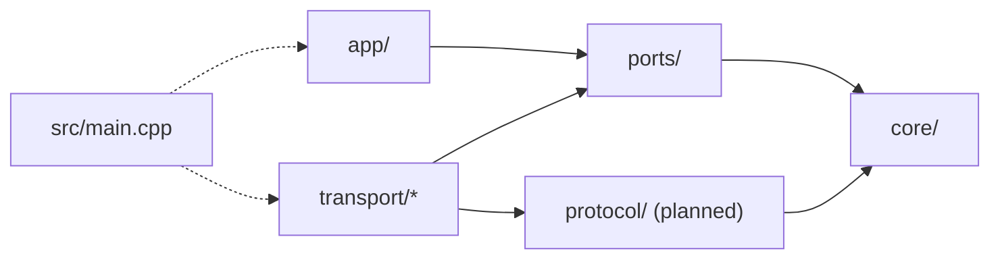

# دليل توسعة المشروع (Extending Guide)

الدليل ده موجّه لأي حد عايز يضيف خاصية جديدة للسيرفر من غير ما يكسر المعمارية. اقرأ الأول [ARCHITECTURE.md](ARCHITECTURE.md) و[system_architecture_guide.md](system_architecture_guide.md) لو مش متعود على الكود.

## الفهرس

1. [قواعد الاعتمادية (لازم تتحفظ)](#1-قواعد-الاعتمادية-لازم-تتحفظ)
2. [إضافة منطق تطبيق جديد (Handler)](#2-إضافة-منطق-تطبيق-جديد-handler)
3. [إضافة وسيلة نقل جديدة (مثال: UDP)](#3-إضافة-وسيلة-نقل-جديدة-مثال-udp)
4. [إضافة Protocol Framing](#4-إضافة-protocol-framing)
5. [تعديل `Message` أو `PeerInfo`](#5-تعديل-message-أو-peerinfo)
6. [تشغيل `io.run()` على أكتر من Thread](#6-تشغيل-iorun-على-أكتر-من-thread)
7. [أخطاء شائعة لازم تتجنبها](#7-أخطاء-شائعة-لازم-تتجنبها)
8. [Checklist قبل الـ Commit](#8-checklist-قبل-الـ-commit)

---

## 1. قواعد الاعتمادية (لازم تتحفظ)

كل خاصية جديدة لازم تحترم اتجاه الاعتمادية ده. السهم معناه "بيعمل `#include` لـ":



| المجلد | مسموح يعمل `#include` لـ | ممنوع يعمل `#include` لـ |
|---|---|---|
| `core/` | المكتبة القياسية بس | `ports/`، `app/`، `transport/`، `protocol/`، Asio |
| `ports/` | `core/`، المكتبة القياسية | `app/`، `transport/`، Asio |
| `protocol/` | `core/`، المكتبة القياسية | `app/`، `transport/`، Asio |
| `app/` | `ports/`، `core/`، `common/` | `transport/`، Asio |
| `transport/*` | `ports/`، `core/`، `protocol/`، `common/`، Asio | `app/` |
| `src/main.cpp` | أي حاجة (هو الـ Composition Root) | — |

القاعدة المختصرة: **منطق التطبيق ما يعرفش TCP، و`TcpSession` ما يعرفش `EchoHandler`**. الحاجة الوحيدة اللي بتربطهم هي `main.cpp`.

تقدر تتأكد إن مفيش مخالفة بالأوامر دي (المفروض ما تطلعش أي نتيجة):

```bash
grep -rnE '#include "netserver/(ports|app|transport|protocol)/' include/netserver/core
grep -rnE '#include [<"]asio|netserver/(app|transport)/' include/netserver/ports
grep -rnE '#include [<"]asio|netserver/transport/' include/netserver/app
grep -rnE 'netserver/app/' include/netserver/transport src/transport
```

---

## 2. إضافة منطق تطبيق جديد (Handler)

ده أسهل نوع توسعة، ومش بيحتاج أي تعديل في طبقة النقل.

### الخطوات

1. اعمل ملف جديد في `include/netserver/app/`، مثلًا `UppercaseHandler.hpp`.
2. الكلاس يستقبل `const InboundMessage&` ويرد عن طريق `inbound.reply_channel`.
3. اربطه في `main.cpp` مكان `EchoHandler` أو جنبه.

```cpp
#pragma once

#include <algorithm>
#include <cctype>
#include "netserver/ports/InboundMessage.hpp"

namespace netserver {

class UppercaseHandler {
public:
    void on_message(const InboundMessage& inbound) {
        if (!inbound.reply_channel) {
            return;
        }

        Message reply = inbound.message;
        std::transform(reply.payload.begin(), reply.payload.end(), reply.payload.begin(),
                       [](unsigned char c) { return static_cast<char>(std::toupper(c)); });
        inbound.reply_channel->send(std::move(reply));
    }
};

} // namespace netserver
```

وفي `main.cpp`:

```cpp
netserver::UppercaseHandler handler;

server->start([&handler](const netserver::InboundMessage& msg) {
    handler.on_message(msg);
});
```

### ملاحظات مهمة

- الـ Handler بيتنفذ **جوه** الـ read callback على نفس الـ thread بتاع `io.run()`. أي عملية بطيئة جواه (I/O على ملفات، `sleep`، حسابات تقيلة) هتوقف كل العملاء التانيين.
- `InboundMessage` بيوصل كـ reference لمتغير محلي. لو محتاج تكمل الشغل بعدين، **انسخ** الـ envelope (`InboundMessage copy = inbound;`). نسخ `reply_channel` بيخلي الجلسة عايشة، ولو الجلسة اتقفلت قبل ما ترد، `send()` هيتجاهل الرسالة بأمان.
- لو عايز تأجل الشغل باستخدام `asio::post`، اعمل ده في الـ lambda اللي في `main.cpp` مش جوه الـ Handler، عشان `app/` ما يعتمدش على Asio.

---

## 3. إضافة وسيلة نقل جديدة (مثال: UDP)

وسيلة النقل الجديدة عبارة عن **Adapter** بيطبّق عقدين:

| العقد | مين بيطبقه في TCP | مين هيطبقه في UDP |
|---|---|---|
| `IMessageEndpoint` | `TcpServer` | `UdpServer` |
| `IReplyChannel` | `TcpSession` | `UdpReplyChannel` (لكل datagram) |

UDP مفيهوش اتصال ولا جلسة، فمفيش حاجة تقابل `TcpSession`. قناة الرد هنا مجرد "الـ socket + عنوان المرسل".

### الخطوات

1. اعمل المجلدات `include/netserver/transport/udp/` و`src/transport/udp/`.
2. اكتب `UdpReplyChannel` و`UdpServer`.
3. ضيف ملفات `.cpp` لـ `netserver_transports` في `CMakeLists.txt`.
4. أنشئ الـ endpoint في `main.cpp`.
5. **ما تعدلش** أي حاجة في `app/` أو `ports/` أو `core/`. لو لقيت نفسك محتاج تعدل فيهم، راجع التصميم الأول.

### `UdpReplyChannel`

```cpp
#pragma once

#include <asio.hpp>
#include <memory>
#include <string>
#include "netserver/ports/IReplyChannel.hpp"

namespace netserver {

class UdpReplyChannel : public IReplyChannel {
public:
    UdpReplyChannel(std::shared_ptr<asio::ip::udp::socket> socket,
                    asio::ip::udp::endpoint remote)
        : m_socket(std::move(socket)), m_remote(std::move(remote)) {}

    void send(Message message) override {
        // The buffer must outlive the async operation.
        auto data = std::make_shared<std::string>(std::move(message.payload));
        auto socket = m_socket;
        socket->async_send_to(asio::buffer(*data), m_remote,
            [socket, data](const asio::error_code&, std::size_t) {});
    }

private:
    std::shared_ptr<asio::ip::udp::socket> m_socket;
    asio::ip::udp::endpoint m_remote;
};

} // namespace netserver
```

الـ socket متخزن كـ `shared_ptr` عشان قناة الرد ممكن تعيش أطول من `UdpServer` نفسه، زي ما `reply_channel` في TCP بيخلي `TcpSession` عايشة.

### `UdpServer`

```cpp
// include/netserver/transport/udp/UdpServer.hpp
#pragma once

#include <asio.hpp>
#include <array>
#include <cstdint>
#include <memory>
#include "netserver/ports/IMessageEndpoint.hpp"

namespace netserver {

class UdpServer : public IMessageEndpoint {
public:
    static constexpr std::size_t kMaxDatagramSize = 65507;

    UdpServer(asio::io_context& io, std::uint16_t port);

    void start(InboundMessageHandler on_message) override;
    void stop() override;

private:
    void receive();

    std::shared_ptr<asio::ip::udp::socket> m_socket;
    asio::ip::udp::endpoint m_remote;
    std::array<char, kMaxDatagramSize> m_buffer{};
    InboundMessageHandler m_on_message;
};

} // namespace netserver
```

```cpp
// src/transport/udp/UdpServer.cpp
#include "netserver/transport/udp/UdpServer.hpp"
#include "netserver/transport/udp/UdpReplyChannel.hpp"

namespace netserver {

UdpServer::UdpServer(asio::io_context& io, std::uint16_t port)
    : m_socket(std::make_shared<asio::ip::udp::socket>(
          io, asio::ip::udp::endpoint(asio::ip::udp::v4(), port)))
{
}

void UdpServer::start(InboundMessageHandler on_message)
{
    m_on_message = std::move(on_message);
    receive();
}

void UdpServer::stop()
{
    asio::error_code ignored;
    m_socket->close(ignored);
}

void UdpServer::receive()
{
    m_socket->async_receive_from(
        asio::buffer(m_buffer), m_remote,
        [this](const asio::error_code& ec, std::size_t bytes)
        {
            if (ec == asio::error::operation_aborted) {
                return;
            }

            if (!ec && m_on_message) {
                InboundMessage inbound{
                    Message{std::string(m_buffer.data(), bytes)},
                    PeerInfo{TransportType::Udp, m_remote.address().to_string(), m_remote.port()},
                    std::make_shared<UdpReplyChannel>(m_socket, m_remote)
                };
                m_on_message(inbound);
            }

            if (m_socket->is_open()) {
                receive();
            }
        });
}

} // namespace netserver
```

### `CMakeLists.txt`

```cmake
add_library(netserver_transports STATIC
    src/transport/tcp/TcpServer.cpp
    src/transport/tcp/TcpSession.cpp
    src/transport/udp/UdpServer.cpp
)
```

### `main.cpp`: تشغيل TCP وUDP مع بعض

هنا بتبان فايدة `IMessageEndpoint`: نفس الكود بيشغّل ويقفل الاتنين.

```cpp
std::vector<std::unique_ptr<netserver::IMessageEndpoint>> endpoints;
endpoints.push_back(std::make_unique<netserver::TcpServer>(io, 8080));
endpoints.push_back(std::make_unique<netserver::UdpServer>(io, 8081));

auto on_message = [&echo_handler](const netserver::InboundMessage& msg) {
    echo_handler.on_message(msg);
};
for (auto& endpoint : endpoints) {
    endpoint->start(on_message);
}

asio::signal_set signals(io, SIGINT, SIGTERM);
signals.async_wait([&endpoints](const asio::error_code& ec, int) {
    if (!ec) {
        for (auto& endpoint : endpoints) {
            endpoint->stop();
        }
    }
});
```

للاختبار: `nc -u 127.0.0.1 8081`.

### فروق لازم تاخد بالك منها في UDP

- **مفيش Backpressure:** مفيش طابور كتابة، وكل `send()` بيبدأ عملية إرسال مستقلة. لو التطبيق بيرد كتير، فكر في حد أقصى للعمليات المعلقة.
- **مفيش Framing:** كل datagram رسالة كاملة، فمش هتحتاج `LengthPrefixFramer` هنا.
- **مفيش ضمان للوصول أو الترتيب:** لو الـ Handler بيفترض إن الرسائل بتوصل بالترتيب، مش هيشتغل صح مع UDP.
- **UDP Amplification:** السيرفر بيرد على أي عنوان مصدر من غير تحقق. ما تخليش الرد أكبر بكتير من الطلب لو السيرفر هيتعرض على شبكة عامة.

---

## 4. إضافة Protocol Framing

TCP بيوصل تدفق بايتات (byte stream) مش رسائل. `async_read_some()` ممكن ترجع نص رسالة، أو رسالتين لازقين في بعض. الـ Framing بيحدد حدود كل رسالة.

### مكانه في المعمارية

- الكود في `include/netserver/protocol/` و`src/protocol/`.
- **C++ قياسي بس، من غير Asio**. ده بيخليك تختبره بـ unit tests من غير شبكة.
- `TcpSession` هو اللي بيستخدمه. `app/` ما يعرفش عنه حاجة.

### الواجهة المقترحة

```cpp
// include/netserver/protocol/LengthPrefixFramer.hpp
#pragma once

#include <cstddef>
#include <optional>
#include <string>

namespace netserver {

// Frame = 4-byte big-endian length + payload.
class LengthPrefixFramer {
public:
    static constexpr std::size_t kHeaderSize = 4;

    explicit LengthPrefixFramer(std::size_t max_frame_size);

    // Returns false if a declared frame length exceeds max_frame_size.
    bool feed(const char* data, std::size_t size);
    std::optional<std::string> next_frame();

    static std::string encode(const std::string& payload);

private:
    std::string m_buffer;
    std::size_t m_max_frame_size;
};

} // namespace netserver
```

### التعديلات في `TcpSession`

1. ضيف عضو `LengthPrefixFramer m_framer{kMaxMessageSize};`.
2. في `read()`، بدل ما تبني `InboundMessage` من البايتات الخام مباشرة:

    ```cpp
    if (!m_framer.feed(m_read_buffer.data(), bytes_read)) {
        stop(); // Declared length too large: protocol violation
        return;
    }

    while (auto frame = m_framer.next_frame()) {
        InboundMessage inbound{Message{std::move(*frame)}, m_peer, self};
        m_on_message(inbound);
        if (m_stopped) {
            return;
        }
    }
    ```

3. في `send()`، اعمل `encode` للـ payload قبل ما تحطه في الطابور، وخلي `m_write_queue_bytes` يحسب الحجم **بعد** إضافة الـ header.
4. شيل رسائل الترحيب النصية من `start()`، لأنها مش متغلفة بالـ framing وهتبوّظ البروتوكول عند العميل.

### `CMakeLists.txt`

```cmake
add_library(netserver_protocol STATIC
    src/protocol/LengthPrefixFramer.cpp
)
target_link_libraries(netserver_protocol PUBLIC netserver_core)

target_link_libraries(netserver_transports
PUBLIC
    netserver_core
    netserver_protocol
    pthread
)
```

### قواعد أمان لازم تتطبق

- **اتحقق من الطول قبل ما تحجز الذاكرة.** لو العميل بعت header فيه `0xFFFFFFFF`، لازم ترفضه فورًا، مش تستنى 4 GB.
- استخدم ترتيب بايتات ثابت (big-endian / network byte order) وحوّل يدويًا بعمليات shift، مش `memcpy` لـ `uint32_t`.
- حجم `m_buffer` جوه الـ Framer لازم يفضل محدود بـ `kHeaderSize + max_frame_size`.
- اختبر الحالات دي: header ناقص، payload ناقص، رسالتين في قراءة واحدة، رسالة بطول صفر، وطول أكبر من الحد.

---

## 5. تعديل `Message` أو `PeerInfo`

الأنواع دي في `core/` وكل الطبقات بتستخدمها، فأي تعديل فيها أثره واسع.

- **إضافة حقل** (مثلًا `MessageType` أو `request_id`): ضيفه بقيمة افتراضية عشان الكود القديم اللي بيستخدم aggregate initialization يفضل شغال.
- **ما تحطش أنواع Asio** (زي `asio::ip::address`) في `core/`. خزّن العنوان كـ `std::string` أو نوع بتاعك.
- `PeerInfo` فيه حاليًا `TransportType`. لو عايز `core/` يبقى مستقل تمامًا عن مفاهيم النقل، انقل `PeerInfo` لـ `ports/` وحدّث الـ includes.
- بعد أي تعديل هنا، راجع الـ UML في [ARCHITECTURE.md](ARCHITECTURE.md).

---

## 6. تشغيل `io.run()` على أكتر من Thread

الكود الحالي **مش thread-safe**، ومعتمد إن `io.run()` بتشتغل على thread واحد. لو هتعمل thread pool:

1. كل `TcpSession` لازم تاخد `asio::strand` بحيث كل الـ handlers بتاعتها (read وwrite وstop) تتنفذ بالتسلسل. ده بيحمي `m_write_queue` و`m_write_queue_bytes` و`m_stopped`.
2. `send()` ممكن يتنادى من thread تاني، فلازم يعمل `asio::post(m_strand, ...)` بدل ما يعدل الطابور مباشرة.
3. `TcpServer::m_sessions` بيتعدل من accept callback ومن close callback اللي جاي من strand الجلسة. لازم يتحمى بـ strand خاص بالسيرفر أو `std::mutex`.
4. الـ Handlers في `app/` هتتنادى بالتوازي، فأي state مشتركة جواها محتاجة حماية.

```cpp
std::vector<std::thread> pool;
for (unsigned i = 0; i < std::thread::hardware_concurrency(); ++i) {
    pool.emplace_back([&io] { io.run(); });
}
for (auto& t : pool) {
    t.join();
}
```

ما تشغلش الكود ده غير بعد ما تعمل الخطوات من 1 لـ 4.

---

## 7. أخطاء شائعة لازم تتجنبها

| الخطأ | ليه غلط | الصح |
|---|---|---|
| `#include <asio.hpp>` جوه `app/` | التطبيق اتربط بتقنية النقل | خلي Asio في `transport/` و`main.cpp` بس |
| `TcpSession` بيعمل `#include "IMessageEndpoint.hpp"` | الجلسة اتربطت بواجهة تشغيل وإيقاف السيرفر | استخدم `InboundMessageHandler.hpp` |
| تحفظ `const InboundMessage&` وتستخدمه بعدين | dangling reference بعد ما الـ callback يرجع | انسخ الـ envelope |
| تعمل `dynamic_cast<TcpSession*>` على `reply_channel` | كده التطبيق عرف TCP | لو محتاج قدرة جديدة، ضيفها في `IReplyChannel` |
| تبدأ `async_write` جديدة من غير الطابور | الكتابات بتتداخل والبيانات بتبوظ | استخدم `send()` دايمًا |
| طابور محدود بالعدد بس | 64 رسالة كبيرة ممكن تاكل الذاكرة | حد للعدد + حد للبايتات + حد للرسالة الواحدة |
| نوع callback جديد لكل Transport | كل Adapter بيعرّف عقده بنفسه | استخدم `InboundMessageHandler` المشترك |

---

## 8. Checklist قبل الـ Commit

- [ ] البناء نضيف من غير warnings:

    ```bash
    cmake -S . -B build -DDEBUG_TRACE=ON
    cmake --build build
    ```

- [ ] أوامر `grep` في [القسم 1](#1-قواعد-الاعتمادية-لازم-تتحفظ) ما طلعتش أي نتيجة.
- [ ] جربت يدويًا: `nc 127.0.0.1 8080` (و`nc -u 127.0.0.1 8081` لو ضفت UDP).
- [ ] جربت `Ctrl+C` والسيرفر طبع `Event loop exited cleanly.`
- [ ] جربت قفل العميل فجأة واتأكدت إن الـ destructor بتاع الجلسة بيتنادى (`[Destructor] TcpSession destroyed`).
- [ ] حدّثت [ARCHITECTURE.md](ARCHITECTURE.md) (جدول الملفات والـ UML).
- [ ] حدّثت [system_blueprint.svg](imgs/system_blueprint.svg) لو ضفت مجلد أو ملف جديد، واتأكدت إنه بيترسم صح:

    ```bash
    rsvg-convert -w 1100 docs/imgs/system_blueprint.svg -o /tmp/blueprint.png
    ```

- [ ] لو حاجة لسه متنفذتش، اكتبها كـ `Planned` في التوثيق والرسم، ما تكتبهاش كأنها موجودة.
